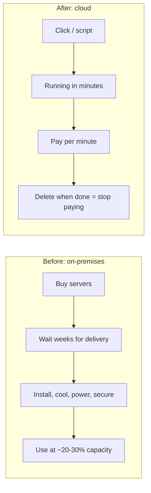
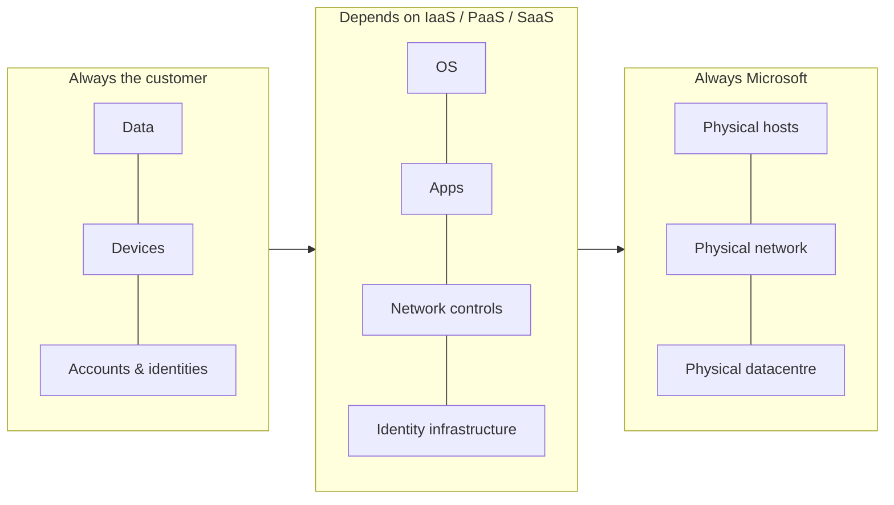
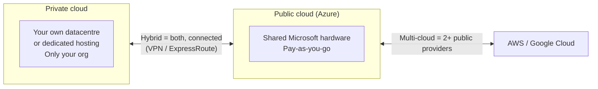
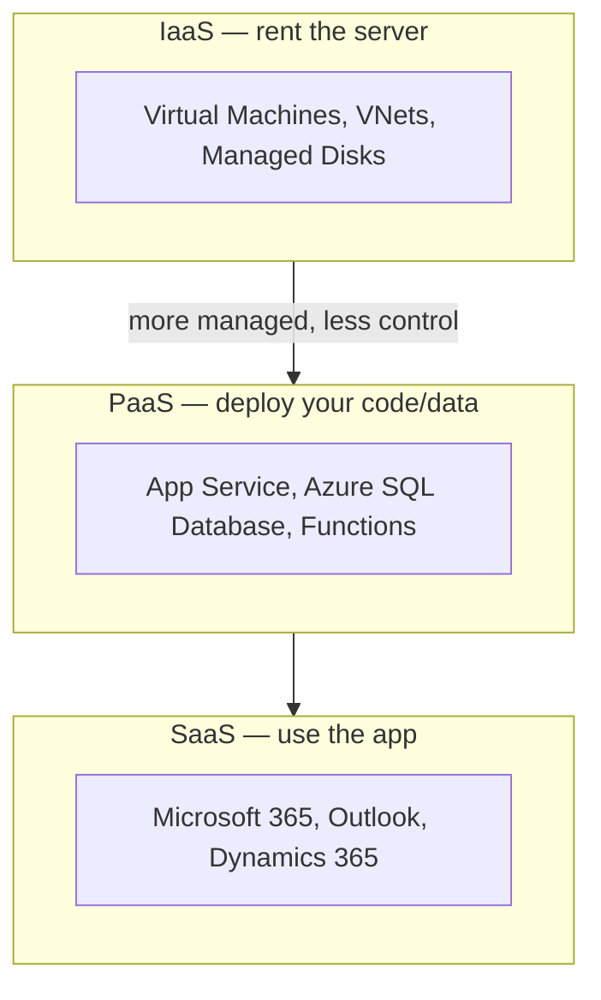

# 01 — Describe Cloud Concepts (25–30%)

> **Prerequisites:** none — this is the foundation for every other file.
> **Official objectives covered:** define cloud computing · shared responsibility model · public/private/hybrid models and use cases · consumption-based model · cloud pricing models · serverless · benefits (HA, scalability, reliability, predictability, security, governance, manageability) · IaaS, PaaS, SaaS and their use cases.

---

## Part A — Concept cards (learn these in order)

### A1. What is cloud computing?

**Simple definition:** renting computing power (servers, storage, databases, networking, software, AI) over the internet from someone else's datacentre, and paying only for what you use — like electricity from the grid instead of running your own generator.

**Business example:** A Diwali flash-sale e-commerce site needs 50 servers for 5 days and 5 servers the rest of the year. On-premises it would have to *buy* 50. In the cloud it rents 50 for 5 days.

| Covered by "cloud computing" | Not covered / misconceptions |
|---|---|
| Compute, storage, networking, databases, analytics, AI, software delivered over a network | "Cloud" does **not** mean free, or automatically cheaper in every case |
| Self-service, on-demand, pay-as-you-go | It does **not** remove all of your responsibilities (see shared responsibility) |
| Can be public (Azure), private (your own), or hybrid | It does **not** require public internet in all cases — ExpressRoute is private |

---

### A2. CapEx vs OpEx (needed before the consumption model)

| | **CapEx — Capital expenditure** | **OpEx — Operational expenditure** |
|---|---|---|
| What | Big **upfront** spend on physical assets | **Ongoing** spend on services as you use them |
| Example | Buy servers, build a datacentre | Monthly Azure bill |
| Accounting | Value **depreciates** over years; deducted over its useful life | Deducted in the **same period** it is spent |
| Risk | You pay even if you over-buy | Pay only for what you use |
| Cloud is mainly… | — | ✅ **OpEx** |

**Exception to remember:** Reserved instances and savings plans are still **OpEx** (you are committing to pay for a *service*, not buying an asset), even though there's a commitment.

**Financial comparison — 3-year web app (illustrative numbers):**

| Cost line | On-prem (CapEx-heavy) | Azure pay-as-you-go (OpEx) | Azure 3-yr reserved (OpEx, committed) |
|---|---|---|---|
| Servers & storage hardware (Day 1) | ₹18,00,000 | ₹0 | ₹0 |
| Datacentre space, power, cooling (3 yrs) | ₹6,00,000 | included | included |
| Hardware maintenance staff time (3 yrs) | ₹7,20,000 | small | small |
| Compute + storage usage (3 yrs) | — | ₹21,60,000 | ₹10,80,000 (≈50% off) |
| **Total 3 years** | **₹31,20,000** | **₹21,60,000 + staff** | **₹10,80,000 + staff** |
| Cash on Day 1 | ₹18,00,000 | ~₹60,000 (first month) | ~₹30,000 (monthly) or upfront |
| If traffic halves in year 2 | Still paid for everything | Bill drops | Commitment still payable* |

\*Reservations can be exchanged or refunded within limits — but the commitment is real. **Takeaway:** steady, predictable 24×7 load → reserved. Spiky or unknown load → pay-as-you-go. Full detail in [file 10](10-capex-vs-opex-financials.md).

---

### A3. Consumption-based model

**Simple definition:** you pay only for the resources you actually consume, measured (per second, per GB, per transaction), with no upfront cost.

Three benefits Microsoft lists:
1. **No upfront costs.**
2. **No need to buy and manage costly infrastructure** you may not fully use.
3. **Pay for additional resources only when needed**, and **stop paying** when you no longer need them.

**Business example:** A tax-filing startup's traffic spikes 20× in July. It autoscales up in July and down in August, and the August bill falls automatically.

| Covered | Not covered / exceptions |
|---|---|
| Usage-based billing (compute hours, GB stored, transactions, data out) | Some things bill whether or not you "use" them — e.g. a **stopped but not deallocated** VM still bills compute; managed **disks bill even when the VM is deallocated**; public IPs bill when reserved |
| Scales cost with demand | Inbound data transfer is free; **outbound (egress)** is charged |

---

### A4. Cloud pricing models (compare)

| Model | How it works | Discount vs PAYG | Best for | Not for |
|---|---|---|---|---|
| **Pay-as-you-go (PAYG)** | Per second/hour/GB, no commitment | 0% | Unknown or spiky workloads, testing | Steady 24×7 production (you overpay) |
| **Reserved instances** | Commit 1 or 3 years to a specific VM size/region (also SQL, Cosmos DB etc.) | Up to ~72% | Steady, predictable workloads | Workloads that will be switched off soon |
| **Azure savings plan for compute** | Commit to a fixed **hourly spend** for 1 or 3 years across compute services/regions | Up to ~65% | Steady spend but changing VM sizes/regions | Highly uncertain spend |
| **Spot VMs** | Use spare capacity; Azure can **evict** with 30 seconds' notice | Up to ~90% | Batch jobs, rendering, testing that can be interrupted | Production web apps, databases |
| **Azure Hybrid Benefit** | Reuse your existing Windows Server / SQL Server licences (with Software Assurance) | Up to ~40% (licence portion), more when combined with reservations | Companies with existing Microsoft licences | Linux-only shops with no such licences |
| **Dev/Test pricing** | Discounted rates for non-production with Visual Studio subscribers | Varies | Developer environments | Production |
| **Free account** | USD 200 credit for 30 days + popular services free for 12 months + always-free services | — | Learning, trials | Production |

**Recommendation rule:** steady → Reserved (fixed size) or Savings plan (changing size); interruptible → Spot; already own licences → add Hybrid Benefit; everything else → PAYG.

---

### A5. Serverless

**Simple definition:** you write code or a workflow; the cloud runs it **only when an event happens**, scales it automatically (even to zero), and bills per execution. Servers still exist — **you just never see or manage them**.

**Business example:** When a customer uploads a scanned invoice to storage, an **Azure Function** triggers, extracts the total and writes it to a database. No uploads at night = no cost at night.

| Serverless characteristics | Not true about serverless |
|---|---|
| No infrastructure management | "There are no servers" — **false**, they're hidden |
| Event-driven (HTTP request, timer, queue message, file upload) | Best for long-running continuous jobs — usually **not** (Functions Consumption plan has execution time limits) |
| Automatic scaling, including to zero | You control the OS — **no** |
| Pay per execution / per resource consumed | Always cheaper — **not** at very high steady volume |

Azure examples: **Azure Functions** (code), **Azure Logic Apps** (low-code workflows), **Azure Container Apps** (serverless containers).

---

### A6. The shared responsibility model

| Responsibility | On-prem | IaaS | PaaS | SaaS |
|---|---|---|---|---|
| **Information & data** | You | **You** | **You** | **You** |
| **Devices (PCs, phones)** | You | **You** | **You** | **You** |
| **Accounts & identities** | You | **You** | **You** | **You** |
| Identity & directory infrastructure | You | You | Shared | Shared |
| Applications | You | You | Shared | Microsoft |
| Network controls | You | You | Shared | Microsoft |
| Operating system | You | **You** | Microsoft | Microsoft |
| Physical hosts | You | **Microsoft** | **Microsoft** | **Microsoft** |
| Physical network | You | **Microsoft** | **Microsoft** | **Microsoft** |
| Physical datacentre | You | **Microsoft** | **Microsoft** | **Microsoft** |

**Memorise:**
- **Always yours:** data, devices, accounts/identities (*"DDA"*).
- **Always Microsoft's (in any cloud service):** physical datacentre, physical network, physical hosts.
- **OS patching:** yours in IaaS, Microsoft's in PaaS/SaaS.

**Business example:** A hospital moves its patient database to Azure SQL Database (PaaS). Microsoft patches the database engine and OS. The hospital is still responsible for **who can log in**, **what data is stored**, and the **laptops** staff use.

| Exception / trap | Truth |
|---|---|
| "With SaaS, Microsoft is responsible for your data" | **No.** You always own and are accountable for your data and who accesses it |
| "With IaaS, Microsoft patches the guest OS" | **No.** You patch the VM's OS (tools like Azure Update Manager help, but it's still your job) |

---

### A7. Cloud models — public, private, hybrid (and multi-cloud)

| | **Public** | **Private** | **Hybrid** | **Multi-cloud** |
|---|---|---|---|---|
| Who owns hardware | Provider | You (or dedicated to you) | Both | Several providers |
| Upfront CapEx | None | High | Some | None/low |
| Scaling | Near-unlimited, fast | Limited by what you bought | Burst to public | Varies per provider |
| Control | Least | **Most** | Flexible | Flexible but complex |
| Security/compliance | Strong, shared | You control everything | Keep sensitive data private | Complex |
| Typical Azure tool | Any Azure service | Azure Stack HCI / Azure Local | **Azure Arc**, VPN Gateway, ExpressRoute | **Azure Arc** |

**Use cases (pick one each):**

| Organisation | Best model | Why |
|---|---|---|
| New startup, no datacentre | **Public** | No CapEx, scale on demand |
| Defence agency with classified data that must stay in its own building | **Private** | Full physical control |
| Bank keeping core ledger on-prem but running its mobile app in Azure | **Hybrid** | Legal data stays local; app scales in cloud |
| Retailer that must handle Black Friday spikes but owns an existing datacentre | **Hybrid** ("cloud bursting") | Use owned servers, burst to Azure for peaks |
| Company that acquired a business running on AWS | **Multi-cloud** (managed with Azure Arc) | Avoid costly migration now |

| Exception / trap | Truth |
|---|---|
| "Private cloud has no upfront cost" | False — it's the most CapEx-heavy |
| "Hybrid cloud means using AWS and Azure" | False — that's **multi-cloud**. Hybrid = private/on-prem + public |
| "Public cloud means your data is visible to other tenants" | False — tenants are logically isolated |

---

### A8. Benefits of cloud services

| Benefit | Simple meaning | Azure example | Business example |
|---|---|---|---|
| **High availability** | The app stays up; measured by the **SLA** (e.g. 99.99%) | Availability zones, load balancers | Ticket-booking site stays up when one datacentre fails |
| **Scalability** | Can add or remove capacity | **Vertical** = bigger VM (scale **up/down**). **Horizontal** = more VMs (scale **out/in**) | Food-delivery app adds VMs at lunchtime |
| **Elasticity** | Scales **automatically** with demand | Autoscale, VM Scale Sets | Streaming site auto-adds servers during a cricket final |
| **Reliability** | Ability to **recover** from failures and keep working | Region pairs, geo-redundant storage, decentralised design | Insurer's claims system recovers in another region |
| **Predictability – performance** | Consistent user experience | Autoscaling, load balancing, high availability | Banking app response time stays steady |
| **Predictability – cost** | Forecast and track spend | Pricing calculator, Cost Management, budgets | CFO gets an accurate monthly forecast |
| **Security** | Built-in protections; you choose how much control | DDoS protection, Defender for Cloud, auto-patching in PaaS/SaaS | Retailer protected from DDoS on sale day |
| **Governance** | Enforce standards and compliance | Azure Policy, templates, auditing | All resources must be in India for data residency |
| **Manageability *of* the cloud** | Managing your resources automatically | Autoscale, templates, monitoring, alerts | Auto-add servers and alert ops on high CPU |
| **Manageability *in* the cloud** | **How** you manage | Portal, CLI, PowerShell, APIs | Admin uses Cloud Shell from a browser |

**SLA ↔ downtime table (learn this):**

| SLA | Downtime / month | Downtime / year |
|---|---|---|
| 99% | 7.2 h | 3.65 days |
| 99.9% | 43.8 min | 8.76 h |
| 99.95% | 21.9 min | 4.38 h |
| 99.99% | 4.38 min | 52.6 min |
| 99.999% | 26.3 s | 5.26 min |

**Composite SLA:** if an app needs service A (99.95%) **and** service B (99.99%), the combined SLA = 0.9995 × 0.9999 ≈ **99.94%** — *lower* than either one. Adding dependencies lowers availability; adding redundancy raises it.

| Trap | Truth |
|---|---|
| "Scalability and elasticity are the same" | Scalability = **can** scale; elasticity = scales **automatically** with demand |
| "Scale up = add more VMs" | Scale **up** = bigger VM; scale **out** = more VMs |
| "High availability means zero downtime" | No — it means downtime within the SLA |
| "Free/preview services have SLAs" | **No SLA** for free tiers and most **preview** features |

---

### A9. Cloud service types — IaaS, PaaS, SaaS

"**Pizza analogy**": On-prem = make pizza at home · IaaS = take-and-bake (you cook) · PaaS = delivery (you set the table) · SaaS = eat at the restaurant.

| | **IaaS** | **PaaS** | **SaaS** |
|---|---|---|---|
| You manage | OS, runtime, apps, data | Apps, data | Data, users, settings |
| Microsoft manages | Physical hardware, virtualisation | + OS, patching, runtime, scaling | Everything except data/access |
| Control | **Most** | Medium | Least |
| Admin effort | **Most** | Medium | Least |
| Azure examples | Virtual Machines, Managed Disks, VNets | App Service, Azure SQL Database, Functions, AKS*, Cosmos DB | Microsoft 365, Dynamics 365 |
| Use cases | **Lift-and-shift** migration, test & dev, custom OS needs, legacy apps | Development frameworks, analytics/BI, web apps without patching | Email, collaboration, CRM, finance apps |
| Business example | Manufacturer moves a legacy ERP needing Windows Server 2016 as-is → **VMs** | Startup deploys a Node.js API without managing servers → **App Service** | Law firm needs email & Teams → **Microsoft 365** |

\*AKS: the control plane is managed (PaaS-like) but you manage worker node pools — the exam usually calls it a managed container orchestration service.

**Recommendation rule:** Need OS control or as-is migration → **IaaS**. Building/hosting your own app with least effort → **PaaS**. Just need the business function → **SaaS**.

---

## Part B — Questions (low → high)

### Q1.01 · L1 · Define cloud computing
Which statement best describes cloud computing?

- A. Buying servers and installing them in your own building
- B. Delivery of computing services over the internet with pay-as-you-go pricing
- C. Storing files only on a USB drive
- D. Using only free software

<b>Answer</b>

**Answer: B**

Cloud computing = computing services (servers, storage, databases, networking, software, analytics) delivered over a network, typically billed by consumption.
- A is on-premises. C and D are unrelated.
- **Not covered:** cloud isn't defined by being free or by public internet only (ExpressRoute is private).

### Q1.02 · L1 · CapEx
Buying physical servers for your own datacentre is an example of:

- A. Operational expenditure (OpEx)
- B. Capital expenditure (CapEx)
- C. Consumption-based expenditure
- D. Serverless expenditure

<b>Answer</b>

**Answer: B**

Upfront purchase of physical assets that depreciate over time = **CapEx**.

### Q1.03 · L1 · OpEx
A monthly Azure invoice for the virtual machines you used is:

- A. CapEx
- B. OpEx
- C. Depreciation
- D. Fixed asset

<b>Answer</b>

**Answer: B**

Paying for services as you consume them = **OpEx**, deductible in the same period.

### Q1.04 · L1 · Consumption model
Which is a benefit of the consumption-based model? (Choose the best answer.)

- A. You pay a fixed amount regardless of usage
- B. You pay for additional resources only when you need them
- C. You must buy hardware in advance
- D. Costs never change

<b>Answer</b>

**Answer: B**

No upfront cost, no buying excess infrastructure, and pay more only when you use more (and stop paying when you stop using).

### Q1.05 · L1 · Shared responsibility — always customer
In every cloud service type, which is **always** the customer's responsibility?

- A. Physical network
- B. Operating system
- C. Information and data
- D. Physical hosts

<b>Answer</b>

**Answer: C**

Always customer: **data, devices, accounts/identities**. Physical items are always Microsoft's. OS is yours only in IaaS.

### Q1.06 · L1 · Shared responsibility — always Microsoft
Which is **always** Microsoft's responsibility when you use Azure?

- A. User accounts
- B. Physical datacentre security
- C. Data classification
- D. Mobile devices used by employees

<b>Answer</b>

**Answer: B**

Physical datacentre, physical network and physical hosts are always the provider's.

### Q1.07 · L1 · IaaS identification
Azure Virtual Machines is an example of:

- A. SaaS
- B. PaaS
- C. IaaS
- D. Serverless

<b>Answer</b>

**Answer: C**

You control the OS → **IaaS**.

### Q1.08 · L1 · SaaS identification
Microsoft 365 (Outlook, Teams, Word online) is an example of:

- A. IaaS
- B. PaaS
- C. SaaS
- D. Private cloud

<b>Answer</b>

**Answer: C**

You just use the finished application → **SaaS**.

### Q1.09 · L1 · PaaS identification
Azure App Service and Azure SQL Database are examples of:

- A. IaaS
- B. PaaS
- C. SaaS
- D. On-premises

<b>Answer</b>

**Answer: B**

You deploy code/data; Microsoft manages OS, runtime and patching → **PaaS**.

### Q1.10 · L1 · Public cloud
Which cloud model has no upfront hardware cost and is owned by a third-party provider?

- A. Private cloud
- B. Public cloud
- C. On-premises
- D. Hybrid cloud

<b>Answer</b>

**Answer: B**

### Q1.11 · L1 · Scale up vs out
Adding more virtual machines to handle load is called:

- A. Scaling up
- B. Scaling out
- C. Scaling down
- D. Vertical scaling

<b>Answer</b>

**Answer: B**

**Horizontal** scaling = scale **out** (more instances) / **in** (fewer). **Vertical** = scale **up/down** (bigger/smaller instance).

### Q1.12 · L1 · Scale up
Changing a VM from 2 vCPUs to 8 vCPUs is:

- A. Horizontal scaling
- B. Vertical scaling
- C. Elasticity
- D. High availability

<b>Answer</b>

**Answer: B**

Bigger machine = **scale up** = vertical. (It usually requires a VM restart — a hint that it's not "elastic".)

### Q1.13 · L2 · Elasticity vs scalability
A video-streaming site automatically adds servers during a cricket final and removes them afterwards. Which benefit is this?

- A. Elasticity
- B. Predictability
- C. Governance
- D. Fault tolerance

<b>Answer</b>

**Answer: A**

**Automatic** scaling in response to demand = **elasticity**. Scalability is the *ability* to scale (manually or automatically).

### Q1.14 · L2 · Reliability
Which cloud benefit describes the ability of a system to recover from failures and continue to function?

- A. Scalability
- B. Reliability
- C. Agility
- D. Manageability

<b>Answer</b>

**Answer: B**

Microsoft Learn defines reliability as the ability to recover from failures and continue to function, aided by decentralised design across regions.

### Q1.15 · L2 · Predictability
Which two areas does Microsoft describe under "predictability" in the cloud?

- A. Performance and cost
- B. Security and identity
- C. Storage and networking
- D. Latency and bandwidth

<b>Answer</b>

**Answer: A**

**Performance** predictability (autoscaling, load balancing, HA) and **cost** predictability (forecasting with the pricing calculator, tracking with Cost Management).

### Q1.16 · L2 · Manageability of vs in
Using the Azure portal, Azure CLI and PowerShell to manage resources is an example of:

- A. Management **of** the cloud
- B. Management **in** the cloud
- C. Governance
- D. Elasticity

<b>Answer</b>

**Answer: B**

*In* the cloud = **how** you manage (portal, CLI, PowerShell, APIs). *Of* the cloud = **what** happens to resources (autoscale, template deployments, monitoring, alerts).

### Q1.17 · L2 · Manageability of the cloud
Automatically scaling resources and receiving alerts when a resource behaves abnormally is:

- A. Management of the cloud
- B. Management in the cloud
- C. Predictability of cost
- D. Shared responsibility

<b>Answer</b>

**Answer: A**

### Q1.18 · L2 · Serverless characteristics
Which statement about serverless computing is correct?

- A. There are no physical servers involved
- B. You manage the operating system patches
- C. The provider manages infrastructure, and you are billed based on execution
- D. It is only for running virtual machines

<b>Answer</b>

**Answer: C**

Servers exist but are abstracted. Event-driven, auto-scaling, pay per execution.

### Q1.19 · L2 · Serverless example
Which Azure service is a serverless compute option that runs code in response to events?

- A. Azure Virtual Machines
- B. Azure Functions
- C. Azure Virtual Desktop
- D. Azure Dedicated Host

<b>Answer</b>

**Answer: B**

Logic Apps is also serverless (workflows). VMs, AVD and Dedicated Host are not.

### Q1.20 · L2 · Hybrid definition
A company runs some workloads in its own datacentre and some in Azure, connected together. This is:

- A. Public cloud
- B. Private cloud
- C. Hybrid cloud
- D. Multi-cloud

<b>Answer</b>

**Answer: C**

Hybrid = private/on-prem **+** public, connected. Using two public providers = multi-cloud.

### Q1.21 · L2 · Private cloud
Which statement about private cloud is correct?

- A. It requires no upfront investment
- B. It gives the organisation the most control over hardware and security
- C. It is always cheaper than public cloud
- D. It can scale infinitely

<b>Answer</b>

**Answer: B**

Most control, but highest CapEx and limited scale.

### Q1.22 · L2 · Pricing model — Spot
A rendering studio runs overnight batch jobs that can be interrupted and restarted. Which option minimises cost?

- A. Reserved instances
- B. Spot virtual machines
- C. Pay-as-you-go VMs
- D. Dedicated hosts

<b>Answer</b>

**Answer: B**

Up to ~90% off; Azure can evict when it needs capacity — fine for interruptible work.
- **Not for:** production web apps or databases.

### Q1.23 · L2 · Pricing model — Reserved
A company runs a database server 24×7 for the next three years at a fixed size. Which option gives the biggest saving?

- A. Pay-as-you-go
- B. Spot VMs
- C. 3-year reserved instance
- D. Free account

<b>Answer</b>

**Answer: C**

Steady, predictable, fixed size → reservation (up to ~72%). Spot is cheaper per hour but can be evicted — unacceptable for a production database.

### Q1.24 · L2 · Hybrid Benefit
A company already owns Windows Server licences with Software Assurance. How can it reduce the cost of Windows VMs in Azure?

- A. Azure Hybrid Benefit
- B. Azure Advisor
- C. Spot VMs
- D. Resource tags

<b>Answer</b>

**Answer: A**

Hybrid Benefit lets you reuse eligible Windows Server and SQL Server licences so you pay only the base compute rate.

### Q1.25 · L2 · Savings plan vs reservation
A company has a steady compute budget but frequently changes VM sizes and regions. Which commitment option fits best?

- A. Reserved instances for a specific VM size
- B. Azure savings plan for compute
- C. Spot VMs
- D. Pay-as-you-go only

<b>Answer</b>

**Answer: B**

Savings plans commit to an hourly **spend** and apply flexibly across sizes, regions and compute services. Reservations are tied to a specific size/region (with some flexibility).

### Q1.26 · L2 · IaaS use case
Which scenario is the best fit for IaaS?

- A. Staff need email
- B. Migrating an on-premises application to the cloud without changing it (lift-and-shift)
- C. Developers want to deploy code without managing servers
- D. Building workflows without code

<b>Answer</b>

**Answer: B**

Lift-and-shift and custom OS needs → IaaS. A = SaaS, C = PaaS, D = Logic Apps (serverless/PaaS).

### Q1.27 · L2 · PaaS use case
Developers want to deploy a web API without worrying about OS patching or the underlying servers but still write their own code. Which type?

- A. IaaS
- B. PaaS
- C. SaaS
- D. On-premises

<b>Answer</b>

**Answer: B**

### Q1.28 · L2 · Composite SLA
A web app (SLA 99.95%) depends on a database (SLA 99.99%). What is the composite SLA?

- A. 99.99%
- B. 99.97%
- C. About 99.94%
- D. 100%

<b>Answer</b>

**Answer: C**

0.9995 × 0.9999 = 0.99940 → **≈ 99.94%**. Dependent services multiply, so the result is lower than either.

### Q1.29 · L2 · SLA downtime
An SLA of 99.9% allows roughly how much downtime per month?

- A. 4 minutes
- B. 22 minutes
- C. 44 minutes
- D. 7 hours

<b>Answer</b>

**Answer: C**

≈ 43.8 minutes/month. (99.95% ≈ 22 min; 99.99% ≈ 4.4 min.)

### Q1.30 · L3 · Shared responsibility in PaaS
Your company uses Azure SQL Database. Who is responsible for patching the database engine and underlying OS?

- A. Your company
- B. Microsoft
- C. Both equally
- D. Nobody — it's never patched

<b>Answer</b>

**Answer: B**

PaaS: Microsoft manages OS and platform patching. You remain responsible for data, access and configuration (e.g. firewall rules, who can log in).

### Q1.31 · L3 · Shared responsibility in IaaS
Your company runs Windows Server on an Azure VM. Who must install OS security updates?

- A. Microsoft
- B. Your company
- C. The hardware vendor
- D. Azure Advisor automatically

<b>Answer</b>

**Answer: B**

IaaS = you own the guest OS. Tools like Azure Update Manager help, but the responsibility stays yours.

### Q1.32 · L3 · Cloud model use case
A government defence lab must keep classified data on hardware it physically controls, with no third-party access. Which model?

- A. Public cloud
- B. Private cloud
- C. Multi-cloud
- D. SaaS

<b>Answer</b>

**Answer: B**

### Q1.33 · L3 · Cloud bursting
A retailer owns a datacentre that handles normal traffic but wants extra capacity only during festival sales, without buying more hardware. Which model?

- A. Private cloud
- B. Hybrid cloud
- C. Public cloud only
- D. On-premises only

<b>Answer</b>

**Answer: B**

**Cloud bursting** — use owned capacity normally and burst to public cloud for peaks.

### Q1.34 · L3 · SaaS use case
A 20-person accounting firm needs email, calendars and document collaboration with the least admin effort. Which type?

- A. IaaS
- B. PaaS
- C. SaaS
- D. Private cloud

<b>Answer</b>

**Answer: C** — e.g. Microsoft 365.

### Q1.35 · L3 · Serverless scenario
An insurance company wants to resize every photo uploaded to blob storage, with no cost when nothing is uploaded. What should it use?

- A. A VM that runs 24×7
- B. Azure Functions with a blob trigger
- C. Azure Virtual Desktop
- D. Reserved instance

<b>Answer</b>

**Answer: B**

Event-driven + scale to zero + pay per execution = serverless.

### Q1.36 · L3 · Benefit identification
A company configures Azure Policy so every resource must carry a cost-centre tag and be deployed only in Indian regions. Which cloud benefit is shown?

- A. Elasticity
- B. Governance
- C. Scalability
- D. Predictability of performance

<b>Answer</b>

**Answer: B**

### Q1.37 · L3 · Cost predictability
A CFO wants to forecast next quarter's cloud spend and get alerts when spending approaches budget. Which benefit is this, and which tools help?

- A. Elasticity — autoscale
- B. Predictability of cost — pricing calculator and Cost Management budgets
- C. Reliability — region pairs
- D. Security — Defender for Cloud

<b>Answer</b>

**Answer: B**

### Q1.38 · L4 · Yes/No — cloud models
Answer Yes or No:
1. A hybrid cloud uses both on-premises (private) and public cloud resources.
2. A public cloud requires the customer to buy the physical servers.
3. Multi-cloud means using more than one public cloud provider.

<b>Answer</b>

**1 Yes · 2 No · 3 Yes**

Public cloud hardware is owned by the provider.

### Q1.39 · L4 · Yes/No — shared responsibility
1. In SaaS, the customer is responsible for managing user accounts and data.
2. In PaaS, the customer is responsible for patching the operating system.
3. In IaaS, Microsoft is responsible for the physical network.

<b>Answer</b>

**1 Yes · 2 No · 3 Yes**

### Q1.40 · L4 · Yes/No — consumption & OpEx
1. The consumption-based model means you pay for resources only when you use them.
2. Moving to the cloud always reduces total costs.
3. Cloud computing generally moves spending from CapEx to OpEx.

<b>Answer</b>

**1 Yes · 2 No · 3 Yes**

"Always" is the trap — a poorly sized or always-on cloud deployment can cost more than on-prem.

### Q1.41 · L4 · Yes/No — serverless
1. Serverless computing removes the need to manage servers.
2. Serverless applications can scale to zero when not in use.
3. Azure Virtual Machines is a serverless service.

<b>Answer</b>

**1 Yes · 2 Yes · 3 No**

### Q1.42 · L4 · Yes/No — benefits
1. Elasticity is the ability to automatically scale resources based on demand.
2. Vertical scaling means adding more instances.
3. High availability guarantees zero downtime.

<b>Answer</b>

**1 Yes · 2 No · 3 No**

### Q1.43 · L4 · Sentence completion
Complete: *"An organisation that wants to avoid upfront costs and pay only for what it uses should move from \_\_\_\_\_ to \_\_\_\_\_."*

- A. OpEx to CapEx
- B. CapEx to OpEx
- C. PaaS to IaaS
- D. Public to private cloud

<b>Answer</b>

**Answer: B**

### Q1.44 · L4 · Least admin effort
A company wants to run a custom line-of-business web app with the **least administrative effort** while still deploying its own code. Which is best?

- A. Azure Virtual Machines
- B. Azure App Service
- C. Microsoft 365
- D. On-premises IIS server

<b>Answer</b>

**Answer: B**

PaaS minimises admin while letting you deploy your code. VMs (IaaS) add OS management; Microsoft 365 can't host custom code.

### Q1.45 · L4 · SLA exceptions
Which statement is correct?

- A. All Azure services, including preview features, have a financially backed SLA
- B. Free-tier and most preview services do not have an SLA
- C. SLAs guarantee 100% uptime
- D. SLA credits are paid automatically in cash

<b>Answer</b>

**Answer: B**

SLAs give **service credits** (not cash), must usually be **claimed**, and don't cover free or preview services.

### Q1.46 · L4 · Multiple select
Which **two** are characteristics of the public cloud? (Each correct answer is a complete solution.)

- A. No upfront capital expenditure
- B. The organisation has complete control over physical hardware
- C. Rapid provisioning and scaling of resources
- D. Hardware must be purchased by the customer

<b>Answer</b>

**Answer: A and C**

### Q1.47 · L4 · Reliability vs HA
A company wants its app to keep running if an entire Azure region fails. Which benefit is primarily being addressed, and what design choice supports it?

- A. Scalability — scale up the VM
- B. Reliability — deploy across multiple regions (e.g. region pairs)
- C. Elasticity — autoscale within one region
- D. Manageability — use the portal

<b>Answer</b>

**Answer: B**

Recovery from large failures with decentralised, multi-region design = reliability. Autoscale in one region doesn't survive a region outage.

### Q1.48 · L4 · Stopped VM billing exception
You stop a VM from inside the operating system (shutdown command) but don't deallocate it in Azure. Which is true?

- A. You stop paying for everything
- B. You still pay for compute because the VM is not deallocated
- C. The VM is deleted
- D. Disks are deleted

<b>Answer</b>

**Answer: B**

Only **Stopped (deallocated)** — e.g. Stop from the portal — stops compute billing. **Disks still bill** even when deallocated.

---
➡️ Next: [02 — Core architecture](02-core-architecture.md)
