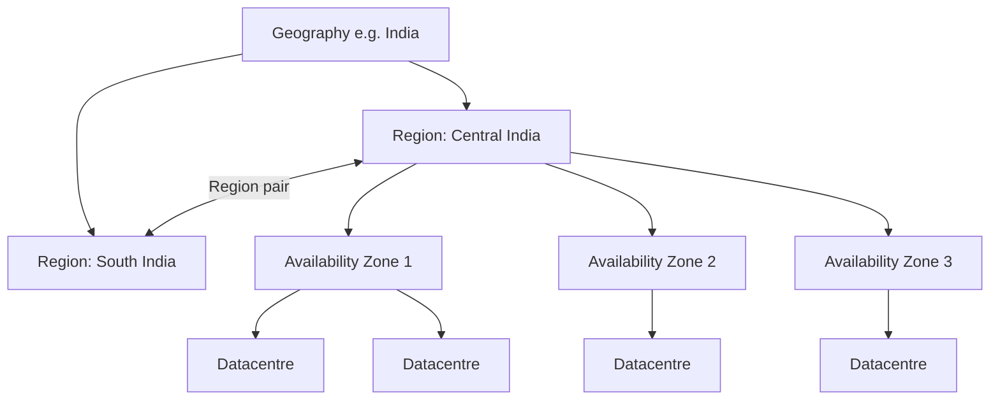
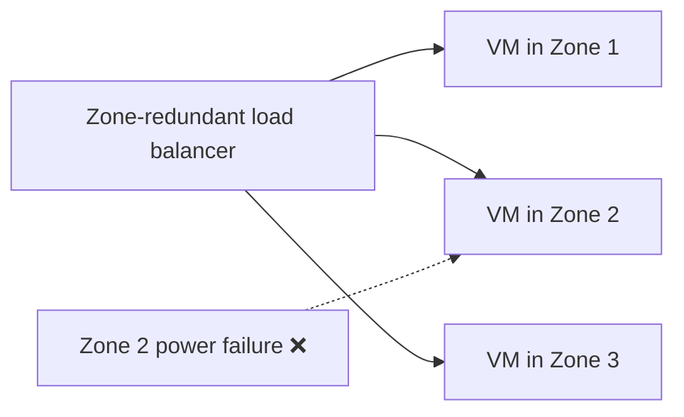
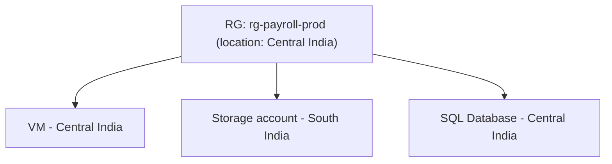
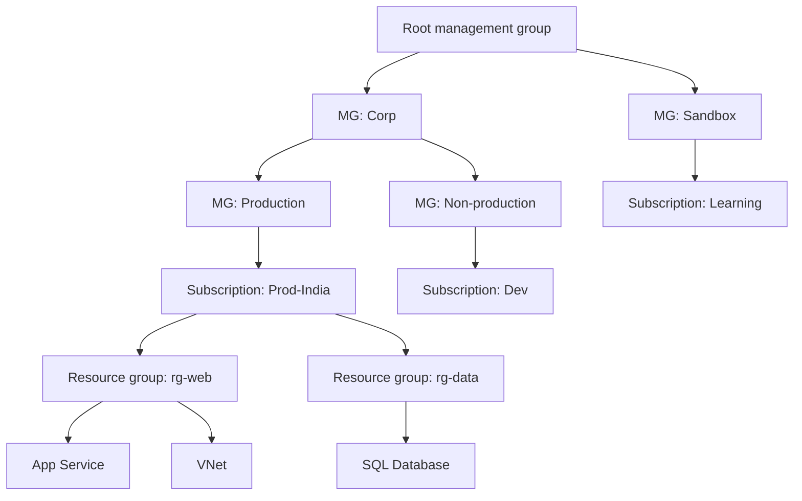

# 02 — Core Architectural Components of Azure

> **Prerequisites (from file 01):** high availability, reliability, SLA, public cloud.
> **Official objectives covered:** regions, region pairs, sovereign regions · availability zones · datacentres · resources and resource groups · subscriptions · management groups · the hierarchy.

---

## Part A — Concept cards

### A1. The physical picture (learn bottom-up)

| Level | Simple meaning | Protects you from |
|---|---|---|
| **Datacentre** | One building full of servers, with power, cooling, network | — (you never pick a datacentre directly) |
| **Availability zone** | One or more datacentres with **independent power, cooling and networking**, inside a region | A **datacentre / zone** failure |
| **Region** | A set of datacentres in one geographic area connected by a low-latency network | Lets you place workloads near users; a region is the unit you choose when you deploy |
| **Region pair** | Two regions in the same geography, usually 300+ miles apart | A **whole-region** disaster |
| **Geography** | A market (e.g. India, Europe) that keeps data residency and compliance boundaries | Legal/residency requirements |

---

### A2. Azure datacentres

**Simple definition:** the physical buildings with racks of servers. Microsoft runs them; you **cannot** visit or choose one directly — you choose a **region** (and optionally a **zone**).

| Covered | Not covered |
|---|---|
| Physical security, power, cooling, hardware (Microsoft's job) | Customer access to the building — **never** |
| Grouped into zones and regions | Choosing a specific datacentre — not possible |

---

### A3. Regions

**Simple definition:** a geographic area containing at least one, but usually several, nearby datacentres. You deploy most resources **into** a region. Azure has **60+ regions** worldwide (more than any other cloud provider, Microsoft states).

**Business example:** A Delhi-based fintech deploys in **Central India** so users get low latency and data stays in India.

| Covered | Exceptions |
|---|---|
| Pick a region per resource | **Not every service or VM size is available in every region** — check before you design |
| Region affects price, latency, compliance | Some services are **global/non-regional** — e.g. Microsoft Entra ID, Azure DNS, Azure Front Door, Traffic Manager — you don't pick a region for them |
| | Prices for the same VM differ between regions |

---

### A4. Availability zones

**Simple definition:** physically separate locations **within one region**. Each zone has its own power, cooling and networking. A zone-enabled region has a **minimum of three** zones.

**Business example:** An online exam platform runs 3 VMs spread across zones 1, 2 and 3. A fire in one datacentre takes zone 2 down; zones 1 and 3 keep serving students.

| Type of zone-aware service | Meaning | Examples |
|---|---|---|
| **Zonal** | You **pin** a resource to a specific zone | VMs, managed disks, standard IP addresses |
| **Zone-redundant** | Azure replicates across zones **automatically** | Zone-redundant storage (ZRS), Azure SQL Database (zone-redundant option) |
| **Non-regional** | Always available from Azure geographies, resilient to zone and region outages | Microsoft Entra ID, Azure DNS |

| Covered | Exceptions / not covered |
|---|---|
| Protects against datacentre/zone failure | **Not** against a whole-region outage → use region pairs / multi-region |
| VM SLA with 2+ VMs across zones: **99.99%** | **Not all regions** support availability zones |
| | Using zones may add **data-transfer cost** between zones and more VMs = more cost |

---

### A5. Region pairs

**Simple definition:** most regions are paired with another region **in the same geography**, typically **at least 300 miles (≈480 km) apart**, so a disaster won't hit both.

Examples: **Central India ↔ South India**, **West India → South India**, East US ↔ West US, North Europe ↔ West Europe.

**Benefits of region pairs:**
1. During a broad outage, **one region in every pair is prioritised for recovery**.
2. Planned Azure updates roll out to **one region of a pair at a time** to limit downtime.
3. Data stays **within the same geography** for residency, tax and law purposes (except Brazil South).
4. Some services (e.g. geo-redundant storage) replicate to the **paired region automatically**.

**Business example:** A bank stores records in GRS storage in Central India; Azure keeps a copy in South India. If Central India is lost, the data survives in South India.

| Exceptions to memorise | |
|---|---|
| **Brazil South** is paired with **South Central US** — outside its geography (one-directional) | |
| Some pairings are **one-directional** (West India's secondary is South India, but South India's pair is Central India) | |
| **Some newer regions have no pair** — they rely on availability zones instead | |
| Region pairing does **not** automatically replicate everything — only services designed to (e.g. GRS). Your VMs aren't copied unless you set up replication (e.g. Azure Site Recovery) | |

---

### A6. Sovereign regions

**Simple definition:** instances of Azure **physically and logically isolated** from the main public Azure, for legal/compliance reasons.

| Sovereign region | Who uses it | Key fact |
|---|---|---|
| **Azure Government (US)** — e.g. US Gov Virginia, US Gov Iowa, US DoD Central | US federal, state and local agencies and their partners | Operated by **screened US personnel**; extra compliance certifications |
| **Azure China (21Vianet)** | Organisations operating in China | Operated by **21Vianet**, not directly by Microsoft; Microsoft doesn't directly maintain the datacentres |

| Trap | Truth |
|---|---|
| "Any company can deploy to Azure Government" | No — only eligible government entities/partners after validation |
| "Azure China is run by Microsoft" | No — run by 21Vianet |

---

### A7. Resources and resource groups

**Resource:** any single thing you create — a VM, storage account, virtual network, database, web app.

**Resource group (RG):** a logical **container** that holds related resources so you can manage them as one unit (deploy, secure, monitor, delete together).

**Business example:** An HR team keeps everything for the **payroll** app in `rg-payroll-prod`. Giving the payroll team Contributor on that RG gives access to exactly those resources. When the old app is retired, deleting the RG removes all its parts at once.

| Rules (covered) | Exceptions / traps |
|---|---|
| Every resource must be in **exactly one** RG | A resource can't be in two RGs |
| Resources can be **moved** between RGs (and subscriptions, for most resource types) | Some resource types can't be moved |
| RGs **cannot be nested** | No RG inside an RG |
| **Deleting an RG deletes everything inside it** | Unless a **resource lock** blocks it |
| RBAC and policies applied to an RG are **inherited** by its resources | — |
| An RG has a location (it stores metadata there) | **Resources in an RG can be in different regions** from the RG |
| Group by **lifecycle** (things you deploy/delete together) | Grouping strategy is your choice (by app, environment, department) |

---

### A8. Subscriptions

**Simple definition:** a **billing and access boundary** — an agreement with Microsoft to use Azure, linked to one Microsoft Entra tenant. All resources live inside a subscription (through RGs).

Two boundary types:
- **Billing boundary:** each subscription gets its own invoice/cost reports.
- **Access control boundary:** you can apply RBAC and policies at subscription level.

**Business example:** A company creates three subscriptions — **Prod**, **Dev/Test** and **Marketing** — so each department sees its own bill and developers can't touch production.

| Reasons for multiple subscriptions | Exceptions |
|---|---|
| Separate environments (dev, test, prod) | A subscription trusts **only one** Entra tenant at a time (a tenant can have many subscriptions) |
| Separate billing (per department/project) | Subscriptions have **limits/quotas** (e.g. vCPU quotas) — another reason to split |
| Separate organisational structures | Resources in different subscriptions can still talk to each other (e.g. via VNet peering) |

---

### A9. Management groups

**Simple definition:** containers **above subscriptions**, used to apply governance (Azure Policy, RBAC) to many subscriptions at once. Everything assigned to a management group is **inherited** by all subscriptions beneath it.

**Business example:** A conglomerate with 40 subscriptions puts all EU subscriptions under an "EU" management group and assigns a policy *"Allowed locations: EU regions only"* once — all 40 inherit it, including new ones.

| Facts to memorise | Exceptions |
|---|---|
| Up to **10,000** management groups per directory | — |
| Tree depth up to **6 levels** (not counting the **root** level or the subscription level) | — |
| Every directory has one **root management group** | It can't be moved or deleted |
| Each management group / subscription has **only one parent** | A subscription can't belong to two management groups |
| A management group can have **many children** | — |
| Management groups apply governance; they **don't** generate bills | Billing is still per subscription |

---

### A10. The hierarchy (exam favourite)

**Order from top:** **Management groups → Subscriptions → Resource groups → Resources.**
Mnemonic: **"My Students Read Regularly."**

**Inheritance:** a policy or role assigned at a higher level flows **down** to everything below. Lower levels **cannot remove** an inherited assignment (but RBAC is additive — see file 05).

**Choosing the scope — recommendation table:**

| Requirement | Assign at |
|---|---|
| Applies to the whole organisation, all subscriptions (including future ones) | **Management group** (root or top-level) |
| Applies to one department's bill / environment | **Subscription** |
| Applies to one application | **Resource group** |
| Applies to one specific item | **Resource** |

---

## Part B — Questions (low → high)

### Q2.01 · L1 · Region
What is an Azure region?

- A. A single server rack
- B. A geographical area containing one or more datacentres connected by a low-latency network
- C. A billing account
- D. A container for resources

<b>Answer</b>

**Answer: B**. D describes a resource group.

### Q2.02 · L1 · Availability zone
What is an availability zone?

- A. A separate Azure tenant
- B. A physically separate location within a region with independent power, cooling and networking
- C. Two regions paired together
- D. A logical container for resources

<b>Answer</b>

**Answer: B**

### Q2.03 · L1 · Minimum zones
What is the minimum number of availability zones in a zone-enabled region?

- A. 1
- B. 2
- C. 3
- D. 5

<b>Answer</b>

**Answer: C**

### Q2.04 · L1 · Resource group
What is a resource group?

- A. A physical datacentre
- B. A logical container for related Azure resources
- C. A billing agreement
- D. A group of users

<b>Answer</b>

**Answer: B**. A group of users is an Entra ID group, not a resource group.

### Q2.05 · L1 · Hierarchy order
What is the correct order from largest to smallest scope?

- A. Subscription → Management group → Resource group → Resource
- B. Management group → Subscription → Resource group → Resource
- C. Resource group → Subscription → Management group → Resource
- D. Management group → Resource group → Subscription → Resource

<b>Answer</b>

**Answer: B**

### Q2.06 · L1 · Sovereign region
Which is an example of an Azure sovereign region?

- A. West Europe
- B. Azure Government (US Gov Virginia)
- C. Central India
- D. East US 2

<b>Answer</b>

**Answer: B**. Azure China (21Vianet) is the other main example.

### Q2.07 · L1 · Subscription boundaries
A subscription provides which two types of boundary?

- A. Billing and access control
- B. Network and storage
- C. Region and zone
- D. Compute and identity

<b>Answer</b>

**Answer: A**

### Q2.08 · L2 · Resource in multiple RGs
Can a single resource belong to two resource groups at the same time?

- A. Yes, up to two
- B. Yes, unlimited
- C. No, each resource exists in exactly one resource group
- D. Only if they are in the same region

<b>Answer</b>

**Answer: C**

### Q2.09 · L2 · Nested resource groups
Can resource groups be nested inside other resource groups?

- A. Yes
- B. No
- C. Only within the same subscription
- D. Only up to six levels

<b>Answer</b>

**Answer: B**. "Six levels" is the management group depth limit — a classic distractor.

### Q2.10 · L2 · Deleting a resource group
You delete a resource group that contains three VMs and a storage account, with no locks applied. What happens?

- A. Only the resource group is deleted; resources move to a default group
- B. All resources in the group are deleted
- C. Deletion is blocked until you delete each resource
- D. Only empty resource groups can be deleted

<b>Answer</b>

**Answer: B**

**Exception:** a **Delete (CanNotDelete) or ReadOnly lock** on the group or a resource blocks it.

### Q2.11 · L2 · Resource location vs RG location
A resource group is created in Central India. Can it contain a storage account in South India?

- A. No, all resources must be in the RG's region
- B. Yes, resources in a resource group can be in different regions
- C. Only if the regions are a pair
- D. Only for global resources

<b>Answer</b>

**Answer: B**. The RG location only stores the group's metadata.

### Q2.12 · L2 · Region pair benefit
Which is a benefit of Azure region pairs?

- A. Both regions are always updated at the same time
- B. Planned system updates are rolled out to one region in the pair at a time
- C. Region pairs are in different geographies to maximise distance
- D. Region pairs eliminate the need for backups

<b>Answer</b>

**Answer: B**

Also: priority recovery of one region per pair, data residency in the same geography (except Brazil South).

### Q2.13 · L2 · Management group purpose
What is the main purpose of management groups?

- A. Group resources by application lifecycle
- B. Apply governance (policies and access) across multiple subscriptions
- C. Create separate invoices
- D. Host virtual machines

<b>Answer</b>

**Answer: B**

### Q2.14 · L2 · Management group depth
What is the maximum depth of a management group hierarchy (excluding root and subscription levels)?

- A. 3
- B. 6
- C. 10
- D. 10,000

<b>Answer</b>

**Answer: B**. 10,000 is the number of management groups allowed per directory.

### Q2.15 · L2 · Global services
Which service does **not** require you to select a region when you use it?

- A. Azure Virtual Machines
- B. Microsoft Entra ID
- C. Azure SQL Database
- D. Azure Storage account

<b>Answer</b>

**Answer: B** — Entra ID is a global (non-regional) service.

### Q2.16 · L2 · Zonal vs zone-redundant
A VM that you deploy into Zone 2 specifically is an example of a:

- A. Zone-redundant service
- B. Zonal service
- C. Non-regional service
- D. Sovereign service

<b>Answer</b>

**Answer: B**. Zone-redundant services (like ZRS storage) replicate across zones automatically.

### Q2.17 · L2 · Azure China
Who operates the Azure China cloud?

- A. Microsoft directly
- B. 21Vianet
- C. The US government
- D. Any Chinese ISP

<b>Answer</b>

**Answer: B**

### Q2.18 · L3 · Survive datacentre failure
An online exam platform must keep running if a single datacentre in its region fails, at the lowest extra cost and without leaving the region. What should it use?

- A. A single larger VM
- B. VMs across availability zones
- C. A second subscription
- D. A sovereign region

<b>Answer</b>

**Answer: B**

Zones protect against datacentre/zone failure inside one region. A second region would also work but costs more and isn't required.

### Q2.19 · L3 · Survive region failure
A bank must keep data safe if an entire Azure region is destroyed by a natural disaster. Which design addresses this?

- A. Availability zones only
- B. Replicating to the paired region (e.g. geo-redundant storage)
- C. An availability set
- D. Resource locks

<b>Answer</b>

**Answer: B**

Zones are within one region — they don't survive a whole-region loss.

### Q2.20 · L3 · Separate billing
A company wants each department to receive its own separate Azure invoice. What should it create?

- A. Separate resource groups
- B. Separate subscriptions
- C. Separate management groups
- D. Separate tags only

<b>Answer</b>

**Answer: B**

Subscriptions are the billing boundary. Tags allow cost **reporting** by department within one bill but don't create separate invoices. (Strictly, invoice sections/billing profiles under some agreement types can also split invoices — but on AZ-900 the expected answer is subscriptions.)

### Q2.21 · L3 · Apply policy across 50 subscriptions
An organisation with 50 subscriptions wants one policy enforced on all of them, including future subscriptions, with the least effort. Where should it assign the policy?

- A. Each resource group
- B. Each subscription
- C. A management group containing all subscriptions
- D. Each resource

<b>Answer</b>

**Answer: C**. Inheritance covers new subscriptions placed under it automatically.

### Q2.22 · L3 · Group by lifecycle
A team wants to delete every component of a short-lived marketing campaign app in one action when the campaign ends. What's the best design?

- A. Put each component in a different subscription
- B. Put all campaign components in one resource group
- C. Put them in a management group
- D. Tag them and delete by tag in the portal

<b>Answer</b>

**Answer: B**. Group resources that share the same lifecycle; delete the RG at the end.

### Q2.23 · L3 · US agency
A US federal agency needs cloud services that meet strict government compliance and are operated by screened US personnel. Which should it use?

- A. Azure public regions in East US
- B. Azure Government
- C. Azure China
- D. Private cloud only

<b>Answer</b>

**Answer: B**

### Q2.24 · L3 · Service availability exception
You plan to deploy a specific GPU VM size in a small Azure region, but it doesn't appear in the portal. What is the most likely reason?

- A. GPU VMs are not available in Azure
- B. Not all services and VM sizes are available in every region
- C. Your resource group is in a different region
- D. You need a management group

<b>Answer</b>

**Answer: B** (a vCPU **quota** limit is another possible cause, raised via a support request).

### Q2.25 · L4 · Yes/No — resource groups
1. A resource group can contain resources from multiple regions.
2. Deleting a resource group deletes all resources in it.
3. Resource groups can be nested.

<b>Answer</b>

**1 Yes · 2 Yes · 3 No**

### Q2.26 · L4 · Yes/No — availability zones
1. Every Azure region supports availability zones.
2. Availability zones protect against the failure of an entire region.
3. Each availability zone has independent power, cooling and networking.

<b>Answer</b>

**1 No · 2 No · 3 Yes**

### Q2.27 · L4 · Yes/No — management groups
1. A subscription can belong to more than one management group.
2. Policies assigned to a management group are inherited by all subscriptions under it.
3. Management groups can be nested.

<b>Answer</b>

**1 No · 2 Yes · 3 Yes** (up to 6 levels).

### Q2.28 · L4 · Yes/No — region pairs
1. Region pairs are usually located in the same geography.
2. All Azure regions have a region pair.
3. Region pairs automatically replicate all VMs to the paired region.

<b>Answer</b>

**1 Yes · 2 No · 3 No**

Some newer regions have no pair; VM replication requires a service such as Azure Site Recovery.

### Q2.29 · L4 · Yes/No — subscriptions
1. An Azure account can have multiple subscriptions.
2. A subscription is a billing boundary.
3. Resources in different subscriptions can never communicate.

<b>Answer</b>

**1 Yes · 2 Yes · 3 No** (VNet peering, VPN etc. work across subscriptions).

### Q2.30 · L4 · Drag-drop style
Match each requirement to the best scope: (i) Restrict VM sizes for one application only · (ii) Allowed regions for the entire company · (iii) Separate bill for Marketing.

- A. (i) Management group, (ii) Resource group, (iii) Subscription
- B. (i) Resource group, (ii) Management group, (iii) Subscription
- C. (i) Subscription, (ii) Resource, (iii) Management group
- D. (i) Resource group, (ii) Subscription, (iii) Management group

<b>Answer</b>

**Answer: B**

### Q2.31 · L4 · Brazil exception
Which statement about region pairs is correct?

- A. Every region pair is bidirectional and in the same geography without exception
- B. Brazil South is paired with a region outside its geography
- C. Region pairs are always in the same city
- D. Region pairs share one datacentre

<b>Answer</b>

**Answer: B** — Brazil South ↔ South Central US.

---
➡️ Next: [03 — Compute & networking](03-compute-networking.md)
