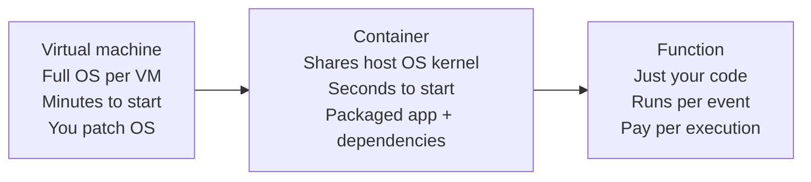
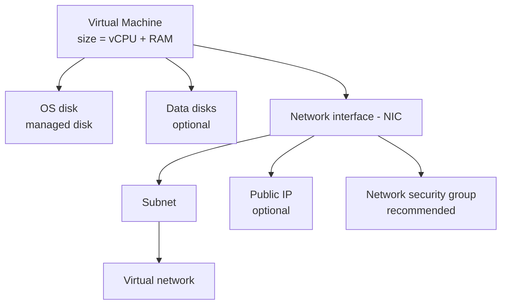
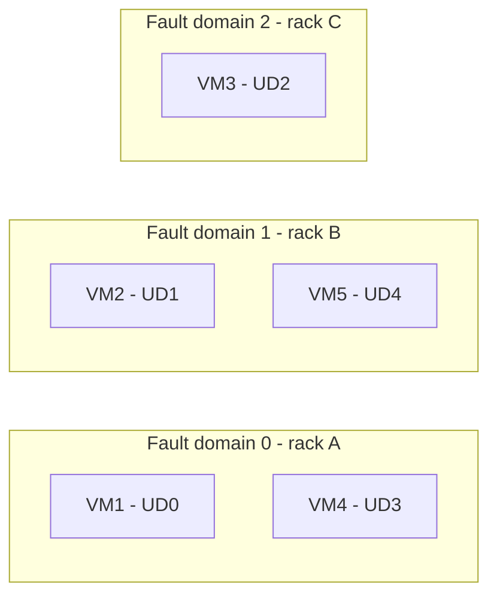
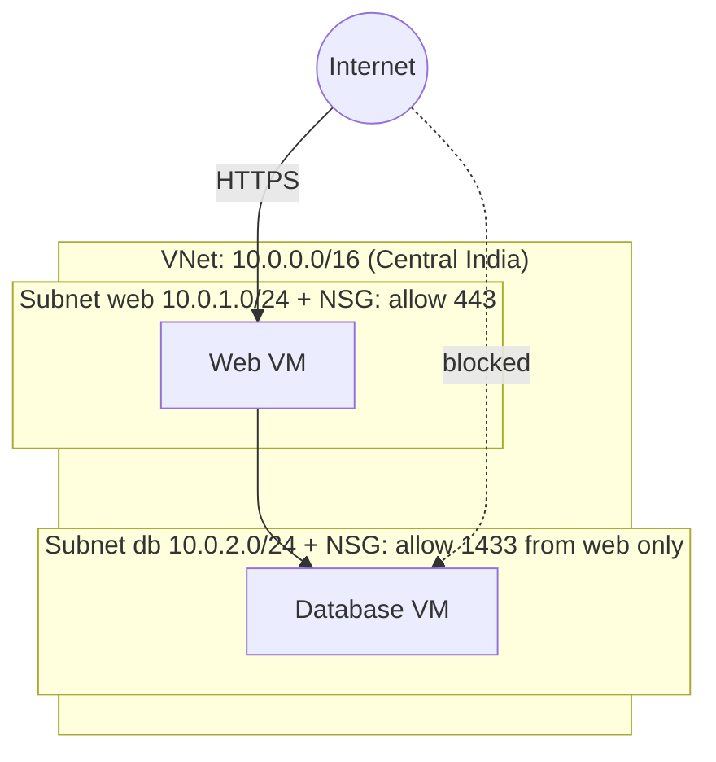
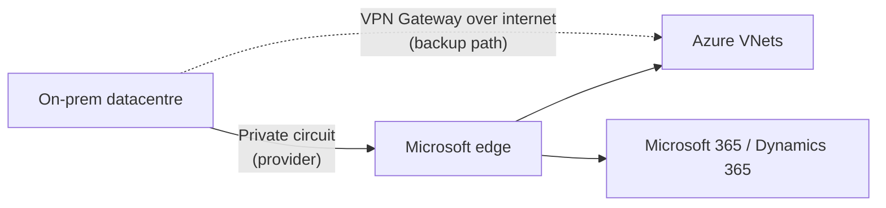

# 03 — Azure Compute and Networking Services

> **Prerequisites:** IaaS/PaaS/serverless (file 01) · regions, availability zones, resource groups (file 02).
> **Official objectives covered:** compare containers, VMs, functions · VM options (VMs, VM Scale Sets, availability sets, Azure Virtual Desktop) · resources required for VMs · app hosting (web apps, containers, VMs) · virtual networks, subnets, peering, Azure DNS, VPN Gateway, ExpressRoute · public and private endpoints.

---

## Part A — Compute

### A1. Compare the three compute types first

*Left = more control · right = less management.*

| | **Virtual machines** | **Containers** | **Functions (serverless)** |
|---|---|---|---|
| What you deploy | A whole OS + apps | App + dependencies in an image | Just a code function |
| Service type | IaaS | PaaS-style (ACI, Container Apps, AKS) | Serverless / PaaS |
| Start time | Minutes | Seconds | Milliseconds–seconds |
| OS control | **Full** | Limited (shares host kernel) | None |
| Scaling | Manual or VM Scale Sets | Fast; orchestrators (AKS, Container Apps) | **Automatic, to zero** |
| Billing | Per second while running | Per second of container resources | Per execution + duration (Consumption plan) |
| Best for | Lift-and-shift, custom software, legacy OS, full control | Microservices, portability, consistent dev→prod | Event-driven tasks, short jobs, glue code |
| Business example | Run a legacy accounting app requiring Windows Server 2016 | A food-delivery app split into order, payment and tracking microservices | Send an SMS when an order ships |
| Not for | Short event-driven jobs (paying for idle time) | Apps needing a different OS kernel per instance | Long-running stateful processes (without Durable Functions) |

**Recommendation:** need full OS control → **VM**; packaging microservices consistently → **containers**; run code on an event with zero idle cost → **Functions**.

---

### A2. Azure Virtual Machines

**Simple definition:** a computer emulated in software (IaaS). You choose the OS, size and software, and you manage it.

**Business example:** A manufacturer moves its 15-year-old inventory software, which only runs on Windows Server 2016 with a custom driver, to an Azure VM — no code changes.

**Use VMs when:** total control over the OS, running custom software, testing/dev, lift-and-shift, extending your datacentre (hybrid).

**Resources a VM needs (objective: "resources required for VMs"):**

| Required | Optional |
|---|---|
| **Size** (vCPU/RAM) | Public IP address |
| **OS disk** (managed disk) + OS image | Data disks |
| **Virtual network + subnet** | Network security group (strongly recommended) |
| **Network interface (NIC)** | Availability set / zone, load balancer |
| Resource group, region, subscription | Extensions, backup |

**VM SLA (single region):**

| Setup | SLA |
|---|---|
| Single VM, Premium SSD / Ultra disk on all disks | **99.9%** |
| Single VM, Standard SSD | 99.5% |
| Single VM, Standard HDD | 95% |
| 2+ VMs in an **availability set** | **99.95%** |
| 2+ VMs across **availability zones** | **99.99%** |

| Covered | Exceptions |
|---|---|
| Full control of OS, software, configuration | You patch, back up, and secure the OS |
| Many sizes (general purpose, compute, memory, GPU) | Changing size (scale up) usually restarts the VM |
| | **Stopped (deallocated)** VMs don't bill compute, but **disks still bill** |

---

### A3. Virtual Machine Scale Sets (VMSS)

**Simple definition:** create and manage a group of **identical, load-balanced VMs** that can **automatically** scale out/in based on demand or a schedule.

**Business example:** A ticket-booking site goes from 4 to 40 VMs when a concert goes on sale, then back to 4 — automatically.

| Covered | Not covered |
|---|---|
| Autoscaling (metrics or schedule) | Different VM configurations per instance (they're identical by design in uniform mode) |
| Built-in load balancing integration | It's not serverless — you still manage the OS image |
| Can span availability zones | |
| No extra charge for the scale set itself; pay for VMs | |

---

### A4. Availability sets

**Simple definition:** a way to spread VMs across different **racks** (fault domains) and **maintenance groups** (update domains) **inside one datacentre**, so one hardware failure or reboot doesn't take everything down.

| Term | Meaning | Numbers |
|---|---|---|
| **Update domain (UD)** | Group of VMs rebooted together during planned maintenance; only one UD rebooted at a time | Default **5**, up to **20** |
| **Fault domain (FD)** | Group sharing a power source and network switch (≈ a rack) | Up to **3** |

**Business example:** A small company's two web servers sit in an availability set; when one rack loses power, the other server stays up.

| Covered | Exceptions |
|---|---|
| Protects from **rack/hardware failure** and **planned maintenance** | **Does not** protect from a **datacentre or zone** failure (use availability zones) |
| **No extra cost** — you pay only for the VMs | Must be chosen when the VM is created |
| SLA 99.95% with 2+ VMs | One VM in a set gets no extra SLA benefit |

**Compare resilience options:**

| Failure you need to survive | Use | SLA |
|---|---|---|
| Rack/hardware/planned reboot | Availability set | 99.95% |
| Whole datacentre / zone | Availability zones | 99.99% |
| Whole region | Second region (region pair) + Site Recovery / traffic routing | Your design |
| Demand spikes | VM Scale Sets (can combine with zones) | — |

---

### A5. Azure Virtual Desktop (AVD)

**Simple definition:** desktop and app **virtualisation** in Azure — users get a full Windows desktop or individual apps streamed to any device.

**Business example:** A BPO with 2,000 agents working from home lets them log in to a secure Windows 11 desktop from personal laptops; customer data never leaves Azure.

| Covered | Not covered |
|---|---|
| Windows 11/10 **multi-session** (many users share one VM — unique to AVD) | Not a replacement for Microsoft 365 apps licensing |
| Centralised security with Entra ID, MFA, Conditional Access | Not for running server workloads |
| Access from Windows, macOS, iOS, Android, web | |
| Data stays in Azure, not on the user's device | |

---

### A6. Containers in Azure

**Simple definition:** a lightweight package containing an app and everything it needs, sharing the host's OS kernel. Many containers can run on one VM.

| Service | Simple meaning | Best for | Business example |
|---|---|---|---|
| **Azure Container Instances (ACI)** | Run a single container fast, no servers or orchestration (PaaS) | Simple tasks, quick jobs, burst | Run a nightly report container |
| **Azure Container Apps** | Serverless containers with autoscale (incl. to zero), built-in load balancing, HTTPS | Microservices and APIs without managing Kubernetes | Startup's set of 6 APIs that scale with traffic |
| **Azure Kubernetes Service (AKS)** | Managed **Kubernetes orchestration** for many containers | Large, complex microservices needing full Kubernetes control | Bank running 200 microservices |

**Recommendation:** single simple container → **ACI**; microservices without Kubernetes ops → **Container Apps**; full Kubernetes control at scale → **AKS**.

---

### A7. Azure Functions

**Simple definition:** serverless code that runs when triggered (HTTP request, timer, queue message, new blob, database change).

**Business example:** Every night at 2 a.m. (timer trigger) a function archives the day's sales logs.

| Covered | Exceptions |
|---|---|
| Auto-scale, pay per execution (Consumption plan) | Consumption-plan executions have a **time limit** (default 5 min, max 10 min); use Premium/Dedicated plans or Durable Functions for longer |
| **Stateless** by default | **Durable Functions** extension adds state |
| Many languages: C#, Java, JavaScript, Python, PowerShell | Cold starts possible on Consumption plan |

---

### A8. Application hosting options (objective)

| Option | You manage | Best for | Business example |
|---|---|---|---|
| **Azure App Service** (web apps, API apps, WebJobs, mobile back ends) | Only your code & settings | Web apps and REST APIs in .NET, Java, Node.js, Python, PHP, Ruby; Windows or Linux | A school deploys its admissions portal with autoscale, deployment slots and built-in HTTPS |
| **Containers** (ACI, Container Apps, AKS) | Container images | Microservices, portability | A logistics company packages tracking services as containers |
| **Virtual machines** | OS + everything | Apps needing full control or unsupported stacks | A legacy CRM that requires a specific Windows version |

**App Service key features:** autoscale, **deployment slots** (staging/production swap), CI/CD from GitHub/Azure DevOps, custom domains & TLS, Windows and Linux, can run containers.

**Recommendation:** default to **App Service** for a web app; containers when you already have container images or microservices; VMs only when you need OS control.

---

## Part B — Networking

### B1. Azure Virtual Network (VNet)

**Simple definition:** your own **private network** in Azure. Resources in a VNet can talk to each other privately, to the internet, and to on-premises networks.

What VNets provide (Microsoft's list):
1. **Isolation and segmentation** (private IP ranges, subnets)
2. **Internet communication** (via public IPs or load balancers)
3. **Communication between Azure resources** (incl. service endpoints / private endpoints)
4. **Communication with on-premises** (VPN Gateway, ExpressRoute, point-to-site)
5. **Route traffic** (route tables, BGP)
6. **Filter traffic** (network security groups, network virtual appliances / Azure Firewall)
7. **Connect virtual networks** (peering)

**Business example:** An e-commerce company puts web servers in a public-facing subnet and databases in a private subnet; an NSG allows only the web subnet to reach the database.

| Covered | Exceptions |
|---|---|
| A VNet lives in **one region** and one subscription | To connect VNets across regions use **global VNet peering** |
| Free to create VNets (you pay for gateways, peering traffic, public IPs) | Address spaces of VNets you connect **must not overlap** |
| **Subnets** divide a VNet; NSGs can attach to subnets or NICs | |

### B2. Subnets
A **subnet** is a range of IP addresses inside a VNet, used to group and secure resources (e.g. web tier, data tier). NSGs and route tables are commonly applied per subnet. Some services require a dedicated subnet (e.g. VPN gateway needs a subnet named **GatewaySubnet**).

### B3. VNet peering

**Simple definition:** connects two VNets so they behave like one network. Traffic stays on the **Microsoft backbone** — private, never over the public internet.

- **Regional peering:** same region. **Global peering:** different regions.
- **Business example:** After merging with another company, a firm peers its VNet with the acquired company's VNet so apps communicate privately.

| Covered | Exceptions |
|---|---|
| Low latency, private backbone traffic | Peering is **non-transitive**: A↔B and B↔C does **not** give A↔C automatically |
| Works across subscriptions and tenants | Address spaces **can't overlap** |
| | Data transfer through peering is **charged** |

### B4. Azure DNS

**Simple definition:** hosts your DNS domains (name → IP lookups) on Azure's global name servers, managed with the same Azure tools, RBAC and logs.

**Business example:** A company hosts `contoso-shop.com` records in Azure DNS so its marketing team can't change them (RBAC), and audit logs show who changed what.

| Covered | Exceptions |
|---|---|
| Public DNS zones and **private DNS zones** (names resolved inside VNets) | **You can't buy a domain name with Azure DNS** — buy from a registrar (or App Service domains) and then delegate it to Azure DNS |
| High availability (anycast, global) | |
| Alias records pointing to Azure resources | |

### B5. Azure VPN Gateway

**Simple definition:** sends **encrypted** traffic between an Azure VNet and another location **over the public internet**.

| Type | Connects | Business example |
|---|---|---|
| **Site-to-site** | On-premises office/datacentre ↔ Azure VNet | A branch office in Pune connects to Azure |
| **Point-to-site** | A single device ↔ Azure VNet | A remote developer's laptop connects to dev VMs |
| **VNet-to-VNet** (network-to-network) | Azure VNet ↔ Azure VNet | Two VNets in different regions (peering is often preferred) |

| Covered | Exceptions |
|---|---|
| IPsec/IKE encryption | Traffic goes over the **public internet** (encrypted) → bandwidth/latency vary |
| Policy-based or **route-based** VPNs | **Only one VPN gateway per VNet** (it can have multiple connections) |
| High availability options: active-standby (default), active-active, zone-redundant gateways | Needs a dedicated **GatewaySubnet** |
| Can be a **failover path for ExpressRoute** | |

### B6. Azure ExpressRoute

**Simple definition:** a **private, dedicated** connection from your on-premises network to Microsoft's cloud, through a **connectivity provider**. It does **not** travel over the public internet.

**Connectivity models:** CloudExchange co-location · point-to-point Ethernet · any-to-any (IPVPN) · directly from ExpressRoute sites (**ExpressRoute Direct**, 10–100 Gbps).

**Features:** predictable performance and higher bandwidth, built-in **redundancy**, connectivity to Microsoft cloud services (Azure, Microsoft 365, Dynamics 365), **Global Reach** (connect your on-prem sites to each other through Microsoft's network), dynamic routing with BGP.

**Business example:** A stock exchange connects its trading datacentre to Azure with ExpressRoute for consistent low latency and because regulators forbid trading data on the public internet.

| Covered | Exceptions / traps |
|---|---|
| Private — not over the public internet | ExpressRoute traffic is **not encrypted by default** (private ≠ encrypted); add MACsec/IPsec if required |
| Higher reliability, speed and lower latency than internet | More expensive and slower to set up (needs a provider) |
| Reaches Microsoft 365 and Dynamics 365 too (Microsoft peering) | Some traffic (DNS, CRL checks, CDN) may still use the internet |

**Compare and recommend — connecting on-prem to Azure:**

| Need | Best fit |
|---|---|
| Small office, low cost, quick setup, encrypted | **VPN Gateway (site-to-site)** |
| Individual remote workers to VNet | **VPN Gateway (point-to-site)** |
| Large enterprise, high bandwidth, predictable latency, no public internet | **ExpressRoute** |
| Mission-critical with backup path | **ExpressRoute + VPN Gateway failover** |
| Connect two Azure VNets | **VNet peering** (not VPN, unless encryption over gateway is specifically required) |

### B7. Public and private endpoints

| | **Public endpoint** | **Private endpoint** |
|---|---|---|
| What | A service address reachable from the **internet** (public IP/hostname) | A **network interface with a private IP from your VNet** that connects privately to a service (powered by **Azure Private Link**) |
| Traffic path | Internet | Stays on Microsoft's backbone / your VNet |
| Example | `mystorage.blob.core.windows.net` open to the internet | Storage account reachable only at `10.0.3.5` inside your VNet |
| Business example | Public product-image storage for a website | Hospital's patient-records SQL Database reachable only from its VNet and on-prem via ExpressRoute |

**Recommendation:** sensitive PaaS data (databases, storage with personal data) → **private endpoint** and disable public access. Public content → public endpoint.

| Trap | Truth |
|---|---|
| "A private endpoint gives a public IP" | No — **private IP** from your VNet |
| Private endpoint vs **service endpoint** | Service endpoints keep the service's **public** IP but restrict access to your VNet over the backbone; private endpoints give the service a **private IP in your VNet** (preferred, works from on-prem too) |

### B8. Network CapEx vs OpEx snapshot

| | On-prem (CapEx) | Azure (OpEx) |
|---|---|---|
| Firewall/router hardware | ₹8–15 lakh upfront + AMC | Azure Firewall / NSGs billed hourly (NSGs free) |
| Dedicated WAN link | Telecom contract + hardware | ExpressRoute circuit monthly fee + provider fee |
| Branch connectivity | VPN appliance per branch | VPN Gateway hourly + data out |
| DNS servers | 2 servers + maintenance | Azure DNS: per zone + per million queries (paise) |

---

## Part C — Questions (low → high)

### Q3.01 · L1 · VM service type
Azure Virtual Machines is an example of which service type?

- A. SaaS
- B. PaaS
- C. IaaS
- D. Serverless

<b>Answer</b>

**Answer: C**

### Q3.02 · L1 · Container definition
Which statement best describes a container?

- A. A full operating system with its own kernel
- B. A lightweight package of an app and its dependencies that shares the host OS kernel
- C. A physical server
- D. A storage account

<b>Answer</b>

**Answer: B**

### Q3.03 · L1 · Functions trigger
Azure Functions code runs:

- A. Continuously 24×7 on a VM you manage
- B. In response to events (triggers)
- C. Only on-premises
- D. Only once per year

<b>Answer</b>

**Answer: B**

### Q3.04 · L1 · VNet purpose
What is the main purpose of an Azure virtual network?

- A. Store blob data
- B. Enable Azure resources to communicate securely with each other, the internet and on-premises networks
- C. Manage user identities
- D. Host DNS domains

<b>Answer</b>

**Answer: B**

### Q3.05 · L1 · VPN Gateway
Azure VPN Gateway sends traffic:

- A. Unencrypted over a private circuit
- B. Encrypted over the public internet
- C. Only between two Azure VMs on the same host
- D. Through physical cables Microsoft lays to your office

<b>Answer</b>

**Answer: B**

### Q3.06 · L1 · ExpressRoute
Which service provides a private connection to Azure that does not go over the public internet?

- A. VPN Gateway
- B. ExpressRoute
- C. Azure DNS
- D. VNet peering

<b>Answer</b>

**Answer: B**. Peering connects VNets *within* Azure, not on-prem to Azure.

### Q3.07 · L1 · AVD
Which service delivers virtual Windows desktops and apps to users on any device?

- A. Azure Virtual Desktop
- B. Azure App Service
- C. Azure Functions
- D. Azure Container Instances

<b>Answer</b>

**Answer: A**

### Q3.08 · L1 · Azure DNS
What does Azure DNS do?

- A. Registers (sells) domain names
- B. Hosts DNS domains and resolves names using Azure infrastructure
- C. Encrypts network traffic
- D. Assigns user licences

<b>Answer</b>

**Answer: B**. You buy the domain elsewhere and delegate it to Azure DNS.

### Q3.09 · L2 · VM required resources
Which resource is **required** to create an Azure VM?

- A. A public IP address
- B. A virtual network (and subnet) with a network interface
- C. An availability set
- D. A load balancer

<b>Answer</b>

**Answer: B**. Public IP, availability set and load balancer are optional.

### Q3.10 · L2 · Availability set
What does an availability set protect against?

- A. A whole-region outage
- B. A datacentre outage
- C. Hardware/rack failures and planned maintenance within a datacentre
- D. Accidental deletion

<b>Answer</b>

**Answer: C**

### Q3.11 · L2 · Fault vs update domain
VMs that share a common power source and network switch are in the same:

- A. Update domain
- B. Fault domain
- C. Availability zone
- D. Region pair

<b>Answer</b>

**Answer: B**. Update domain = rebooted together during planned maintenance.

### Q3.12 · L2 · Availability set cost
How much does an availability set cost?

- A. A fixed monthly fee
- B. Nothing — you pay only for the VMs in it
- C. Double the VM price
- D. Per fault domain

<b>Answer</b>

**Answer: B**

### Q3.13 · L2 · VMSS
Which service lets you automatically increase or decrease the number of identical, load-balanced VMs?

- A. Availability sets
- B. Virtual Machine Scale Sets
- C. Azure Virtual Desktop
- D. Azure Dedicated Host

<b>Answer</b>

**Answer: B**. Availability sets don't autoscale.

### Q3.14 · L2 · Peering path
Traffic between peered VNets travels over:

- A. The public internet, encrypted with IPsec
- B. The Microsoft backbone network, privately
- C. ExpressRoute only
- D. A VPN gateway always

<b>Answer</b>

**Answer: B**

### Q3.15 · L2 · Peering transitivity
VNet A is peered with VNet B, and VNet B is peered with VNet C. Can A communicate with C through B by default?

- A. Yes, peering is transitive
- B. No, peering is non-transitive
- C. Only if all are in the same region
- D. Only with Azure DNS

<b>Answer</b>

**Answer: B**. You'd add A↔C peering or use a hub with gateway transit / Azure Virtual WAN.

### Q3.16 · L2 · Point-to-site
A single remote developer needs to connect a laptop securely to an Azure VNet. Which connection type?

- A. Site-to-site VPN
- B. Point-to-site VPN
- C. ExpressRoute
- D. VNet peering

<b>Answer</b>

**Answer: B**

### Q3.17 · L2 · Private endpoint
What is a private endpoint?

- A. A public IP for a VM
- B. A network interface with a private IP from your VNet that connects privately to an Azure service
- C. A VPN between two offices
- D. A DNS zone

<b>Answer</b>

**Answer: B**

### Q3.18 · L2 · App Service languages
Which statement about Azure App Service is true?

- A. It supports only .NET on Windows
- B. It supports multiple languages (e.g. .NET, Java, Node.js, Python, PHP) on Windows and Linux
- C. You must patch the OS yourself
- D. It cannot autoscale

<b>Answer</b>

**Answer: B**

### Q3.19 · L2 · Compare compute
Which compute option starts fastest and has the least management overhead for a short task triggered by a queue message?

- A. Virtual machine
- B. Virtual machine scale set
- C. Azure Functions
- D. Azure Virtual Desktop

<b>Answer</b>

**Answer: C**

### Q3.20 · L3 · Legacy app
A company must move an application that requires a specific OS configuration and a custom driver, without changing the app. What should it use?

- A. Azure Functions
- B. Azure App Service
- C. Azure Virtual Machines
- D. Azure Container Instances

<b>Answer</b>

**Answer: C** — full OS control.

### Q3.21 · L3 · Ticket sales spike
A concert-ticket website sees huge, unpredictable spikes. It runs on VMs and must add and remove VMs automatically. What should it use?

- A. A larger single VM
- B. Virtual Machine Scale Sets with autoscale
- C. An availability set
- D. Reserved instances

<b>Answer</b>

**Answer: B**

### Q3.22 · L3 · Highest VM availability in a region
You need the highest SLA for a VM-based app within a single region. Which deployment?

- A. One VM with Premium SSD
- B. Two VMs in an availability set
- C. Two or more VMs across availability zones
- D. One VM with Standard HDD

<b>Answer</b>

**Answer: C** — 99.99% (vs 99.95% for a set, 99.9% single Premium SSD).

### Q3.23 · L3 · Remote workforce
A call centre wants 500 staff working from home to use a secure Windows desktop, keeping customer data off personal devices, with multiple users sharing VMs to cut cost. Which service?

- A. Azure Virtual Desktop
- B. Azure App Service
- C. Azure VPN Gateway alone
- D. Microsoft Entra ID alone

<b>Answer</b>

**Answer: A** — Windows multi-session is unique to AVD.

### Q3.24 · L3 · Microservices without Kubernetes ops
A startup has six containerised APIs. It wants autoscaling (including to zero) and HTTPS without managing a Kubernetes cluster. Which service is the best fit?

- A. Azure Kubernetes Service
- B. Azure Container Apps
- C. Azure Virtual Machines
- D. Azure Virtual Desktop

<b>Answer</b>

**Answer: B**. AKS works but adds cluster management; ACI lacks microservice scaling features.

### Q3.25 · L3 · Simple container job
You need to run a single container for 10 minutes each night with no orchestration and least effort. Which service?

- A. Azure Container Instances
- B. Azure Kubernetes Service
- C. Virtual Machine Scale Sets
- D. Azure Virtual Desktop

<b>Answer</b>

**Answer: A**

### Q3.26 · L3 · Bank connectivity
A bank needs a high-bandwidth, low-latency connection between its datacentre and Azure, and regulators prohibit routing the traffic over the public internet. What should it use?

- A. Site-to-site VPN
- B. ExpressRoute
- C. Point-to-site VPN
- D. Public endpoints

<b>Answer</b>

**Answer: B**

### Q3.27 · L3 · Branch office cheaply
A 15-person branch office needs encrypted connectivity to Azure quickly and at low cost. What should it use?

- A. ExpressRoute Direct
- B. Site-to-site VPN Gateway
- C. Global VNet peering
- D. Azure DNS

<b>Answer</b>

**Answer: B**

### Q3.28 · L3 · Private PaaS access
A hospital wants its Azure SQL Database reachable only from its own VNet and on-prem network, never from the internet. What should it configure?

- A. A public endpoint with a strong password
- B. A private endpoint and disable public network access
- C. Azure DNS public zone
- D. An availability set

<b>Answer</b>

**Answer: B**

### Q3.29 · L3 · Segmentation
You want web servers and database servers in the same VNet but with different security rules. What should you create?

- A. Two subscriptions
- B. Two subnets with network security groups
- C. Two regions
- D. Two DNS zones

<b>Answer</b>

**Answer: B**

### Q3.30 · L3 · Connect two Azure VNets
Two Azure VNets in different regions must communicate privately with low latency and minimal setup. Which option is best?

- A. Global VNet peering
- B. ExpressRoute
- C. Point-to-site VPN
- D. Public endpoints

<b>Answer</b>

**Answer: A**

### Q3.31 · L3 · Web app hosting
A school wants to host its admissions website (Python) with built-in autoscale, a staging slot and no OS management. What should it use?

- A. Azure Virtual Machines
- B. Azure App Service
- C. Azure Virtual Desktop
- D. Azure Data Box

<b>Answer</b>

**Answer: B**

### Q3.32 · L4 · Yes/No — VMs
1. You are responsible for patching the operating system on an Azure VM.
2. A deallocated VM continues to incur compute charges.
3. A public IP address is required to create a VM.

<b>Answer</b>

**1 Yes · 2 No · 3 No** (disks still bill when deallocated).

### Q3.33 · L4 · Yes/No — ExpressRoute
1. ExpressRoute connections go over the public internet.
2. ExpressRoute can provide access to Microsoft 365.
3. ExpressRoute traffic is encrypted by default.

<b>Answer</b>

**1 No · 2 Yes · 3 No**

### Q3.34 · L4 · Yes/No — VPN Gateway
1. A virtual network can have multiple VPN gateways.
2. VPN Gateway can be used as a backup for ExpressRoute.
3. Site-to-site VPN connects an on-premises network to an Azure VNet.

<b>Answer</b>

**1 No · 2 Yes · 3 Yes** (one VPN gateway per VNet; it can have many connections).

### Q3.35 · L4 · Yes/No — Azure DNS
1. You can purchase a domain name through Azure DNS.
2. Azure DNS supports private DNS zones for VNets.
3. Azure DNS uses Azure RBAC to control who can manage records.

<b>Answer</b>

**1 No · 2 Yes · 3 Yes**

### Q3.36 · L4 · Yes/No — availability options
1. Availability zones protect VMs from a datacentre failure.
2. Availability sets protect VMs from a datacentre failure.
3. VM Scale Sets can be deployed across availability zones.

<b>Answer</b>

**1 Yes · 2 No · 3 Yes**

### Q3.37 · L4 · Yes/No — Functions
1. Azure Functions is stateless by default.
2. Functions on the Consumption plan are billed for every hour even when idle.
3. Durable Functions allow stateful workflows.

<b>Answer</b>

**1 Yes · 2 No · 3 Yes**

### Q3.38 · L4 · Sentence completion
"To connect an on-premises network to Azure through a connectivity provider without using the internet, use \_\_\_\_\_."

- A. Azure VPN Gateway
- B. Azure ExpressRoute
- C. Virtual network peering
- D. Azure Front Door

<b>Answer</b>

**Answer: B**

### Q3.39 · L4 · Choose two
Which **two** options can connect an on-premises network to an Azure VNet? (Each is a complete solution.)

- A. Site-to-site VPN
- B. ExpressRoute
- C. Azure DNS
- D. Network security group

<b>Answer</b>

**Answer: A and B**

### Q3.40 · L4 · Cost-minimised container choice
You must run a containerised batch job that runs for 20 minutes once a day. You want to **minimise cost and administration**. What should you use?

- A. An AKS cluster running 24×7
- B. A VM running Docker 24×7
- C. Azure Container Instances (billed per second while running)
- D. Azure Virtual Desktop

<b>Answer</b>

**Answer: C**

### Q3.41 · L4 · Overlapping address trap
Two VNets both use the address space 10.0.0.0/16. What happens if you try to peer them?

- A. Peering works normally
- B. Peering fails because address spaces overlap
- C. Azure renumbers one VNet automatically
- D. Traffic goes over the internet

<b>Answer</b>

**Answer: B**

---
➡️ Next: [04 — Storage](04-storage.md)
