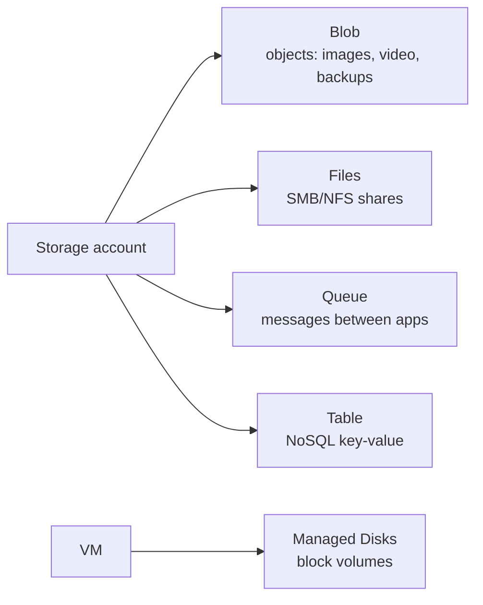
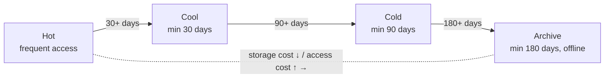
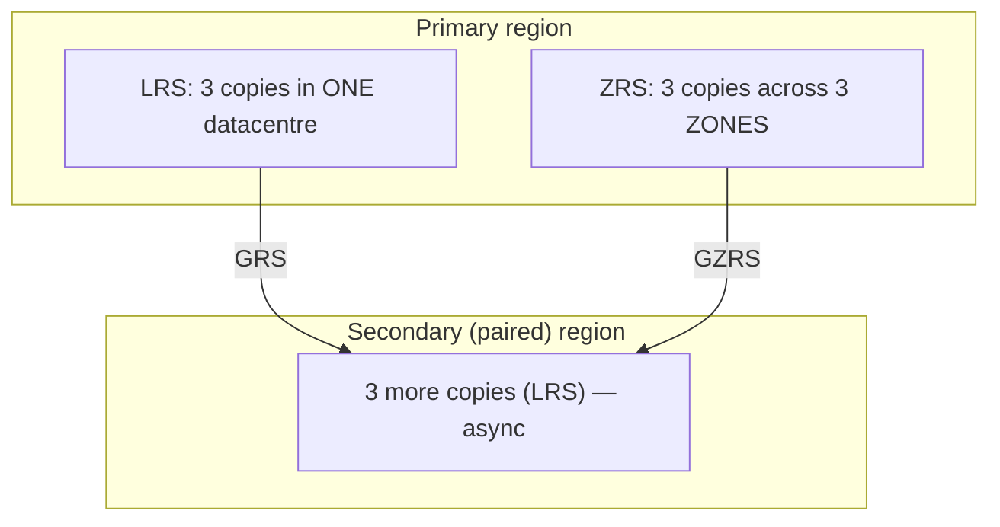

# 04 — Azure Storage Services

> **Prerequisites:** regions, availability zones, region pairs (file 02) · VMs and managed disks (file 03) · CapEx/OpEx (file 01).
> **Official objectives covered:** compare storage services · storage tiers · redundancy options · storage account options and types · moving files (AzCopy, Storage Explorer, Azure File Sync) · migration (Azure Migrate, Azure Data Box).

---

## Part A — Concept cards

### A1. The storage account (the container for most storage)

A **storage account** is the top-level object that gives you a unique namespace for your data, reachable over HTTP/HTTPS from anywhere.

**Rules:**
- Name must be **globally unique**, **3–24 characters**, **lowercase letters and numbers only**.
- Data is **always encrypted at rest** (256-bit AES, Storage Service Encryption) — it **cannot be turned off**.
- Endpoints follow the pattern `https://<account>.<service>.core.windows.net`:

| Service | Endpoint |
|---|---|
| Blob | `https://mystore.blob.core.windows.net` |
| Data Lake Storage Gen2 | `https://mystore.dfs.core.windows.net` |
| Azure Files | `https://mystore.file.core.windows.net` |
| Queue | `https://mystore.queue.core.windows.net` |
| Table | `https://mystore.table.core.windows.net` |

### A2. Storage account types (objective)

| Type | Supports | Redundancy options | Use when |
|---|---|---|---|
| **Standard general-purpose v2** | Blob (incl. Data Lake), Queue, Table, Azure Files | LRS, GRS, RA-GRS, ZRS, GZRS, RA-GZRS | **Default for most scenarios** |
| **Premium block blobs** | Block & append blobs | LRS, ZRS | High transaction rates, small objects, low latency |
| **Premium file shares** | Azure Files only | LRS, ZRS | Enterprise, high-performance file shares (SMB and NFS) |
| **Premium page blobs** | Page blobs only | LRS | Page-blob-heavy workloads |

**Exceptions:** Premium accounts **don't support geo-redundancy** (GRS/GZRS). Premium uses SSDs; Standard uses HDDs.

---

### A3. The five core data services — compare

| Service | Simple meaning | Business example | Not for |
|---|---|---|---|
| **Blob storage** | Massive storage for **unstructured** data (files of any type) | A news site stores millions of photos and videos; a company stores backups and logs | Mounting as a classic shared drive for legacy apps (use Files) |
| **Azure Files** | Fully managed **file shares** using **SMB** (and NFS); mount from Windows, Linux, macOS, cloud or on-prem | A law firm replaces its on-prem file server so offices share `\\files\cases` | Message passing between apps |
| **Queue storage** | Stores large numbers of **messages** (each up to 64 KB) for asynchronous processing | An online shop puts each order on a queue; a worker processes them so the site isn't slowed during peaks | Large file storage |
| **Table storage** | **NoSQL** structured data store (key/attribute, schemaless) | An IoT company stores device metadata cheaply | Complex relational queries/joins (use Azure SQL) |
| **Disk storage (managed disks)** | **Block-level** volumes attached to VMs (OS and data disks) | A VM running SQL Server uses Premium SSD data disks | Sharing files across many users (use Files) |

**Blob types (know the names):** **Block** blobs (text/binary files, up to ~190 TiB), **Append** blobs (append-only, e.g. logs), **Page** blobs (random read/write; back VM disks).

**Recommendation:** files of any kind for apps/web → **Blob**; replace a file server / lift-and-shift shared drive → **Files**; decouple app components → **Queue**; cheap NoSQL key-value → **Table**; VM storage → **Disks**.

---

### A4. Access tiers (objective: storage tiers)

| Tier | Storage cost | Access cost | Minimum retention (early-deletion fee) | Availability | Typical use |
|---|---|---|---|---|---|
| **Hot** | Highest | Lowest | None | Online, ms | Website images, active data |
| **Cool** | Lower | Higher | **30 days** | Online, ms | Short-term backups, older invoices |
| **Cold** | Lower still | Higher still | **90 days** | Online, ms | Rarely read data that must be quickly available |
| **Archive** | **Lowest** | **Highest** | **180 days** | **Offline** — must **rehydrate** (up to **15 hours**) | Legal records kept 7 years, compliance archives |

**Business example:** A hospital keeps scans in **Hot** for 30 days (doctors review them), moves them to **Cool** for a year, then **Archive** for 10 years for legal compliance — automated with a **lifecycle management policy**.

| Covered | Exceptions / traps |
|---|---|
| Change tiers any time; lifecycle policies automate moves | **Archive can't be the account default** — only Hot, Cool or Cold can be set at account level; Archive is set **per blob** |
| Early deletion fee is **prorated** (e.g. delete a Cool blob after 21 days → pay for the remaining 9) | You **can't read** an archived blob until rehydrated to Hot/Cool/Cold |
| Rehydration priority: **Standard** (up to 15 h) or **High** (faster, often < 1 h for small objects, more expensive) | Tiers apply to **block blobs** in general-purpose v2 / Blob Storage accounts, not to Files/Queues/Tables |

---

### A5. Redundancy options (objective) — most tested storage topic

| Option | Copies | Survives | Durability (per year) | Read from secondary? |
|---|---|---|---|---|
| **LRS** — Locally redundant | 3 in **one datacentre** | Disk/rack/server failure | **11 nines** (99.999999999%) | — |
| **ZRS** — Zone-redundant | 3 across **3 availability zones** | **Datacentre/zone** failure | **12 nines** | — |
| **GRS** — Geo-redundant | LRS in primary + LRS in **secondary region** (6 total) | **Region** failure | **16 nines** | Only after failover |
| **RA-GRS** | Same as GRS | Region failure | 16 nines | ✅ **Yes, anytime** |
| **GZRS** — Geo-zone-redundant | ZRS in primary + LRS in secondary | Zone **and** region failure | 16 nines | Only after failover |
| **RA-GZRS** | Same as GZRS | Zone and region failure | 16 nines | ✅ **Yes, anytime** |

**Key facts:**
- Replication **within** a region (LRS/ZRS) is **synchronous**; replication to the secondary region is **asynchronous** (some recent writes can be lost — RPO typically < 15 minutes).
- The secondary region is normally the **paired region**.
- Without **RA-**, you can read secondary data only after a **failover** (customer-initiated, or Microsoft-managed in a disaster).
- **Cheapest → most expensive:** LRS < ZRS < GRS < RA-GRS < GZRS < RA-GZRS.

**Recommendation table:**

| Requirement | Pick |
|---|---|
| Cheapest; data easily recreated (test data, scratch) | **LRS** |
| Survive datacentre failure, data must stay in one region (residency/latency) | **ZRS** |
| Survive region disaster, cost-conscious | **GRS** |
| Survive region disaster **and** read from secondary during outage | **RA-GRS** |
| Maximum protection: zone + region failure, read during outage | **RA-GZRS** |

**Business example:** A bank stores customer statements in **RA-GZRS** in Central India — a zone fire won't interrupt access, and if the whole region goes down, statements can still be read from South India.

---

### A6. Moving files (objective)

| Tool | What it is | Best for | Business example |
|---|---|---|---|
| **AzCopy** | **Command-line** tool to copy blobs or files to/from/between storage accounts; can **sync one way** | Scripting, automation, bulk copies | A nightly script uploads 50 GB of logs to Blob storage |
| **Azure Storage Explorer** | Free **GUI desktop app** (Windows, macOS, Linux) to browse and manage storage; uses AzCopy under the hood | People who prefer clicking, ad-hoc uploads/downloads | An analyst drags-and-drops CSVs into a container |
| **Azure File Sync** | Syncs **on-prem Windows Servers** with **Azure Files**; keeps a local cache; **cloud tiering** keeps hot files local and the rest in Azure | Branch offices needing fast local access + central cloud copy | 10 branch offices share one central file share, each with a local cached copy |

**Azure File Sync covers:** any protocol available on Windows Server (SMB, NFS, FTPS) to access data locally · as many caches as needed worldwide · replace a failed local server by installing on a new server and syncing · cloud tiering.
**Not covered:** syncing Linux servers natively; syncing with Blob storage (it's for **Azure Files**).

**Recommendation:** automate → **AzCopy**; occasional GUI work → **Storage Explorer**; keep on-prem Windows file servers in sync with the cloud → **Azure File Sync**.

---

### A7. Migration options (objective)

#### Azure Migrate
**Simple definition:** a free **central hub** to **discover, assess and migrate** on-prem servers, databases, web apps and data to Azure.

Integrated tools: **Discovery and assessment** · **Server migration** · **Data Migration Assistant** · **Azure Database Migration Service** · **Web app migration assistant** · **Azure Data Box**.

**Business example:** An Indian manufacturer with 200 VMware servers uses Azure Migrate to inventory them, get Azure size/cost recommendations, and replicate them to Azure VMs.

#### Azure Data Box
**Simple definition:** Microsoft ships you a **ruggedised physical device**, you copy data onto it, ship it back, and Microsoft uploads it into your storage account.

| Fact | Value |
|---|---|
| Usable capacity | Classic Data Box **80 TB** (the figure in the Microsoft Learn AZ-900 module — answer this on the exam) · next-gen Data Box **120 TB** or **525 TB** (classic 80 TB being phased out region by region) |
| Encryption | AES 256-bit |
| Directions | **Import** to Azure and **export** from Azure |
| After upload | Disks are securely wiped (NIST 800-88r1) |
| Family | Data Box Disk (smaller, SSDs) · Data Box (80 TB classic / 120 TB / 525 TB next-gen). *Data Box Heavy has been retired.* |

**When to use Data Box:** large data (typically **40 TB+**) with **limited or no network bandwidth**, one-time migrations, initial bulk upload before incremental sync, disaster recovery restore, data-centre exit, or remote locations.

**CapEx/OpEx & time comparison — moving 100 TB:**

| Method | Time (approx.) | Cost nature |
|---|---|---|
| Over a 100 Mbps internet line | **~93 days** (100 TB × 8 ÷ 100 Mbps, ignoring overhead) | Bandwidth bill, network tied up |
| Over a 1 Gbps line | ~9–10 days | Expensive link upgrade (CapEx/contract) |
| **2 × Azure Data Box** | **~1–2 weeks incl. shipping** | Per-order fee (OpEx), no upgrade |

| Trap | Truth |
|---|---|
| "Azure Migrate is a paid service" | The hub itself is free; you pay for target resources and some tools/licences |
| "Data Box is for continuous sync" | No — it's for **offline bulk** transfer; use File Sync or AzCopy for ongoing sync |
| "AzCopy has a GUI" | No — Storage Explorer is the GUI (it uses AzCopy internally) |

---

### A8. Storage CapEx vs OpEx — 100 TB archive, 5 years (illustrative)

| | On-prem SAN/NAS | Azure Blob Archive (LRS) | Azure Blob Cool (GRS) |
|---|---|---|---|
| Upfront hardware | ₹40–60 lakh (+ replace at year 5) | ₹0 | ₹0 |
| Power, cooling, space, AMC (5 yrs) | ₹10–15 lakh | included | included |
| Monthly storage | — | Very low (≈₹0.15/GB-month order of magnitude) | Higher (≈₹1.5–2/GB-month) |
| Retrieval cost | None | **High** + hours of delay | Low, instant |
| Off-site copy (DR) | Second array = double CapEx | Add GRS | Included (GRS) |
| Best for | Constant high-speed access, no cloud allowed | Rarely-read compliance data | Data read occasionally, needs DR |

> Prices vary by region and change often — always confirm with the **pricing calculator** (file 06). The **pattern** is what the exam tests: Archive = cheapest to store, most expensive/slowest to read.

---

## Part B — Questions (low → high)

### Q4.01 · L1 · Blob storage
Which Azure storage service is optimised for storing massive amounts of unstructured data such as images and videos?

- A. Table storage
- B. Blob storage
- C. Queue storage
- D. Azure Files

<b>Answer</b>

**Answer: B**

### Q4.02 · L1 · Azure Files
Which service provides fully managed file shares accessible via SMB?

- A. Blob storage
- B. Azure Files
- C. Queue storage
- D. Managed disks

<b>Answer</b>

**Answer: B**

### Q4.03 · L1 · Queue storage
Which service stores messages to decouple application components?

- A. Table storage
- B. Queue storage
- C. Blob storage
- D. Azure Files

<b>Answer</b>

**Answer: B**

### Q4.04 · L1 · Table storage
Which service stores NoSQL key/attribute data?

- A. Table storage
- B. Disk storage
- C. Queue storage
- D. Azure Files

<b>Answer</b>

**Answer: A**

### Q4.05 · L1 · LRS
How many copies of data does LRS keep, and where?

- A. 3 copies in one datacentre
- B. 3 copies across 3 zones
- C. 6 copies across 2 regions
- D. 1 copy

<b>Answer</b>

**Answer: A**

### Q4.06 · L1 · Archive tier
Which access tier has the lowest storage cost?

- A. Hot
- B. Cool
- C. Cold
- D. Archive

<b>Answer</b>

**Answer: D**

### Q4.07 · L1 · AzCopy
AzCopy is:

- A. A graphical tool
- B. A command-line utility for copying data to and from storage accounts
- C. A physical device
- D. A migration assessment hub

<b>Answer</b>

**Answer: B**

### Q4.08 · L1 · Data Box
Azure Data Box is:

- A. A cloud VM
- B. A physical device used to transfer large amounts of data to and from Azure offline
- C. A database service
- D. A VPN appliance

<b>Answer</b>

**Answer: B**

### Q4.09 · L2 · Name rule
Which is a valid storage account name?

- A. `My_Storage01`
- B. `mystorage01`
- C. `my-storage-01`
- D. `ms`

<b>Answer</b>

**Answer: B** — 3–24 chars, lowercase letters and numbers only, globally unique. Hyphens and uppercase aren't allowed; `ms` is too short.

### Q4.10 · L2 · Default account type
Which storage account type supports Blob, Queue, Table and Azure Files and is recommended for most scenarios?

- A. Premium block blobs
- B. Standard general-purpose v2
- C. Premium page blobs
- D. Premium file shares

<b>Answer</b>

**Answer: B**

### Q4.11 · L2 · ZRS
What does ZRS protect against that LRS does not?

- A. Region failure
- B. Datacentre/zone failure
- C. Accidental deletion
- D. Ransomware

<b>Answer</b>

**Answer: B**. No redundancy option protects against accidental deletion or ransomware — use soft delete, versioning, backups, immutability.

### Q4.12 · L2 · RA-GRS
What extra capability does RA-GRS add over GRS?

- A. Copies across zones in the primary region
- B. Read access to the secondary region at any time
- C. Write access to the secondary region
- D. Infinite retention

<b>Answer</b>

**Answer: B** (read-only).

### Q4.13 · L2 · GZRS
GZRS combines:

- A. LRS in primary and LRS in secondary
- B. ZRS in primary and LRS in secondary
- C. ZRS in both regions
- D. Archive and Hot tiers

<b>Answer</b>

**Answer: B**

### Q4.14 · L2 · Archive rehydration
What must happen before you can read a blob in the Archive tier?

- A. Nothing
- B. It must be rehydrated to an online tier (Hot, Cool or Cold), which can take up to 15 hours
- C. It must be copied to a VM
- D. It must be deleted

<b>Answer</b>

**Answer: B**

### Q4.15 · L2 · Account default tier
Which tier **cannot** be set as a storage account's default access tier?

- A. Hot
- B. Cool
- C. Cold
- D. Archive

<b>Answer</b>

**Answer: D** — Archive is set per blob.

### Q4.16 · L2 · Cool minimum
What is the minimum retention period for the Cool tier (general-purpose v2) before an early-deletion fee applies?

- A. 7 days
- B. 30 days
- C. 90 days
- D. 180 days

<b>Answer</b>

**Answer: B** — Cold 90, Archive 180.

### Q4.17 · L2 · Storage Explorer
Which tool is a graphical application for managing storage accounts on Windows, macOS and Linux?

- A. AzCopy
- B. Azure Storage Explorer
- C. Azure File Sync
- D. Azure Data Box

<b>Answer</b>

**Answer: B**

### Q4.18 · L2 · File Sync
What does Azure File Sync do?

- A. Copies blobs between regions
- B. Synchronises on-premises Windows file servers with Azure Files, with optional cloud tiering
- C. Ships disks to Microsoft
- D. Assesses VMs for migration

<b>Answer</b>

**Answer: B**

### Q4.19 · L2 · Azure Migrate
Azure Migrate provides:

- A. A central hub to discover, assess and migrate on-premises workloads to Azure
- B. A backup service only
- C. A physical device for data transfer only
- D. Identity management

<b>Answer</b>

**Answer: A**. It integrates Data Box, DMS, Data Migration Assistant and more.

### Q4.20 · L2 · Encryption at rest
Which statement about Azure Storage encryption is true?

- A. Encryption at rest is optional and off by default
- B. Data is automatically encrypted at rest and this cannot be disabled
- C. Only Premium accounts are encrypted
- D. Only blobs are encrypted

<b>Answer</b>

**Answer: B**

### Q4.21 · L3 · Website images
A shopping website serves product images that are accessed constantly. Which service and tier?

- A. Blob storage, Hot tier
- B. Blob storage, Archive tier
- C. Queue storage
- D. Table storage

<b>Answer</b>

**Answer: A**

### Q4.22 · L3 · Legal records
A law firm must keep scanned contracts for 10 years; they are almost never read, and a delay of hours is acceptable. What minimises cost?

- A. Hot tier
- B. Cool tier
- C. Archive tier
- D. Premium block blobs

<b>Answer</b>

**Answer: C**

### Q4.23 · L3 · Rarely read, instant access
Data is read a few times a year but must be available within milliseconds when needed, and kept at least 3 months. Which tier balances cost?

- A. Hot
- B. Cold
- C. Archive
- D. Premium

<b>Answer</b>

**Answer: B** — online like Hot/Cool, cheaper storage, 90-day minimum fits.

### Q4.24 · L3 · Replace file server
A company wants to retire its on-premises file server and give staff mapped network drives to shared folders in Azure. Which service?

- A. Blob storage
- B. Azure Files
- C. Table storage
- D. Queue storage

<b>Answer</b>

**Answer: B**

### Q4.25 · L3 · Branch offices with local cache
Ten branch offices need fast local access to the same files while keeping a central copy in Azure. Which solution?

- A. AzCopy scheduled every hour
- B. Azure Files with Azure File Sync on a Windows Server in each branch
- C. Azure Data Box
- D. Blob Archive tier

<b>Answer</b>

**Answer: B**

### Q4.26 · L3 · 300 TB, slow link
A media company must move 300 TB of video to Azure. Its internet connection is 50 Mbps. What's the most practical option?

- A. Upload with Storage Explorer
- B. Azure Data Box (one large next-gen device or several devices)
- C. AzCopy over the internet
- D. Azure File Sync

<b>Answer</b>

**Answer: B**. 300 TB at 50 Mbps ≈ 1.5 years.

### Q4.27 · L3 · Scripted nightly upload
An ops team wants a scheduled script that uploads log folders to Blob storage every night. Which tool?

- A. Azure Storage Explorer
- B. AzCopy
- C. Azure Data Box
- D. Azure Migrate

<b>Answer</b>

**Answer: B**

### Q4.28 · L3 · Survive datacentre, stay in region
A company must keep data in one region for residency reasons and survive the loss of a datacentre, at the lowest cost. Which redundancy?

- A. LRS
- B. ZRS
- C. GRS
- D. RA-GZRS

<b>Answer</b>

**Answer: B** — GRS/GZRS copy data to a second region, which violates the single-region requirement.

### Q4.29 · L3 · Read during regional outage
A company needs its data readable even if the primary region is unavailable, without waiting for a failover. Which options work? (Choose the cheapest that meets it.)

- A. GRS
- B. RA-GRS
- C. ZRS
- D. LRS

<b>Answer</b>

**Answer: B** (RA-GZRS also works but costs more).

### Q4.30 · L3 · Cheapest redundancy
Test data that can be recreated easily needs the cheapest redundancy. Which?

- A. LRS
- B. ZRS
- C. GRS
- D. RA-GZRS

<b>Answer</b>

**Answer: A**

### Q4.31 · L3 · Decoupling
An online shop slows down during sales because order processing happens inside the web request. What helps the web tier stay fast?

- A. Put orders on Azure Queue storage and process them asynchronously with a worker
- B. Move orders to Archive tier
- C. Use Table storage for images
- D. Use Azure Data Box

<b>Answer</b>

**Answer: A**

### Q4.32 · L3 · Assess before migrating
Before migrating 200 on-prem VMs, a company wants an inventory, dependency view, and Azure size/cost recommendations. Which service?

- A. Azure Advisor
- B. Azure Migrate
- C. Azure Data Box
- D. Azure Arc

<b>Answer</b>

**Answer: B**. Advisor optimises *existing* Azure resources; Arc manages non-Azure resources but doesn't migrate them.

### Q4.33 · L4 · Yes/No — redundancy
1. GRS copies data to a secondary region.
2. With GRS (not RA-GRS), you can read secondary data at any time.
3. Replication to the secondary region is synchronous.

<b>Answer</b>

**1 Yes · 2 No · 3 No** (asynchronous).

### Q4.34 · L4 · Yes/No — tiers
1. You can set the Archive tier as the default for a storage account.
2. Deleting a Cool-tier blob after 10 days may incur an early-deletion charge.
3. Archived blobs can be read immediately.

<b>Answer</b>

**1 No · 2 Yes · 3 No**

### Q4.35 · L4 · Yes/No — tools
1. Azure Storage Explorer uses AzCopy to transfer data.
2. Azure File Sync can turn a Windows Server into a cache of an Azure file share.
3. Azure Data Box can be used to export data from Azure.

<b>Answer</b>

**1 Yes · 2 Yes · 3 Yes**

### Q4.36 · L4 · Yes/No — account types
1. Premium storage accounts support GRS.
2. A storage account name must be globally unique.
3. Standard general-purpose v2 supports Azure Files.

<b>Answer</b>

**1 No · 2 Yes · 3 Yes**

### Q4.37 · L4 · Order by cost
Order these redundancy options from cheapest to most expensive: GRS, LRS, RA-GZRS, ZRS.

- A. LRS, ZRS, GRS, RA-GZRS
- B. ZRS, LRS, GRS, RA-GZRS
- C. LRS, GRS, ZRS, RA-GZRS
- D. RA-GZRS, GRS, ZRS, LRS

<b>Answer</b>

**Answer: A**

### Q4.38 · L4 · Durability numbers
Which redundancy option offers at least 99.99999999999999% (16 nines) durability?

- A. LRS
- B. ZRS
- C. GRS
- D. None

<b>Answer</b>

**Answer: C** (also RA-GRS, GZRS, RA-GZRS). LRS = 11 nines, ZRS = 12 nines.

### Q4.39 · L4 · Early deletion calculation
A blob in the Archive tier is deleted after 60 days. For how many additional days are you charged an early-deletion fee?

- A. 0
- B. 30
- C. 120
- D. 180

<b>Answer</b>

**Answer: C** — 180 − 60 = 120 days, prorated.

### Q4.40 · L4 · Sentence completion
"To transfer about 70 TB of data to Azure from a site with no reliable internet connection, use \_\_\_\_\_."

- A. AzCopy
- B. Azure Data Box
- C. Azure File Sync
- D. Azure Storage Explorer

<b>Answer</b>

**Answer: B**

---
➡️ Next: [05 — Identity, access & security](05-identity-security.md)
