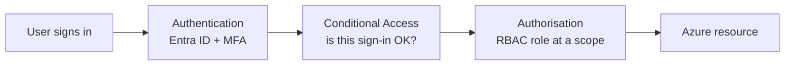
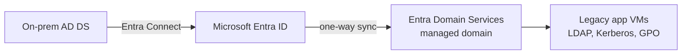
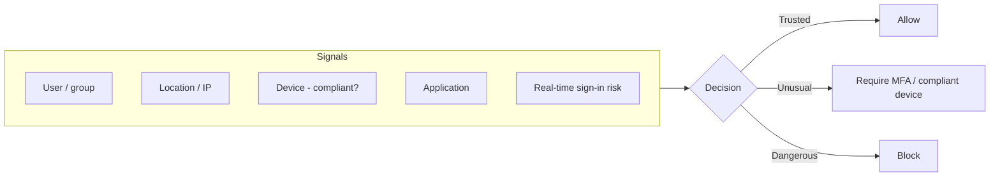
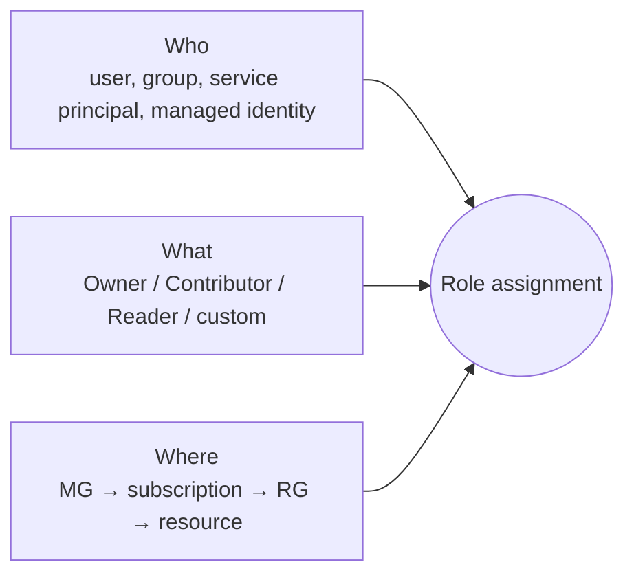
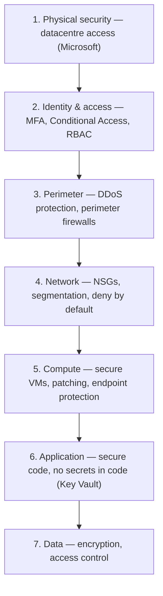
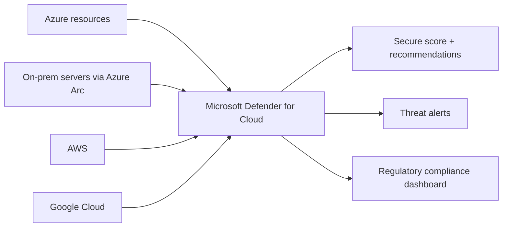

# 05 — Azure Identity, Access and Security

> **Prerequisites:** shared responsibility (file 01) · subscriptions, resource groups, management groups and scope inheritance (file 02) · VNets/NSGs (file 03).
> **Official objectives covered:** Microsoft Entra ID and Entra Domain Services · SSO, MFA, passwordless · external identities · Conditional Access · Azure RBAC · Zero Trust · defense in depth · Microsoft Defender for Cloud.

**Two words first:**
- **Authentication (AuthN)** = *who are you?* — proving identity (password, MFA). Handled by **Entra ID**.
- **Authorisation (AuthZ)** = *what can you do?* — permissions. For Azure resources handled by **RBAC**.

---

## Part A — Concept cards

### A1. Microsoft Entra ID (formerly Azure Active Directory)

**Simple definition:** Microsoft's **cloud identity service** — it stores users, groups and apps, and signs people in to Azure, Microsoft 365 and thousands of SaaS apps.

**What it provides:** authentication (incl. self-service password reset, MFA, smart lockout) · **single sign-on** · application management · device management (register/join) · B2B · identity protection.

**Business example:** A 3,000-employee company uses Entra ID so staff sign in once to Outlook, Teams, Salesforce and the Azure portal; leavers are disabled in one place and lose access everywhere.

**Hybrid identity:** **Microsoft Entra Connect** (Connect Sync / Cloud Sync) synchronises users from on-prem **Active Directory Domain Services (AD DS)** to Entra ID, so people use the same credentials everywhere.

| Entra ID IS | Entra ID is NOT |
|---|---|
| A cloud identity provider (OAuth, OpenID Connect, SAML) | A cloud copy of Windows Server AD — it has **no** Group Policy, OUs, LDAP or Kerberos domain join by default |
| Global, non-regional | Something you deploy VMs for |
| Free tier included with Azure/M365; **P1/P2** add features | P1 is required for **Conditional Access**; P2 adds Identity Protection risk policies & Privileged Identity Management (PIM) |

---

### A2. Microsoft Entra Domain Services (formerly Azure AD DS)

**Simple definition:** **managed** traditional domain services — **domain join, Group Policy, LDAP, Kerberos/NTLM** — **without** you deploying or patching domain controllers.

**Business example:** A company moves a 2008-era HR app that only authenticates via LDAP and needs domain-joined servers. Instead of building two domain-controller VMs, it enables Entra Domain Services.

| Covered | Exceptions |
|---|---|
| Domain join, GPO, LDAP, Kerberos/NTLM | Sync is **one-way** Entra ID → Domain Services; changes made in the managed domain **don't** sync back |
| Microsoft manages, patches and backs up the DCs | You **can't** sign in to the DCs as Domain Admin |
| Lift-and-shift of legacy apps | It's not an extension of your on-prem domain (separate managed domain) |

**Compare:**

| Need | Choose |
|---|---|
| Modern cloud sign-in, SSO to SaaS, MFA | **Entra ID** |
| Legacy app needing LDAP/Kerberos/domain join, no DC management | **Entra Domain Services** |
| Full AD control, schema changes, existing forest extension | **AD DS on Azure VMs** (IaaS) |

---

### A3. Authentication methods

| Method | Simple meaning | Business example | Security vs convenience |
|---|---|---|---|
| **Passwords alone** | Something you know | — | Weakest |
| **Single sign-on (SSO)** | Sign in **once**, access many apps | Staff open Teams, SharePoint and Workday without signing in again | More convenient; and **fewer passwords = more secure** — but one compromised identity reaches many apps, so pair with MFA |
| **Multifactor authentication (MFA)** | Two or more of: **something you know** (password/PIN), **have** (phone, key), **are** (fingerprint/face) | Bank staff need password + Authenticator approval | Big security boost |
| **Passwordless** | Remove the password; use a factor that's already strong | | **Most secure and most convenient** |

**Passwordless options in Azure (know all three):**
1. **Windows Hello for Business** — face/fingerprint/PIN tied to a specific PC. *Best for staff with their own Windows PC.*
2. **Microsoft Authenticator app** — phone approves sign-in (number match + biometric/PIN). *Best for mobile workers.*
3. **FIDO2 security keys / passkeys** — USB/NFC key or device passkey. *Best for shared PCs, high-security staff, or where phones aren't allowed (e.g. factory floor, call centre).*

**Also know:** **Self-service password reset (SSPR)** — users reset their own passwords, cutting helpdesk calls.

| Trap | Truth |
|---|---|
| "MFA = two passwords" | No — two **different categories** of factor |
| "SSO reduces security" | Generally it **improves** security (fewer passwords to reuse/phish), especially with MFA |

---

### A4. External identities

**Simple definition:** letting people **outside** your organisation access your apps using **their own** identities (work account, Google, Microsoft account, email OTP).

| Option | Who | Business example |
|---|---|---|
| **B2B collaboration** | Partners/vendors invited as **guest users** in your directory | A pharma company invites an external research lab's staff to a SharePoint site and Teams |
| **B2B direct connect** | Mutual, two-way trust with another Entra organisation (no guest object) | Two companies use **Teams shared channels** together |
| **Customer identities — Microsoft Entra External ID** (successor to **Azure AD B2C**) | Your **customers/consumers** signing up to your public apps | An online grocery app lets customers sign up with Google or email |

| Trap | Truth |
|---|---|
| "Guests need a new account and password in your tenant" | No — they use their **own** credentials |
| "Use B2B for millions of shoppers" | No — customer-facing apps use **External ID (customers)** / B2C, not B2B |
| AZ-900 question mentions **Azure AD B2C** | Treat it as the customer-identity answer; it's no longer sold to new customers (since May 2025) — External ID is the current product |

---

### A5. Microsoft Entra Conditional Access

**Simple definition:** "**if-then**" policies that look at **signals** about a sign-in and decide **allow**, **allow with conditions (e.g. MFA)**, or **block**.

**Business example:** A bank's policy: *If a user accesses the payroll app from outside India → require MFA. If from an unknown country flagged high-risk → block. If from the office network on a compliant laptop → allow.*

| Covered | Exceptions |
|---|---|
| Require MFA only when risky (better experience than MFA always) | Requires **Microsoft Entra ID P1** (or P2) licences |
| Block legacy authentication, block countries, require compliant/hybrid-joined devices | It acts **after** first-factor authentication — it doesn't replace authentication |
| Applies to cloud apps incl. Azure portal, M365 | Risk-based signals (user/sign-in risk) need **P2** (Identity Protection) |

---

### A6. Azure role-based access control (RBAC)

**Simple definition:** gives people **only the access they need** to Azure **resources**, by assigning a **role** at a **scope**.

**Role assignment = Who (security principal) + What (role definition) + Where (scope)**

**Four fundamental built-in roles:**

| Role | Can manage resources? | Can grant access to others? | Business example |
|---|---|---|---|
| **Owner** | ✅ Full | ✅ Yes | Head of cloud platform |
| **Contributor** | ✅ Full | ❌ **No** | Developer building in the dev RG |
| **Reader** | ❌ View only | ❌ No | Auditor checking configurations |
| **User Access Administrator** | ❌ | ✅ Yes (manage access only) | Security admin managing who has access |

**Business example:** Helpdesk staff get **Reader** on the production subscription (can see, can't change); developers get **Contributor** on the dev resource group only; one platform lead is **Owner**.

**Rules:**
- **Scope inheritance:** assign at a management group/subscription/RG → applies to everything below.
- **Additive (allow model):** if you have Reader on the subscription and Contributor on one RG, you can **contribute** in that RG.
- Enforced on actions through **Azure Resource Manager** (portal, CLI, PowerShell, ARM templates all obey it).
- **Least privilege:** grant the smallest role at the narrowest scope; prefer assigning to **groups**, not individuals.

| Trap | Truth |
|---|---|
| "RBAC controls who can sign in" | No — sign-in = Entra ID authentication; RBAC = what you can do on Azure resources |
| "Contributor can give access to others" | **No** — only Owner and User Access Administrator |
| "A lower-scope assignment can remove an inherited higher-scope permission" | No — RBAC is additive. Only **deny assignments** block (created by Azure, e.g. Deployment Stacks/managed apps — you can't create them directly) |
| Azure RBAC roles vs **Entra roles** (Global Administrator, User Administrator) | Different systems: Entra roles manage **directory** objects (users, licences); Azure RBAC manages **Azure resources** |
| RBAC vs **Azure Policy** | RBAC = **who** can act. Policy = **what configurations** are allowed, regardless of who (file 07) |

---

### A7. Zero Trust

**Simple definition:** "**Never trust, always verify.**" Treat every request as if it came from an open network — no automatic trust for being "inside the office network".

**Three principles (memorise exactly):**
1. **Verify explicitly** — authenticate and authorise using all available data (identity, location, device health, data classification, anomalies).
2. **Use least privilege access** — just-in-time and just-enough access (JIT/JEA), risk-based policies.
3. **Assume breach** — minimise blast radius, segment access, encrypt end-to-end, use analytics to detect threats.

**Business example:** A consultancy stops trusting its VPN as "safe". Every app access checks identity (MFA), device compliance and location via Conditional Access; admins get elevated rights only for 2 hours via PIM; networks are segmented.

| Zero Trust ≠ | |
|---|---|
| A product you buy | It's a **security model/strategy** implemented with many tools (Entra ID, Conditional Access, Defender, segmentation) |
| "Trust inside the firewall" | That's the **old perimeter** model Zero Trust replaces |

---

### A8. Defense in depth

**Simple definition:** **multiple layers** of protection, so if one layer is breached, the next one slows or stops the attacker. Like a castle: moat, walls, guards, locked vault.

**Mnemonic (outside → in):** **P**lease **I**nspect **P**erimeter **N**etworks **C**arefully **A**nd **D**ata → Physical, Identity, Perimeter, Network, Compute, Application, **Data** (data is at the centre).

| Layer | Example control | Business example |
|---|---|---|
| Physical | Biometric datacentre access | Microsoft's job |
| Identity & access | MFA, SSO, Conditional Access | Bank requires MFA for all staff |
| Perimeter | **Azure DDoS Protection**, Azure Firewall | Retailer protected on sale day |
| Network | **NSGs**, limit communication between resources | DB subnet only accepts web subnet |
| Compute | Patch VMs, close unused ports, endpoint protection | Monthly patch cycle |
| Application | Secure development, store secrets in **Azure Key Vault** | No passwords in source code |
| Data | Encryption at rest/in transit | Encrypted customer database |

| Trap | Truth |
|---|---|
| "Defense in depth relies on one strong firewall" | No — the point is **multiple** layers |
| Order trick: "Network is the outermost layer" | No — **Physical** is outermost; **Data** is innermost |

---

### A9. Microsoft Defender for Cloud

**Simple definition:** a **cloud security posture management (CSPM)** and **cloud workload protection (CWP)** tool. It continuously assesses your resources, gives a **secure score**, recommends fixes, and detects threats — across **Azure, on-premises (via Azure Arc) and other clouds (AWS, Google Cloud)**.

Three jobs: **Assess** (continuously check configuration) → **Secure** (harden with recommendations, Azure Policy-based) → **Defend** (detect & alert on threats, e.g. brute-force on a VM, suspicious storage access).

**Business example:** A fintech sees its secure score at 54%. Defender for Cloud recommends enabling MFA for owners, closing open RDP ports, and turning on encryption; after fixes the score reaches 85%. Later it alerts on a brute-force attack against a VM and suggests **just-in-time VM access**.

| Covered | Exceptions |
|---|---|
| Free foundational CSPM (secure score, recommendations) for Azure | **Enhanced protection (Defender plans** for servers, SQL, storage, containers, Key Vault, etc.) is **paid** |
| Multi-cloud and hybrid | On-prem servers need **Azure Arc** (or the agent) to be covered |
| Regulatory compliance dashboard (e.g. ISO 27001, PCI DSS) | It doesn't automatically fix everything — you act on recommendations (some have quick-fix) |

**Compare security tools (common exam confusion):**

| Question asks for… | Answer |
|---|---|
| Security posture, secure score, threat protection for workloads | **Defender for Cloud** |
| General recommendations incl. cost, performance, reliability | **Azure Advisor** (file 09) — its Security category comes from Defender for Cloud |
| Enforce/deny configurations | **Azure Policy** (file 07) |
| Data discovery, classification, compliance of data | **Microsoft Purview** (file 07) |
| Protect against volumetric network attacks | **Azure DDoS Protection** |

### A10. Identity & security CapEx vs OpEx

| | On-prem | Azure |
|---|---|---|
| Identity | 2+ domain controllers (servers, Windows licences, backup) — CapEx + admin time | Entra ID Free/P1/P2 per user per month (OpEx) |
| MFA | Hardware token server + tokens (CapEx) | Built into Entra ID (security defaults free; Conditional Access with P1) |
| Remote access | VPN concentrator appliances (CapEx) | Conditional Access + AVD/App Proxy (OpEx) |
| Security monitoring | SIEM hardware/licences | Defender for Cloud plans billed per resource-hour (OpEx) |

---

## Part B — Questions (low → high)

### Q5.01 · L1 · Entra ID
What is Microsoft Entra ID?

- A. A virtual machine service
- B. Microsoft's cloud-based identity and access management service
- C. A storage service
- D. A networking appliance

<b>Answer</b>

**Answer: B**

### Q5.02 · L1 · Authentication vs authorisation
Authentication is the process of:

- A. Deciding what a user can do
- B. Proving who a user is
- C. Encrypting data
- D. Billing a user

<b>Answer</b>

**Answer: B**. Authorisation decides what they can do.

### Q5.03 · L1 · MFA
Multifactor authentication requires:

- A. Two passwords
- B. Two or more different types of verification (know/have/are)
- C. A username only
- D. A hardware firewall

<b>Answer</b>

**Answer: B**

### Q5.04 · L1 · SSO
Single sign-on lets users:

- A. Sign in once and access multiple applications
- B. Use one device only
- C. Skip authentication entirely
- D. Share passwords safely

<b>Answer</b>

**Answer: A**

### Q5.05 · L1 · Zero Trust principles
Which is one of the three Zero Trust principles?

- A. Trust the internal network
- B. Assume breach
- C. Grant full access by default
- D. Use a single firewall

<b>Answer</b>

**Answer: B**. The others: verify explicitly, use least privilege access.

### Q5.06 · L1 · Defense in depth
Defense in depth means:

- A. One very strong firewall
- B. Multiple layers of security so a breach of one layer doesn't expose everything
- C. Encrypting only data
- D. Physical security only

<b>Answer</b>

**Answer: B**

### Q5.07 · L1 · RBAC
Azure RBAC is used to:

- A. Authenticate users with MFA
- B. Manage who has access to Azure resources and what they can do
- C. Encrypt disks
- D. Estimate costs

<b>Answer</b>

**Answer: B**

### Q5.08 · L1 · Defender for Cloud
Microsoft Defender for Cloud is primarily used to:

- A. Manage costs
- B. Assess and improve security posture and protect workloads
- C. Create VMs
- D. Host DNS

<b>Answer</b>

**Answer: B**

### Q5.09 · L2 · Innermost layer
Which is the innermost layer of the defense-in-depth model?

- A. Physical security
- B. Network
- C. Data
- D. Perimeter

<b>Answer</b>

**Answer: C**. Outermost is Physical.

### Q5.10 · L2 · Perimeter layer control
Azure DDoS Protection is associated with which defense-in-depth layer?

- A. Data
- B. Perimeter
- C. Application
- D. Compute

<b>Answer</b>

**Answer: B**

### Q5.11 · L2 · Network layer control
Network security groups belong to which layer?

- A. Network
- B. Identity
- C. Physical
- D. Data

<b>Answer</b>

**Answer: A**

### Q5.12 · L2 · Contributor
Which RBAC role can create and manage all resources but **cannot** grant access to others?

- A. Owner
- B. Contributor
- C. Reader
- D. User Access Administrator

<b>Answer</b>

**Answer: B**

### Q5.13 · L2 · Owner
Which role has full access, including the right to assign roles to others?

- A. Owner
- B. Contributor
- C. Reader
- D. Billing Reader

<b>Answer</b>

**Answer: A**

### Q5.14 · L2 · RBAC scope
At which scopes can Azure RBAC roles be assigned?

- A. Only subscriptions
- B. Management group, subscription, resource group, resource
- C. Only resources
- D. Only Entra tenants

<b>Answer</b>

**Answer: B**

### Q5.15 · L2 · Conditional Access signals
Which is a signal Conditional Access can evaluate?

- A. VM size
- B. User location (IP address)
- C. Storage tier
- D. Resource group name

<b>Answer</b>

**Answer: B**. Also user/group, device, application, real-time risk.

### Q5.16 · L2 · Conditional Access licence
Which licence is required for Microsoft Entra Conditional Access?

- A. Entra ID Free
- B. Entra ID P1 (or P2)
- C. Any Azure subscription
- D. Microsoft 365 Basic

<b>Answer</b>

**Answer: B**

### Q5.17 · L2 · Passwordless options
Which are passwordless authentication methods supported by Microsoft Entra ID? (Choose the best set.)

- A. SMS codes and security questions
- B. Windows Hello for Business, Microsoft Authenticator, FIDO2 security keys
- C. Passwords and PINs
- D. Email links only

<b>Answer</b>

**Answer: B**

### Q5.18 · L2 · Entra Domain Services
Which service provides managed domain join, Group Policy, LDAP and Kerberos without deploying domain controllers?

- A. Microsoft Entra ID
- B. Microsoft Entra Domain Services
- C. Azure RBAC
- D. Azure Policy

<b>Answer</b>

**Answer: B**

### Q5.19 · L2 · Entra Connect
Which tool synchronises on-premises Active Directory identities to Microsoft Entra ID?

- A. Azure Migrate
- B. Microsoft Entra Connect
- C. Azure File Sync
- D. AzCopy

<b>Answer</b>

**Answer: B**

### Q5.20 · L2 · B2B
How do B2B guest users sign in to your organisation's apps?

- A. You create new usernames and passwords for them
- B. With their own existing identities (work, social or email)
- C. They can't sign in
- D. With a shared generic account

<b>Answer</b>

**Answer: B**

### Q5.21 · L2 · Defender multicloud
Which environments can Microsoft Defender for Cloud protect?

- A. Azure only
- B. Azure, on-premises and other clouds such as AWS and Google Cloud
- C. On-premises only
- D. Microsoft 365 only

<b>Answer</b>

**Answer: B**

### Q5.22 · L3 · Least privilege auditor
An external auditor must view all resources in a subscription but change nothing. Which role at which scope?

- A. Owner on the subscription
- B. Reader on the subscription
- C. Contributor on each resource group
- D. User Access Administrator on the management group

<b>Answer</b>

**Answer: B**

### Q5.23 · L3 · Developer scope
Developers must create and delete resources only within the `rg-dev` resource group. What should you assign?

- A. Contributor on `rg-dev`
- B. Owner on the subscription
- C. Reader on `rg-dev`
- D. Contributor on the management group

<b>Answer</b>

**Answer: A** — smallest role at the narrowest scope.

### Q5.24 · L3 · Risk-based MFA
A company wants MFA only when users sign in from outside the corporate network, and to block sign-ins from certain countries. What should it use?

- A. Azure Policy
- B. Microsoft Entra Conditional Access
- C. Azure RBAC
- D. Resource locks

<b>Answer</b>

**Answer: B**

### Q5.25 · L3 · Legacy LDAP app
A company is moving a legacy app that needs LDAP and Kerberos to Azure VMs and doesn't want to manage domain controllers. What should it use?

- A. Microsoft Entra ID only
- B. Microsoft Entra Domain Services
- C. Microsoft Entra External ID
- D. Azure Key Vault

<b>Answer</b>

**Answer: B**

### Q5.26 · L3 · Partner collaboration
A company wants staff at a partner firm to access a Teams team and SharePoint site using their own work accounts. What should it use?

- A. Entra B2B collaboration (guest users)
- B. Customer identity (External ID for customers)
- C. Entra Domain Services
- D. Shared accounts

<b>Answer</b>

**Answer: A**

### Q5.27 · L3 · Consumer app sign-up
An online grocery app wants millions of customers to sign up with Google, Facebook or email. Which identity solution fits?

- A. B2B collaboration
- B. Microsoft Entra External ID (customer identities; formerly Azure AD B2C)
- C. Entra Domain Services
- D. Azure RBAC

<b>Answer</b>

**Answer: B**

### Q5.28 · L3 · Shared factory PCs
Factory workers share PCs and are not allowed phones on the floor. Which passwordless method fits best?

- A. Windows Hello for Business
- B. Microsoft Authenticator app
- C. FIDO2 security keys
- D. SMS codes

<b>Answer</b>

**Answer: C**. Windows Hello is tied to one personal device; Authenticator needs a phone.

### Q5.29 · L3 · Secure score
A CISO wants a single score showing how secure the Azure environment is, with prioritised recommendations. What should they use?

- A. Azure Monitor
- B. Microsoft Defender for Cloud
- C. Azure Cost Management
- D. Azure Service Health

<b>Answer</b>

**Answer: B**

### Q5.30 · L3 · Zero Trust scenario
A company gives administrators elevated permissions only when needed for a limited time. Which Zero Trust principle does this support?

- A. Verify explicitly
- B. Use least privilege access
- C. Assume breach
- D. Trust but verify

<b>Answer</b>

**Answer: B** — just-in-time / just-enough access (e.g. Entra PIM).

### Q5.31 · L3 · Assume breach
Segmenting networks and encrypting all data end-to-end to limit damage if an attacker gets in reflects which Zero Trust principle?

- A. Verify explicitly
- B. Least privilege
- C. Assume breach
- D. Perimeter security

<b>Answer</b>

**Answer: C**

### Q5.32 · L4 · Yes/No — RBAC
1. RBAC role assignments are inherited by child scopes.
2. Contributor can assign roles to other users.
3. If a user has Reader at subscription level and Contributor on a resource group, they can modify resources in that resource group.

<b>Answer</b>

**1 Yes · 2 No · 3 Yes** (additive).

### Q5.33 · L4 · Yes/No — Entra ID
1. Microsoft Entra ID supports Group Policy and organisational units natively.
2. Microsoft Entra ID can provide SSO to third-party SaaS applications.
3. Microsoft Entra Domain Services syncs changes back to Entra ID.

<b>Answer</b>

**1 No · 2 Yes · 3 No**

### Q5.34 · L4 · Yes/No — Conditional Access
1. Conditional Access can block access based on location.
2. Conditional Access can require a compliant device.
3. Conditional Access replaces the need for authentication.

<b>Answer</b>

**1 Yes · 2 Yes · 3 No**

### Q5.35 · L4 · Yes/No — Defender for Cloud
1. Defender for Cloud can protect resources in AWS.
2. All Defender for Cloud features are free.
3. Defender for Cloud provides a secure score.

<b>Answer</b>

**1 Yes · 2 No · 3 Yes**

### Q5.36 · L4 · Order the layers
Arrange from outermost to innermost: Network, Data, Physical, Identity & access, Application, Compute, Perimeter.

- A. Physical, Identity & access, Perimeter, Network, Compute, Application, Data
- B. Data, Application, Compute, Network, Perimeter, Identity, Physical
- C. Perimeter, Physical, Network, Identity, Compute, Data, Application
- D. Identity, Physical, Perimeter, Network, Application, Compute, Data

<b>Answer</b>

**Answer: A**

### Q5.37 · L4 · RBAC vs Entra roles
A user needs to reset other users' passwords and manage licences in the directory. Which type of role is needed?

- A. Azure RBAC Contributor on the subscription
- B. A Microsoft Entra role (e.g. User Administrator)
- C. Azure Policy
- D. Owner on a resource group

<b>Answer</b>

**Answer: B** — directory objects are managed with Entra roles, not Azure RBAC.

### Q5.38 · L4 · Choose two (complete solutions)
Which **two** methods would satisfy a requirement that users authenticate with something they **have** in addition to a password?

- A. Microsoft Authenticator app approval
- B. A FIDO2 security key
- C. A second password
- D. A security question

<b>Answer</b>

**Answer: A and B**. C and D are both "something you know".

### Q5.39 · L4 · Sentence completion
"\_\_\_\_\_ is a strategy that assumes no implicit trust and verifies every access request."

- A. Defense in depth
- B. Zero Trust
- C. Shared responsibility
- D. RBAC

<b>Answer</b>

**Answer: B**

### Q5.40 · L4 · Who vs what configuration
Even subscription Owners must be prevented from creating public IP addresses. Which tool enforces this?

- A. RBAC (remove Owner)
- B. Azure Policy (deny effect)
- C. Conditional Access
- D. Defender for Cloud

<b>Answer</b>

**Answer: B** — Policy restricts **what** can be deployed regardless of role. (Preview of file 07.)

---
➡️ Next: [06 — Cost management](06-cost-management.md)
