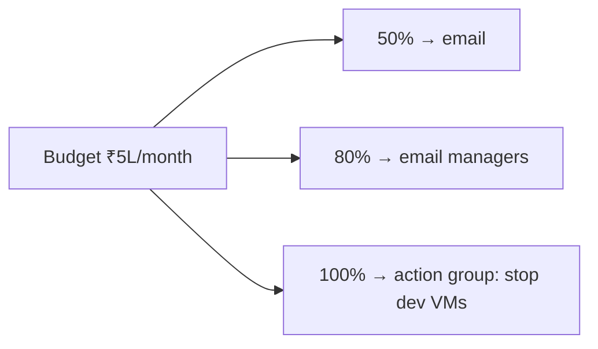

# 06 — Cost Management in Azure

> **Prerequisites:** consumption model, pricing models (reserved, spot, Hybrid Benefit), CapEx/OpEx (file 01) · regions, subscriptions, management groups (file 02) · VMs, storage tiers/redundancy (files 03–04).
> **Official objectives covered:** factors that affect costs · pricing calculator · cost management capabilities · purpose of tags.

---

## Part A — Concept cards

### A1. Factors that affect costs (objective)

| Factor | How it changes the bill | Business example | Lower it by… |
|---|---|---|---|
| **Resource type** | Different services, sizes, tiers and SKUs cost differently | An 8-vCPU VM costs far more than a 2-vCPU VM; Premium SSD > Standard HDD | Right-size; choose cheaper tiers |
| **Consumption (usage)** | More hours, GB, transactions = more cost | VM running 24×7 vs 9-to-5 | Shut down/deallocate when idle; autoscale |
| **Commitment discounts** | Reservations / savings plans cut rates for steady load | 3-yr reservation on a production DB | Reserve steady workloads |
| **Maintenance (cleanup)** | Forgotten resources keep billing | Disks, public IPs, snapshots left after a VM is deleted | Delete unused resources; group by lifecycle in RGs |
| **Geography (region)** | Prices vary by region (local costs, taxes, power) | Same VM is cheaper in one region than another | Choose cheaper region if latency/residency allow |
| **Network traffic (bandwidth)** | **Inbound data is free; outbound (egress) is charged**, priced by billing zone; traffic between regions/zones may be charged | Video streaming company pays for data leaving Azure | Use a CDN, keep traffic in-region |
| **Subscription type** | Free trial, pay-as-you-go, Enterprise Agreement, CSP etc. have different rates/allowances | Free account has $200 credit | Pick the right agreement |
| **Azure Marketplace** | Third-party solutions add vendor charges on top of Azure resource costs | A third-party firewall VM image | Compare marketplace vs native services |
| **Licensing** | Windows/SQL licences inside VMs add cost | Windows VM costs more than Linux | **Azure Hybrid Benefit** |

**Ways to reduce costs (memorise list):** reservations / savings plans · spot VMs · Azure Hybrid Benefit · right-size (Advisor) · deallocate idle VMs · autoscale · cheaper storage tiers + lifecycle policies · choose appropriate redundancy (LRS vs GRS) · delete unused resources · cheaper regions · Dev/Test pricing · budgets + alerts · PaaS/serverless instead of always-on VMs.

| Traps | Truth |
|---|---|
| "Data transfer into Azure is charged" | **Free** (ingress) |
| "Deleting a VM deletes its disks and public IP" | Not necessarily — they can remain and keep billing unless you choose to delete them |
| "Resources in all regions cost the same" | No |

---

### A2. The pricing calculator (objective: "Explore the pricing calculator")

**Simple definition:** a free website that **estimates** the cost of Azure services **before** you deploy. You pick services, region, tier, size, hours, billing option (PAYG vs reserved/savings plan), support plan, programs/offers and dev/test pricing.

**Business example:** Before a new app launch, a project manager estimates *2 × D4s v5 VMs in Central India 730 h/month + Azure SQL Database + 1 TB Blob Hot LRS + support plan* and shares the estimate link with finance.

| Covered | Not covered |
|---|---|
| Estimates for new deployments | **Actual** spending, bills or budgets (that's Cost Management) |
| Compare regions, tiers, PAYG vs reservations | It doesn't create or deploy anything |
| Export/share estimates | It doesn't cost anything to use; estimates aren't a quote/contract |

> **History note:** older material describes a **TCO (Total Cost of Ownership) calculator** that compared on-prem costs with Azure. It was **retired**, and the current outline mentions only the pricing calculator. If an older-style question asks *"compare the cost of running on-prem vs Azure"*, the expected historical answer was **TCO calculator**; today Microsoft points to Azure Migrate business-case features for that comparison.

---

### A3. Microsoft Cost Management (objective: cost management capabilities)

**Simple definition:** a built-in Azure tool to **monitor, analyse, allocate and control** your **actual** cloud spending.

| Capability | What it does | Business example |
|---|---|---|
| **Cost analysis** | Explore costs by service, resource group, region, **tag**, time; see trends and **forecasts** | CFO sees Marketing's spend doubled this month |
| **Budgets** | Set a spending threshold at a scope (management group, subscription, RG…) | ₹5,00,000/month budget for Dev subscription |
| **Alerts** | **Budget alerts** (e.g. at 50%, 80%, 100%, incl. forecasted), **credit alerts**, **department spending quota alerts** (EA) | Email to the team lead when Dev reaches 80% |
| **Action groups on budgets** | Trigger automation (e.g. run a runbook to shut down dev VMs) | Auto-stop dev VMs at 100% |
| **Recommendations** | Cost-saving suggestions (surfaced from Azure Advisor) | Resize under-used VM |
| **Exports** | Scheduled cost data export to storage for Power BI/reports | Monthly chargeback report |

| Traps | Truth |
|---|---|
| "Budgets stop resources automatically by default" | **No** — budgets **alert**. Stopping requires an **action group** with automation you configure |
| "Cost Management estimates costs before deployment" | No — that's the **pricing calculator** |
| "Cost Management gives you separate invoices per department" | No — it **reports** costs (e.g. by tag or RG); separate invoices come from separate subscriptions/billing structures |

---

### A4. Tags (objective: purpose of tags)

**Simple definition:** **name : value** labels you attach to resources, resource groups and subscriptions — e.g. `CostCenter: 4021`, `Env: Prod`, `Owner: anup@contoso.com`.

**Purposes (Microsoft's list):**
1. **Resource management** — find resources by owner, workload, environment
2. **Cost management & optimisation** — group costs in Cost Management by tag (**chargeback/showback**)
3. **Operations management** — mark business criticality to plan SLAs, maintenance
4. **Security** — tag data classification (e.g. `Confidential`)
5. **Governance & regulatory compliance** — e.g. `ISO27001: true`
6. **Workload optimisation & automation** — scripts act on tagged resources (e.g. stop all `AutoShutdown: true` VMs at 8 p.m.)

**Business example:** A company tags every resource with `Department` and `Project`. Each month, Cost Management groups costs by these tags so Finance charges each department correctly — all on one subscription bill.

| Rules / covered | Exceptions / traps |
|---|---|
| Up to **50 tags** per resource, RG or subscription | **Not all resource types support tags** |
| Add/edit with portal, CLI, PowerShell, ARM templates, **Azure Policy** | **Tags are NOT inherited** by default — a tag on a resource group doesn't automatically appear on its resources |
| Use **Azure Policy** to **require** a tag or **inherit** a tag from the RG | Tags are **not** a security boundary and don't grant access |
| Tag names are case-insensitive; values are case-sensitive | Don't put sensitive data in tags (they're visible) |

---

### A5. Support plans (older outline topic — still occasionally appears)

| Plan | Cost | Who | Key point |
|---|---|---|---|
| **Basic** | Free with every subscription | Everyone | Billing & subscription support, docs, Advisor, Service Health — **no technical support** |
| **Developer** | Paid | Trial/non-production | Business-hours technical support by email |
| **Standard** | Paid | Production workloads | 24×7 technical support, faster response |
| **Professional Direct** | Paid | Business-critical | Fastest response, proactive guidance |
| **Unified / Enterprise** | Paid (contract) | Large enterprises | Designated account team |

---

### A6. Cost tool recommendation table

| Question | Tool |
|---|---|
| "How much **will** it cost?" (before deploying) | **Pricing calculator** |
| "How much **did** it cost / are we spending?" | **Cost Management – cost analysis** |
| "Warn me before we overspend" | **Cost Management – budgets + alerts** |
| "How can I spend less?" | **Azure Advisor** (Cost) — also shown in Cost Management |
| "Which department spent what on one subscription?" | **Tags** + cost analysis grouped by tag |
| "Separate bills per department" | **Separate subscriptions** |
| "Force every resource to have a CostCenter tag" | **Azure Policy** |

---

### A7. Cost scenarios with CapEx vs OpEx numbers (illustrative)

**Scenario: dev/test environment, 10 VMs, used 10 h/day on weekdays.**

| Option | Monthly hours billed per VM | Relative cost |
|---|---|---|
| On-prem 10 servers (₹25 lakh CapEx over 4 yrs ≈ ₹52,000/month + power/admin) | Always "on" | Highest effective |
| Azure PAYG running 24×7 | 730 | 100% |
| Azure PAYG with **auto-shutdown** (10 h × 22 days) | 220 | **≈ 30%** |
| + **Dev/Test pricing** (no Windows licence charge) | 220 | ≈ 20–25% |

**Takeaway:** for intermittent workloads the biggest saving is **turning things off** (consumption model), not reservations.

**Scenario: production SQL VM, 24×7, 3 years.**

| Option | Relative cost (illustrative) |
|---|---|
| PAYG + SQL licence included | 100% |
| PAYG + **Azure Hybrid Benefit** (own licences) | ~55–60% |
| **3-yr reservation + Hybrid Benefit** | ~25–35% |

---

## Part B — Questions (low → high)

### Q6.01 · L1 · Pricing calculator
Which tool estimates the cost of Azure services **before** deployment?

- A. Azure Cost Management
- B. Azure pricing calculator
- C. Azure Advisor
- D. Azure Monitor

<b>Answer</b>

**Answer: B**

### Q6.02 · L1 · Cost Management
Which tool analyses actual Azure spending and lets you create budgets?

- A. Pricing calculator
- B. Microsoft Cost Management
- C. Azure Service Health
- D. Azure Arc

<b>Answer</b>

**Answer: B**

### Q6.03 · L1 · Tags
What are tags in Azure?

- A. Security roles
- B. Name/value pairs used to organise resources
- C. Network rules
- D. Storage tiers

<b>Answer</b>

**Answer: B**

### Q6.04 · L1 · Ingress
Is inbound data transfer into Azure datacentres charged?

- A. Yes, per GB
- B. No, inbound data transfer is free
- C. Only for VMs
- D. Only between regions

<b>Answer</b>

**Answer: B**. Outbound (egress) is charged.

### Q6.05 · L1 · Region pricing
Can the same VM size cost different amounts in different regions?

- A. Yes
- B. No
- C. Only in sovereign regions
- D. Only for Linux

<b>Answer</b>

**Answer: A**

### Q6.06 · L2 · Cost factors
Which **two** factors affect the cost of an Azure VM? (Each is a complete answer.)

- A. VM size
- B. The region where it's deployed
- C. The colour theme of the portal
- D. The name of the resource group

<b>Answer</b>

**Answer: A and B**

### Q6.07 · L2 · Budget behaviour
What happens by default when a Cost Management budget threshold is reached?

- A. All resources are deleted
- B. Resources are stopped automatically
- C. An alert notification is sent (if configured)
- D. The subscription is cancelled

<b>Answer</b>

**Answer: C**. Automation requires an action group.

### Q6.08 · L2 · Tag inheritance
You apply a tag `Env: Prod` to a resource group. What happens to existing resources in it?

- A. They automatically inherit the tag
- B. They don't inherit the tag by default
- C. They're deleted
- D. They're moved

<b>Answer</b>

**Answer: B**. Use Azure Policy (e.g. "Inherit a tag from the resource group") to apply it.

### Q6.09 · L2 · Tag limit
What is the maximum number of tags per resource?

- A. 10
- B. 15
- C. 50
- D. Unlimited

<b>Answer</b>

**Answer: C**

### Q6.10 · L2 · Marketplace
Deploying a third-party solution from Azure Marketplace can:

- A. Never add cost
- B. Add vendor charges on top of the Azure resource costs
- C. Remove Azure charges
- D. Only be done on Enterprise Agreements

<b>Answer</b>

**Answer: B**

### Q6.11 · L2 · Pricing calculator scope
Which can you configure in the pricing calculator? (Choose the best answer.)

- A. Region, tier, billing option (PAYG/reserved), support plan
- B. Actual invoices
- C. Budgets and alerts
- D. RBAC roles

<b>Answer</b>

**Answer: A**

### Q6.12 · L3 · Chargeback on one subscription
All departments share one subscription. Finance wants a monthly cost breakdown per department. What should you do?

- A. Create resource locks
- B. Tag resources with a Department tag and group cost analysis by tag
- C. Create a management group per department
- D. Use Azure Service Health

<b>Answer</b>

**Answer: B**

### Q6.13 · L3 · Warn at 80%
A team lead wants an email when the dev subscription's spend reaches 80% of ₹2 lakh. What should be configured?

- A. A budget with an alert in Cost Management
- B. An Azure Policy
- C. A resource lock
- D. An Azure Monitor log query only

<b>Answer</b>

**Answer: A**

### Q6.14 · L3 · Estimate migration
A company wants to estimate monthly costs for 5 VMs and a SQL database it plans to deploy next month. What should it use?

- A. Cost analysis
- B. Pricing calculator
- C. Azure Advisor
- D. Budgets

<b>Answer</b>

**Answer: B**

### Q6.15 · L3 · Enforce tagging
Every new resource must have a `CostCenter` tag; deployments without it must fail. What should you use?

- A. Tags alone
- B. Azure Policy with a "require a tag" (deny) definition
- C. RBAC
- D. Pricing calculator

<b>Answer</b>

**Answer: B**

### Q6.16 · L3 · Dev VMs idle at night
Dev VMs run 24×7 but are used only during office hours. What reduces cost most simply?

- A. Buy 3-year reservations
- B. Configure auto-shutdown (deallocate) outside office hours
- C. Change to GRS storage
- D. Add more VMs

<b>Answer</b>

**Answer: B**. Reservations suit 24×7 use; here you'd be paying for unused hours.

### Q6.17 · L3 · Egress heavy
A video platform's bill is dominated by data leaving Azure to users worldwide. Which cost factor is this?

- A. Resource type
- B. Network traffic (outbound bandwidth)
- C. Subscription type
- D. Maintenance

<b>Answer</b>

**Answer: B**

### Q6.18 · L3 · Orphaned resources
After deleting VMs, the bill still includes disk and public IP charges. Which cost factor is this, and what's the fix?

- A. Geography — move region
- B. Maintenance — delete the orphaned disks and IPs
- C. Marketplace — cancel subscription
- D. Licensing — use Hybrid Benefit

<b>Answer</b>

**Answer: B**

### Q6.19 · L4 · Yes/No — tags
1. Tags can be used to group costs in Cost Management.
2. All Azure resource types support tags.
3. Azure Policy can enforce tagging rules.

<b>Answer</b>

**1 Yes · 2 No · 3 Yes**

### Q6.20 · L4 · Yes/No — cost tools
1. The pricing calculator shows your current month's actual spending.
2. Cost Management can forecast future spending.
3. Budgets can trigger automated actions through action groups.

<b>Answer</b>

**1 No · 2 Yes · 3 Yes**

### Q6.21 · L4 · Yes/No — cost factors
1. Outbound data transfer from Azure is charged.
2. Using Azure Hybrid Benefit can reduce VM costs.
3. Spot VMs are suitable for workloads that must never be interrupted.

<b>Answer</b>

**1 Yes · 2 Yes · 3 No**

### Q6.22 · L4 · Drag-drop match
Match: (i) Estimate before deploying, (ii) Recommend resizing under-used VMs, (iii) Alert at 90% of spend.

- A. (i) Cost Management, (ii) Pricing calculator, (iii) Advisor
- B. (i) Pricing calculator, (ii) Azure Advisor, (iii) Cost Management budget
- C. (i) Advisor, (ii) Cost Management, (iii) Pricing calculator
- D. (i) Pricing calculator, (ii) Azure Monitor, (iii) Service Health

<b>Answer</b>

**Answer: B**

### Q6.23 · L4 · Free support plan
Which support plan is included free with every Azure subscription and does **not** include technical support?

- A. Developer
- B. Basic
- C. Standard
- D. Professional Direct

<b>Answer</b>

**Answer: B**

### Q6.24 · L4 · Most cost-effective combination
A company will run a Windows Server VM at a fixed size 24×7 for 3 years and already owns Windows Server licences with Software Assurance. Which combination minimises cost?

- A. PAYG only
- B. Spot VM + Hybrid Benefit
- C. 3-year reservation + Azure Hybrid Benefit
- D. 1-year reservation only

<b>Answer</b>

**Answer: C**. Spot is evictable — wrong for a 24×7 production server.

---
➡️ Next: [07 — Governance & compliance](07-governance-compliance.md)
