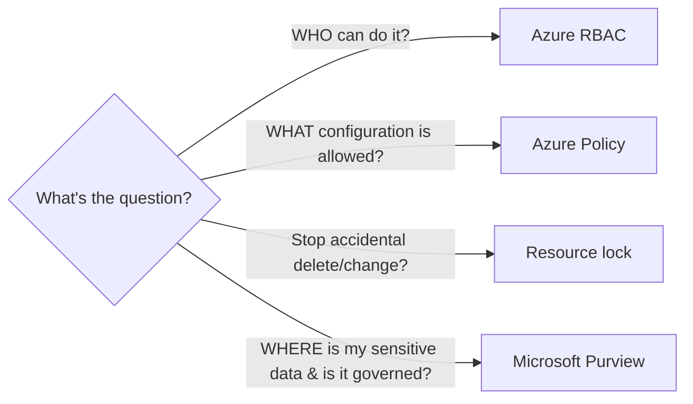

# 07 — Governance and Compliance

> **Prerequisites:** hierarchy and inheritance (file 02) · RBAC (file 05) · tags (file 06).
> **Official objectives covered:** purpose of Microsoft Purview · purpose of Azure Policy · purpose of resource locks.

**The governance trio — know which does what:**

---

## Part A — Concept cards

### A1. Microsoft Purview

**Simple definition:** a family of **data governance, risk and compliance** solutions that gives you a **single view of your data** — where it is, what's sensitive, who uses it — across **on-premises, multi-cloud and SaaS**.

Two main areas:

| Area | What it does | Examples |
|---|---|---|
| **Risk & compliance** (mainly Microsoft 365 data) | Protect sensitive data in Teams, OneDrive, Exchange, SharePoint; manage risks | Data loss prevention (DLP), information protection/sensitivity labels, insider risk management, audit, eDiscovery, Compliance Manager |
| **Unified data governance** | Discover, map, classify and catalogue data everywhere | **Data Map**, **Unified Catalog**, automated discovery & classification, **data lineage** across Azure SQL, Azure Storage, Amazon S3, on-prem SQL Server, Power BI… |

**Business example:** A pharma company doesn't know where patient identifiers live across 40 databases, Azure Storage, S3 buckets and SharePoint. Purview scans all of them, automatically labels files containing patient IDs as *Highly Confidential*, shows lineage of how data flows into reports, and DLP stops staff emailing those files outside the company.

| Covered | Not covered |
|---|---|
| Discovering & classifying data, lineage, catalog | Enforcing **resource configuration** (that's Azure Policy) |
| DLP, sensitivity labels, insider risk, eDiscovery | Who can manage Azure resources (RBAC) |
| Multi-cloud, on-prem and SaaS data sources | Threat detection on VMs (Defender for Cloud) |

> Formerly **Azure Purview** (data governance) + Microsoft 365 compliance — now unified as **Microsoft Purview**.

---

### A2. Azure Policy

**Simple definition:** create and enforce **rules about what resources may look like** — allowed regions, allowed VM sizes, required tags, required encryption — and **report compliance**.

**How it works:**
1. **Policy definition** — the rule (e.g. *"Allowed locations"*). Hundreds of **built-in** definitions, or write custom JSON.
2. **Initiative** — a **group of policy definitions** that serve one goal (e.g. *"ISO 27001"* or *"Enable monitoring in Defender for Cloud"*).
3. **Assignment** — apply a definition/initiative at a **scope** (management group, subscription, resource group, resource) — **inherited** downwards; you can add **exclusions**.
4. **Evaluation** — Azure checks new and existing resources and shows a **compliance dashboard**.

**Common effects:**

| Effect | What happens | Example |
|---|---|---|
| **Deny** | Blocks the create/update request | Block VMs outside India regions |
| **Audit** | Allows, but flags as non-compliant | Report storage accounts without HTTPS-only |
| **Append / Modify** | Adds or changes properties (e.g. add a tag) | Add `Env` tag from RG |
| **DeployIfNotExists** | Deploys a related resource if missing | Auto-install monitoring agent |
| **AuditIfNotExists** | Flags if related resource is missing | Flag VMs without backup |
| **Disabled** | Turns the policy off | — |

**Business example:** An Indian bank's regulator requires data residency. It assigns *"Allowed locations: Central India, South India"* and *"Require tag: CostCenter"* at the root management group. A developer's attempt to create a VM in East US is **denied**; existing non-compliant resources show up in the dashboard and can be **remediated**.

| Covered | Exceptions / traps |
|---|---|
| Applies to **everyone**, including Owners | Policy **doesn't** grant or remove user permissions — that's RBAC |
| Prevents non-compliant **new** resources (deny) | **Existing** non-compliant resources are **not deleted** — they're marked non-compliant; fix via **remediation tasks** (for modify/deployIfNotExists) |
| Inheritance from management groups | Policy evaluation of existing resources isn't instant (periodic scans; on-demand scan possible) |
| Built-in + custom definitions; integrates with Azure DevOps/CI | |
| Can apply to **Azure Arc** servers (non-Azure) | |

---

### A3. Resource locks

**Simple definition:** a setting that **prevents accidental deletion or modification** of a subscription, resource group or resource.

| Lock type | Portal name | Read | Modify | Delete |
|---|---|---|---|---|
| **CanNotDelete** | **Delete** | ✅ | ✅ | ❌ |
| **ReadOnly** | **Read-only** | ✅ | ❌ | ❌ |

**Business example:** An e-commerce company puts a **Delete** lock on its production resource group. An admin who runs a cleanup script against the wrong RG gets an error instead of wiping the production database.

**Rules:**
- Apply at **subscription, resource group or resource** level — **inherited** by child resources.
- Locks apply to **all users and roles, including Owner**.
- To delete/modify a locked resource, you must **first remove the lock** — which requires `Microsoft.Authorization/locks/*` permission (**Owner** or **User Access Administrator** built-in roles).
- Most restrictive lock wins when several are inherited.

| Exceptions / traps | |
|---|---|
| Locks protect against **management-plane** actions (Azure Resource Manager), not **data** inside the resource — a Delete lock on a storage account doesn't stop someone deleting **blobs** in it, and a lock on a SQL server doesn't stop deleting **rows** |
| **ReadOnly** can break things: e.g. it blocks **listing storage account keys** (a POST action), and blocks scaling an App Service plan |
| A lock **doesn't stop** someone with lock permissions from removing it — combine with RBAC least privilege |
| A Delete lock on a resource group blocks deleting the RG **and** its resources, but you can still add new resources to it |

---

### A4. Compare & recommend — RBAC vs Policy vs Locks vs Purview vs Tags

| Requirement | Best tool | Why not the others |
|---|---|---|
| Developers can only manage their own RG | **RBAC** | Policy doesn't control *who* |
| Nobody (incl. Owners) may deploy outside India | **Azure Policy (Deny)** | RBAC can't restrict regions; locks don't control location |
| Prevent accidental deletion of production DB | **Resource lock (Delete)** | RBAC Reader would block legitimate changes too; Policy isn't designed for this |
| Freeze a resource's configuration completely | **Resource lock (ReadOnly)** | — |
| Find which databases contain credit-card numbers across Azure, AWS and on-prem | **Microsoft Purview** | Policy checks resource settings, not data content |
| Show cost by department | **Tags** (+ Cost Management) | — |
| Enforce that tags exist | **Azure Policy** | Tags can't enforce themselves |
| Apply a standard set of policies for ISO 27001 | **Policy initiative** | — |

**Older outline items you may still see:** *Azure Blueprints* (packaged policies + RBAC + templates) — **retiring 31 Jan 2027**, replaced by **Deployment Stacks** and template specs; *Service Trust Portal* (Microsoft's compliance reports/audits, e.g. SOC, ISO) — if asked *"where do you download Microsoft's audit reports?"*, the answer is the **Service Trust Portal**.

### A5. Governance CapEx vs OpEx

| | On-prem | Azure |
|---|---|---|
| Configuration compliance | Third-party config management tools + audit consultants (CapEx licences + services) | **Azure Policy — free** for Azure resources (Arc-enabled servers may incur charges for some features) |
| Accidental-deletion protection | Change-control process, backups | **Resource locks — free** |
| Data discovery & classification | Data catalogue products (licences, servers) | **Purview** — consumption-based (OpEx) |

---

## Part B — Questions (low → high)

### Q7.01 · L1 · Azure Policy purpose
What is Azure Policy used for?

- A. Assigning permissions to users
- B. Creating, assigning and enforcing rules for resource configurations
- C. Estimating costs
- D. Monitoring CPU usage

<b>Answer</b>

**Answer: B**

### Q7.02 · L1 · Resource lock purpose
What is the purpose of a resource lock?

- A. Encrypt data
- B. Prevent accidental deletion or modification of resources
- C. Control network traffic
- D. Grant access

<b>Answer</b>

**Answer: B**

### Q7.03 · L1 · Purview purpose
Microsoft Purview helps organisations to:

- A. Host web apps
- B. Govern, protect and manage data across on-premises, multi-cloud and SaaS
- C. Create VMs
- D. Peer VNets

<b>Answer</b>

**Answer: B**

### Q7.04 · L1 · Lock types
Which are the two types of resource locks?

- A. Delete (CanNotDelete) and ReadOnly
- B. Allow and Deny
- C. Audit and Deny
- D. Owner and Reader

<b>Answer</b>

**Answer: A**

### Q7.05 · L1 · Initiative
What is an Azure Policy initiative?

- A. A single rule
- B. A collection of policy definitions grouped toward a goal
- C. An RBAC role
- D. A resource lock

<b>Answer</b>

**Answer: B**

### Q7.06 · L2 · Delete lock behaviour
A resource has a **Delete (CanNotDelete)** lock. What can authorised users do?

- A. Nothing
- B. Read and modify, but not delete
- C. Delete, but not modify
- D. Only delete

<b>Answer</b>

**Answer: B**

### Q7.07 · L2 · ReadOnly lock behaviour
A resource has a **ReadOnly** lock. What can authorised users do?

- A. Read only — no modify or delete
- B. Modify only
- C. Delete only
- D. Everything

<b>Answer</b>

**Answer: A**

### Q7.08 · L2 · Locks and Owners
Do resource locks apply to users with the Owner role?

- A. No, Owners bypass locks
- B. Yes, locks apply to all users including Owners
- C. Only ReadOnly applies to Owners
- D. Only in production subscriptions

<b>Answer</b>

**Answer: B**. An Owner can remove the lock first, then act.

### Q7.09 · L2 · Lock inheritance
A Delete lock is placed on a resource group. What about resources inside it?

- A. They are not protected
- B. They inherit the lock and can't be deleted
- C. They become read-only
- D. They're moved to another group

<b>Answer</b>

**Answer: B**

### Q7.10 · L2 · Policy on existing resources
You assign a policy that denies a particular VM size. What happens to existing VMs of that size?

- A. They're deleted
- B. They're resized automatically
- C. They're flagged as non-compliant but keep running
- D. Nothing is reported

<b>Answer</b>

**Answer: C**

### Q7.11 · L2 · Policy vs RBAC
Which statement is correct?

- A. RBAC controls what resource configurations are allowed
- B. Azure Policy controls what resource properties are allowed; RBAC controls who can perform actions
- C. They do the same thing
- D. Policy grants permissions

<b>Answer</b>

**Answer: B**

### Q7.12 · L2 · Purview data lineage
Which service shows how data moves from source systems into reports (data lineage) across Azure and AWS?

- A. Azure Policy
- B. Microsoft Purview
- C. Azure Monitor
- D. Resource locks

<b>Answer</b>

**Answer: B**

### Q7.13 · L3 · Data residency
A company must ensure no one can create resources outside EU regions. What should it use?

- A. RBAC Reader role
- B. Azure Policy "Allowed locations" with deny effect
- C. Resource locks
- D. Tags

<b>Answer</b>

**Answer: B**

### Q7.14 · L3 · Protect production
An admin accidentally deleted a production storage account last month. Management wants to stop this from happening while still allowing configuration changes. What should you use?

- A. ReadOnly lock
- B. Delete (CanNotDelete) lock
- C. Azure Policy audit
- D. Remove all admins

<b>Answer</b>

**Answer: B** — ReadOnly would also block configuration changes.

### Q7.15 · L3 · Find sensitive data
A healthcare company needs to find and classify personal health data stored in Azure SQL, Amazon S3 and on-prem SQL Server. What should it use?

- A. Microsoft Purview
- B. Azure Policy
- C. Defender for Cloud
- D. Azure Advisor

<b>Answer</b>

**Answer: A**

### Q7.16 · L3 · Prevent leaking sensitive files
Staff must be stopped from emailing documents labelled *Highly Confidential* outside the company. Which solution family provides data loss prevention?

- A. Microsoft Purview (DLP)
- B. Azure Policy
- C. Network security groups
- D. Resource locks

<b>Answer</b>

**Answer: A**

### Q7.17 · L3 · Auto-add monitoring agent
Every new VM must automatically get a monitoring extension if it's missing. Which Policy effect fits?

- A. Deny
- B. Audit
- C. DeployIfNotExists
- D. Disabled

<b>Answer</b>

**Answer: C**

### Q7.18 · L3 · Compliance standard set
A company wants to apply a ready-made group of controls mapped to ISO 27001 and track compliance. What should it assign?

- A. A single resource lock
- B. A built-in Azure Policy initiative (regulatory compliance)
- C. An RBAC custom role
- D. A tag

<b>Answer</b>

**Answer: B**

### Q7.19 · L3 · Remove a locked resource
You must delete a resource group protected by a Delete lock. What must happen first?

- A. Nothing — Owners can delete anyway
- B. Someone with permission to manage locks (e.g. Owner or User Access Administrator) removes the lock
- C. Contact Microsoft support
- D. Move the resources to another region

<b>Answer</b>

**Answer: B**

### Q7.20 · L4 · Yes/No — locks
1. A Delete lock prevents users from modifying a resource.
2. Resource locks can be applied at the subscription level.
3. A Delete lock on a storage account prevents deleting individual blobs in it.

<b>Answer</b>

**1 No · 2 Yes · 3 No** (locks protect the management plane, not data).

### Q7.21 · L4 · Yes/No — Policy
1. Azure Policy can be assigned to a management group.
2. Azure Policy can automatically remediate some non-compliant resources.
3. Azure Policy can restrict which users can sign in.

<b>Answer</b>

**1 Yes · 2 Yes · 3 No** (sign-in = Entra ID / Conditional Access).

### Q7.22 · L4 · Yes/No — Purview
1. Microsoft Purview can scan data in Amazon S3.
2. Microsoft Purview enforces allowed VM sizes.
3. Microsoft Purview can classify sensitive data automatically.

<b>Answer</b>

**1 Yes · 2 No · 3 Yes**

### Q7.23 · L4 · ReadOnly side effect
After applying a ReadOnly lock to a storage account, an app can no longer retrieve the account's access keys. Why?

- A. The account was deleted
- B. Listing keys is a POST (write-type) operation, which ReadOnly blocks
- C. Keys expire after a lock
- D. RBAC was removed

<b>Answer</b>

**Answer: B**

### Q7.24 · L4 · Pick the right tool (drag-drop)
Match: (i) Ensure all storage accounts use HTTPS only, (ii) Prevent deletion of a VNet, (iii) Allow only the network team to manage VNets.

- A. (i) Lock, (ii) Policy, (iii) RBAC
- B. (i) Policy, (ii) Lock, (iii) RBAC
- C. (i) RBAC, (ii) Policy, (iii) Lock
- D. (i) Purview, (ii) Lock, (iii) Policy

<b>Answer</b>

**Answer: B**

### Q7.25 · L4 · Audit reports
An auditor wants Microsoft's independent SOC and ISO audit reports for Azure. Where are they published?

- A. Azure Advisor
- B. Service Trust Portal
- C. Azure Policy
- D. Cost Management

<b>Answer</b>

**Answer: B** (older-outline topic, kept because it still appears in some question pools).

---
➡️ Next: [08 — Management & deployment tools](08-management-deployment.md)
