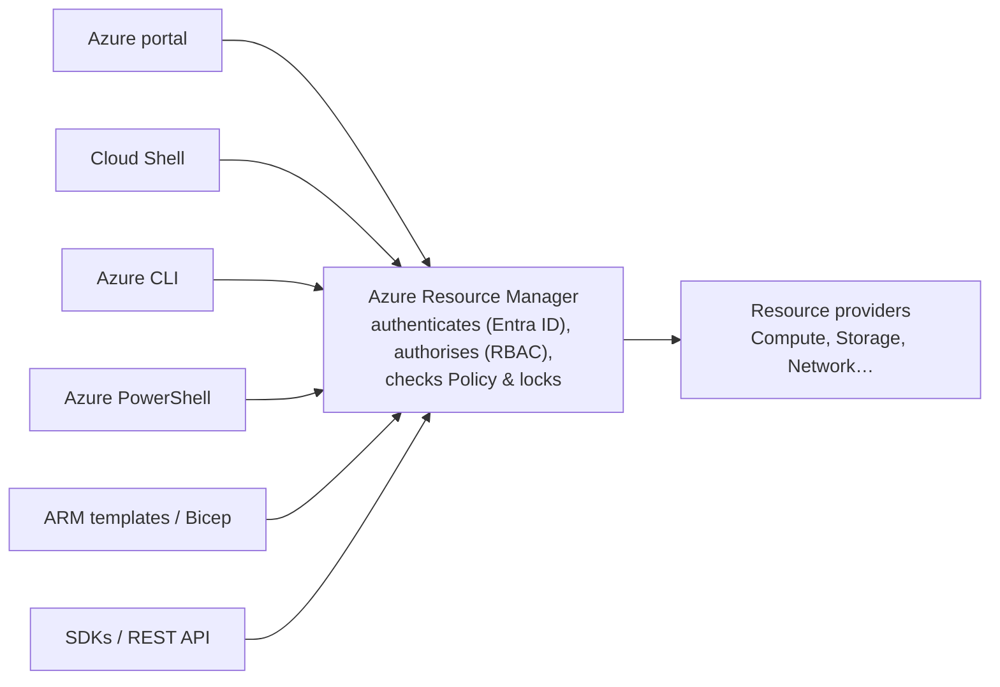
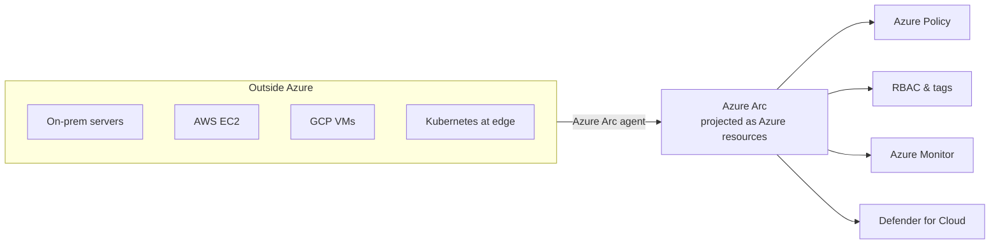

# 08 — Tools for Managing and Deploying Azure Resources

> **Prerequisites:** resources, RGs, subscriptions, hierarchy (file 02) · RBAC (file 05) · Azure Policy, tags, locks (files 06–07) · hybrid/multi-cloud (file 01).
> **Official objectives covered:** Azure portal · Azure Cloud Shell, Azure CLI, Azure PowerShell · Azure Arc · infrastructure as code (IaC) · Azure Resource Manager (ARM) and ARM templates.

**The big idea — every tool talks to ARM:**



Because everything goes through **ARM**, RBAC, Policy, locks and tags behave **identically** whichever tool you use.

---

## Part A — Concept cards

### A1. Azure portal

**Simple definition:** the **web-based, graphical** console (portal.azure.com) to build, manage and monitor everything — from simple web apps to complex deployments.

**Features:** customisable **dashboards**, accessibility options, wizards, Marketplace, built-in Cloud Shell button. The portal is designed for resiliency: it's present in every Azure datacentre, updated continuously and needs **no maintenance downtime** from you.

**Business example:** A new admin uses the portal wizard to create a VM and pins a CPU chart to a dashboard for the support team.

| Best for | Not best for |
|---|---|
| Learning, one-off tasks, visual monitoring, dashboards | **Repeatable** deployments of many resources (error-prone clicking) → use scripts/IaC |

### A2. Azure Cloud Shell

**Simple definition:** a **browser-based shell** (**Bash** or **PowerShell**) with Azure CLI, Azure PowerShell and common tools (git, kubectl, terraform, editors) **pre-installed** and **already authenticated** with your Azure account.

**Business example:** A consultant at a client site, on a locked-down laptop where she can't install software, opens Cloud Shell in the browser and runs Azure CLI commands immediately.

| Covered | Exceptions |
|---|---|
| No local installation; works from any browser (and Windows Terminal, VS Code, shell.azure.com, mobile app) | Session **times out after ~20 minutes** of inactivity |
| Choose Bash or PowerShell experience | File persistence uses an **Azure Files share** (small storage cost) — or choose an ephemeral session with no storage |
| Automatically signed in with your Entra identity | Not for long-running background jobs |

### A3. Azure CLI vs Azure PowerShell

| | **Azure CLI** | **Azure PowerShell** |
|---|---|---|
| Command style | `az <group> <command>` e.g. `az vm create` | Verb-Noun **cmdlets**, e.g. `New-AzVM` (Az module) |
| Feels like | Bash / Linux scripting | PowerShell / Windows admin scripting |
| Platforms | Windows, macOS, Linux | Windows, macOS, Linux (PowerShell 7) |
| Functionality | Broadly the same — both manage Azure via ARM | Same |
| Choose when | Team knows Bash/Linux | Team knows PowerShell/Windows |

**Business example (same task, both tools):**

```bash
# Azure CLI — create a resource group (az = Azure CLI; group create = make a resource group)
az group create --name rg-payroll --location centralindia
```

```powershell
# Azure PowerShell — same thing (New-AzResourceGroup is the Az module cmdlet)
New-AzResourceGroup -Name rg-payroll -Location centralindia
```

| Trap | Truth |
|---|---|
| "Azure PowerShell only runs on Windows" | No — cross-platform with PowerShell 7 |
| "Azure CLI only runs on Linux" | No — cross-platform |
| "Cloud Shell and Azure CLI are alternatives" | Cloud Shell is a **place to run** CLI and PowerShell |

**Recommendation:** one-off visual task → **portal**; quick scripted task without installing anything → **Cloud Shell**; automation in your own pipelines → **CLI or PowerShell** (whichever your team knows); repeatable full-environment deployments → **IaC (Bicep/ARM)**.

---

### A4. Azure Arc

**Simple definition:** extends **Azure management** (Policy, RBAC, tags, Monitor, Defender for Cloud, Update Manager, inventory) to resources **outside Azure** — **on-premises, other clouds (AWS, Google Cloud) and edge** — so you manage everything from one place.

What Arc can manage:
- **Servers** (Windows and Linux, physical or virtual)
- **Kubernetes clusters** (anywhere)
- **Azure data services** (e.g. SQL Managed Instance, PostgreSQL) running on your own infrastructure
- **SQL Server** instances
- **VMs** in VMware vSphere, System Center VMM, Azure Local (Azure Stack HCI)



**Business example:** A retailer runs 300 store servers on-prem and some workloads on AWS after an acquisition. With Azure Arc, all servers appear in the Azure portal; one Azure Policy enforces security baselines on every server, and Defender for Cloud protects all of them.

| Covered | Not covered / traps |
|---|---|
| **Manage/govern** non-Azure resources with Azure tools | Arc does **not migrate** resources to Azure (use **Azure Migrate**) |
| Hybrid and multi-cloud management | Arc is not a VPN/connection service (it needs outbound connectivity; use VPN/ExpressRoute for networking) |
| Arc-enabled resources get an Azure resource ID, can be in RGs, tagged, given RBAC | Some Arc-enabled features (e.g. Defender plans, Monitor data, extended security updates) cost money |

**Compare hybrid tools:** manage non-Azure resources → **Arc**; move them into Azure → **Azure Migrate**; connect networks → **VPN Gateway / ExpressRoute**; protect them → **Defender for Cloud (+ Arc)**.

---

### A5. Infrastructure as code (IaC)

**Simple definition:** describe infrastructure (networks, VMs, databases) in **code files** that are version-controlled and deployed automatically — instead of clicking in the portal.

| | **Declarative** | **Imperative** |
|---|---|---|
| You write | **What** the end state should be | **How** — step-by-step commands |
| Examples | **ARM templates, Bicep**, Terraform | Azure CLI / PowerShell scripts |
| Re-running | **Idempotent** — same result every time, only changes differences | May fail or duplicate if not written carefully |

**Benefits:** consistency (no snowflake environments), repeatability (dev = test = prod), speed, version control & review (Git), disaster recovery (rebuild from code), automation in CI/CD.

**Business example:** A SaaS company keeps its entire environment in Bicep files in Git. A new customer region is created in 20 minutes by running the same pipeline with a different parameter file, identical to existing regions.

---

### A6. Azure Resource Manager (ARM) and ARM templates

**ARM — simple definition:** the **deployment and management service** for Azure. Every request from every tool goes through ARM, which authenticates, authorises (RBAC), checks Policy and locks, and sends it to the right resource provider.

**ARM benefits (Microsoft's list):**
- Manage infrastructure through **declarative templates** rather than scripts
- **Deploy, manage and monitor** resources **as a group**
- **Redeploy** consistently throughout the lifecycle
- Define **dependencies** so resources deploy in the right order
- Apply **access control** (RBAC) to all services
- Apply **tags** to organise resources
- Clarify billing by viewing costs for groups of resources sharing a tag

**ARM templates — simple definition:** **JSON** files that declare the resources to deploy.

ARM template benefits:
| Benefit | Meaning |
|---|---|
| **Declarative syntax** | Describe the end state |
| **Repeatable results / idempotent** | Deploy many times, same result |
| **Orchestration** | ARM orders deployments by dependency and deploys **in parallel** where possible |
| **Modular files** | Break into smaller templates, link/nest them |
| **Extensibility** | Deployment scripts (Bash/PowerShell) inside templates |
| **Validation** | Template is validated before deployment; **what-if** preview of changes |
| **Tracked deployments** | Deployment history in Azure |
| **Exportable** | Export a template from existing resources |

**Bicep:** a simpler **domain-specific language** that compiles (**transpiles**) to ARM JSON. Cleaner syntax, same capabilities, immediate support for new resource types, **no state file** to manage. Recommended by Microsoft for new IaC on Azure.

```bicep
// Bicep — deploy a storage account (simpler than the equivalent ARM JSON)
resource sa 'Microsoft.Storage/storageAccounts@2023-05-01' = {
  name: 'payrolldata01'          // globally unique, lowercase
  location: 'centralindia'
  sku: { name: 'Standard_ZRS' }  // zone-redundant
  kind: 'StorageV2'              // general-purpose v2
}
```

| Traps | Truth |
|---|---|
| "ARM templates are written in YAML" | **JSON** (Bicep has its own syntax) |
| "ARM templates are imperative" | **Declarative** |
| "ARM is only used by templates" | **All** tools (portal, CLI, PowerShell, SDK) go through ARM |
| "Terraform is an Azure-native tool" | It's a third-party (HashiCorp) declarative IaC tool that also works with Azure |

**Recommendation:** repeatable Azure-only environments → **Bicep** (or ARM JSON if mandated); multi-cloud IaC with one language → **Terraform**; ad-hoc admin → **CLI/PowerShell**.

### A7. Management CapEx vs OpEx

| | On-prem | Azure |
|---|---|---|
| Management consoles/tools | Licences for server management suites (CapEx) | **Portal, Cloud Shell, CLI, PowerShell, ARM, Bicep — free** |
| Hybrid management | Separate tools per environment | **Azure Arc** core inventory/management free; paid add-ons per server (OpEx) |
| Environment rebuild | Manual, weeks | IaC pipeline, minutes |

---

## Part B — Questions (low → high)

### Q8.01 · L1 · Portal
The Azure portal is:

- A. A command-line tool
- B. A web-based graphical interface to manage Azure
- C. A physical device
- D. A JSON template

<details><summary><b>Answer</b></summary>

**Answer: B**
</details>

### Q8.02 · L1 · Cloud Shell shells
Which two shell experiences does Azure Cloud Shell offer?

- A. Bash and PowerShell
- B. CMD and Zsh
- C. Python and Java
- D. Bash and CMD

<details><summary><b>Answer</b></summary>

**Answer: A**
</details>

### Q8.03 · L1 · ARM template format
ARM templates are written in:

- A. YAML
- B. JSON
- C. XML
- D. Python

<details><summary><b>Answer</b></summary>

**Answer: B**
</details>

### Q8.04 · L1 · Azure Arc
What is Azure Arc used for?

- A. Migrating VMs to Azure
- B. Extending Azure management and governance to on-premises, multi-cloud and edge resources
- C. Hosting websites
- D. Storing archives

<details><summary><b>Answer</b></summary>

**Answer: B**
</details>

### Q8.05 · L1 · IaC definition
Infrastructure as code means:

- A. Writing application code on VMs
- B. Managing and provisioning infrastructure through code files
- C. Encrypting infrastructure
- D. Buying infrastructure upfront

<details><summary><b>Answer</b></summary>

**Answer: B**
</details>

### Q8.06 · L2 · ARM role
Which service handles all Azure management requests from the portal, CLI, PowerShell and templates?

- A. Azure Monitor
- B. Azure Resource Manager
- C. Azure Arc
- D. Azure Advisor

<details><summary><b>Answer</b></summary>

**Answer: B**
</details>

### Q8.07 · L2 · Cloud Shell install
What must you install locally to use Azure Cloud Shell?

- A. Azure CLI
- B. Azure PowerShell
- C. Nothing — only a browser
- D. Docker

<details><summary><b>Answer</b></summary>

**Answer: C**
</details>

### Q8.08 · L2 · Cloud Shell storage
Cloud Shell persists your files using:

- A. A local disk on your laptop
- B. An Azure Files share
- C. Table storage
- D. A VM disk

<details><summary><b>Answer</b></summary>

**Answer: B** (or you can choose an ephemeral session without storage).
</details>

### Q8.09 · L2 · PowerShell platform
Azure PowerShell can run on:

- A. Windows only
- B. Windows, macOS and Linux
- C. Linux only
- D. Only inside Cloud Shell

<details><summary><b>Answer</b></summary>

**Answer: B**
</details>

### Q8.10 · L2 · Declarative
ARM templates and Bicep use which approach?

- A. Imperative — step-by-step commands
- B. Declarative — describe the desired end state
- C. Graphical
- D. Manual

<details><summary><b>Answer</b></summary>

**Answer: B**
</details>

### Q8.11 · L2 · Bicep
What is Bicep?

- A. A monitoring tool
- B. A domain-specific language that compiles to ARM JSON templates
- C. A VM size
- D. A storage tier

<details><summary><b>Answer</b></summary>

**Answer: B**
</details>

### Q8.12 · L2 · Idempotent
Deploying the same ARM template several times produces the same result. This property is called:

- A. Elasticity
- B. Idempotency
- C. Redundancy
- D. Orchestration

<details><summary><b>Answer</b></summary>

**Answer: B**
</details>

### Q8.13 · L3 · No install allowed
An admin on a locked-down PC (cannot install software) needs to run Azure CLI commands. What should they use?

- A. Azure Cloud Shell
- B. Install Azure CLI anyway
- C. Azure Data Box
- D. Azure Arc

<details><summary><b>Answer</b></summary>

**Answer: A**
</details>

### Q8.14 · L3 · Repeatable environments
A company must create identical dev, test and production environments repeatedly with minimal errors. What should it use?

- A. Portal clicks documented in a Word file
- B. ARM templates / Bicep (IaC)
- C. Azure Advisor
- D. Resource locks

<details><summary><b>Answer</b></summary>

**Answer: B**
</details>

### Q8.15 · L3 · Govern AWS servers
A company wants to apply the same Azure Policy security baseline to its servers running in AWS and on-prem. What should it use?

- A. Azure Migrate
- B. Azure Arc
- C. Azure VPN Gateway
- D. Azure Cloud Shell

<details><summary><b>Answer</b></summary>

**Answer: B**
</details>

### Q8.16 · L3 · Visual dashboard
The operations manager wants a customised visual dashboard showing key metrics of several resources. What's simplest?

- A. Azure portal dashboard
- B. ARM template
- C. AzCopy
- D. Azure CLI

<details><summary><b>Answer</b></summary>

**Answer: A**
</details>

### Q8.17 · L3 · Windows admins scripting
A team of Windows administrators experienced with PowerShell wants to automate Azure tasks. Which tool fits their skills?

- A. Azure PowerShell
- B. Azure CLI
- C. Azure portal
- D. Azure Data Box

<details><summary><b>Answer</b></summary>

**Answer: A** (CLI would also work, but PowerShell matches their skills).
</details>

### Q8.18 · L3 · Deployment order
An ARM template creates a VNet and a VM that depends on it. How does ARM ensure correct ordering?

- A. It can't — you must deploy separately
- B. Dependencies defined in the template; ARM orchestrates the order and parallelises the rest
- C. Alphabetical order
- D. Random order

<details><summary><b>Answer</b></summary>

**Answer: B**
</details>

### Q8.19 · L4 · Yes/No — tools
1. Azure Cloud Shell requires you to install Azure CLI locally.
2. Azure CLI can be used on macOS.
3. Actions performed in the portal are processed by Azure Resource Manager.

<details><summary><b>Answer</b></summary>

**1 No · 2 Yes · 3 Yes**
</details>

### Q8.20 · L4 · Yes/No — Arc
1. Azure Arc can manage Kubernetes clusters running outside Azure.
2. Azure Arc migrates on-premises servers into Azure.
3. Azure Arc-enabled servers can be governed with Azure Policy.

<details><summary><b>Answer</b></summary>

**1 Yes · 2 No · 3 Yes**
</details>

### Q8.21 · L4 · Yes/No — ARM templates
1. ARM templates use a declarative syntax.
2. ARM templates can deploy resources in parallel when there are no dependencies.
3. ARM templates must be written in YAML.

<details><summary><b>Answer</b></summary>

**1 Yes · 2 Yes · 3 No**
</details>

### Q8.22 · L4 · Consistency of controls
Why do RBAC, Azure Policy and resource locks apply equally whether you use the portal, CLI or PowerShell?

- A. Each tool implements its own checks
- B. All tools send requests through Azure Resource Manager, which enforces them
- C. They don't apply to CLI
- D. Only the portal enforces them

<details><summary><b>Answer</b></summary>

**Answer: B**
</details>

### Q8.23 · L4 · Arc vs Migrate
Match: (i) Move on-prem VMs into Azure, (ii) Manage on-prem VMs from Azure while they stay on-prem.

- A. (i) Arc, (ii) Migrate
- B. (i) Azure Migrate, (ii) Azure Arc
- C. Both Arc
- D. Both Migrate

<details><summary><b>Answer</b></summary>

**Answer: B**
</details>

### Q8.24 · L4 · Sentence completion
"\_\_\_\_\_ provides a browser-accessible, pre-authenticated shell with Azure CLI and Azure PowerShell already installed."

- A. Azure portal dashboard
- B. Azure Cloud Shell
- C. Azure Arc
- D. ARM template

<details><summary><b>Answer</b></summary>

**Answer: B**
</details>

---
➡️ Next: [09 — Monitoring](09-monitoring.md)
