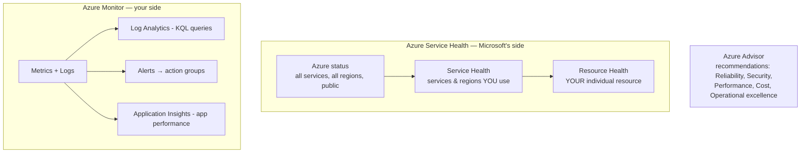

# 09 — Monitoring Tools in Azure

> **Prerequisites:** VMs/App Service (file 03) · cost, security concepts (files 05–06) · Azure Arc (file 08).
> **Official objectives covered:** purpose of Azure Advisor · Azure Service Health · Azure Monitor incl. Log Analytics, Azure Monitor alerts, Application Insights.

**One-line memory hooks:**

| Tool | Hook |
|---|---|
| **Azure Advisor** | "**What should I improve?**" — recommendations |
| **Azure Service Health** | "**Is Azure broken (for me)?**" — Microsoft-side incidents & maintenance |
| **Azure Monitor** | "**How are MY resources/apps behaving?**" — metrics, logs, alerts |



---

## Part A — Concept cards

### A1. Azure Advisor

**Simple definition:** a **free** service that analyses your resources and gives **personalised best-practice recommendations** in five categories.

| Category | Example recommendation | Business example |
|---|---|---|
| **Reliability** (formerly High Availability) | Use availability zones; enable VM backup | Clinic's single VM flagged: "add redundancy" |
| **Security** | Enable MFA, fix open ports (from **Defender for Cloud**) | Open RDP port flagged |
| **Performance** | Upgrade storage, scale DB | Slow SQL DB flagged |
| **Cost** | **Resize or shut down under-used VMs**, buy reservations, delete idle resources | 12 VMs at 3% CPU → save ₹40,000/month |
| **Operational excellence** | Process & workflow efficiency, deployment best practices | Use Service Health alerts |

**Features:** **Advisor Score** (overall optimisation score), filter by subscription/RG, **download PDF/CSV**, configure alerts for new recommendations, postpone/dismiss.

| Covered | Not covered |
|---|---|
| Recommendations across 5 pillars | It doesn't **enforce** anything (Policy does) |
| Free | It doesn't **monitor live metrics/alert on CPU** (Monitor does) |
| Quick-fix for some recommendations | It doesn't report **Azure outages** (Service Health does) |

---

### A2. Azure Service Health

**Simple definition:** tells you about **Azure platform** issues that affect you — outages, planned maintenance, advisories — at three levels of focus.

| Component | Scope | Example |
|---|---|---|
| **Azure status** | **Global** — every service in every region; public page, no sign-in | "Storage degraded in West Europe" |
| **Service Health** | **Personalised** — only services and regions **you use**: service issues, **planned maintenance**, health advisories, security advisories; set **alerts**; incident history and root-cause analysis | Email: "planned maintenance for VMs in Central India this Saturday" |
| **Resource Health** | **Your individual resources** — current and past health of e.g. your VM | "Your VM *vm-web01* was unavailable 02:10–02:25 due to a host failure" |

**Business example:** An airline's ops team gets a Service Health alert about a networking incident in Central India affecting its subscriptions; they invoke failover and later attach Microsoft's root-cause report to their incident review.

| Covered | Traps |
|---|---|
| Microsoft-caused problems & maintenance | It doesn't tell you your app has a bug (Monitor/App Insights) |
| Alerts by service/region | Azure status ≠ personalised — Service Health is personalised |
| History of incidents (kept for a period, ~90 days) | Resource Health shows **one resource's** health, not cost or config recommendations |

---

### A3. Azure Monitor

**Simple definition:** the platform to **collect, analyse and act on telemetry** (metrics and logs) from Azure, **on-premises** and **other clouds** (via agents/Arc).

**Data types:**
- **Metrics** — numbers over time (CPU %, requests/sec), near real-time, lightweight.
- **Logs** — records with rich data (events, traces, activity log), queried with **KQL**.
- **Activity log** — subscription-level record of **who did what and when** on resources (management-plane events: create, delete, update).

#### Log Analytics
A tool in the portal to **write and run queries** (Kusto Query Language — **KQL**) on log data stored in a **Log Analytics workspace**, then chart or alert on results.

```kusto
// KQL — VMs with average CPU over 80% in the last hour
Perf
| where TimeGenerated > ago(1h) and CounterName == "% Processor Time"
| summarize AvgCPU = avg(CounterValue) by Computer
| where AvgCPU > 80
```

**Business example:** A security analyst queries sign-in and firewall logs from 300 servers in one place to investigate a suspected breach.

#### Azure Monitor alerts
**Notify or act** when a condition is met — based on **metrics** (CPU > 80% for 5 min), **log queries**, or **activity log** events (someone deleted a VM).
**Action groups** define what happens: email, SMS, push, voice call, webhook, Azure Function, Logic App, Automation runbook, ITSM ticket.

**Business example:** When the checkout API's error rate exceeds 5%, an alert pages the on-call engineer by SMS and opens a ServiceNow ticket.

#### Application Insights
**Application performance monitoring (APM)** for web apps — request rates, response times, failure rates, dependency calls (database, APIs), exceptions, page views and load performance, user/session counts, availability (synthetic ping) tests.
Works for apps in **Azure, on-premises or other clouds** (SDK or auto-instrumentation).

**Business example:** An online learning platform sees in Application Insights that a slow third-party payment API is causing 6-second checkouts and 2% failed requests.

| Covered | Exceptions / traps |
|---|---|
| Metrics, logs, alerts, dashboards, workbooks, autoscale triggers | Some data collection (log ingestion/retention, App Insights data) is **charged** by volume |
| Works across Azure, on-prem, other clouds | Monitor shows **your** resources' behaviour, not Microsoft-wide outages (Service Health) |
| Activity log keeps events (~90 days) for free | Recommendations come from **Advisor**, not Monitor |

---

### A4. Compare & recommend

| Scenario | Tool |
|---|---|
| "How can we save money / improve reliability?" | **Azure Advisor** |
| "Notify me of planned maintenance in the regions we use" | **Service Health** |
| "Was my specific VM down last night because of Azure?" | **Resource Health** |
| "Is any Azure service down anywhere right now?" (public) | **Azure status** |
| "Alert when CPU > 85%" | **Azure Monitor alert** |
| "Query logs from many VMs" | **Log Analytics** (Azure Monitor) |
| "Why is my web app slow / which dependency fails?" | **Application Insights** |
| "Who deleted the storage account?" | **Activity log** (Azure Monitor) |
| "Security score and threat alerts" | **Defender for Cloud** (file 05) |

### A5. Monitoring CapEx vs OpEx

| | On-prem | Azure |
|---|---|---|
| Monitoring servers & licences | Monitoring server farm, APM licences (CapEx) | Azure Monitor metrics/activity log free; logs & App Insights per GB ingested (OpEx) |
| Recommendations | Consultants/audits | **Azure Advisor — free** |
| Platform status | — | **Service Health — free** |

---

## Part B — Questions (low → high)

### Q9.01 · L1 · Advisor
Which service provides personalised recommendations to optimise Azure resources?

- A. Azure Monitor
- B. Azure Advisor
- C. Azure Service Health
- D. Azure Policy

<details><summary><b>Answer</b></summary>

**Answer: B**
</details>

### Q9.02 · L1 · Service Health
Which service informs you about Azure service issues and planned maintenance affecting your resources?

- A. Azure Advisor
- B. Azure Service Health
- C. Application Insights
- D. Azure Arc

<details><summary><b>Answer</b></summary>

**Answer: B**
</details>

### Q9.03 · L1 · Azure Monitor
Which service collects metrics and logs from resources and can raise alerts?

- A. Azure Monitor
- B. Azure Advisor
- C. Pricing calculator
- D. Microsoft Purview

<details><summary><b>Answer</b></summary>

**Answer: A**
</details>

### Q9.04 · L1 · Log Analytics language
Log Analytics queries are written in:

- A. SQL only
- B. Kusto Query Language (KQL)
- C. JSON
- D. Bicep

<details><summary><b>Answer</b></summary>

**Answer: B**
</details>

### Q9.05 · L1 · Application Insights
Application Insights is used to:

- A. Monitor web application performance and usage
- B. Store backups
- C. Host DNS
- D. Assign roles

<details><summary><b>Answer</b></summary>

**Answer: A**
</details>

### Q9.06 · L2 · Advisor categories
Which is **not** an Azure Advisor recommendation category?

- A. Cost
- B. Security
- C. Reliability
- D. Licensing compliance

<details><summary><b>Answer</b></summary>

**Answer: D**. The five: Reliability, Security, Performance, Cost, Operational excellence.
</details>

### Q9.07 · L2 · Resource Health
Which component shows the health of an individual resource, such as one of your VMs?

- A. Azure status
- B. Service Health
- C. Resource Health
- D. Azure Advisor

<details><summary><b>Answer</b></summary>

**Answer: C**
</details>

### Q9.08 · L2 · Azure status
Which provides a global view of the health of all Azure services across all regions?

- A. Azure status
- B. Resource Health
- C. Application Insights
- D. Log Analytics

<details><summary><b>Answer</b></summary>

**Answer: A**
</details>

### Q9.09 · L2 · Action groups
What defines the notifications and actions (email, SMS, webhook) taken when an Azure Monitor alert fires?

- A. Resource group
- B. Action group
- C. Management group
- D. Availability set

<details><summary><b>Answer</b></summary>

**Answer: B**
</details>

### Q9.10 · L2 · Activity log
Which log records who created, modified or deleted Azure resources?

- A. Application Insights
- B. Azure Activity log
- C. Azure status
- D. Pricing calculator

<details><summary><b>Answer</b></summary>

**Answer: B**
</details>

### Q9.11 · L2 · On-prem monitoring
Can Azure Monitor collect data from on-premises servers?

- A. No, Azure only
- B. Yes, using agents (and Azure Arc)
- C. Only from AWS
- D. Only through Data Box

<details><summary><b>Answer</b></summary>

**Answer: B**
</details>

### Q9.12 · L3 · CPU alert
You need an email when a VM's CPU exceeds 85% for 10 minutes. What should you configure?

- A. Azure Advisor recommendation
- B. Azure Monitor metric alert with an action group
- C. Service Health alert
- D. Resource lock

<details><summary><b>Answer</b></summary>

**Answer: B**
</details>

### Q9.13 · L3 · Planned maintenance notice
The IT manager wants notifications whenever Microsoft plans maintenance in the regions the company uses. What should be configured?

- A. Azure Monitor metric alert
- B. Service Health alert
- C. Azure Advisor
- D. Log Analytics query

<details><summary><b>Answer</b></summary>

**Answer: B**
</details>

### Q9.14 · L3 · Save money
Management asks for a list of underused VMs that could be resized or shut down. Which service gives this list most directly?

- A. Azure Advisor
- B. Azure Service Health
- C. Azure Arc
- D. Microsoft Purview

<details><summary><b>Answer</b></summary>

**Answer: A**
</details>

### Q9.15 · L3 · Slow web app
Users complain the website is slow at checkout. Developers want to see response times, failed requests and slow dependencies. What should they use?

- A. Application Insights
- B. Azure Advisor
- C. Resource Health
- D. Cost Management

<details><summary><b>Answer</b></summary>

**Answer: A**
</details>

### Q9.16 · L3 · Was it Azure?
Your VM was unavailable for 15 minutes last night. You want to know if an Azure platform problem caused it. Where should you look first?

- A. Resource Health
- B. Pricing calculator
- C. Azure Policy
- D. Microsoft Purview

<details><summary><b>Answer</b></summary>

**Answer: A**
</details>

### Q9.17 · L3 · Central log queries
A security team wants to query logs from 200 servers (Azure and on-prem) in one place. What should they use?

- A. Log Analytics workspace in Azure Monitor
- B. Azure Advisor
- C. Azure status
- D. Storage Explorer

<details><summary><b>Answer</b></summary>

**Answer: A**
</details>

### Q9.18 · L3 · Who deleted it
A storage account disappeared. You need to know which user deleted it and when. Where do you check?

- A. Activity log
- B. Azure Advisor
- C. Application Insights
- D. Pricing calculator

<details><summary><b>Answer</b></summary>

**Answer: A**
</details>

### Q9.19 · L4 · Yes/No — Advisor
1. Azure Advisor can recommend ways to reduce costs.
2. Azure Advisor enforces configurations on resources.
3. Azure Advisor is free.

<details><summary><b>Answer</b></summary>

**1 Yes · 2 No · 3 Yes**
</details>

### Q9.20 · L4 · Yes/No — Service Health
1. Service Health provides a personalised view of Azure service issues affecting your subscriptions.
2. Azure status shows only the services you use.
3. Resource Health can show the past health of a specific VM.

<details><summary><b>Answer</b></summary>

**1 Yes · 2 No · 3 Yes**
</details>

### Q9.21 · L4 · Yes/No — Monitor
1. Application Insights can monitor apps hosted on-premises.
2. Azure Monitor alerts can trigger a Logic App.
3. Log Analytics is used to estimate future costs.

<details><summary><b>Answer</b></summary>

**1 Yes · 2 Yes · 3 No**
</details>

### Q9.22 · L4 · Drag-drop
Match: (i) recommendations to improve reliability, (ii) notification of a regional outage affecting you, (iii) alert on HTTP 500 error spike in your app.

- A. (i) Monitor, (ii) Advisor, (iii) Service Health
- B. (i) Advisor, (ii) Service Health, (iii) Azure Monitor / Application Insights alert
- C. (i) Service Health, (ii) Monitor, (iii) Advisor
- D. (i) Advisor, (ii) Resource Health, (iii) Policy

<details><summary><b>Answer</b></summary>

**Answer: B**
</details>

### Q9.23 · L4 · Sentence completion
"\_\_\_\_\_ evaluates your Azure resources and makes recommendations to improve reliability, security, performance, cost and operational excellence."

- A. Azure Monitor
- B. Azure Advisor
- C. Azure Service Health
- D. Microsoft Defender for Cloud

<details><summary><b>Answer</b></summary>

**Answer: B**
</details>

---
➡️ Next: [10 — CapEx vs OpEx financials](10-capex-vs-opex-financials.md)
