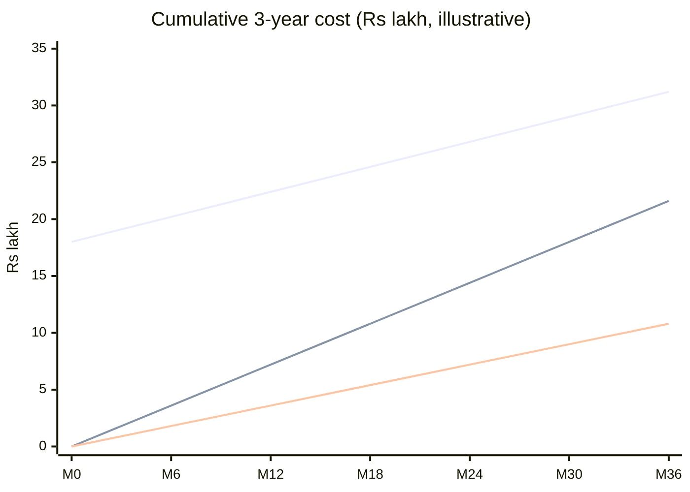

# 10 — CapEx vs OpEx: Financial Comparisons

> **Prerequisites:** CapEx/OpEx and pricing models (file 01) · compute (03), storage (04), cost tools (06).
> All figures are **illustrative** round numbers in Indian rupees to show the *pattern* the exam tests. Use the [pricing calculator](https://azure.microsoft.com/pricing/calculator/) for real quotes.

---

## 1. The accounting difference in one picture

| | CapEx | OpEx |
|---|---|---|
| When cash leaves | **Day 1, large** | Monthly, proportional to use |
| On the books | Asset → **depreciated** over useful life (e.g. 5 years) | Expense in the **same period** |
| Tax deduction | Spread over years (via depreciation) | Deducted in the year spent |
| Risk of over-buying | **You carry it** | Provider carries it |
| Risk of under-buying | Outage / lost sales until new hardware arrives | Scale up in minutes |
| Approval | Usually board/CFO capital budget | Operating budget |

**Depreciation example:** ₹20,00,000 of servers, 5-year straight-line → ₹4,00,000 expense per year for 5 years, even if you stop using them in year 2.

---

## 2. Scenario A — steady web application (3 years)

| Cost line | On-prem | Azure PAYG | Azure 3-yr reserved |
|---|---|---|---|
| Hardware (Day 1) | 18,00,000 | 0 | 0 |
| Power, cooling, space | 6,00,000 | incl. | incl. |
| Hardware maintenance & staff time | 7,20,000 | — | — |
| Cloud usage | — | 60,000 × 36 = 21,60,000 | 30,000 × 36 = 10,80,000 |
| **3-year total** | **31,20,000** | **21,60,000** | **10,80,000** |

**Cumulative cost (₹ lakh) — the "break-even" picture:**

*Top line = on-prem · middle = Azure PAYG · bottom = Azure 3-yr reserved.*

**Recommendation:** steady 24×7 → **reserved instance (or savings plan)** + Hybrid Benefit if you own licences.

---

## 3. Scenario B — seasonal e-commerce (peak 50 servers for 2 months, 5 servers otherwise)

| | On-prem | Azure (autoscale, PAYG) |
|---|---|---|
| Servers needed | Must own **50** (peak) | Pay for 5 × 10 months + 50 × 2 months |
| Server-months paid | 50 × 12 = **600** | 50 + 100 = **150** |
| Average utilisation | **25%** | ~100% of what's paid |
| Cost index | **100** | **≈ 25–35** |

**Recommendation:** spiky / seasonal → **PAYG + autoscale (VM Scale Sets or PaaS)**; optionally reserve only the 5-server baseline.

---

## 4. Scenario C — disaster recovery site

| | Second on-prem datacentre | Azure as DR target (e.g. Azure Site Recovery + GRS) |
|---|---|---|
| Upfront | Duplicate hardware + building/colo — ₹50 lakh+ | ₹0 |
| Running | Power, staff, licences for idle servers | Replication + storage fee monthly; **compute paid only during failover/tests** |
| Cost index | **100** | **≈ 10–20** |

**Recommendation:** DR is the classic "pay only when you need it" case → **Azure as DR site**.

---

## 5. Scenario D — startup cash flow (first 12 months)

| | On-prem | Azure PAYG / PaaS |
|---|---|---|
| Month-0 cash | ₹10 lakh hardware | ₹0 (or free account credit) |
| If product fails at month 6 | ₹10 lakh sunk (resale small) | Delete resources → spend stops |
| If product goes viral | Weeks to buy servers | Scale in minutes |

**Recommendation:** startups → **public cloud, PaaS/serverless, PAYG**; consider reservations only after usage stabilises.

---

## 6. Scenario E — 100 TB compliance archive (5 years)

| | On-prem storage array | Azure Blob **Archive** |
|---|---|---|
| Upfront | ₹40–60 lakh + refresh at year 5 | ₹0 |
| Monthly | Power, space, AMC | Very low per-GB |
| Retrieval | Instant, free | Hours + per-GB retrieval fee |
| Cost index (5 yrs, rarely read) | **100** | **≈ 10–20** |

**Recommendation:** rarely-read data → **Archive tier** with lifecycle policy; frequently read → Hot/Cool.

---

## 7. Scenario F — dev/test lab (10 VMs, office hours only)

| Option | Hours billed / VM / month | Cost index |
|---|---|---|
| On-prem 10 servers | always on | 100 |
| Azure PAYG 24×7 | 730 | ~80 |
| Azure PAYG + auto-shutdown | ~220 | ~25 |
| + Dev/Test pricing | ~220 | ~20 |

**Recommendation:** non-production → **auto-shutdown + Dev/Test pricing**; never reserve part-time workloads.

---

## 8. Scenario G — batch rendering / data processing

| Option | Cost index | Risk |
|---|---|---|
| Buy a render farm | 100 | Idle most of the month |
| Azure PAYG VMs | ~40 | None |
| **Azure Spot VMs** | **~5–15** | Eviction — jobs must checkpoint/restart |

**Recommendation:** interruptible batch → **Spot VMs** (or Azure Batch with Spot).

---

## 9. When on-prem (CapEx) can still win — exceptions to remember

| Situation | Why |
|---|---|
| Hardware already bought and paid off with years of life left | Sunk cost; marginal cost low |
| Extremely steady, very high utilisation for 5+ years | Ownership amortises well |
| Massive outbound data (egress-heavy) | Egress charges add up |
| Regulation forbids any third-party hosting | Cloud not allowed |
| Ultra-low-latency to on-site machines (factory) | Edge/on-prem needed (or Azure Local / Arc) |

> This is exactly why "**moving to the cloud always reduces cost**" is a **No** on the exam.

---

## 10. Summary matrix — pick the pricing approach

| Workload pattern | Best financial model |
|---|---|
| Unknown / new | PAYG |
| Steady 24×7, fixed size | Reserved instance (1 or 3 yr) |
| Steady spend, changing sizes/regions | Savings plan for compute |
| Interruptible batch | Spot VMs |
| Own Windows/SQL licences with SA | + Azure Hybrid Benefit |
| Seasonal spikes | PAYG + autoscale (reserve baseline) |
| Non-production | Auto-shutdown + Dev/Test pricing |
| Rarely-read data | Archive/Cold tier + lifecycle policy |
| DR | Azure Site Recovery + geo-redundant storage |

---

## Questions

### Q10.01 · L2 · Depreciation
Which expenditure type is depreciated over the asset's useful life?

- A. OpEx
- B. CapEx
- C. Consumption spend
- D. Spot spend

<b>Answer</b>

**Answer: B**

### Q10.02 · L2 · Tax timing
OpEx is typically deducted:

- A. Over 5 years
- B. In the same period it's incurred
- C. Never
- D. Only when assets are sold

<b>Answer</b>

**Answer: B**

### Q10.03 · L3 · Seasonal business
A festival-season retailer needs 10× capacity for 6 weeks a year. Which financial approach minimises cost?

- A. Buy hardware for peak capacity (CapEx)
- B. PAYG with autoscale for the peak, optionally reserving the baseline
- C. 3-year reservations for peak capacity
- D. Spot VMs for the checkout system

<b>Answer</b>

**Answer: B**. Spot is wrong for checkout (eviction); reserving peak wastes 46 weeks.

### Q10.04 · L3 · DR financials
Why is Azure usually cheaper than a second datacentre for disaster recovery?

- A. Azure compute is free
- B. You avoid duplicate hardware CapEx and pay mostly for replication/storage until a failover
- C. DR isn't needed in the cloud
- D. Region pairs include free VMs

<b>Answer</b>

**Answer: B**

### Q10.05 · L4 · Yes/No — financial statements
1. Reserved instances turn cloud spending into CapEx.
2. A startup benefits from OpEx because it avoids large upfront costs.
3. Paying for unused on-prem capacity is a risk of CapEx.

<b>Answer</b>

**1 No · 2 Yes · 3 Yes** — reservations are a commitment to pay for a service, still OpEx.

### Q10.06 · L4 · When on-prem wins
Which situation could make on-premises cheaper than Azure?

- A. Unpredictable traffic spikes
- B. Fully paid-off hardware with years of life, running steady high utilisation
- C. A short 3-month project
- D. A new startup

<b>Answer</b>

**Answer: B**

---
➡️ Next: [11 — Scenario playbook](11-scenario-playbook.md)
