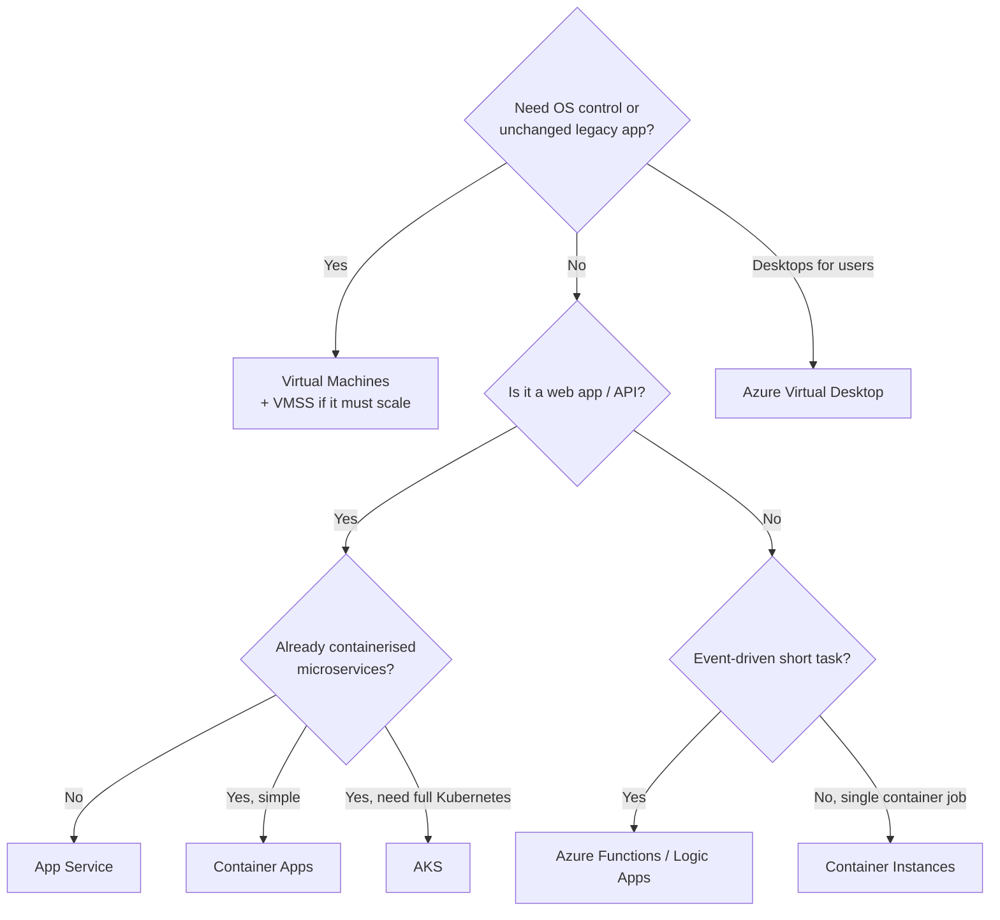
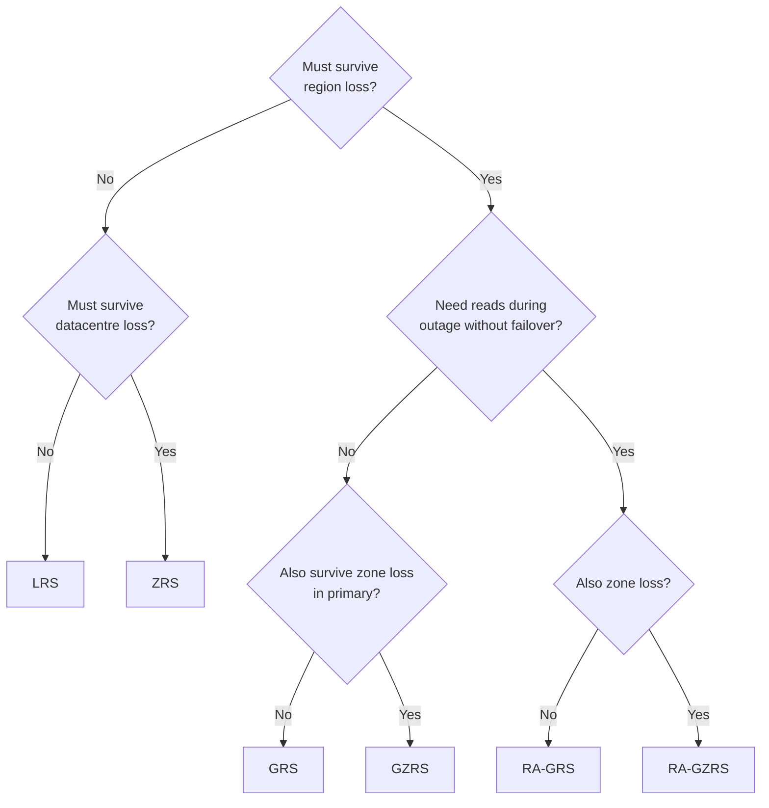
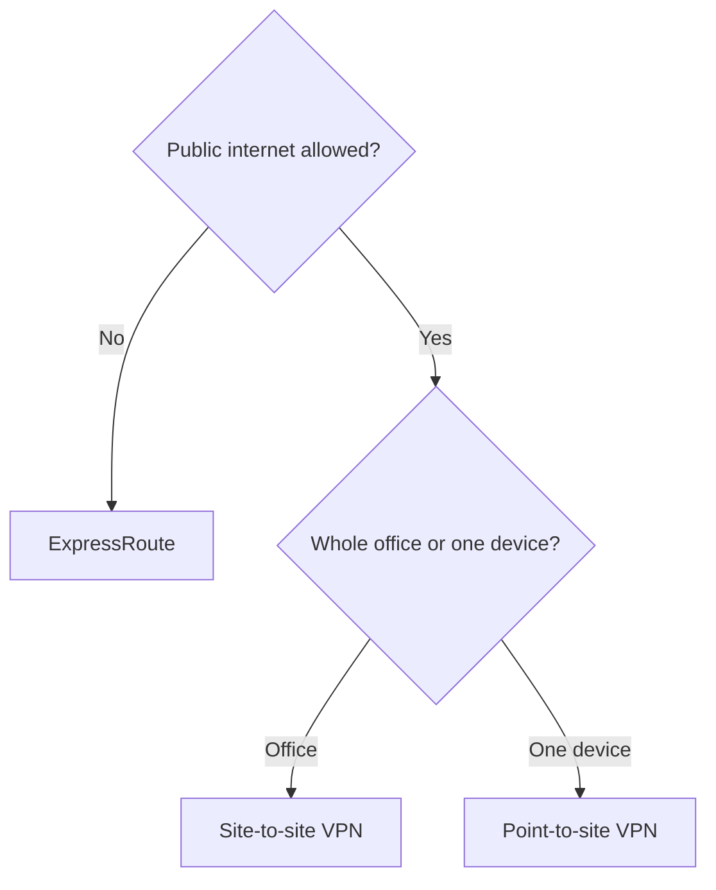

# 11 — Scenario Playbook: Best Fit for Each Type of Organisation

> **Prerequisites:** files 01–10. This file **combines** everything — the way real exam scenarios do.
> Each row gives **one recommendation** and the reason, so you practise picking, not listing.

---

## 1. Quick decision trees

### Which compute?

### Which storage redundancy?

### Which on-prem connection?

---

## 2. Organisation playbooks

### 2.1 Early-stage startup (8 people, no datacentre, uncertain traffic)

| Need | Recommendation | Why |
|---|---|---|
| Cloud model | **Public cloud** | Zero CapEx |
| Service type | **PaaS / serverless** | Least admin with tiny team |
| Web app | **App Service** (or Container Apps if containerised) | Autoscale, no OS patching |
| Background jobs | **Azure Functions** | Pay per execution |
| Data | **Azure SQL Database** or Cosmos DB; Blob Hot **LRS/ZRS** | Managed; cheap redundancy |
| Identity | **Entra ID** with MFA (security defaults); customers via **External ID** | Secure from day one |
| Cost control | **Free account → PAYG**, **budgets + alerts** | Cash-flow protection |
| Monitoring | **Application Insights** | Find bugs fast |

### 2.2 Mid-size retailer with a datacentre and festival peaks

| Need | Recommendation | Why |
|---|---|---|
| Cloud model | **Hybrid** (cloud bursting) | Reuse owned servers, burst for peaks |
| Peak compute | **VM Scale Sets** with autoscale (or App Service autoscale) | Elastic |
| Connectivity | **Site-to-site VPN** (upgrade to ExpressRoute if bandwidth grows) | Cheap, quick |
| Pricing | Reserve baseline, **PAYG** for peaks | Matches demand |
| Images/catalogue | **Blob Hot** + CDN | Fast, egress-optimised |
| Order processing | **Queue storage** + workers | Decouples peaks |
| Governance | **Tags** (Department), **Cost Management** budgets | Chargeback |

### 2.3 Bank / financial institution (regulated, data residency, high availability)

| Need | Recommendation | Why |
|---|---|---|
| Cloud model | **Hybrid** — core ledger on-prem, digital channels in Azure | Regulation + agility |
| Connectivity | **ExpressRoute** (+ VPN as failover) | Private, predictable, not over internet |
| Data residency | **Azure Policy: Allowed locations** at management group | Enforced for everyone |
| HA/DR | **Availability zones** + **paired region**, **RA-GZRS** storage | Zone + region resilience |
| Identity | **Entra ID + Conditional Access + MFA/passwordless**, **PIM** for admins | Zero Trust |
| Access | **RBAC least privilege** at RG scope | Separation of duties |
| Protection | **Resource locks (Delete)** on production; **Defender for Cloud**; **private endpoints** | Defense in depth |
| Data governance | **Microsoft Purview** (classification, DLP) | Find & protect PII |
| Cost | **Reserved instances + Hybrid Benefit** for steady core | Lowest steady-state cost |

### 2.4 Hospital / healthcare

| Need | Recommendation | Why |
|---|---|---|
| Patient records DB | **Azure SQL Database (PaaS)** with **private endpoint** | Microsoft patches; no public exposure |
| Medical images | **Blob**: Hot → Cool → **Archive** via lifecycle policy | Legal retention at lowest cost |
| Redundancy | **ZRS** in-region (residency) or **GZRS** if a paired region in-country is allowed | Survive datacentre loss |
| Clinician access | **AVD** on shared ward PCs + **FIDO2 keys** | No data on devices, passwordless on shared PCs |
| Compliance | **Policy initiatives** (e.g. HIPAA/ISO), **Purview** DLP | Prove compliance |
| Monitoring | **Service Health alerts**, **Azure Monitor** | Clinical uptime |

### 2.5 Government agency

| Need | Recommendation | Why |
|---|---|---|
| US federal | **Azure Government** (sovereign region) | Screened US personnel, gov compliance |
| Classified on-site only | **Private cloud** (e.g. Azure Local) managed with **Azure Arc** | Physical control + Azure management |
| Citizen portal | **App Service** in public Azure with **Entra External ID** | Scale, citizen sign-up |
| Governance | **Management groups** + **Policy** at root | One rule set for all departments |

### 2.6 Manufacturer with factories and legacy systems

| Need | Recommendation | Why |
|---|---|---|
| Legacy ERP (Windows Server 2016, custom driver) | **Azure VMs** (lift-and-shift) | Needs OS control |
| Migration planning | **Azure Migrate** | Discover, assess, migrate |
| 400 TB historical data over slow link | **Azure Data Box** | Offline bulk transfer |
| Factory servers staying on-site | **Azure Arc** | Govern/monitor with Azure tools |
| Legacy LDAP app | **Entra Domain Services** | No DCs to manage |
| Shop-floor workers, no phones | **FIDO2 keys** | Passwordless without phones |

### 2.7 School / university

| Need | Recommendation | Why |
|---|---|---|
| Email & collaboration | **Microsoft 365 (SaaS)** | Least admin |
| Computer labs from home | **Azure Virtual Desktop** (multi-session) | Lab software on any device, shared VMs cut cost |
| Admissions portal | **App Service** with deployment slots | Safe releases during admission season |
| Student project subscriptions | Separate **subscriptions** under a "Sandbox" **management group** + **budgets** | Isolation + spend limits |
| Exam-day resilience | VMs/App Service across **availability zones** | Survive datacentre loss |

### 2.8 Global enterprise with 60 subscriptions

| Need | Recommendation | Why |
|---|---|---|
| Organise | **Management group hierarchy** (Corp → Prod/Non-prod; Sandbox) | Inherited governance |
| Standards | **Policy initiatives** at top MG; **RBAC** via groups | Consistent, least effort |
| Deploy | **Bicep/ARM** in CI/CD | Repeatable |
| Multi-cloud estate (AWS from acquisition) | **Azure Arc** + **Defender for Cloud** | One pane of glass |
| Cost | **Cost Management** by MG/subscription + **tags**; **savings plan** | Visibility + discount |
| Optimisation | **Azure Advisor** reviews monthly | Continuous improvement |

### 2.9 BPO / call centre (2,000 remote agents)

| Need | Recommendation | Why |
|---|---|---|
| Agent desktops | **AVD** Windows multi-session | Data stays in Azure |
| Sign-in | **Entra ID + Conditional Access** (compliant device / location) | Block risky access |
| Partner client access | **B2B collaboration** | Client staff use own accounts |
| Cost | **Autoscale AVD host pools** by shift; reserve baseline | Pay for active shifts |

### 2.10 Media / video company

| Need | Recommendation | Why |
|---|---|---|
| Upload 300 TB archive | **Data Box** (525 TB next-gen device, or several smaller) | Bandwidth too slow |
| Raw footage | **Blob Cool/Cold**, finished masters **Archive** | Lower storage cost |
| Rendering | **Spot VMs** | Up to ~90% cheaper, interruptible |
| Delivery cost | Watch **egress**; use CDN | Bandwidth is main cost factor |
| Editors' shared drives | **Azure Files** (Premium) + **File Sync** at studios | Local speed + cloud copy |

### 2.11 SaaS software vendor (ISV)

| Need | Recommendation | Why |
|---|---|---|
| Microservices | **AKS** (large) or **Container Apps** (simpler) | Portability + scale |
| New region rollout | **Bicep** templates | Identical stamps |
| Customer sign-in | **Entra External ID** | Social/email sign-up |
| SLA design | Zones + multi-region; compute **composite SLA** | Contractual uptime |
| Observability | **Application Insights + Log Analytics** | Per-tenant diagnostics |

### 2.12 Small NGO (10 staff, tiny budget)

| Need | Recommendation | Why |
|---|---|---|
| Productivity | **Microsoft 365 (SaaS)** (nonprofit offers) | No servers |
| Website | **App Service** free/basic tier or Static Web Apps | Minimal cost |
| Backups | **Blob Cool LRS** | Cheapest adequate |
| Security | **MFA** (security defaults), **Basic support** | Free protections |

---

## 3. Scenario questions (mixed services)

### Q11.01 · L3 · Startup stack
A two-person startup wants to launch a web API with the least administration and no upfront cost. Which combination is best?

- A. On-prem server + VPN
- B. Public cloud, Azure App Service, PAYG
- C. Private cloud, VMs, 3-year reservations
- D. Azure Government, AKS

<b>Answer</b>

**Answer: B**

### Q11.02 · L3 · Bank residency
A bank must ensure all resources in 30 subscriptions are deployed only in India and that production databases can't be accidentally deleted. Which two tools?

- A. Azure Policy at a management group + resource locks on production
- B. Tags + Advisor
- C. RBAC Reader + Service Health
- D. Cost Management + Arc

<b>Answer</b>

**Answer: A**

### Q11.03 · L3 · Hospital archive
A hospital must keep MRI scans for 10 years. Scans are viewed often in the first month, rarely after. What minimises cost while meeting the need?

- A. Keep everything in Hot
- B. Lifecycle policy: Hot → Cool → Archive
- C. Premium block blobs
- D. Azure Files

<b>Answer</b>

**Answer: B**

### Q11.04 · L3 · Manufacturer hybrid
A manufacturer keeps 200 servers in factories (they can't move) and wants to apply Azure Policy and monitor them from Azure. What should it use?

- A. Azure Migrate
- B. Azure Arc
- C. Azure Data Box
- D. ExpressRoute only

<b>Answer</b>

**Answer: B**

### Q11.05 · L3 · University labs
A university wants students to use licensed lab software from home on any device, with many students sharing VMs to reduce cost. What should it use?

- A. Azure Virtual Desktop
- B. App Service
- C. Azure Functions
- D. Microsoft 365 only

<b>Answer</b>

**Answer: A**

### Q11.06 · L3 · Enterprise structure
A company with 60 subscriptions wants one place to apply security policies and access for all production subscriptions. What should it create?

- A. A resource group for production
- B. A "Production" management group containing the production subscriptions
- C. A tag called Production
- D. A single giant subscription

<b>Answer</b>

**Answer: B**

### Q11.07 · L3 · Media rendering
A studio must render animations overnight at the lowest cost; jobs can restart if interrupted. What should it use?

- A. Reserved VMs
- B. Spot VMs
- C. Dedicated Hosts
- D. AVD

<b>Answer</b>

**Answer: B**

### Q11.08 · L3 · SaaS vendor customers
A SaaS vendor wants customers to sign up using Google or email accounts. What should it use?

- A. B2B collaboration
- B. Microsoft Entra External ID (customer identity)
- C. Entra Domain Services
- D. RBAC

<b>Answer</b>

**Answer: B**

### Q11.09 · L4 · Bank connectivity + backup
A bank needs a private connection to Azure plus an encrypted backup path if the private circuit fails. Which combination?

- A. ExpressRoute + site-to-site VPN Gateway
- B. Two point-to-site VPNs
- C. VNet peering + Azure DNS
- D. Public endpoints + NSGs

<b>Answer</b>

**Answer: A**

### Q11.10 · L4 · Government
A US state agency wants a cloud environment physically and logically isolated from the public Azure cloud and operated by screened US personnel. What should it use?

- A. Azure China
- B. Azure Government
- C. Central US with Azure Policy
- D. A private cloud on AWS

<b>Answer</b>

**Answer: B**

### Q11.11 · L4 · Call-centre access control
A BPO wants agents to access their AVD desktops only from company-managed devices and require MFA when outside the office network. What should it configure?

- A. Azure Policy
- B. Microsoft Entra Conditional Access
- C. Resource locks
- D. NSGs only

<b>Answer</b>

**Answer: B**

### Q11.12 · L4 · Retailer queue
During festival sales, an online shop's checkout times out because order processing is slow. Which design change improves resilience at low cost?

- A. Larger single VM
- B. Put orders on Queue storage, process with scalable workers (VMSS or Functions)
- C. Move orders to Archive tier
- D. Add a ReadOnly lock

<b>Answer</b>

**Answer: B**

---
➡️ Next: [12 — Confusing pairs & traps](12-confusing-pairs-traps.md)
