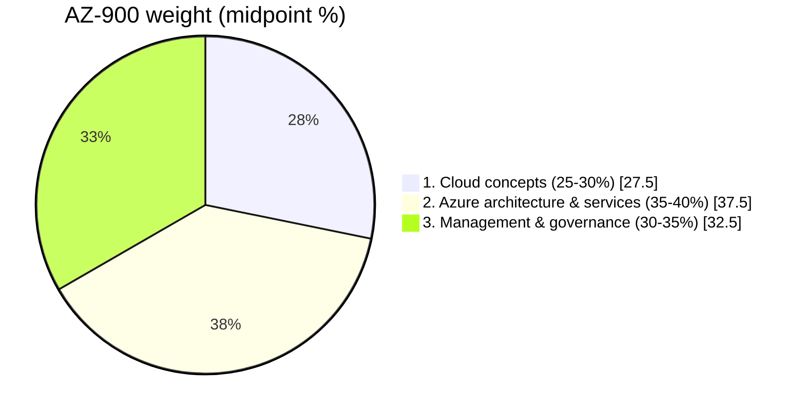

# AZ-900 Microsoft Azure Fundamentals — Complete Pass Kit

> Built against the **official skills outline dated 20 July 2026** (the current one as of October 2026).
> Source: [Microsoft Learn AZ-900 study guide](https://learn.microsoft.com/en-us/credentials/certifications/resources/study-guides/az-900)

## Exam facts at a glance

| Item | Detail |
|---|---|
| Passing score | **700 / 1000** (scaled — not "70% correct") |
| Questions | Usually **40–60** |
| Time | ~45 minutes of answering time (~65 minutes total seat time) |
| Question types | Multiple choice, multiple select, **Yes/No statement series**, drag-and-drop, hot area (pick from drop-down), sentence completion |
| Negative marking | **None** — never leave a question blank |
| Review | You can flag and come back, **except** Yes/No series (once you move on, you can't return) |
| Free practice | [Official practice assessment](https://learn.microsoft.com/en-us/credentials/certifications/exams/az-900/practice/assessment?assessment-type=practice&assessmentId=23) · [Exam sandbox](https://aka.ms/examdemo) |

### Domain weights (where the marks are)



## How this repository is organised

Files are ordered **low → high difficulty**. Every file starts with the prerequisites it needs, and every later file only uses ideas taught earlier.

| # | File | Covers (official objective) | Weight |
|---|---|---|---|
| 00 | [Exam strategy & question types](00-exam-strategy.md) | How the exam works, how to answer each question type | — |
| 01 | [Cloud concepts](01-cloud-concepts.md) | Cloud computing, shared responsibility, cloud models, consumption model, serverless, benefits, IaaS/PaaS/SaaS | 25–30% |
| 02 | [Core architecture](02-core-architecture.md) | Regions, region pairs, sovereign regions, availability zones, datacenters, resources, resource groups, subscriptions, management groups | part of 35–40% |
| 03 | [Compute & networking](03-compute-networking.md) | VMs, VMSS, availability sets, AVD, containers, Functions, App Service, VNets, subnets, peering, DNS, VPN Gateway, ExpressRoute, endpoints | part of 35–40% |
| 04 | [Storage](04-storage.md) | Storage services, tiers, redundancy, account types, AzCopy, Storage Explorer, File Sync, Azure Migrate, Data Box | part of 35–40% |
| 05 | [Identity, access & security](05-identity-security.md) | Entra ID, Entra Domain Services, SSO, MFA, passwordless, external identities, Conditional Access, RBAC, Zero Trust, defense in depth, Defender for Cloud | part of 35–40% |
| 06 | [Cost management](06-cost-management.md) | Cost factors, pricing calculator, Cost Management, tags | part of 30–35% |
| 07 | [Governance & compliance](07-governance-compliance.md) | Microsoft Purview, Azure Policy, resource locks | part of 30–35% |
| 08 | [Management & deployment tools](08-management-deployment.md) | Portal, Cloud Shell, CLI, PowerShell, Azure Arc, IaC, ARM, ARM templates, Bicep | part of 30–35% |
| 09 | [Monitoring](09-monitoring.md) | Advisor, Service Health, Azure Monitor, Log Analytics, alerts, Application Insights | part of 30–35% |
| 10 | [CapEx vs OpEx financial comparisons](10-capex-vs-opex-financials.md) | Worked money examples across compute, storage, networking, identity, DR | cross-cutting |
| 11 | [Scenario playbook — best fit per organisation](11-scenario-playbook.md) | Startup, bank, hospital, government, retailer, manufacturer, school… one recommendation each | cross-cutting |
| 12 | [Confusing pairs & exam traps](12-confusing-pairs-traps.md) | The 60 look-alikes that cost most people the pass | cross-cutting |
| 13 | [Mock exam 1](13-mock-exam-1.md) | 50 mixed questions, real exam format, full explanations | full exam |
| 14 | [Mock exam 2](14-mock-exam-2.md) | 50 mixed questions, harder, full explanations | full exam |
| 15 | [Last-day cheat sheet](15-cheat-sheet.md) | Every number, limit and keyword on two screens | revision |

`tools/validate.py` checks that every question in the repo has exactly one answer block and prints a count per file — run it after you add your own questions.

## How each question is written

```text
### Q3.14 · L3 · <topic>          ← Q<file>.<number> · Level · objective
Question text (often a business scenario)
- A / B / C / D options
<details> Answer → why it is right → why the others are wrong → covered / not covered / exceptions → trap </details>
```

| Level | Meaning | What to do if you miss it |
|---|---|---|
| **L1** | Recall a definition | Re-read the concept card |
| **L2** | Understand / compare | Re-read the comparison table |
| **L3** | Apply to a business scenario | Re-read the business example + scenario playbook |
| **L4** | Exam-tricky (Yes/No series, exceptions, "NOT", "minimise cost") | Re-read file 12 (traps) |

Click **Answer** to expand. Answer every question on paper first, then check.

## 10-day study plan (≈1.5 hours/day)

| Day | Do | Target |
|---|---|---|
| 1 | 00 + 01 (first half) | Understand the question formats; cloud basics |
| 2 | 01 (all questions) + 10 | ≥ 85% on file 01 questions |
| 3 | 02 | Hierarchy diagram from memory |
| 4 | 03 | Can pick the right compute/network service for any scenario |
| 5 | 04 | Tiers, redundancy, migration tools from memory |
| 6 | 05 | Entra vs RBAC vs Conditional Access instantly |
| 7 | 06 + 07 + 08 + 09 | Policy vs RBAC vs lock; Advisor vs Monitor vs Service Health |
| 8 | 11 + 12 | No confusion on any pair |
| 9 | Mock 1 → review every miss → Microsoft's free practice assessment | ≥ 85% |
| 10 | Mock 2 → 15 (cheat sheet) → free practice assessment again | ≥ 90%, then book/sit |

**Readiness rule:** sit the exam when you score **≥ 85% on both mocks and ≥ 85% twice in a row on Microsoft's free practice assessment**. That margin covers the unknown questions you'll see on the day.

## An honest note about "actual exam questions"

Microsoft's exam content is under NDA, and leaked "dump" sites are both against the exam agreement (your certification can be revoked) and frequently wrong or outdated (many still teach the retired TCO calculator and Azure Blueprints as current). Every question here is **written in the real exam's formats and styles**, modelled on the public objectives, Microsoft Learn modules and the free official practice assessment, and covers the scenarios that repeatedly appear in the real exam's question pool. If you understand *why* each answer is right, reworded versions on the day won't trip you up.

## Things that changed recently (dumps often get these wrong)

| Item | Status as of Oct 2026 |
|---|---|
| Azure Active Directory | Renamed **Microsoft Entra ID** (2023). Azure AD DS → **Microsoft Entra Domain Services** |
| TCO calculator | **Retired** (2025); the outline now lists only the **pricing calculator** |
| Azure Blueprints | **Retiring 31 Jan 2027** (phased retirement began 31 Jul 2026). Replaced by **Deployment Stacks** + template specs. Not in the current outline |
| Azure AD B2C | No longer sold to new customers (since May 2025); **Microsoft Entra External ID** is the current answer for customer identities |
| Azure Data Box | Classic 80 TB device being phased out; next-gen 120 TB / 525 TB; Data Box Heavy retired. Learn module still quotes 80 TB |
| Storage tiers | Four tiers: **Hot, Cool, Cold, Archive** (Cold added 2023) |
| Azure Purview | Now **Microsoft Purview** |
