# 01 — Machine Learning & Deep Learning Foundations

> **JD lines covered:** [TTN] design and productionise ML and DL models — supervised, unsupervised, deep learning (NLP and/or CV) and **recommendation engines** · solid experience with **regression, tree-based models, clustering, anomaly detection** and DL architectures for NLP/CV · Python, PyTorch, TensorFlow, Scikit-learn, Pandas, NumPy. [DBX] hands-on ML.
>
> **Why this file matters most:** your background is backend + GenAI. Interviewers for [TTN] will test classical ML depth. You don't need to be a researcher — you need to explain **when** to use what, **how** to evaluate it, and **how** it fails in production.
>
> **Prereq:** predictive lifecycle (feature store, backtesting, drift) → [pack 01 / 01 Q1.9](../01-ai-engineering-leader/01-ai-strategy-delivery.md).

**Levels:** L1 basics · L2 practitioner · L3 senior/architect

---

## Part A — Classical ML

### Q1.1 · L1 · "Explain supervised, unsupervised, self-supervised and reinforcement learning with business examples."

**Picture it:**

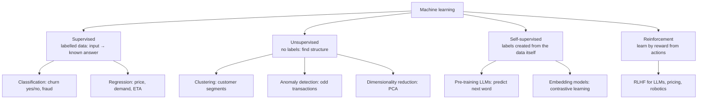

<details><summary><b>▶ Answer</b></summary>

- **Supervised** — learn a mapping from inputs to a **known label**. *Classification* predicts a category (will this customer churn?); *regression* predicts a number (next week's demand). Needs labelled history — often the most expensive part.
- **Unsupervised** — no labels; find structure. *Clustering* (customer segments), *anomaly detection* (unusual transactions), *dimensionality reduction* (PCA to compress features or visualise).
- **Self-supervised** — the data creates its own labels: hide a word and predict it (BERT), predict the next token (GPT), pull matching image-caption pairs together (CLIP). This is how foundation models and embedding models are trained — it's why GenAI exists.
- **Reinforcement learning** — an agent takes actions and learns from rewards. In industry: RLHF/preference tuning of LLMs, dynamic pricing, recommendations as a bandit problem.

**Interview tip:** add *semi-supervised* (a few labels + lots of unlabelled data) and *weak supervision* (labels from rules or an LLM) — very common in practice when labelling is expensive. Using an LLM to label data, then training a small fast classifier on those labels, is a strong hybrid pattern.

</details>

**Say this:** *"Supervised learns from labelled answers, unsupervised finds structure, self-supervised makes labels from the data itself — that's how LLMs and embedding models are pre-trained — and RL learns from rewards, which is how LLMs get aligned."*

---

### Q1.2 · L2 · "Linear vs logistic regression — and what do L1 and L2 regularisation do?"

<details><summary><b>▶ Answer</b></summary>

- **Linear regression** predicts a continuous number: `y = w·x + b`, fitted by minimising squared error. Assumes a roughly linear relationship, independent errors, constant error variance; sensitive to outliers and correlated features (multicollinearity).
- **Logistic regression** predicts a **probability** for a class by passing `w·x + b` through a sigmoid; trained with log-loss (cross-entropy). Despite the name, it's a classifier. Strengths: fast, **interpretable** (each coefficient is a log-odds effect), well-calibrated probabilities — still the baseline in credit scoring and many regulated settings.
- **Regularisation** adds a penalty on weights to reduce overfitting:
  - **L1 (Lasso)** — penalty on |w| → pushes some weights to exactly **zero** → built-in **feature selection**.
  - **L2 (Ridge)** — penalty on w² → shrinks weights smoothly, handles correlated features better.
  - **Elastic Net** — mix of both.
  - Strength controlled by a hyper-parameter (`alpha`/`C`) tuned by cross-validation. **Scale features first** — penalties assume comparable scales.

</details>

**Say this:** *"Linear predicts a number, logistic predicts a class probability and stays the interpretable baseline. L1 zeroes weights for feature selection, L2 shrinks them smoothly; scale features and tune the strength by cross-validation."*

---

### Q1.3 · L2 · "Explain the bias–variance trade-off and how you detect and fix overfitting."

**Picture it:**

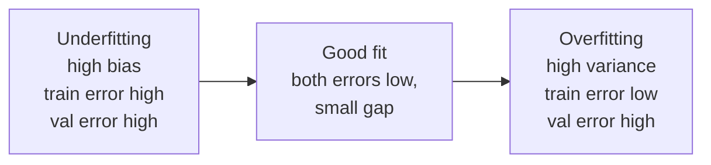

<details><summary><b>▶ Answer</b></summary>

- **Bias** = error from a model too simple to capture the pattern (underfitting). **Variance** = error from a model too sensitive to the training data (overfitting). Making a model more complex lowers bias but raises variance; the goal is the sweet spot.
- **Detect:** compare training vs validation error (learning curves). Big gap → overfitting; both high → underfitting.
- **Fix overfitting:** more data, simpler model, regularisation (L1/L2, dropout for NNs), early stopping, fewer/better features, ensembling (bagging reduces variance), data augmentation (CV/NLP).
- **Fix underfitting:** richer features, more complex model, less regularisation, train longer.
- **Validate properly:** k-fold cross-validation for i.i.d. data; **time-based splits** for time series; **group splits** when the same customer/patient appears many times (otherwise leakage inflates scores).

</details>

**Say this:** *"Bias is too simple, variance is too sensitive. I read the train-vs-validation gap, fix overfitting with data, regularisation, early stopping or bagging, and validate with the right split — time-based or grouped when needed."*

---

### Q1.4 · L2 · "Decision tree vs Random Forest vs Gradient Boosting (XGBoost/LightGBM) — when do you use which?"

> **Why they ask:** tree ensembles win most tabular problems. Expect depth here.

**Picture it:**

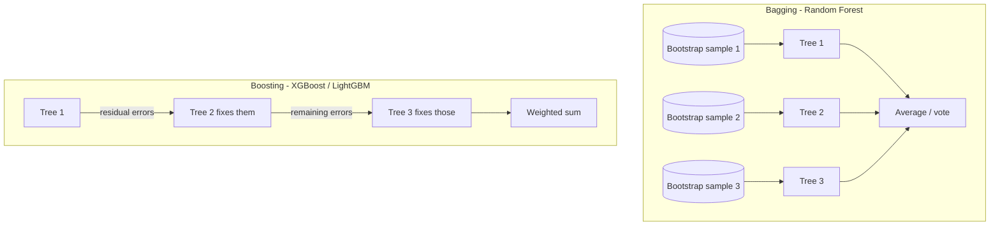
*Bagging = many independent trees in parallel, reduces variance · Boosting = trees in sequence, each fixing the last one's errors, reduces bias.*

<details><summary><b>▶ Answer</b></summary>

| Model | How it works | Strengths | Weaknesses |
|---|---|---|---|
| **Decision tree** | Splits data on the feature/threshold that best separates targets (Gini/entropy for classification, variance for regression) | Very interpretable, no scaling needed | Overfits badly alone, unstable |
| **Random Forest** (bagging) | Many deep trees on bootstrap samples + random feature subsets; average/vote | Robust, little tuning, hard to overfit badly, parallel | Larger models, slightly lower accuracy than boosting |
| **Gradient boosting** (XGBoost, LightGBM, CatBoost) | Shallow trees added sequentially, each fitting the **residual errors** (gradients of the loss) of the ensemble so far | Usually **best accuracy on tabular data**; handles missing values; LightGBM is fast on big data; CatBoost handles categoricals natively | More hyper-parameters (learning rate, depth, n_estimators, subsampling); can overfit — use early stopping |

**My default for tabular problems:** a simple baseline (logistic/linear) → LightGBM/XGBoost with early stopping → explain with **SHAP**. Deep learning rarely beats boosting on structured tabular data unless data is huge or has text/images.

**Key tuning knobs:** learning rate (lower + more trees = better but slower), max depth / num leaves (complexity), min child samples (regularisation), subsample/colsample (randomness), early stopping on a validation set.

</details>

**Say this:** *"Random Forest averages many independent deep trees to cut variance; gradient boosting adds shallow trees in sequence, each correcting the last, and is usually the tabular winner. My default is a linear baseline, then LightGBM with early stopping, explained with SHAP."*

---

### Q1.5 · L2 · "Explain clustering algorithms and how you choose the number of clusters."

**Picture it:**

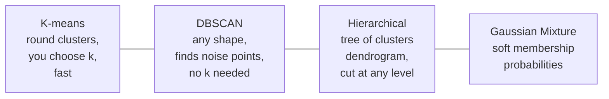

<details><summary><b>▶ Answer</b></summary>

- **K-means** — assigns points to the nearest of k centroids, recomputes centroids, repeats. Fast and scalable; assumes roughly spherical, similar-size clusters; sensitive to scaling and outliers. Use **k-means++** initialisation.
- **DBSCAN / HDBSCAN** — density-based: clusters are dense regions; sparse points are **noise** (handy for anomaly detection). Finds arbitrary shapes, no k needed; needs density parameters (eps, min samples); HDBSCAN handles varying densities better.
- **Hierarchical (agglomerative)** — merges closest clusters step by step into a tree (dendrogram); cut the tree where it makes sense. Good for small/medium data and explaining structure.
- **Gaussian Mixture Models** — soft clustering with probabilities; elliptical clusters.

**Choosing k:** elbow method (inertia vs k), **silhouette score** (how well each point fits its cluster vs the next), gap statistic — but the final judge is **business usefulness**: can marketing act on 5 segments? Are they stable over time?

**Practical steps:** scale features, reduce dimensions (PCA/UMAP) for high-dimensional data, check stability across samples, profile each cluster (means of key features) and name it in business terms.

**GenAI link:** clustering **embeddings** of support tickets or user queries is a great way to discover topics and find knowledge gaps in a RAG system — and an LLM can name each cluster.

</details>

**Say this:** *"K-means for fast round clusters, DBSCAN/HDBSCAN for odd shapes and noise, hierarchical to see structure. I pick k with elbow and silhouette, but the real test is whether the business can act on the segments — and clustering embeddings is a great way to find RAG knowledge gaps."*

---

### Q1.6 · L3 · "How do you build an anomaly detection system?"

> **Why they ask:** explicitly in [TTN]. Also your home ground — alerts and observability at MGM.

**Picture it:**

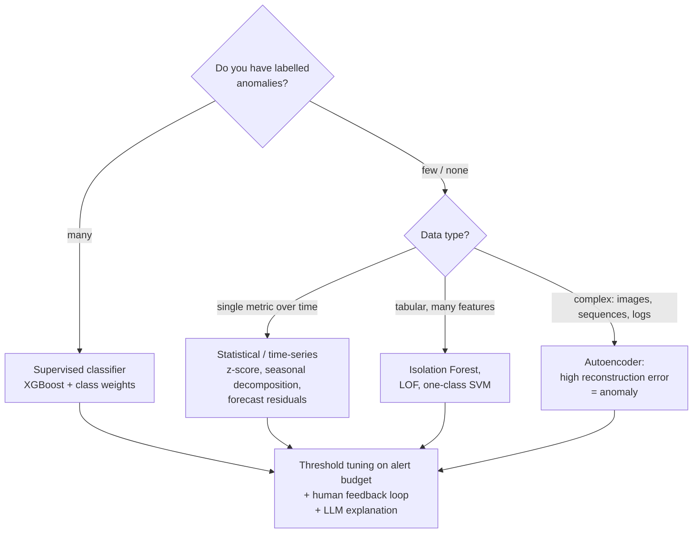

<details><summary><b>▶ Answer</b></summary>

**Step 1 — define "anomaly" with the business** (fraud? equipment fault? a metric spike?) and the **cost of a false alarm vs a miss**. This sets the threshold, not the algorithm.

**Step 2 — pick the approach by label availability and data type:**
- **Statistical / time-series:** z-score or robust z (median/MAD), seasonal decomposition (STL), or **forecast residuals** — predict the expected value; alert when actual deviates beyond a band. Great for metrics (latency, sales per hour).
- **Isolation Forest:** randomly splits features; anomalies are isolated in fewer splits. Fast, works on many features, no labels.
- **Local Outlier Factor / one-class SVM:** density or boundary based; OK on smaller data.
- **Autoencoders:** neural net learns to reconstruct normal data; poor reconstruction = anomaly. For images, sensor sequences, logs.
- **Supervised:** if you have labelled fraud cases, a boosted classifier with class weights usually wins — anomalies become a (highly imbalanced) classification problem.

**Step 3 — operate it:**
- Tune the threshold to an **alert budget** (e.g., top 50 per day reviewers can handle) and measure precision at that budget.
- **Feedback loop** — reviewers mark true/false alerts; use them to retrain or move to supervised over time.
- **Handle seasonality and drift** — what's normal on Diwali isn't normal in March.
- **Explain** — show which features drove the score (SHAP or contribution per feature) and, as a hybrid, let an LLM turn that into a plain-language summary for the analyst.

```python
# Minimal Isolation Forest example (scikit-learn)
import pandas as pd
from sklearn.ensemble import IsolationForest
from sklearn.preprocessing import StandardScaler
from sklearn.pipeline import make_pipeline

df = pd.read_csv("transactions.csv")            # amount, hour, merchant_risk, txn_per_day ...
features = ["amount", "hour", "merchant_risk", "txn_per_day"]

model = make_pipeline(StandardScaler(),
                      IsolationForest(n_estimators=300, contamination=0.01, random_state=42))
model.fit(df[features])

df["score"] = -model.decision_function(df[features])   # higher = more anomalous
top_alerts = df.nlargest(50, "score")                     # alert budget: 50/day
```
- `StandardScaler` puts features on the same scale; `IsolationForest(contamination=0.01)` assumes ~1% anomalies; `decision_function` gives a score we rank on instead of trusting a fixed cut-off.

**MGM link:** alert noise is an anomaly-detection problem — the RAG summariser helped explain *why* an alert fired; a model can decide *which* alerts deserve a human first.

</details>

**Say this:** *"Define the cost of false alarms vs misses first. Then pick by labels and data: statistical or forecast-residual for metrics, Isolation Forest for tabular, autoencoders for complex data, supervised if labels exist. Tune to an alert budget, close the feedback loop, and explain each alert."*

---

### Q1.7 · L2 · "Which evaluation metrics do you use, and how do you handle the decision threshold?"

**Picture it:**

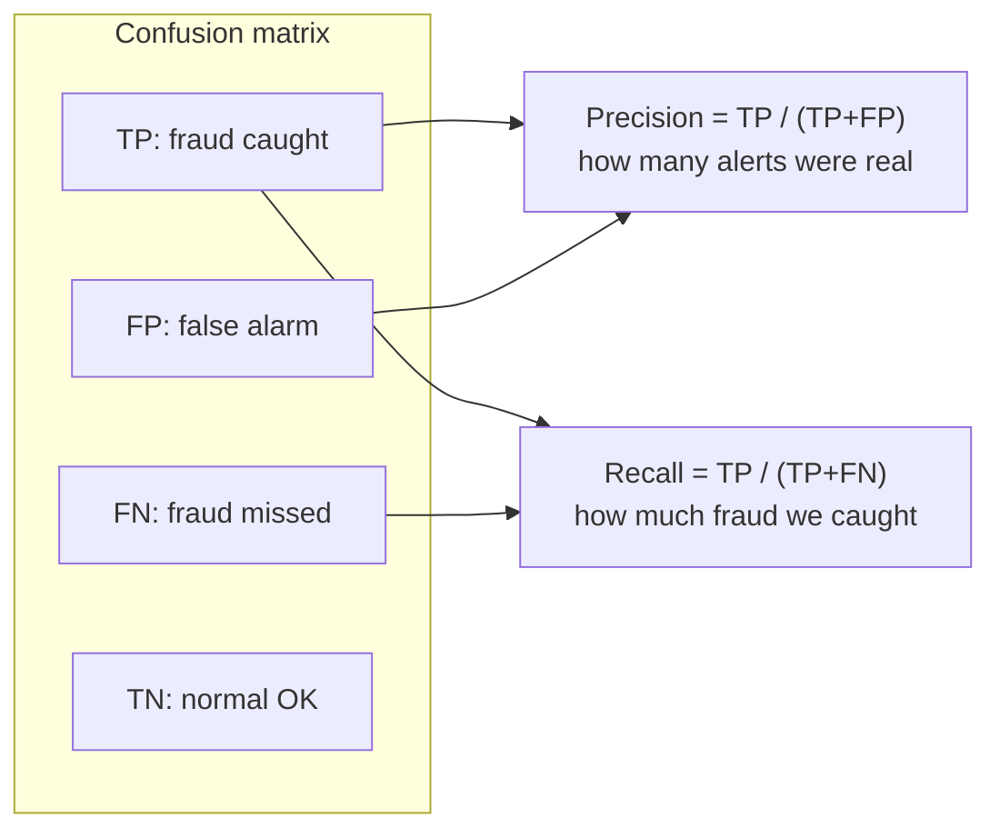

<details><summary><b>▶ Answer</b></summary>

| Problem | Metrics | Notes |
|---|---|---|
| **Classification** | Precision, recall, F1, ROC-AUC, **PR-AUC**, log-loss, calibration | Use **PR-AUC** for imbalanced data — ROC-AUC looks great even when the model is poor on the rare class |
| **Regression** | MAE (robust, interpretable), RMSE (punishes big errors), MAPE (percentage — breaks near zero), R² | Pick by business: is one big miss worse than many small ones? |
| **Ranking / recommendation** | Precision@k, Recall@k, NDCG, MAP, hit rate, coverage, diversity | Plus online: CTR, conversion, revenue per session |
| **Clustering** | Silhouette, Davies–Bouldin; business usefulness | |
| **Forecasting** | MAE/MAPE/WAPE vs a naive seasonal baseline | Always compare to the naive baseline |

**Threshold is a business decision:** a model outputs a probability; the cut-off decides the precision/recall trade-off. Choose it from the cost matrix (e.g., a missed fraud costs ₹20,000, a false alarm costs ₹200 of analyst time) or from capacity (top-N per day). Check **calibration** (does 0.8 mean 80%?) when probabilities drive decisions — fix with Platt scaling or isotonic regression.

</details>

**Say this:** *"Precision and recall from the confusion matrix, PR-AUC for imbalanced data, MAE or RMSE for regression depending on how much big misses hurt, NDCG for ranking — and the threshold comes from the business cost matrix, not 0.5."*

---

### Q1.8 · L3 · "What is data leakage and how do you prevent it?"

<details><summary><b>▶ Answer</b></summary>

**Leakage** = information available during training that won't be available at prediction time → amazing offline scores, failure in production.

**Common forms:**
- **Target leakage:** a feature that is caused by the target ("refund_issued" when predicting complaints; "account_closed_date" in churn).
- **Temporal leakage:** random splits on time-ordered data let the model see the future.
- **Preprocessing leakage:** fitting the scaler/imputer/encoder on the full dataset before splitting.
- **Group leakage:** the same customer in train and test.
- **Duplicate leakage:** near-duplicate rows across splits.

**Prevention:** for each feature ask "would I know this at the moment of prediction?"; time-based and group-based splits; **fit all preprocessing inside a scikit-learn `Pipeline`** so it's learned on training folds only; feature store with point-in-time correct joins; suspiciously high scores = investigate before celebrating.

</details>

**Say this:** *"Leakage is training on information you won't have at prediction time. I ask 'would I know this at prediction time?' for every feature, split by time or group, and fit all preprocessing inside a pipeline. A suspiciously great score is a bug until proven otherwise."*

---

### Q1.9 · L2 · "How do you handle class imbalance?"

<details><summary><b>▶ Answer</b></summary>

1. **Use the right metric** first — PR-AUC, recall at a fixed precision; accuracy is meaningless at 1% positives.
2. **Class weights** in the loss (`class_weight="balanced"`, `scale_pos_weight` in XGBoost) — simplest and often enough.
3. **Resampling** — undersample the majority, oversample the minority, or SMOTE (synthetic minority samples) — **only on the training fold**, never before splitting.
4. **Threshold tuning** — often the biggest win.
5. **More signal** — better features, more positive examples (active learning, LLM-assisted labelling).
6. **Anomaly-detection framing** if positives are extremely rare.

</details>

---

## Part B — Deep learning (NLP & Computer Vision)

### Q1.10 · L2 · "Explain how a neural network is trained, and the main tricks that make training work."

**Picture it:**

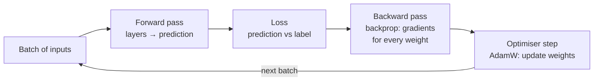

<details><summary><b>▶ Answer</b></summary>

- **Forward pass** computes predictions; **loss** measures error (cross-entropy for classification, MSE for regression); **backpropagation** uses the chain rule to compute the gradient of the loss for every weight; the **optimiser** (SGD with momentum, **Adam/AdamW**) updates weights. One pass over all data = an epoch.
- **Tricks that matter:**
  - **Learning rate** — the most important hyper-parameter; use warm-up + decay (cosine) schedules.
  - **Normalisation** — BatchNorm (CNNs), LayerNorm (transformers) stabilise training.
  - **Regularisation** — dropout, weight decay, data augmentation, early stopping.
  - **Activations** — ReLU/GELU avoid vanishing gradients; residual connections let very deep networks train.
  - **Mixed precision (fp16/bf16)** and gradient accumulation — fit bigger batches on limited GPU memory.
  - **Transfer learning** — start from a pre-trained model instead of random weights (file 02).

```python
# The PyTorch training loop every interviewer expects you to know
for epoch in range(epochs):
    model.train()
    for x, y in train_loader:
        x, y = x.to(device), y.to(device)
        optimizer.zero_grad()            # clear old gradients
        loss = loss_fn(model(x), y)      # forward pass + loss
        loss.backward()                  # backprop: compute gradients
        optimizer.step()                 # update weights
    scheduler.step()                     # adjust learning rate
    # evaluate on validation set with model.eval() and torch.no_grad(); early-stop on val loss
```
- `zero_grad()` resets gradients (PyTorch accumulates them by default); `backward()` computes them; `step()` applies the update; `model.eval()` + `torch.no_grad()` switch off dropout and gradient tracking for validation.

</details>

**Say this:** *"Forward pass, loss, backprop, optimiser step. What makes it work in practice is the learning-rate schedule, normalisation, regularisation, residual connections, mixed precision — and starting from a pre-trained model."*

---

### Q1.11 · L2 · "Computer vision: what architectures do you use for classification, detection and segmentation?"

**Picture it:**

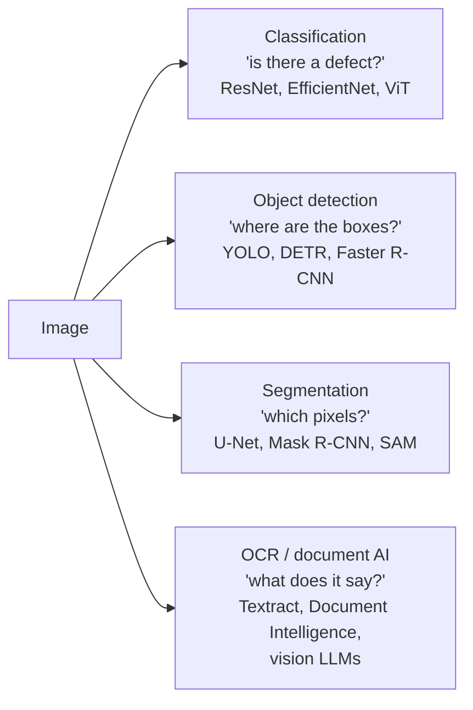

<details><summary><b>▶ Answer</b></summary>

- **CNNs** learn local patterns with convolution filters (edges → textures → parts → objects). Classic backbones: **ResNet** (residual connections), **EfficientNet** (scaled efficiently). **Vision Transformers (ViT)** split the image into patches and use attention; strong with large data/pre-training.
- **Tasks:** classification (one label per image) · **object detection** (boxes + labels: YOLO family for real-time, DETR) · **segmentation** (pixel masks: U-Net in medical/industrial, Mask R-CNN, **Segment Anything** for promptable masks) · OCR/document understanding.
- **Practical recipe:** start from a pre-trained backbone (transfer learning), augment data (flips, crops, colour jitter), handle class imbalance, evaluate with the right metric (accuracy/F1, **mAP** for detection, **IoU/Dice** for segmentation), and optimise for deployment (ONNX/TensorRT, quantisation, edge vs cloud).
- **GenAI shift:** multimodal LLMs (GPT/Claude/Gemini vision) now handle many document and image-understanding tasks zero-shot — great for prototypes and low volume; dedicated CV models still win on **latency, cost at high volume, edge deployment and precise localisation**.

**Example to use (as a design, not a claim):** visual defect detection on a car production line — a YOLO-style detector at the edge for speed, defect images + metadata streamed via Kafka for analytics, an LLM summarising defect trends for engineers. It connects honestly to your BMW quality-management work (defect dashboards on Kafka + Elasticsearch): say *"I built the defect data and visualisation side; this is how I'd add the CV model."*

</details>

**Say this:** *"Classification with ResNet or ViT, detection with YOLO or DETR, segmentation with U-Net or SAM — always from a pre-trained backbone with augmentation. Vision LLMs are great for prototypes and documents; dedicated models still win on latency, cost and edge."*

---

### Q1.12 · L2 · "Explain transformers and attention. Encoder vs decoder vs encoder–decoder?"

**Picture it:**

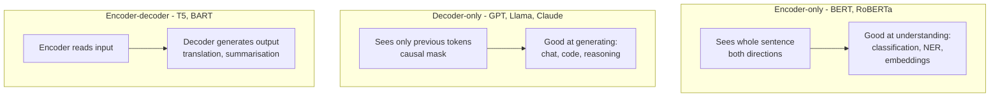

<details><summary><b>▶ Answer</b></summary>

- **Attention:** for each token, the model computes how much to "look at" every other token. Each token gets a **Query**, **Key** and **Value** vector; attention weights = softmax(Q·Kᵀ / √d); output = weighted sum of Values. **Multi-head** attention runs several of these in parallel to capture different relationships (syntax, coreference, topic).
- **Why transformers won:** attention connects any two positions directly (no long chains like RNNs), and it's highly parallel on GPUs → scale to huge data.
- **Other parts:** positional encodings (order information; RoPE in modern LLMs), feed-forward layers, residual connections, layer norm.
- **Three families:**
  - **Encoder-only (BERT)** — bidirectional; best for understanding tasks: classification, NER, **embedding models**.
  - **Decoder-only (GPT, Llama, Claude)** — causal (left-to-right) generation; today's LLMs.
  - **Encoder–decoder (T5, BART)** — input → output transformations like translation and summarisation.
- **Cost:** attention is quadratic in sequence length → long-context tricks (efficient attention kernels like FlashAttention, KV-cache at inference).

</details>

**Say this:** *"Attention lets every token weigh every other token via queries, keys and values. Encoders like BERT understand — classification and embeddings; decoders like GPT generate; encoder-decoders like T5 transform input to output."*

---

### Q1.13 · L3 · "For an NLP task like ticket classification or NER, would you fine-tune BERT or prompt an LLM?"

<details><summary><b>▶ Answer</b></summary>

| Factor | Fine-tuned small model (BERT/DeBERTa, SetFit) | Prompted LLM |
|---|---|---|
| Labelled data | Needs hundreds–thousands | Zero/few-shot |
| Volume & cost | **Cheap at high volume** (CPU/small GPU) | Cost per call adds up |
| Latency | Milliseconds | Hundreds of ms – seconds |
| Accuracy on narrow task | Often **equal or better** once trained | Strong, more variable |
| Flexibility | Retrain for new labels | Change the prompt |
| Explainability/control | Deterministic, testable | Needs evals and guards |

**My approach (hybrid, and a great interview answer):**
1. **Prototype with an LLM** — few-shot prompt, measure on a golden set. Ship if volume is low.
2. If volume is high, **use the LLM to label data** (with human spot-checks), then **distil into a small fine-tuned classifier**.
3. Route **low-confidence cases** from the small model back to the LLM or a human.

This gives LLM-level quality at small-model cost — and it's exactly the "hybrid AI" the [TTN] posting asks for (file 05).

</details>

**Say this:** *"Prototype with a prompted LLM; if volume is high, let the LLM label data and distil into a fine-tuned small model, with low-confidence cases routed back to the LLM. LLM quality at classifier cost."*

---

### Q1.14 · L2 · "How are embedding models trained, and how do you choose one?"

<details><summary><b>▶ Answer</b></summary>

- **Training:** usually **contrastive learning** — pull embeddings of matching pairs together (question ↔ answer passage, image ↔ caption) and push non-matching pairs apart. Hard negatives (similar but wrong) make them sharper.
- **Choosing:** check the **MTEB** leaderboard as a starting point, then evaluate **on your own retrieval set** (recall@k). Consider: language coverage (Hindi/multilingual?), domain (legal, code), **dimensions** (768–3072 — more = better recall but more storage/latency), max input length, licence, hosted vs self-hosted, cost.
- **Matryoshka embeddings** let you truncate dimensions with modest quality loss — cheaper storage.
- **Fine-tuning embeddings** on your domain pairs (e.g., past questions ↔ resolving KB article) often gives a larger retrieval gain than changing the LLM.
- **Changing the embedding model means re-indexing everything** (pack 01 → 02 Q2.16).

</details>

**Say this:** *"Embedding models are trained contrastively on matching pairs. I shortlist from MTEB, then decide on recall@k on our own data, weighing languages, dimensions, cost and licence — and domain fine-tuning of embeddings is often the cheapest retrieval win."*

---

## Part C — Recommendation engines

### Q1.15 · L2 · "Explain the main approaches to building a recommendation engine."

**Picture it:**

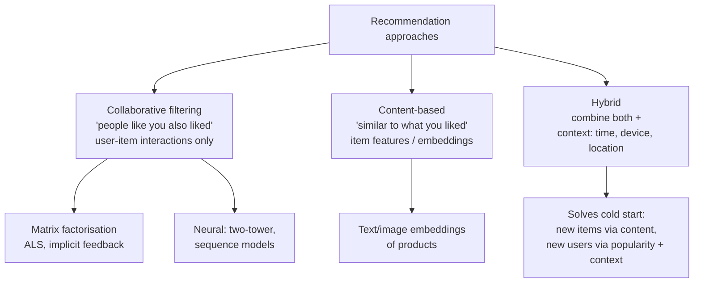

<details><summary><b>▶ Answer</b></summary>

- **Collaborative filtering (CF)** — uses only the interaction matrix (users × items: views, purchases, ratings). *User-based* ("similar users liked…") or *item-based* ("people who bought X bought Y"). **Matrix factorisation** (ALS, SVD) learns a latent vector for every user and item; score = dot product. Works great with lots of interactions; fails on **cold start**.
- **Content-based** — recommends items similar to what the user liked using item attributes or **embeddings** (text, image). Handles new items; can over-specialise ("filter bubble").
- **Hybrid** — combine both plus context (time, device, location, session). Industry standard.
- **Modern neural:** **two-tower models** (user tower + item tower → embeddings → nearest-neighbour search), sequence models (transformer over the user's recent actions — "next item prediction").
- **Implicit vs explicit feedback:** most real data is implicit (clicks, dwell time) — no explicit "dislike", so treat unobserved as weak negatives.
- **Cold start strategies:** new users → popularity + context + onboarding questions; new items → content embeddings; exploration with **bandits**.

</details>

**Say this:** *"Collaborative filtering learns from who-interacted-with-what, content-based from item features or embeddings, and production systems are hybrids — usually two-tower retrieval plus a ranking model, with content and popularity to handle cold start."*

---

### Q1.16 · L3 · "Design a recommendation system for an e-commerce site with 10M users and 1M products."

**Picture it:**

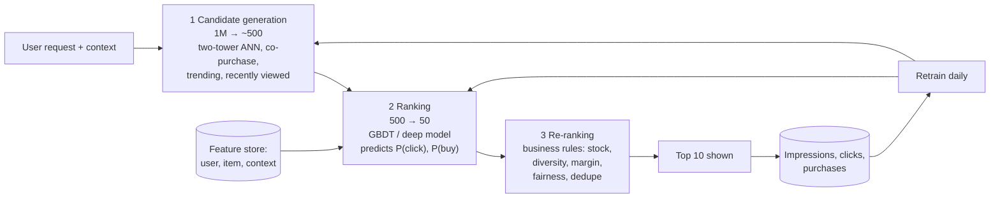

<details><summary><b>▶ Answer</b></summary>

**1. Requirements.** Home page + "similar items" + "frequently bought together"; p99 latency < 100 ms; business goal: revenue per session / conversion; guardrails: diversity, no out-of-stock items.

**2. Multi-stage architecture** (the standard industry pattern):
- **Candidate generation (recall):** cheap, broad. Two-tower model embeddings + **ANN vector search** (FAISS/Milvus/OpenSearch), co-purchase graph, trending in user's city, recently viewed. 1M → ~500.
- **Ranking (precision):** a richer model (LightGBM or a deep ranking model) scores each candidate using user, item and context features from a **feature store**; predicts click and purchase probabilities; combine into one score.
- **Re-ranking:** business rules — in stock, diversity across categories, sponsored slots, margin, freshness, remove already-purchased.

**3. Data & training.** Event stream (Kafka) of impressions, clicks, adds-to-cart, purchases → lakehouse. **Log impressions**, not just clicks — you need negatives. Daily retraining; real-time features (session clicks) via streaming.

**4. Evaluation.** Offline: Recall@k for candidates, NDCG/AUC for ranking, coverage & diversity. **Online A/B test is the truth:** CTR, conversion, revenue per session, long-term retention. Watch **position bias** and **feedback loops** (the model only learns from what it showed).

**5. Cold start & exploration.** Content embeddings for new products, popularity for new users, a small exploration budget (bandits).

**6. Where GenAI fits:** product embeddings from text + images, LLM-generated explanations ("Recommended because you bought running shoes"), conversational shopping assistant that calls the recommender as a tool, LLM-based query understanding for search.

**7. Scale.** Precompute candidates for heavy users nightly; cache; serve ranking model on CPU with optimised runtime; ANN index sharded.

</details>

**Say this:** *"Three stages: cheap candidate generation with two-tower ANN and co-purchase signals, a ranking model on feature-store features, then business re-ranking for stock and diversity. Log impressions for negatives, judge it by online A/B on revenue per session, and use GenAI for embeddings, explanations and conversational shopping."*

---

### Q1.17 · L3 · "How are LLMs changing recommendation systems?"

<details><summary><b>▶ Answer</b></summary>

- **Better item understanding:** LLM/multimodal embeddings of product text and images → much better content-based and cold-start recommendations.
- **Conversational recommendation:** "I need a gift for my dad who likes trekking under ₹3,000" → LLM extracts intent/constraints → calls search + recommender tools → explains picks. (Agent + classical recommender = hybrid.)
- **Explanations** generated from the features that drove the ranking.
- **LLM as re-ranker** for small candidate sets where quality matters more than latency.
- **Synthetic data / labelling** — generate queries, judge relevance offline.
- **Limits:** LLMs are too slow and expensive to score millions of items per request; they don't learn collaborative signals by themselves. So: **classical retrieval + ranking for scale, LLM for understanding, conversation and explanation.**

</details>

**Say this:** *"LLMs improve item understanding, enable conversational shopping and explanations, and can re-rank small sets — but collaborative signals and million-item scoring still need classical retrieval and ranking. It's a hybrid."*

---

## Part D — Hands-on

### Q1.18 · L2 · "Walk me through an end-to-end scikit-learn pipeline you'd write for a churn model."

<details><summary><b>▶ Answer</b></summary>

```python
import pandas as pd
from sklearn.model_selection import train_test_split
from sklearn.compose import ColumnTransformer
from sklearn.preprocessing import OneHotEncoder, StandardScaler
from sklearn.impute import SimpleImputer
from sklearn.pipeline import Pipeline
from sklearn.metrics import average_precision_score, classification_report
from lightgbm import LGBMClassifier

df = pd.read_parquet("customers.parquet")
y = df.pop("churned")
num = ["tenure_months", "monthly_spend", "tickets_90d", "logins_30d"]
cat = ["plan", "region", "payment_method"]

pre = ColumnTransformer([
    ("num", Pipeline([("imp", SimpleImputer(strategy="median")), ("sc", StandardScaler())]), num),
    ("cat", Pipeline([("imp", SimpleImputer(strategy="most_frequent")),
                      ("oh", OneHotEncoder(handle_unknown="ignore"))]), cat),
])

clf = Pipeline([("pre", pre),
                ("model", LGBMClassifier(n_estimators=500, learning_rate=0.05,
                                         class_weight="balanced", random_state=42))])

X_train, X_test, y_train, y_test = train_test_split(df, y, test_size=0.2,
                                                    stratify=y, random_state=42)
clf.fit(X_train, y_train)
proba = clf.predict_proba(X_test)[:, 1]
print("PR-AUC:", average_precision_score(y_test, proba))
print(classification_report(y_test, proba > 0.35))   # threshold chosen from business cost
```

**Explain each piece in the interview:**
- `ColumnTransformer` applies different preprocessing to numeric and categorical columns.
- `SimpleImputer` fills missing values; `StandardScaler` scales numbers; `OneHotEncoder(handle_unknown="ignore")` turns categories into columns and won't crash on unseen categories in production.
- Wrapping everything in one `Pipeline` means preprocessing is **fit only on training data** (no leakage) and the **same object** is saved and served.
- `LGBMClassifier` — gradient boosting; `class_weight="balanced"` handles imbalance.
- `stratify=y` keeps the churn ratio equal in train/test. *(If data is time-ordered, use a time-based split instead.)*
- `average_precision_score` = PR-AUC, the right metric for imbalance; the 0.35 threshold comes from the cost of a retention offer vs a lost customer.
- **Next steps to mention:** cross-validation + hyper-parameter search (Optuna), SHAP for explanations, log the run and model to **MLflow**, register it, deploy as batch scoring.

</details>

---

## ⚡ Rapid-fire

| Question | One-line answer |
|---|---|
| Bagging vs boosting? | Parallel independent models to cut variance vs sequential models fixing errors to cut bias. |
| Why PR-AUC over ROC-AUC? | ROC-AUC stays high on imbalanced data even when the rare class is predicted poorly. |
| L1 vs L2? | L1 zeroes weights (feature selection); L2 shrinks them smoothly. |
| Silhouette score? | How well a point fits its cluster vs the nearest other cluster (−1 to 1). |
| Isolation Forest idea? | Anomalies get isolated in fewer random splits. |
| SMOTE pitfall? | Applying it before the split leaks synthetic copies into the test set. |
| Vanishing gradients fix? | ReLU/GELU, residual connections, normalisation. |
| AdamW? | Adam with decoupled weight decay — the default for transformers. |
| mAP / IoU? | Detection accuracy across thresholds / overlap of predicted and true regions. |
| BERT vs GPT? | Bidirectional encoder for understanding vs causal decoder for generation. |
| Two-tower model? | Separate user and item networks producing embeddings matched by ANN search. |
| Cold start? | No history for a new user/item; use content, popularity, context, exploration. |
| NDCG? | Ranking quality that rewards relevant items placed higher. |
| Position bias? | Users click top slots more regardless of relevance; correct for it in training. |
| SHAP? | Per-prediction feature contributions based on Shapley values. |
