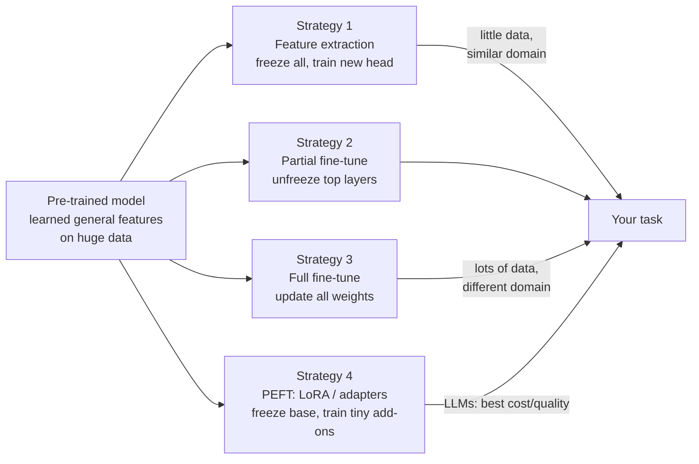
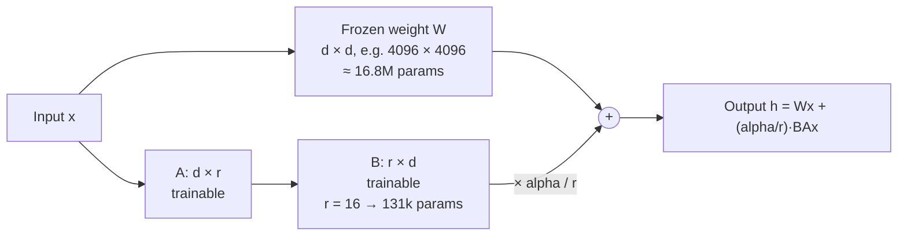
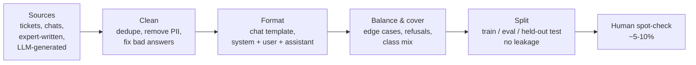
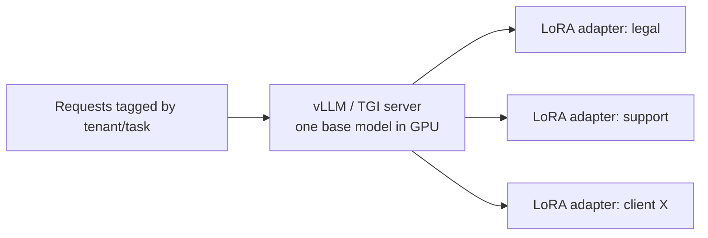

# 02 — Model Training, Fine-Tuning, LoRA/QLoRA & Transfer Learning

> **JD lines covered:** [TTN] experience with model training and fine-tuning, **including LoRA/QLoRA and transfer learning** · PyTorch, TensorFlow, **Hugging Face** · [DBX] HuggingFace in production.
>
> **Already covered:** *when* to fine-tune vs RAG (decision level) → [pack 01 / 03 Q3.15](../01-ai-engineering-leader/03-genai-rag-agents-copilots.md). This file is the **how** — mechanics, code, memory maths, failure modes.
>
> **Do this once for real:** run the QLoRA script in Q2.5 on a free Colab/Kaggle GPU with a tiny dataset. Then "I've fine-tuned with QLoRA" is true, and you'll answer follow-ups from experience.

---

### Q2.1 · L1 · "What is transfer learning, and what are the strategies?"

**Picture it:**



<details><summary><b>▶ Answer</b></summary>

**Transfer learning** = start from a model already trained on a large, general dataset and adapt it to your task. Early layers have learned general features (edges and textures in vision; grammar and meaning in language), so you need far less data and compute than training from scratch.

| Strategy | When |
|---|---|
| **Feature extraction** — freeze the backbone, train only a new output head (or a classical model on the embeddings) | Small dataset, task similar to pre-training |
| **Partial fine-tuning** — unfreeze the top layers, low learning rate | Medium data |
| **Full fine-tuning** — update everything | Lots of data, domain quite different, enough GPU |
| **Parameter-efficient fine-tuning (PEFT)** — freeze the base, train small added parameters (LoRA, adapters, prefix tuning) | **Default for LLMs**: a fraction of the memory, one base model can serve many adapters |

**Tips:** lower learning rate for pre-trained layers than for the new head (discriminative learning rates); gradual unfreezing; keep the same preprocessing the base model was trained with (image normalisation, tokenizer).

</details>

**Say this:** *"Reuse what a big model already learned. Freeze and train a head for small data, unfreeze more as data grows, and for LLMs use parameter-efficient methods like LoRA by default."*

---

### Q2.2 · L2 · "Full fine-tuning vs PEFT — why has PEFT become the default for LLMs?"

<details><summary><b>▶ Answer</b></summary>

**Memory maths (the argument that wins the interview)** — for a **7–8B parameter** model:
- Weights in fp16/bf16: ~2 bytes/param → **~14–16 GB** just to load.
- **Full fine-tuning with AdamW** needs weights + gradients + two optimiser states (+ fp32 master copy): roughly **16 bytes/param → ~110–130 GB**, plus activations → multiple 80 GB GPUs.
- **LoRA** — base frozen (no gradients/optimiser for it); trains ~0.1–1% extra params → fits on **one 40–80 GB GPU** in bf16.
- **QLoRA** — base loaded in **4-bit** (~0.5 bytes/param → ~4–5 GB) + LoRA adapters → fits on a **single 16–24 GB GPU**.

**Other PEFT benefits:**
- Adapter files are tiny (tens of MB) → **one base model, many adapters** (one per customer/task), swapped at serve time.
- Less **catastrophic forgetting** — base weights untouched.
- Faster experiments, cheaper storage.

**When full fine-tuning still wins:** large domain shift with lots of data, or when you need maximum quality and have the compute (e.g., continued pre-training on a new language).

</details>

**Say this:** *"Full fine-tuning an 8B model needs roughly 16 bytes per parameter — over 100 GB. LoRA freezes the base and trains under 1% extra; QLoRA loads the base in 4-bit, so it fits on one 24 GB GPU — with tiny adapters you can swap per task."*

---

### Q2.3 · L2 · "Explain LoRA. What are rank, alpha and target modules?"

**Picture it:**



<details><summary><b>▶ Answer</b></summary>

- **Idea:** the *change* a fine-tune needs to make to a big weight matrix is **low-rank** — it can be approximated by the product of two thin matrices. So instead of updating `W` (d×d), keep it **frozen** and learn `ΔW = B·A` where `A` is d×r and `B` is r×d with small **rank r** (8–64).
- **Parameter saving:** for a 4096×4096 matrix, full update = ~16.8M params; LoRA with r=16 = 2 × 4096 × 16 ≈ **131k** (~0.8%).
- **`B` initialised to zero** → at the start the model behaves exactly like the base model; training moves it gradually.
- **Hyper-parameters:**
  - **r (rank):** capacity of the adapter. 8–16 for style/format tasks; 32–64 for harder domain adaptation.
  - **alpha:** scaling factor; effective scale = alpha / r. Common: alpha = r or 2r.
  - **target_modules:** which layers get adapters — attention projections (`q_proj`, `k_proj`, `v_proj`, `o_proj`) and often MLP layers (`gate_proj`, `up_proj`, `down_proj`). Targeting all linear layers usually gives better quality.
  - **dropout:** 0.05–0.1 regularisation on the adapter path.
- **After training:** either keep the adapter separate (swap at serve time) or **merge** `W + BA` into the base weights → zero extra inference latency.

</details>

**Say this:** *"LoRA freezes W and learns a low-rank update B·A — under 1% of the parameters. Rank sets capacity, alpha over r sets the scale, target modules choose which layers adapt, and you can merge it back for zero extra latency."*

---

### Q2.4 · L3 · "What does QLoRA add on top of LoRA? Any quality trade-off?"

<details><summary><b>▶ Answer</b></summary>

QLoRA = **LoRA on top of a 4-bit quantised, frozen base model**. Three ideas:
1. **4-bit NormalFloat (NF4)** — a 4-bit data type designed for normally distributed weights, losing less information than plain int4.
2. **Double quantisation** — even the quantisation constants are quantised, saving more memory.
3. **Paged optimisers** — optimiser states page to CPU memory during spikes, avoiding out-of-memory crashes.

The base is stored in 4-bit but **computation happens in bf16** (weights are de-quantised on the fly); gradients flow only into the LoRA adapters (kept in bf16).

**Trade-offs:**
- Quality is typically **close to 16-bit LoRA** for most tasks; small degradation is possible — verify on your eval set.
- **Slower per step** than LoRA (de-quantisation overhead).
- **Serving:** you can't simply merge an adapter into 4-bit weights cleanly — usual path is to merge into the bf16 base, then quantise again (e.g., AWQ/GPTQ) for inference if needed.

**Rule of thumb:** QLoRA when GPU memory is the constraint (single consumer/mid GPU); LoRA in bf16 when you have the memory and want speed.

</details>

**Say this:** *"QLoRA trains LoRA adapters on a 4-bit NF4-quantised frozen base with double quantisation and paged optimisers. Quality is close to 16-bit LoRA, it's slower per step, and for serving you merge into a bf16 base and re-quantise."*

---

### Q2.5 · L3 · "Show me how you'd fine-tune an open model with QLoRA using Hugging Face."

<details><summary><b>▶ Answer</b></summary>

```python
# pip install transformers peft trl bitsandbytes datasets accelerate
import torch
from datasets import load_dataset
from transformers import AutoTokenizer, AutoModelForCausalLM, BitsAndBytesConfig
from peft import LoraConfig, prepare_model_for_kbit_training
from trl import SFTTrainer, SFTConfig

base = "meta-llama/Llama-3.1-8B-Instruct"        # any open instruct model you have access to

bnb = BitsAndBytesConfig(                         # 4-bit loading = the "Q" in QLoRA
    load_in_4bit=True,
    bnb_4bit_quant_type="nf4",
    bnb_4bit_use_double_quant=True,
    bnb_4bit_compute_dtype=torch.bfloat16,
)
tok = AutoTokenizer.from_pretrained(base)
model = AutoModelForCausalLM.from_pretrained(base, quantization_config=bnb, device_map="auto")
model = prepare_model_for_kbit_training(model)   # enables gradient checkpointing etc.

lora = LoraConfig(
    r=16, lora_alpha=32, lora_dropout=0.05, task_type="CAUSAL_LM",
    target_modules=["q_proj", "k_proj", "v_proj", "o_proj", "gate_proj", "up_proj", "down_proj"],
)

# JSONL rows like {"messages": [{"role":"user","content":...},{"role":"assistant","content":...}]}
data = load_dataset("json", data_files={"train": "train.jsonl", "eval": "eval.jsonl"})

args = SFTConfig(
    output_dir="out-qlora",
    num_train_epochs=2,
    per_device_train_batch_size=4,
    gradient_accumulation_steps=4,               # effective batch 16
    learning_rate=2e-4,                          # LoRA tolerates higher LR than full FT
    lr_scheduler_type="cosine", warmup_ratio=0.03,
    bf16=True, logging_steps=10,
    eval_strategy="steps", eval_steps=100, save_steps=100,
)

trainer = SFTTrainer(model=model, args=args, peft_config=lora,
                     train_dataset=data["train"], eval_dataset=data["eval"],
                     processing_class=tok)
trainer.train()
trainer.save_model("out-qlora/adapter")          # saves only the small LoRA adapter
```

**Explain each library in one line:**
- **transformers** — loads models/tokenizers from the Hugging Face Hub.
- **bitsandbytes** (via `BitsAndBytesConfig`) — 4-bit/8-bit quantisation on GPU.
- **peft** — LoRA and other parameter-efficient methods (`LoraConfig`).
- **trl** — training helpers for LLMs: `SFTTrainer` for supervised fine-tuning, plus DPO trainers.
- **datasets** — loads and processes datasets efficiently.
- **accelerate** — handles devices and multi-GPU under the hood (`device_map="auto"`).

**Note:** these libraries change their argument names between versions — check the current docs before a live coding round, and say so in the interview (it shows real experience).

</details>

**Say this:** *"Load the base in 4-bit NF4 with bitsandbytes, prepare it for k-bit training, attach a LoRA config with peft, and train with trl's SFTTrainer on chat-formatted JSONL — then save just the adapter."*

---

### Q2.6 · L3 · "How do you prepare data for fine-tuning an LLM?"

**Picture it:**



<details><summary><b>▶ Answer</b></summary>

- **Quality beats quantity.** A few hundred to a few thousand **excellent** examples often beat 100k noisy ones. Bad examples teach bad behaviour.
- **Sources:** historical tickets/chats (only the *good* resolutions), expert-written examples, **synthetic data** from a strong LLM (then human-reviewed — and check the model provider's terms allow it).
- **Format:** the model's **chat template** (system/user/assistant roles); consistent output format; include examples of **refusals and "I don't know"** if you want that behaviour.
- **Coverage:** edge cases, all classes/intents, different lengths and languages.
- **Clean:** deduplicate (near-duplicates too), remove PII/secrets, fix contradictions.
- **Split carefully:** train/eval/test with no overlap (group by customer or document); keep a **held-out test** untouched until the end.
- **Track lineage:** dataset version → training run → model version (MLflow).
- **Legal:** do we have rights to train on this data? Personal data in fine-tuning is hard to "forget" later.

</details>

**Say this:** *"Hundreds to thousands of excellent, deduplicated, PII-free examples in the model's chat template — covering edge cases and refusals — split without leakage, spot-checked by humans, versioned, and legally cleared."*

---

### Q2.7 · L3 · "What goes wrong in fine-tuning, and how do you spot it?"

<details><summary><b>▶ Answer</b></summary>

| Failure | Symptom | Fix |
|---|---|---|
| **Overfitting** | Train loss keeps falling, eval loss rises; model parrots training answers | Fewer epochs (1–3 is typical), more/diverse data, early stopping, higher dropout, lower rank |
| **Catastrophic forgetting** | Gets better at the task, worse at general skills or safety | PEFT, lower LR, mix in general instruction data, evaluate general benchmarks too |
| **Format collapse** | Ignores instructions, always answers the same way | More varied prompts, include system prompt variety |
| **Learning rate too high** | Loss spikes / diverges | Lower LR, warm-up |
| **Wrong chat template** | Garbled or never-ending outputs | Use the tokenizer's template for both training and inference; correct EOS tokens |
| **Data leakage** | Great eval, poor production | Group-based split; test on truly new data |
| **Safety regression** | Model becomes easier to jailbreak | Run red-team suite after fine-tuning; include refusal examples |

**Watch:** train/eval loss curves, task metrics on the golden set every N steps, a small general-capability and safety eval.

</details>

**Say this:** *"Overfitting, catastrophic forgetting, format collapse, bad learning rate, wrong chat template, leakage and safety regressions. I watch eval loss and the golden set during training, plus a general and safety check after."*

---

### Q2.8 · L3 · "How do you evaluate whether fine-tuning was worth it?"

<details><summary><b>▶ Answer</b></summary>

Compare **three contenders on the same held-out test set**: (1) base model with best prompt, (2) base model + RAG/few-shot, (3) fine-tuned model.

- **Task metrics:** accuracy/F1 for classification, exact match/field accuracy for extraction, LLM-judge + human rubric for generation.
- **Operational:** latency, tokens per request (fine-tuned models often need much shorter prompts), cost per 1k requests, hosting cost.
- **Regressions:** general capability sample, safety/red-team suite.
- **Total cost of ownership:** training + hosting + **retraining when the base model is deprecated** or data changes.

Ship it only if it wins on quality **or** on cost at equal quality — and someone owns retraining.

</details>

**Say this:** *"Same held-out set for best-prompt base, base plus RAG, and fine-tuned — comparing quality, latency, cost and safety regressions — and it ships only if it wins and someone owns retraining."*

---

### Q2.9 · L3 · "How do you serve fine-tuned models in production?"

**Picture it:**


*Multi-LoRA serving: many adapters share one base model in GPU memory.*

<details><summary><b>▶ Answer</b></summary>

- **Option A — merge and serve:** merge LoRA into base → one model; quantise (AWQ/GPTQ/FP8) for speed; serve with **vLLM/TGI/TensorRT-LLM** on GPU nodes (EKS/AKS) or a managed endpoint (SageMaker, Databricks Model Serving).
- **Option B — multi-LoRA serving:** keep adapters separate; vLLM and similar servers can load **many adapters on one base** and pick per request → cost-efficient for many tenants/tasks.
- **Managed options:** Amazon Bedrock **Custom Model Import** (bring your fine-tuned open-weight model) or Bedrock's own fine-tuning for supported models; SageMaker endpoints; Databricks Model Serving; Vertex AI / Gemini Enterprise Agent Platform tuning and endpoints; Azure AI Foundry fine-tuning.
- **Ops:** autoscale on queue depth, put it behind the same AI gateway (pack 01 → 02 Q2.8), version adapters in a registry (MLflow), canary new adapters.

</details>

**Say this:** *"Either merge the adapter and serve a quantised model on vLLM, or keep adapters separate and use multi-LoRA serving so many tenants share one base. Managed routes are Bedrock Custom Model Import, SageMaker or Databricks Model Serving — always behind the gateway with registry versioning."*

---

### Q2.10 · L3 · "What are RLHF and DPO, and when would you use preference tuning?"

<details><summary><b>▶ Answer</b></summary>

- **SFT** teaches the model *what a good answer looks like* from examples.
- **Preference tuning** teaches *which of two answers is better* — for tone, helpfulness, safety, following a style guide.
  - **RLHF:** train a reward model on human preference pairs, then optimise the LLM against it with RL (PPO). Powerful, complex, unstable.
  - **DPO (Direct Preference Optimization):** optimises directly on (prompt, chosen, rejected) pairs with a simple loss — no separate reward model or RL loop. Much simpler; the common choice for enterprise teams (TRL has a `DPOTrainer`). Variants: ORPO, KTO, SimPO.
- **Use it when:** SFT outputs are correct but the *style or judgement* is off (too verbose, wrong tone, over-refusing), and you can collect preference pairs (e.g., agents picking the better of two drafts in a copilot — free preference data).

</details>

**Say this:** *"SFT shows good answers; preference tuning teaches which answer is better. RLHF uses a reward model and RL; DPO trains directly on chosen-vs-rejected pairs and is the practical choice. A copilot where users pick between drafts generates that data for free."*

---

### Q2.11 · L2 · "Classical transfer learning: how would you build an image classifier with only 2,000 labelled images?"

<details><summary><b>▶ Answer</b></summary>

```python
import torch, torch.nn as nn
from torchvision import models, transforms, datasets

tfm = transforms.Compose([
    transforms.RandomResizedCrop(224), transforms.RandomHorizontalFlip(),
    transforms.ColorJitter(0.2, 0.2, 0.2), transforms.ToTensor(),
    transforms.Normalize([0.485, 0.456, 0.406], [0.229, 0.224, 0.225]),   # ImageNet stats
])
train = datasets.ImageFolder("data/train", transform=tfm)
loader = torch.utils.data.DataLoader(train, batch_size=32, shuffle=True)

model = models.resnet50(weights=models.ResNet50_Weights.DEFAULT)   # pre-trained backbone
for p in model.parameters():
    p.requires_grad = False                                          # stage 1: freeze backbone
model.fc = nn.Linear(model.fc.in_features, len(train.classes))       # new head for our classes

optimizer = torch.optim.AdamW(model.fc.parameters(), lr=1e-3)
# train the head for a few epochs, then stage 2: unfreeze layer4 and train with lr ~1e-4
```

- `torchvision.models.resnet50(weights=...)` loads ImageNet-pre-trained weights.
- Freezing (`requires_grad = False`) keeps general features; replacing `model.fc` adds our task head.
- **Augmentation** multiplies the effective dataset; **normalising with ImageNet statistics** matches what the backbone expects.
- **Stage 2:** unfreeze the last block with a lower learning rate for extra accuracy.
- Evaluate on a held-out set with per-class precision/recall; check the confusion matrix for classes that get mixed up.

</details>

**Say this:** *"Pre-trained ResNet or ViT, freeze the backbone, train a new head with heavy augmentation and ImageNet normalisation, then unfreeze the top block at a lower learning rate."*

---

## ⚡ Rapid-fire

| Question | One-line answer |
|---|---|
| LoRA in one line? | Freeze W, learn a low-rank update B·A. |
| Why B = 0 at init? | Model starts identical to base; training moves it gradually. |
| Typical LoRA rank? | 8–16 for style/format; 32–64 for harder adaptation. |
| NF4? | 4-bit NormalFloat type used by QLoRA for normally-distributed weights. |
| Memory for full FT with Adam? | ~16 bytes/param (weights, grads, 2 optimiser states, master copy). |
| Typical LoRA learning rate? | ~1e-4 to 2e-4 (higher than full fine-tuning). |
| Epochs for SFT? | Usually 1–3; more risks overfitting. |
| Catastrophic forgetting? | Losing general abilities after narrow fine-tuning. |
| DPO needs? | (prompt, chosen, rejected) preference pairs. |
| Multi-LoRA serving? | Many adapters share one base model in GPU memory. |
| Gradient accumulation? | Sum gradients over several small batches to simulate a large one. |
| Gradient checkpointing? | Recompute activations in backward pass to save memory. |
