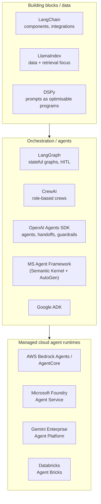
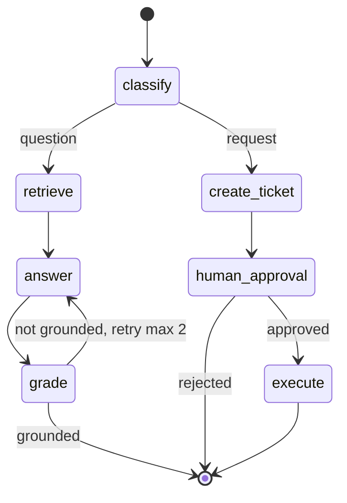
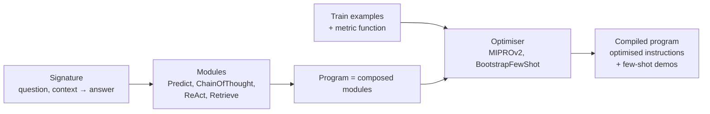
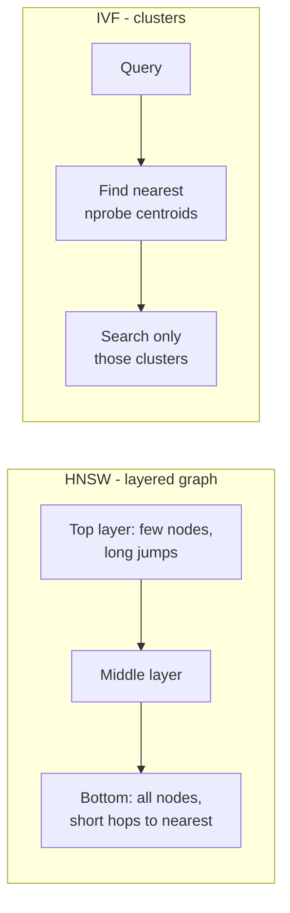
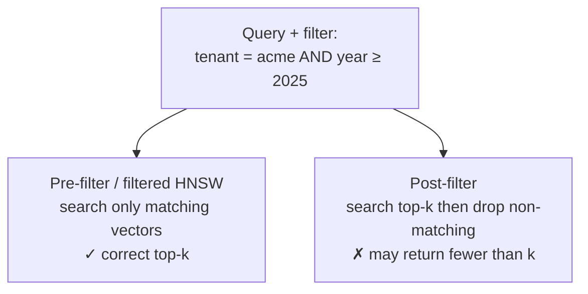
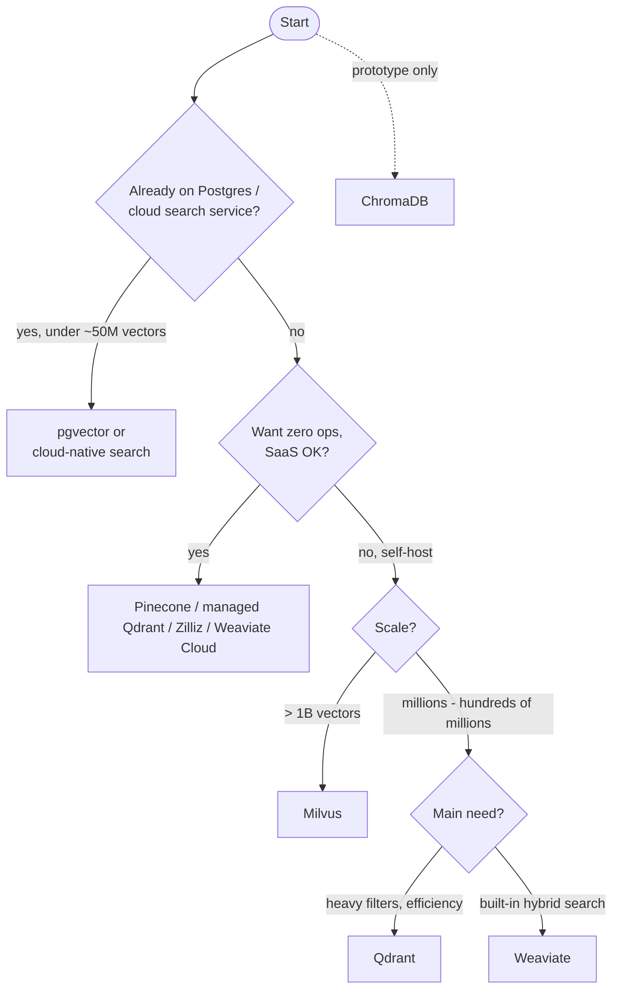

# 03 — GenAI Frameworks & Vector Databases

> **JD lines covered:** [TTN] agent frameworks — **LangChain, CrewAI, Bedrock Agents, OpenAI SDK** · vector DBs — **Pinecone, Weaviate, Qdrant, Milvus, ChromaDB**. [TUR] frameworks — **LangGraph, LangChain, LlamaIndex, Semantic Kernel**; retrieval — vector databases. [DBX] **LangChain, DSPy**, HuggingFace.
>
> **Already covered:** RAG design, agent design principles, MCP/A2A, evals → [pack 01 / 03](../01-ai-engineering-leader/03-genai-rag-agents-copilots.md). This file is about **tools**: what each framework/DB is, when to pick it, and code you can talk through.
>
> ⚠️ These libraries change fast — APIs below reflect late 2026; always say "I'd check the current version" in a live coding round.

---

## Part A — Frameworks

### Q3.1 · L2 · "Compare the main GenAI / agent frameworks."

**Picture it:**



<details><summary><b>▶ Answer</b></summary>

| Framework | What it's best at | Watch out |
|---|---|---|
| **LangChain** | Huge integration library (models, vector stores, loaders, tools); quick composition | Abstractions can be heavy; versions move fast |
| **LangGraph** | **Stateful, controllable agent workflows** as graphs: explicit state, cycles, checkpoints, human-in-the-loop, durable runs | More code than a simple chain; you design the graph |
| **LlamaIndex** | **Data/RAG-first**: ingestion, parsing, many index types, query engines, agentic retrieval | Less focused on general orchestration |
| **CrewAI** | **Role-based multi-agent** ("researcher", "writer") — fast to prototype collaborative agents; Flows for structured control | Less fine-grained control; validate cost/loops |
| **OpenAI Agents SDK** | Lightweight: agents, tools, **handoffs** between agents, guardrails, built-in tracing | Best with OpenAI models (supports others via adapters) |
| **Microsoft Agent Framework / Semantic Kernel** | Enterprise SDK for **.NET, Python, Java**; plugins, planners, multi-agent; Azure integration | Azure-centric ecosystem |
| **Google ADK** | Code-first agents and multi-agent systems; deploys to Google's agent runtime | GCP-centric |
| **DSPy** | Replace hand-written prompts with **declarative modules optimised against a metric** | Different mental model; needs eval data |
| **Managed runtimes** (Bedrock AgentCore, Foundry Agent Service, Gemini Enterprise Agent Platform, Databricks Agent Bricks) | Hosting, identity, memory, tool gateways, policy, observability, evals — ops handled | Cloud lock-in; less control |

**Senior take:** frameworks are **replaceable plumbing**. What lasts is the eval set, the tool layer (MCP), the gateway and the data. I keep business logic in plain code and tools, and keep the framework thin so I can swap it.

</details>

**Say this:** *"LangChain for integrations, LangGraph for controllable stateful agents, LlamaIndex for data-heavy RAG, CrewAI for quick role-based crews, OpenAI Agents SDK for lightweight handoffs, Semantic Kernel/Agent Framework for .NET and Java shops, DSPy to optimise prompts — and managed runtimes when ops matter more than control. I keep the framework thin."*

---

### Q3.2 · L3 · "LangChain vs LangGraph — when do you need a graph? Walk me through LangGraph's concepts."

**Picture it:**



<details><summary><b>▶ Answer</b></summary>

- **LangChain chains** are great for linear flows (prompt → model → parser, or simple RAG).
- **LangGraph** when the flow needs **branching, loops, retries, memory across steps, human approval, or long-running/resumable execution**. Most production agents.

**Core concepts:**
- **State** — a typed object (TypedDict/Pydantic) passed between steps; every node reads and returns updates.
- **Nodes** — functions (LLM call, tool call, plain Python).
- **Edges** — fixed or **conditional** (route based on state).
- **Checkpointer** — persists state after each step (memory/SQLite/Postgres) → resume after crash, time-travel debugging, multi-turn memory per `thread_id`.
- **Interrupts** — pause the graph for **human-in-the-loop** approval and resume with the human's input.
- **Streaming** of tokens and intermediate steps to the UI.

```python
from typing import TypedDict
from langgraph.graph import StateGraph, START, END
from langgraph.checkpoint.memory import MemorySaver

class State(TypedDict):
    question: str
    docs: list[str]
    answer: str
    attempts: int

def retrieve(s: State):  return {"docs": search(s["question"])}            # your retriever
def generate(s: State):  return {"answer": llm_answer(s["question"], s["docs"]),
                                 "attempts": s.get("attempts", 0) + 1}
def route(s: State):     return END if is_grounded(s["answer"], s["docs"]) or s["attempts"] >= 2 else "generate"

g = StateGraph(State)
g.add_node("retrieve", retrieve)
g.add_node("generate", generate)
g.add_edge(START, "retrieve")
g.add_edge("retrieve", "generate")
g.add_conditional_edges("generate", route)          # loop back if not grounded
app = g.compile(checkpointer=MemorySaver())          # state saved per thread_id

app.invoke({"question": "What is our leave policy?"},
           config={"configurable": {"thread_id": "user-42"}})
```
- `StateGraph(State)` defines the workflow over a typed state; `add_conditional_edges` routes based on a function; `MemorySaver` checkpoints state (use Postgres in production); `thread_id` separates conversations.

</details>

**Say this:** *"Chains for linear flows; LangGraph once I need branches, loops, retries, human approval or resumable runs. It's typed state, nodes, conditional edges, a checkpointer for durability and memory, and interrupts for human-in-the-loop."*

---

### Q3.3 · L2 · "When would you choose LlamaIndex?"

<details><summary><b>▶ Answer</b></summary>

When the problem is mainly **getting the right data to the model**:
- Rich **data connectors** and parsing (PDFs, tables, slides — LlamaParse for complex documents).
- Many **index types**: vector, keyword, summary, knowledge-graph/property-graph; composable.
- **Query engines** with routing, sub-question decomposition (multi-hop), re-ranking, response synthesis.
- **Agentic retrieval** and workflows for document-heavy agents (contracts, research, reports).

Typical split: **LlamaIndex for ingestion/retrieval**, LangGraph (or plain code) for orchestration — they interoperate.

</details>

**Say this:** *"LlamaIndex when the hard part is data — complex document parsing, multiple index types and query engines that decompose multi-hop questions. I often pair it with LangGraph for orchestration."*

---

### Q3.4 · L2 · "What is CrewAI, and what are its pros and cons?"

<details><summary><b>▶ Answer</b></summary>

- **Concepts:** **Agents** (role, goal, backstory, tools, LLM) · **Tasks** (description, expected output, assigned agent) · **Crew** (agents + tasks + process: *sequential* or *hierarchical* with a manager agent) · **Flows** (event-driven, structured control around crews, with state).
- **Pros:** very fast to prototype multi-agent collaboration; readable role-based design that business stakeholders understand; good for content/research pipelines.
- **Cons:** less fine-grained control of each step than LangGraph; multi-agent chatter increases **token cost and latency**; you still need evals, guardrails, tracing and limits.
- **When I'd use it:** prototypes and internal research/content workflows; for regulated, action-taking production agents I prefer explicit graphs (or CrewAI Flows with strict structure).

</details>

**Say this:** *"CrewAI models agents as roles with tasks in a crew — sequential or with a manager — and Flows add structure. Brilliant for fast prototypes and content pipelines; for regulated, action-taking agents I want LangGraph-level control."*

---

### Q3.5 · L2 · "Explain the OpenAI Agents SDK."

<details><summary><b>▶ Answer</b></summary>

A lightweight Python/TypeScript framework with a few primitives:
- **Agent** — instructions + model + tools (Python functions become tools via a decorator) + optional structured output type.
- **Handoffs** — an agent can transfer the conversation to another specialised agent (triage → billing agent).
- **Guardrails** — input/output checks that run alongside and can stop the run.
- **Sessions** — conversation memory.
- **Tracing** — built-in traces of every LLM call, tool call and handoff.

```python
from agents import Agent, Runner, function_tool

@function_tool
def order_status(order_id: str) -> str:
    """Return the shipping status for an order."""
    return lookup(order_id)                       # your system call

billing = Agent(name="Billing", instructions="Handle refunds and invoices.")
support = Agent(name="Support",
                instructions="Answer order questions. Hand off billing issues.",
                tools=[order_status], handoffs=[billing])

result = Runner.run_sync(support, "Where is order 123, and can I get a refund?")
print(result.final_output)
```
- `@function_tool` turns a typed, documented function into a tool schema; `handoffs=[billing]` lets Support pass control; `Runner.run_sync` runs the agent loop until a final answer.

</details>

**Say this:** *"Agents with tools, handoffs between specialists, guardrails and built-in tracing — minimal abstractions, good for quick, clean multi-agent apps."*

---

### Q3.6 · L2 · "What is Semantic Kernel, and why does it matter for Java/.NET enterprises?"

<details><summary><b>▶ Answer</b></summary>

- **Semantic Kernel (SK)** — Microsoft's open-source SDK for **C#, Python and Java** to build AI apps: a **kernel** holding AI services and **plugins** (native functions + prompt functions), function calling, memory/vector connectors, filters (for logging, safety), and agent abstractions.
- **Microsoft Agent Framework** is the successor that unifies **Semantic Kernel and AutoGen** into one framework for agents and multi-agent workflows, integrating with Microsoft Foundry.
- **Why it matters:** enterprises with large **Java or .NET** estates can add AI without rewriting in Python — the plugin model maps neatly onto existing services. (In Java, also know **Spring AI** and **LangChain4j**.)
- **Your angle:** Java/Spring Boot is your strength — "I can bring GenAI into Java estates with Spring AI, LangChain4j or Semantic Kernel Java, exposing existing services as plugins/tools."

</details>

**Say this:** *"Semantic Kernel is Microsoft's SDK for C#, Python and Java — kernel, plugins, function calling, filters — now folded with AutoGen into Microsoft Agent Framework. It lets Java and .NET enterprises add agents without a Python rewrite, alongside Spring AI and LangChain4j."*

---

### Q3.7 · L3 · "What is DSPy, and how is it different from prompt engineering?"

> **Why they ask:** explicitly in [DBX]. Shows you think about GenAI quality systematically.

**Picture it:**



<details><summary><b>▶ Answer</b></summary>

- **Idea:** "programming, not prompting." Instead of hand-tuning prompt strings, you declare **what** each step does and let DSPy **optimise how** it's prompted, against a metric on your data.
- **Signatures** — typed input/output specs: `"question, context -> answer"`.
- **Modules** — reusable strategies: `Predict`, `ChainOfThought`, `ReAct` (tools), composed into a program like normal Python.
- **Optimisers (teleprompters)** — e.g., `BootstrapFewShot`, `MIPROv2` — search instructions and few-shot examples to maximise your **metric** on a training set. Some can also fine-tune weights.
- **Benefits:** prompts become reproducible artefacts; **switching models = re-compile**, not re-write prompts by hand; quality improves measurably.
- **Cost:** needs a labelled dev set and a reliable metric; optimisation runs consume many LLM calls.

```python
import dspy
dspy.configure(lm=dspy.LM("openai/gpt-4o-mini"))           # any supported provider string

class RAG(dspy.Module):
    def __init__(self):
        self.answer = dspy.ChainOfThought("context, question -> answer")
    def forward(self, question):
        ctx = retrieve(question)                            # your retriever
        return self.answer(context=ctx, question=question)

def metric(example, pred, trace=None):
    return example.answer.lower() in pred.answer.lower()

optimizer = dspy.MIPROv2(metric=metric, auto="light")
compiled = optimizer.compile(RAG(), trainset=train_examples)   # list of dspy.Example
compiled.save("rag_v3.json")                                    # versioned, deployable
```

</details>

**Say this:** *"DSPy turns prompts into programs: signatures declare inputs and outputs, modules like ChainOfThought or ReAct implement steps, and optimisers like MIPROv2 tune instructions and examples against my metric. Changing models becomes a re-compile, not a prompt rewrite."*

---

### Q3.8 · L3 · "How do you choose a framework for a client — or decide to use none?"

<details><summary><b>▶ Answer</b></summary>

**Decision criteria:**
1. **Client's cloud and language** — Azure + .NET/Java → Microsoft Agent Framework/SK or Spring AI; AWS → Bedrock AgentCore with LangGraph/Strands; Databricks → Agent Bricks + MLflow; GCP → ADK.
2. **Control needs** — regulated, action-taking → explicit graphs (LangGraph) or plain code.
3. **Ops maturity** — small team → managed runtime; strong platform team → open source on their Kubernetes.
4. **Team skills** and hiring market.
5. **Observability & eval integration** (OpenTelemetry, MLflow, Langfuse).
6. **Lock-in & longevity** — abstraction at model gateway and tool layer (MCP) keeps options open.

**"No framework" is valid** for simple RAG or single-tool assistants — the model SDK + a few hundred lines of clear code are easier to test, debug and secure. Add a framework when you need what it gives (state, checkpoints, HITL, multi-agent).

</details>

**Say this:** *"Match the client's cloud and language, the control and compliance level, and their ops maturity; keep the framework thin behind a gateway and MCP tools. For simple RAG, plain SDK code is often the best framework."*

---

## Part B — Vector databases

### Q3.9 · L2 · "Compare Pinecone, Weaviate, Qdrant, Milvus, ChromaDB and pgvector."

<details><summary><b>▶ Answer</b></summary>

| DB | Type | Strengths | Consider when |
|---|---|---|---|
| **Pinecone** | Fully managed SaaS (serverless) | Zero ops, scales easily, namespaces for multi-tenancy, hybrid (sparse+dense) | Team wants no infrastructure; OK with SaaS data residency/cost |
| **Weaviate** | Open source + managed cloud | Built-in **hybrid search** (BM25 + vector), modules for vectorisation, multi-tenancy, GraphQL/REST | Want hybrid out of the box, self-host option |
| **Qdrant** | Open source (Rust) + cloud | Fast, rich **payload filtering**, quantisation, good resource efficiency | Heavy metadata filtering, self-hosting efficiency |
| **Milvus / Zilliz** | Open source distributed + managed (Zilliz) | **Billion-scale**, many index types (HNSW, IVF, DiskANN, GPU), separation of storage/compute | Very large scale |
| **ChromaDB** | Open source, embedded-first | Dead simple, great for **prototypes and local dev** | POCs, small apps; check production features before scaling |
| **pgvector** (PostgreSQL) | Extension | Vectors **next to relational data**, SQL filters, transactions, existing backups/HA | Already on Postgres, moderate scale (up to tens of millions with HNSW) |
| **OpenSearch / Elasticsearch** | Search engines with vector support | Mature keyword + vector hybrid, existing ops skills | Already run them for search/logs |
| **Cloud-native** | Azure AI Search, Vertex/Gemini Vector Search, Databricks Vector Search, Bedrock Knowledge Bases | Managed, integrated security & connectors | Staying inside one cloud |

**My usual recommendation:** start with what the client already operates (**pgvector** or their cloud's search service) unless scale, filtering or hybrid needs justify a dedicated vector DB. Most enterprise RAG corpora are millions, not billions, of vectors.

</details>

**Say this:** *"Pinecone for zero-ops SaaS, Weaviate for built-in hybrid, Qdrant for fast filtering, Milvus for billion-scale, Chroma for prototypes, pgvector when data already lives in Postgres. I start with what the client already runs unless scale or hybrid needs say otherwise."*

---

### Q3.10 · L3 · "Explain ANN index types — HNSW, IVF, PQ, DiskANN — and their tuning knobs."

**Picture it:**



<details><summary><b>▶ Answer</b></summary>

| Index | Idea | Knobs | Trade-off |
|---|---|---|---|
| **Flat (brute force)** | Compare with every vector | — | Exact, slow beyond ~100k–1M |
| **HNSW** | Multi-layer proximity graph; greedy search from the top layer down | `M` (links per node), `ef_construction` (build quality), `ef_search` (query breadth) | Excellent recall/latency; **memory-heavy**; slower inserts |
| **IVF** | k-means clusters; search only the `nprobe` nearest clusters | `nlist` (clusters), `nprobe` | Less memory; recall depends on nprobe; needs training |
| **PQ / scalar / binary quantisation** | Compress vectors (e.g., float32 → int8/bits) | code size | 4–32× less memory, some recall loss → re-score top results with full vectors |
| **DiskANN** | Graph index stored on SSD | — | Billion-scale with low RAM |

**Tuning method:** build a test set of queries with **exact** nearest neighbours (brute force), then tune `ef_search`/`nprobe` to hit a recall target (e.g., 95% recall@10) at your latency budget. Measure p95 latency under concurrent load, with your real filters.

**Distance metric:** use what the embedding model was trained for — usually **cosine** (or dot product on normalised vectors).

</details>

**Say this:** *"HNSW is a layered graph — great recall and latency, memory-hungry, tuned with M and ef. IVF searches only nearby clusters via nprobe. Quantisation cuts memory with re-scoring, DiskANN goes billion-scale on SSD. I tune against exact neighbours to hit a recall target at my latency budget."*

---

### Q3.11 · L3 · "How do you handle metadata filtering and multi-tenancy in vector search?"

**Picture it:**



<details><summary><b>▶ Answer</b></summary>

- **Filtering:** post-filtering (search, then drop) can return too few or zero results with selective filters; prefer engines with **filtered search during traversal** (Qdrant, Weaviate, Milvus, pgvector with proper indexes, OpenSearch efficient filtering). Index the filter fields (payload indexes).
- **Multi-tenancy options:**
  1. **Shared collection + tenant_id filter** — simplest, efficient; risk: one bug leaks data → enforce filter in a server-side layer, never trust the client.
  2. **Namespace/partition per tenant** (Pinecone namespaces, Weaviate multi-tenancy, Milvus partitions) — stronger isolation, easy delete per tenant.
  3. **Collection/index per tenant** — strongest isolation, more overhead; for large or regulated clients.
- **Permission trimming** (document ACLs) is the same mechanism at finer grain (pack 01 → 03 Q3.4).
- **Right to erasure:** delete by document ID / tenant must be fast and verified.

</details>

**Say this:** *"Use filtered search during traversal, not post-filtering, and index the filter fields. For tenants: shared collection with enforced tenant filter, a namespace per tenant, or a collection per tenant for strict isolation — and make delete-by-tenant fast."*

---

### Q3.12 · L3 · "A client asks: which vector DB should we use? Walk me through your decision."

**Picture it:**



<details><summary><b>▶ Answer</b></summary>

Questions I ask: corpus size and growth; QPS and latency target; filtering complexity; hybrid keyword need; multi-tenancy & isolation; data residency/compliance; existing skills and platforms; managed vs self-host; budget. Then **benchmark 2 candidates on the client's data** (recall@10 at target p95 latency, cost per month) rather than trusting vendor benchmarks. And always put retrieval behind our own interface so the DB can change later.

</details>

---

### Q3.13 · L2 · "Code a minimal RAG retrieval layer with a vector DB."

<details><summary><b>▶ Answer</b></summary>

```python
# pip install qdrant-client sentence-transformers
from qdrant_client import QdrantClient
from qdrant_client.models import VectorParams, Distance, PointStruct, Filter, FieldCondition, MatchValue
from sentence_transformers import SentenceTransformer

emb = SentenceTransformer("BAAI/bge-small-en-v1.5")       # 384-dim embedding model
client = QdrantClient(":memory:")                          # use a server URL in production

client.create_collection("kb", vectors_config=VectorParams(size=384, distance=Distance.COSINE))

chunks = [  # (id, text, metadata)
    (1, "Employees get 26 weeks of maternity leave.", {"dept": "hr", "doc": "HR-12"}),
    (2, "Laptops are refreshed every 4 years.",       {"dept": "it", "doc": "IT-03"}),
]
client.upsert("kb", points=[
    PointStruct(id=i, vector=emb.encode(t, normalize_embeddings=True).tolist(),
                payload={"text": t, **m}) for i, t, m in chunks])

hits = client.query_points(
    "kb",
    query=emb.encode("How long is maternity leave?", normalize_embeddings=True).tolist(),
    query_filter=Filter(must=[FieldCondition(key="dept", match=MatchValue(value="hr"))]),
    limit=3,
).points
context = "\n".join(f"[{h.payload['doc']}] {h.payload['text']}" for h in hits)
# → pass `context` + question to the LLM with "answer only from context, cite [doc]"
```

- **sentence-transformers** — runs open embedding models locally; `normalize_embeddings=True` so cosine works correctly.
- **qdrant-client** — Python client; `create_collection` sets dimension and distance; `upsert` stores vectors with a **payload** (text + metadata); `query_points` searches with a **metadata filter**.
- Production additions: chunking pipeline, hybrid (sparse + dense) search, re-ranker, ACL filters, batching, and evaluation of recall@k.

</details>

---

## ⚡ Rapid-fire

| Question | One-line answer |
|---|---|
| LangGraph checkpointer? | Persists state per thread — resume, memory, time-travel debugging. |
| LangGraph interrupt? | Pause for human approval, then resume. |
| CrewAI process types? | Sequential or hierarchical (manager agent). |
| OpenAI Agents SDK handoff? | One agent transfers control to a specialist agent. |
| Semantic Kernel languages? | C#, Python, Java. |
| DSPy signature? | Declarative "inputs -> outputs" spec for a step. |
| DSPy optimiser example? | MIPROv2 / BootstrapFewShot. |
| HNSW knobs? | M, ef_construction, ef_search. |
| IVF knobs? | nlist, nprobe. |
| Why quantise vectors? | 4–32× less memory; re-score top results to recover recall. |
| Post-filter problem? | Selective filters can leave fewer than k results. |
| Chroma's sweet spot? | Prototypes and local development. |
| pgvector advantage? | Vectors beside relational data with SQL filters and transactions. |
