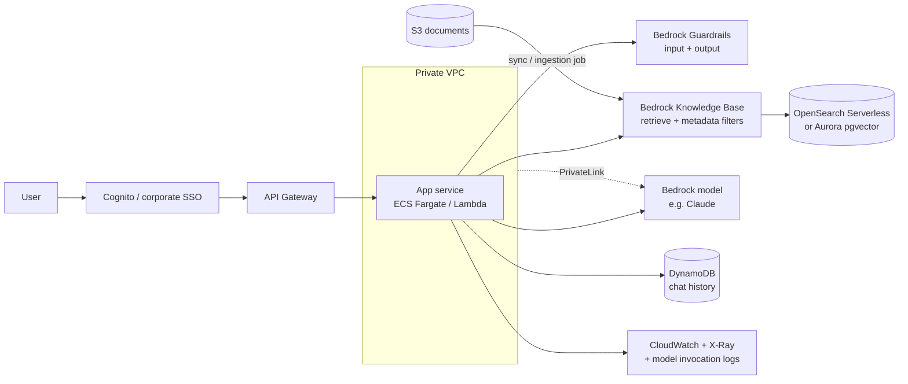
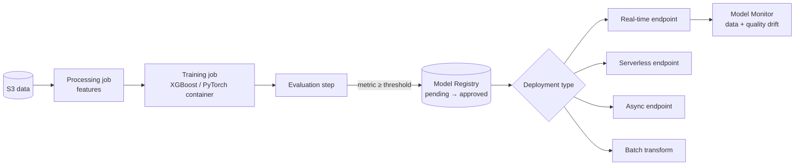
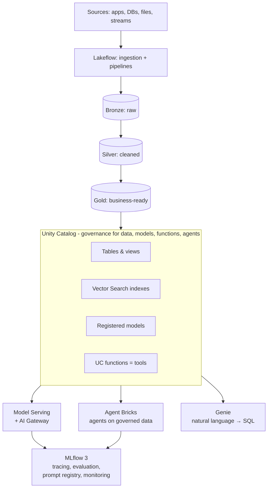
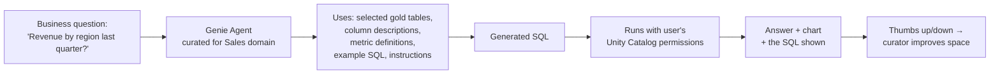
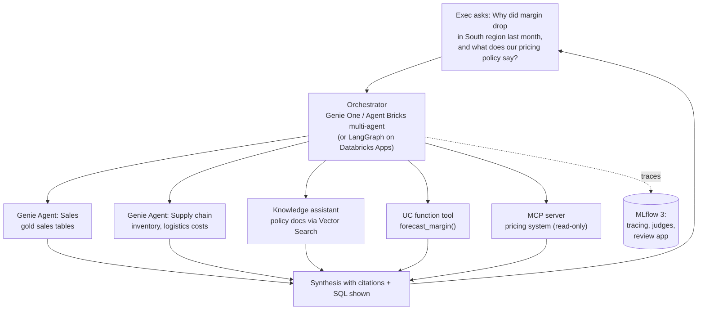
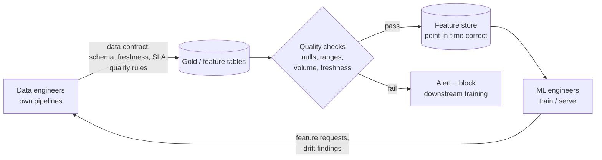
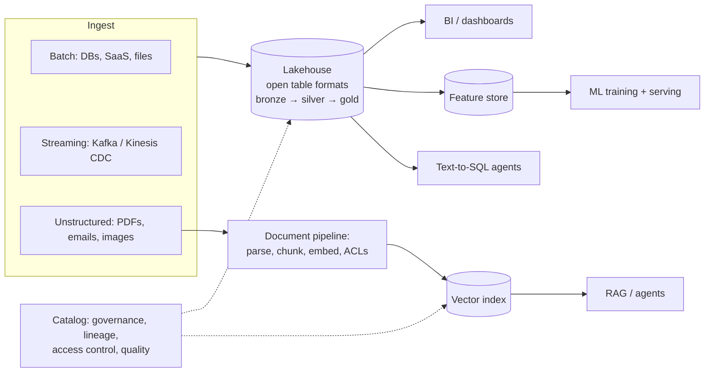

# 04 — Cloud & Data Platforms: AWS, GCP, Databricks, Snowflake

> **JD lines covered:** [TTN] deploying AI on **AWS (preferred)**; Azure OpenAI or Vertex AI a plus; containerisation and cloud AI deployments; multi-cloud GenAI (AWS, Azure, GCP); collaborate with data engineers on **pipelines, feature readiness and scalable data architectures**. [TUR] Azure OpenAI, **AWS Bedrock, Google Vertex AI**; **Databricks, Snowflake**. [DBX] **Agent Bricks, Genie**, MLflow; ML deployment on AWS/Azure/GCP; data ingestion → model serving.
>
> **Already covered:** Azure AI platform map, AI gateway, self-hosting → [pack 01 / 02](../01-ai-engineering-leader/02-ai-platform-cloud-llmops.md).
>
> ⚠️ **Names change constantly.** Checked 25 Nov 2026: Google now delivers Vertex AI through **Gemini Enterprise Agent Platform**; Databricks marks the **Agent Bricks Supervisor Agent as legacy** and has renamed Genie spaces to **Genie Agents**. In interviews, describe the **capability** first and the product name second.

---

## Part A — AWS (preferred by TTN)

### Q4.1 · L2 · "Map the AWS GenAI and ML stack — and translate from Azure."

<details><summary><b>▶ Answer</b></summary>

| Capability | AWS | Azure equivalent (what you know) | GCP |
|---|---|---|---|
| Foundation models API | **Amazon Bedrock** (Anthropic Claude, Llama, Mistral, Amazon Nova, etc.) | Azure OpenAI / Microsoft Foundry models | Gemini Enterprise Agent Platform (Vertex AI) Model Garden |
| Managed RAG | **Bedrock Knowledge Bases** | Azure AI Search + Foundry | RAG Engine, Vertex AI Search |
| Agents runtime | **Bedrock Agents**, **Bedrock AgentCore** (runtime, gateway, identity, memory, policy, observability, evaluations) | Foundry Agent Service | Agent Runtime / Agent Engine, ADK |
| Safety | **Bedrock Guardrails** | Azure AI Content Safety, Prompt Shields | Model safety filters, Model Armor |
| Classical ML platform | **SageMaker AI** (training, pipelines, registry, endpoints, Model Monitor) | Azure Machine Learning | Vertex AI training/pipelines |
| Vector store | OpenSearch Serverless, Aurora/RDS PostgreSQL pgvector, S3 Vectors | AI Search, Cosmos DB, PostgreSQL pgvector | Vector Search, AlloyDB |
| Containers | EKS, ECS/Fargate, Lambda | AKS, Container Apps, Functions | GKE, Cloud Run |
| Data | S3, Glue, Athena, Redshift, Kinesis/MSK | Data Lake, Fabric, Event Hubs | GCS, BigQuery, Pub/Sub |
| Identity & secrets | IAM roles, Cognito, Secrets Manager, KMS | Entra ID, managed identity, Key Vault | IAM, Secret Manager, KMS |
| Private networking | VPC endpoints / PrivateLink | Private Endpoints | Private Service Connect |
| Observability | CloudWatch, X-Ray, AgentCore Observability | Azure Monitor, App Insights | Cloud Monitoring/Trace |
| IaC | CloudFormation, CDK, Terraform | Bicep, Terraform | Terraform |

**Interview line:** "My production depth is Azure; the architecture is the same on AWS — Bedrock instead of Azure OpenAI, Knowledge Bases instead of AI Search, SageMaker instead of Azure ML, IAM roles instead of managed identities."

</details>

**Say this:** *"Bedrock for models, Knowledge Bases for managed RAG, AgentCore for running agents, Guardrails for safety, SageMaker for classical ML — the same architecture I've built on Azure, with different service names."*

---

### Q4.2 · L3 · "Design a production RAG assistant on AWS."

**Picture it:**



<details><summary><b>▶ Answer</b></summary>

1. **Ingestion:** documents land in **S3** (source of truth, versioned, KMS-encrypted); a **Bedrock Knowledge Base** parses, chunks (fixed, semantic or hierarchical), embeds and writes to the vector store — **OpenSearch Serverless** for hybrid search at scale, or **Aurora PostgreSQL + pgvector** if they're already on Postgres. Event-driven sync on S3 changes. Metadata files carry ACL/department for filtering.
2. **Serving:** app on **ECS Fargate** (or Lambda for low traffic) behind **API Gateway** with **Cognito**/SSO; calls `Retrieve` (or `RetrieveAndGenerate`) with metadata filters based on the user's groups; calls a Bedrock model with a prompt that requires citations; **Bedrock Guardrails** for PII masking, denied topics, prompt-attack detection and contextual grounding checks.
3. **Security:** private VPC, **VPC endpoints/PrivateLink** to Bedrock, least-privilege IAM roles, KMS, CloudTrail auditing. Bedrock doesn't use customer prompts/outputs to train its models — confirm in the current AWS terms for the client.
4. **Observability & evals:** model invocation logging, CloudWatch metrics (latency, tokens, throttles), traces; Bedrock evaluations or an external eval harness (RAGAS/MLflow) in CI.
5. **Cost & scale:** on-demand for spiky traffic, provisioned throughput for steady volume; prompt caching; cross-region inference profiles for capacity; smaller model routing.
6. **When to go custom:** complex chunking, re-ranking strategy, or multi-index routing → own pipeline (Glue/Lambda/Step Functions) with OpenSearch directly, still keeping Bedrock for models.

</details>

**Say this:** *"S3 as source of truth, Bedrock Knowledge Base into OpenSearch Serverless or pgvector, an ECS app behind API Gateway and Cognito, Guardrails on both sides, PrivateLink and least-privilege IAM, CloudWatch plus evals — and custom ingestion only where the managed pipeline can't meet quality."*

---

### Q4.3 · L3 · "Bedrock Agents vs Bedrock AgentCore vs building your own on EKS — how do you choose?"

<details><summary><b>▶ Answer</b></summary>

- **Bedrock Agents** — **configuration-driven** managed agents: instructions, action groups (Lambda/OpenAPI tools), knowledge bases, guardrails, multi-agent collaboration. Fast to build standard tool-using assistants; less control over the loop.
- **Bedrock AgentCore** — **infrastructure for agents you write in any framework** (LangGraph, CrewAI, Strands, OpenAI Agents SDK…): serverless **Runtime** with session isolation, **Gateway** (turn APIs/Lambdas into MCP tools), **Identity** (OAuth to third-party tools, on-behalf-of users), **Memory**, built-in tools (code interpreter, browser, managed knowledge base, web search), **Policy** (authorisation of agent actions, now with Guardrails at the gateway), **Observability** and **Evaluations**.
- **Self-built on EKS/ECS** — maximum control and portability; you own scaling, identity, memory, security, observability.

**Choosing:** standard enterprise assistant fast → Bedrock Agents; custom agent logic but don't want to run infra → **AgentCore + your framework** (my usual recommendation on AWS); strict portability/multi-cloud or special runtime needs → EKS.

</details>

**Say this:** *"Bedrock Agents for configuration-driven standard agents, AgentCore when I write the agent in LangGraph or CrewAI but want managed runtime, identity, memory, gateway, policy and observability — and EKS only when portability or control demands it."*

---

### Q4.4 · L2 · "How do you train and deploy a classical ML model on SageMaker?"

**Picture it:**



<details><summary><b>▶ Answer</b></summary>

- **SageMaker Pipelines** orchestrate: processing (feature prep) → training job (built-in algorithms like XGBoost, or your PyTorch/TensorFlow container; spot instances to cut cost) → evaluation → conditional **register in Model Registry** → approval → deploy.
- **Deployment options:**
  - **Real-time endpoint** — always-on, low latency, autoscaling.
  - **Serverless inference** — scales to zero, for spiky/low traffic (cold starts).
  - **Asynchronous inference** — large payloads/long processing, queue-based.
  - **Batch transform** — offline scoring of big datasets.
  - Multi-model endpoints for many small models.
- **Monitoring:** **Model Monitor** for data quality, model quality (with ground truth), bias drift and feature-attribution drift; **Clarify** for bias/explainability.
- **Also know:** Feature Store, Experiments (MLflow-based tracking available), JumpStart for pre-trained/foundation models.

</details>

**Say this:** *"SageMaker Pipelines run processing, training, evaluation and conditional registration; approved models deploy to real-time, serverless, async or batch; Model Monitor and Clarify watch drift and bias."*

---

### Q4.5 · L2 · "Multi-cloud: compare AWS, Azure and GCP for GenAI, and how you design for portability."

<details><summary><b>▶ Answer</b></summary>

- **Azure:** strongest OpenAI integration and Microsoft 365/Entra ecosystem; Foundry Agent Service; good for Microsoft-heavy enterprises.
- **AWS:** **Bedrock's model choice** (Anthropic, Meta, Mistral, Amazon…), AgentCore for agent ops, deep data/infra services; common in digital-native and many Indian enterprises.
- **GCP:** **Gemini** models, BigQuery for analytics, **Gemini Enterprise Agent Platform** (the evolution of Vertex AI: Model Garden, ADK, Agent Studio, agent runtime, RAG Engine, Vector Search) and Gemini Enterprise for employees.

**Portability design:**
- **Model gateway** abstraction (LiteLLM-style or own) — swap providers by config.
- **MCP** for tools, **A2A** for agent-to-agent — open protocols supported across clouds.
- **OpenTelemetry** for traces; **MLflow** for experiments/registry.
- **Containers + Terraform** for custom services.
- **Data gravity wins:** run the AI where the governed data already is (Databricks/Snowflake/BigQuery) to avoid egress cost and compliance issues.

</details>

**Say this:** *"Azure for Microsoft-heavy shops and OpenAI, AWS for Bedrock's model choice and AgentCore, GCP for Gemini and BigQuery. For portability: a model gateway, MCP and A2A, OpenTelemetry, MLflow, containers and Terraform — and keep AI next to the data."*

---

## Part B — Databricks (DBX, TUR)

### Q4.6 · L2 · "Explain the Databricks Data Intelligence Platform for AI."

**Picture it:**



<details><summary><b>▶ Answer</b></summary>

- **Lakehouse:** data in open formats (**Delta Lake**) on cloud storage; one copy for BI, data engineering and ML. **Medallion architecture** — bronze (raw) → silver (cleaned, conformed) → gold (business aggregates/features).
- **Unity Catalog** — single governance layer for **tables, files, ML models, vector indexes, functions and agents**: permissions, lineage, audit. This is the big selling point for AI: agents inherit governed access, often **on behalf of the user**.
- **Mosaic AI** capabilities: **Model Serving** (foundation model APIs, external models, custom models), **AI Gateway** (rate limits, guardrails, usage tracking), **Vector Search** (synced from Delta tables), feature engineering/serving, fine-tuning.
- **MLflow 3** (managed) — tracing for GenAI apps, `mlflow.genai.evaluate()` with LLM judges, human-feedback review app, **prompt registry**, production monitoring, plus classic experiment tracking and model registry.
- **Agent Bricks** — Databricks' platform to build, evaluate, optimise and govern agents on business data (knowledge assistants, information extraction, custom agents on Databricks Apps, multi-agent coordination).
- **Genie** — natural-language analytics over governed tables (Q4.7).

</details>

**Say this:** *"Delta lakehouse with medallion layers, Unity Catalog governing data, models, functions and agents together, Mosaic AI for serving, gateway and vector search, MLflow 3 for tracing and evals, Agent Bricks for agents and Genie for natural-language analytics — all on the same governed data."*

---

### Q4.7 · L3 · "What is Genie, and how do you make text-to-SQL accurate enough for business users?"

**Picture it:**



<details><summary><b>▶ Answer</b></summary>

**Genie** lets business users ask questions in natural language; it generates SQL over governed Unity Catalog tables, runs it with the user's permissions, and returns answers/charts **with the SQL visible**. (Genie spaces are now called **Genie Agents**; Genie One coordinates across them.)

**Making it accurate (this is the real job):**
1. **Small, focused domains** — one agent per business area with a limited set of clean **gold tables**; huge spaces with hundreds of tables give worse answers.
2. **Semantic context** — table/column descriptions, synonyms ("GMV" = gross_merchandise_value), join paths, **metric definitions** (what exactly is "active customer"?).
3. **Example/trusted SQL** for common questions — certified answers.
4. **Instructions** — business rules (fiscal year starts April, exclude test accounts).
5. **Benchmarks** — a set of questions with known-correct SQL/results; run after every change.
6. **Feedback loop** — users rate answers; a domain curator reviews failures weekly.
7. **Governance** — row/column-level security in Unity Catalog applies automatically.

Same principles apply to **Snowflake Cortex Analyst** (semantic model/views) and any text-to-SQL system.

</details>

**Say this:** *"Genie turns questions into SQL over governed tables and shows the SQL. Accuracy comes from curation: small domains of clean gold tables, descriptions and metric definitions, trusted example queries, business-rule instructions, a benchmark set and a feedback loop."*

---

### Q4.8 · L3 · "Design a multi-agent system on Databricks for a retailer's leadership team." ([DBX] core question)

**Picture it:**



<details><summary><b>▶ Answer</b></summary>

**1. Discovery (design session with stakeholders):** top 20 questions leadership asks; which data answers them; who may see what; success = % questions answered correctly + time saved vs analysts.

**2. Architecture:**
- **Specialist sub-agents** aligned to data domains: Genie Agents for sales and supply chain (curated gold tables), a **knowledge assistant** over policy documents (Vector Search), **Unity Catalog functions** as deterministic tools (forecasting, margin calculations), external systems via **MCP** (read-only first).
- **Orchestrator** routes and combines: Databricks' managed multi-agent option (current offering — the older Supervisor Agent is legacy) or a code-first LangGraph agent deployed on **Databricks Apps** when custom logic is needed.
- **Governance:** everything registered in **Unity Catalog**; **on-behalf-of-user** access so each exec sees only what they're entitled to; AI Gateway for model limits and guardrails.

**3. Quality:**
- **MLflow 3** tracing of every sub-agent call; evaluation set of 100+ leadership questions with expected answers; **LLM judges** (correctness, groundedness, relevance) + **review app** for domain experts; improve sub-agents independently.
- Answers show the SQL and document citations — trust comes from transparency.

**4. Rollout:** pilot with one leadership team and two domains; add domains as each passes its benchmark; monitor cost per answer and accuracy in production.

</details>

**Say this:** *"Domain sub-agents — Genie Agents for structured data, a knowledge assistant for documents, UC functions and MCP for tools — under an orchestrator, all governed by Unity Catalog with on-behalf-of access, traced and judged in MLflow 3, rolled out domain by domain as each passes its benchmark."*

---

### Q4.9 · L2 · "What does MLflow do across classic ML and GenAI?"

<details><summary><b>▶ Answer</b></summary>

| Area | MLflow capability |
|---|---|
| Experiment tracking | Log params, metrics, artifacts per run; compare runs |
| Models | **Model Registry** (versions, aliases like `@champion`, lineage), standard packaging/flavours, serving |
| **GenAI tracing** | Hierarchical traces of LLM calls, retrieval, tool calls; auto-tracing for LangChain, LlamaIndex, OpenAI, DSPy and more; OpenTelemetry-compatible |
| **GenAI evaluation** | `mlflow.genai.evaluate()` with built-in and custom LLM judges/scorers, evaluation datasets |
| Human feedback | Review/labelling sessions with domain experts |
| **Prompt Registry** | Versioned prompts, aliases, linked to evaluations; prompt optimisation |
| Monitoring | Production traces scored continuously |
| Versioning apps | Link traces and evals to specific app/agent versions (LoggedModel) |

Open source, with extra managed features on Databricks (Unity Catalog integration). Also integrates with SageMaker and Azure ML.

```python
import mlflow
mlflow.set_experiment("support-rag")
mlflow.langchain.autolog()            # auto-trace every LangChain/LangGraph call

with mlflow.start_run():
    mlflow.log_params({"chunk_size": 800, "top_k": 5, "model": "claude-sonnet"})
    results = mlflow.genai.evaluate(data=eval_rows, predict_fn=answer_question,
                                    scorers=[...])    # built-in or custom judges
```

</details>

**Say this:** *"MLflow covers both worlds — tracking and registry for classic ML; tracing, LLM-judge evaluation, human review, prompt registry and monitoring for GenAI — open source, with managed extras on Databricks."*

---

## Part C — Snowflake

### Q4.10 · L2 · "What AI capabilities does Snowflake offer, and when Snowflake vs Databricks?"

<details><summary><b>▶ Answer</b></summary>

**Snowflake Cortex AI** (AI inside the data cloud, governed by Snowflake's access controls):
- **AI SQL functions** — call LLMs directly in SQL (complete, classify, extract, summarise, translate, sentiment, embed) over table rows — great for batch enrichment without moving data.
- **Cortex Search** — managed hybrid search service for RAG over text in Snowflake.
- **Cortex Analyst** — text-to-SQL driven by a **semantic model/semantic views** (metrics, dimensions, synonyms).
- **Cortex Agents / Snowflake Intelligence** — agents that orchestrate Cortex Search + Analyst + tools for business users.
- **Snowpark** (Python/Java/Scala on Snowflake compute), **Snowpark Container Services** for custom models/apps, Snowflake ML (feature store, model registry).

**Snowflake vs Databricks — how I'd frame it to a client:**
- Choose where the **governed data already lives** — moving data is expensive and risky.
- Snowflake: SQL-first analytics teams, simplicity, strong governance/sharing; AI SQL functions and Cortex make SQL users productive fast.
- Databricks: engineering/ML-heavy teams, Spark, open formats, custom model training, deeper ML/agent tooling (MLflow, Agent Bricks).
- Many enterprises run both; interoperability via Iceberg/Delta open table formats.

</details>

**Say this:** *"Cortex brings LLMs into SQL, Cortex Search does managed RAG, Cortex Analyst does semantic-model text-to-SQL and Cortex Agents orchestrate them. Snowflake suits SQL-first teams, Databricks suits ML-heavy engineering teams — and the deciding factor is where the governed data already lives."*

---

## Part D — Data engineering collaboration

### Q4.11 · L3 · "How do you work with data engineers to ensure pipelines and features are ready for ML?"

> **Why they ask:** [TTN] "collaborate closely with data engineers and analysts to ensure high-quality pipelines, feature readiness and scalable data architectures".

**Picture it:**



<details><summary><b>▶ Answer</b></summary>

- **Start from the prediction moment:** agree with data engineers which data is available **at prediction time** and its latency (batch daily vs streaming). This prevents leakage and impossible features.
- **Data contracts** for every source feeding ML: schema, semantics, freshness SLA, owner, allowed changes, quality rules. Schema changes go through review — not discovered when the model breaks.
- **Automated data quality** (Great Expectations, Delta Live Tables/Lakeflow expectations, dbt tests, Soda): nulls, ranges, uniqueness, volume anomalies, freshness. **Failing checks block training/scoring.**
- **Feature store** with point-in-time correct joins, feature ownership and reuse; same definitions offline and online.
- **Medallion layers** — ML reads from silver/gold, never raw.
- **Unstructured data for GenAI** gets the same treatment: document pipelines with parsing quality checks, deduplication, PII handling, metadata and lineage.
- **Ways of working:** shared backlog for data readiness, data/ML engineers in the same squad for each use case, a "feature readiness" checklist at the feasibility gate.

</details>

**Say this:** *"Agree what's available at prediction time, put data contracts and automated quality checks on every feed that block training when they fail, serve features from a point-in-time-correct feature store, and put data and ML engineers in the same squad with a readiness checklist at feasibility."*

---

### Q4.12 · L3 · "Design a scalable data architecture that serves BI, classical ML and GenAI together."

**Picture it:**



<details><summary><b>▶ Answer</b></summary>

- **One governed lakehouse** (Databricks/Snowflake/BigQuery or S3 + Iceberg + Glue/Athena) with open table formats — single source of truth for BI, ML and GenAI.
- **Batch + streaming:** CDC (Debezium/DMS) and event streams (Kafka/Kinesis/Event Hubs) for fresh data; batch for heavy history.
- **Three consumption paths:** gold tables for BI and text-to-SQL agents; feature store for ML; document pipeline → vector index for RAG.
- **One catalog** governing all of it — permissions, lineage, quality, PII tags — including vector indexes and AI assets.
- **Scale levers:** partitioning/clustering, incremental processing, separate compute per workload, autoscaling, cost tags.
- **My Kafka background** fits here — event-driven freshness for features and RAG indexes (pack 01 → 02 Q2.16).

</details>

**Say this:** *"One governed lakehouse fed by batch and CDC streams, serving gold tables to BI and text-to-SQL, a feature store to ML and a document pipeline into vector indexes for RAG — all under one catalog for access, lineage and quality."*

---

### Q4.13 · L2 · "How do you containerise and deploy an ML model? Which serving pattern when?"

<details><summary><b>▶ Answer</b></summary>

```dockerfile
# Small, reproducible inference image
FROM python:3.12-slim
WORKDIR /app
COPY requirements.txt .
RUN pip install --no-cache-dir -r requirements.txt     # pinned versions
COPY model/ ./model/                                    # or pull from registry at startup
COPY app.py .
USER 1000                                               # don't run as root
EXPOSE 8080
CMD ["uvicorn", "app:app", "--host", "0.0.0.0", "--port", "8080", "--workers", "2"]
```
- `python:3.12-slim` keeps the image small; pinned `requirements.txt` for reproducibility; non-root user for security; `uvicorn` serves a FastAPI app with a `/predict` endpoint and a `/health` endpoint for probes.

| Serving pattern | When | Example |
|---|---|---|
| **Real-time API** | User waits for the answer (<100 ms–1 s) | Fraud score at checkout |
| **Batch** | Predictions can be precomputed | Nightly churn scores to CRM |
| **Streaming** | Predict on events as they arrive | Anomaly detection on Kafka telemetry |
| **Async / queue** | Long jobs, large payloads | Document extraction, video analysis |
| **Edge** | No connectivity / ultra-low latency | Defect detection on a factory camera |

**Deploy:** image to ECR/ACR → EKS/AKS (HPA/KEDA autoscaling, GPU node pools if needed) or managed endpoints (SageMaker, Azure ML, Databricks Model Serving) → canary release → monitoring (latency, errors, drift).

</details>

**Say this:** *"Slim pinned image, non-root, FastAPI with health checks, pushed to a registry and deployed to Kubernetes or a managed endpoint with canary and monitoring — choosing real-time, batch, streaming, async or edge by how fast the answer is needed."*

---

## ⚡ Rapid-fire

| Question | One-line answer |
|---|---|
| Bedrock Knowledge Bases? | Managed RAG: ingest from S3, chunk, embed, store, retrieve. |
| AgentCore Gateway? | Turns APIs/Lambdas into MCP tools for agents. |
| AgentCore Policy? | Authorises which actions agents may take; can apply Guardrails at the gateway. |
| SageMaker serverless inference? | Endpoints that scale to zero for spiky traffic. |
| GCP's agent platform now? | Gemini Enterprise Agent Platform (evolution of Vertex AI). |
| Google's code-first agent framework? | Agent Development Kit (ADK). |
| Unity Catalog governs? | Data, models, functions, vector indexes and agents. |
| Medallion layers? | Bronze raw → silver cleaned → gold business-ready. |
| Genie accuracy lever? | Small curated domains + metric definitions + trusted example SQL. |
| Cortex Analyst? | Snowflake text-to-SQL driven by a semantic model. |
| Data contract? | Agreed schema, semantics, freshness and quality rules between producer and consumer. |
| Point-in-time join? | Feature values as they were at prediction time — prevents leakage. |

---

**Sources (checked 25 Nov 2026):**
[Databricks — Agent Bricks platform](https://databricks.com/blog/agent-bricks-governed-enterprise-agent-platform) ·
[Databricks docs — Supervisor Agent (legacy)](https://docs.databricks.com/aws/en/generative-ai/agent-bricks/multi-agent-supervisor) ·
[AWS — AgentCore Policy with Guardrails](https://aws.amazon.com/about-aws/whats-new/2026/06/amazon-bedrock-agentcore-policy-guardrails-generally-available) ·
[Google Cloud — Gemini Enterprise Agent Platform](https://cloud.google.com/blog/products/ai-machine-learning/introducing-gemini-enterprise-agent-platform) ·
[Databricks — MLflow 3 for GenAI](https://docs.databricks.com/aws/mlflow3/genai)
