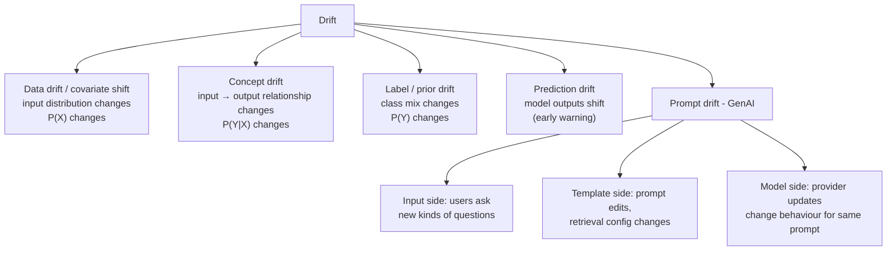
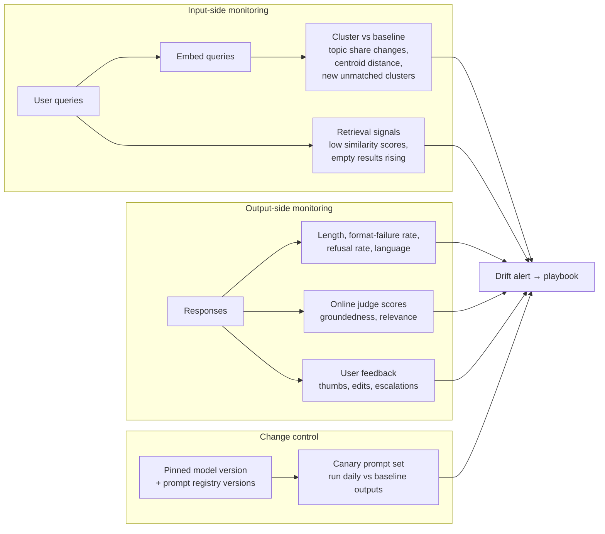
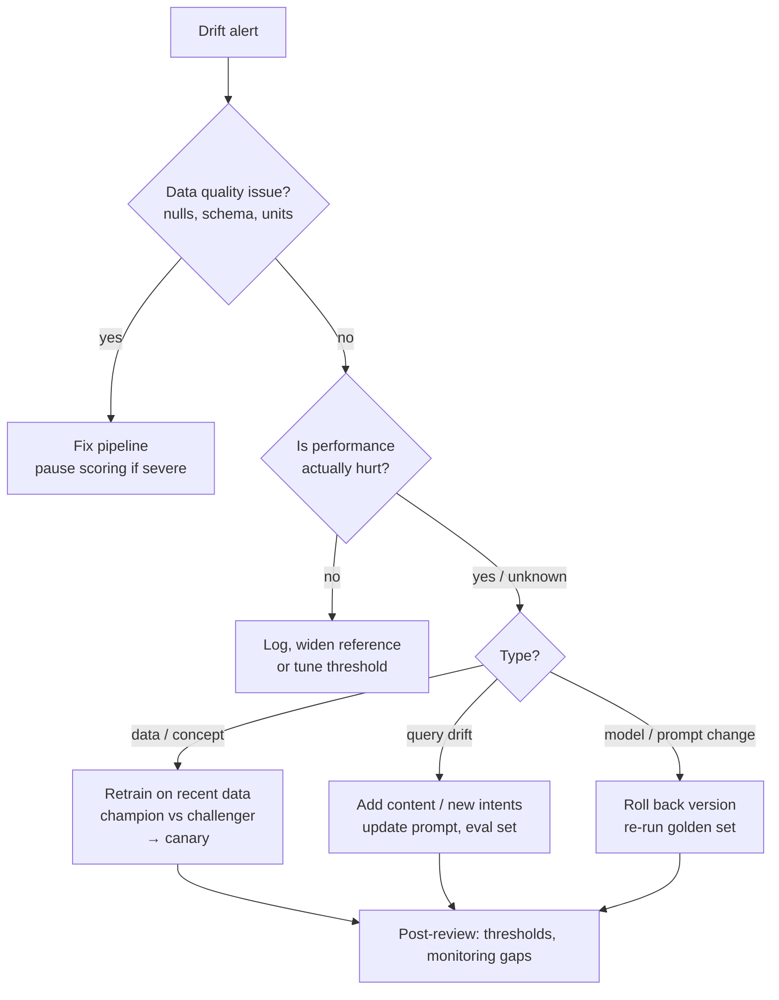
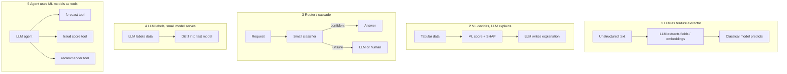
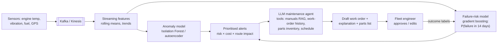

# 05 — MLOps Deep Dive: Drift (Data, Concept, Prompt), Testing, Versioning & Hybrid AI

> **JD lines covered:** [TTN] implement MLOps and LLMOps — **model versioning, automated testing, drift detection (data, concept and prompt drift)**, performance monitoring · **build hybrid AI systems combining GenAI with classical ML/DL** · enterprise-grade MLOps/LLMOps tooling. [DBX] MLflow.
>
> **Already covered:** MLOps vs LLMOps, CI/CD for LLM apps, deployment strategies, monitoring families, test pyramid → [pack 01 / 02](../01-ai-engineering-leader/02-ai-platform-cloud-llmops.md). This file adds **how to actually detect drift (with code)**, **prompt drift**, ML-specific testing, and **hybrid system design**.

---

## Part A — Drift

### Q5.1 · L2 · "Explain the types of drift, including prompt drift."

**Picture it:**



<details><summary><b>▶ Answer</b></summary>

| Drift | What changes | Example | Detect with |
|---|---|---|---|
| **Data (covariate) drift** | Distribution of inputs | New city launched → order sizes differ | PSI, KS test, JS divergence per feature |
| **Concept drift** | Relationship between inputs and target | After a policy change, the same customer profile now churns less | Performance drop once labels arrive; error-rate detectors |
| **Label/prior drift** | Class balance | Fraud rate doubles during festival season | Label distribution over time |
| **Prediction drift** | Model output distribution | Average churn score jumps | Distribution of scores — earliest signal, no labels needed |
| **Upstream data bugs** (not real drift) | Pipeline broke | Feature suddenly all null, units changed | Data quality checks |

**Prompt drift (GenAI) — three flavours:**
1. **Input/query drift** — users start asking about topics the knowledge base or prompt wasn't designed for (new product launch, new policy).
2. **Prompt/config drift** — prompt templates, system instructions or retrieval settings change (sometimes untracked edits) and behaviour shifts.
3. **Model drift behind an API** — the provider updates or retires a model; same prompt, different outputs (format, length, refusals).

The answer to all three: **version everything** (prompts, configs, model versions), **monitor inputs and outputs**, and **re-run the golden set** on any change.

</details>

**Say this:** *"Data drift is inputs shifting, concept drift is the input-output relationship changing, label drift is the class mix moving, prediction drift is the early warning. Prompt drift has three sources — users asking new things, prompt or config edits, and model updates behind the API."*

---

### Q5.2 · L3 · "How do you detect data drift? Show me."

<details><summary><b>▶ Answer</b></summary>

**Statistical tests per feature, comparing a reference window (training data or a stable recent period) with the current window:**

| Method | Use for | Rule of thumb |
|---|---|---|
| **PSI (Population Stability Index)** | Numeric (binned) and categorical | < 0.1 stable · 0.1–0.25 moderate · > 0.25 significant |
| **Kolmogorov–Smirnov test** | Numeric | Very sensitive at large sample sizes — p-values become tiny for trivial shifts; prefer effect size |
| **Chi-square** | Categorical | Same caution |
| **Jensen–Shannon / Wasserstein distance** | Numeric or embeddings | Bounded/interpretable distances |
| **Domain classifier** | Multivariate | Train a model to tell reference vs current; AUC ≫ 0.5 = drift, and feature importance shows *what* drifted |

```python
import numpy as np

def psi(reference: np.ndarray, current: np.ndarray, bins: int = 10) -> float:
    """Population Stability Index for one numeric feature."""
    edges = np.quantile(reference, np.linspace(0, 1, bins + 1))
    edges[0], edges[-1] = -np.inf, np.inf                 # catch out-of-range values
    ref_pct = np.histogram(reference, edges)[0] / len(reference)
    cur_pct = np.histogram(current, edges)[0] / len(current)
    ref_pct, cur_pct = np.clip(ref_pct, 1e-6, None), np.clip(cur_pct, 1e-6, None)
    return float(np.sum((cur_pct - ref_pct) * np.log(cur_pct / ref_pct)))

# e.g. daily job: alert if psi(train["order_value"], today["order_value"]) > 0.25
```
- Bins come from **reference quantiles** so each bin starts with ~10% of data; `clip` avoids log(0).

**Practical rules:** monitor the **top features by importance** (not all 500), weight alerts by importance, use seasonality-aware reference windows, and connect alerts to a playbook (Q5.5). Tools: **Evidently**, NannyML, WhyLabs, Arize, SageMaker Model Monitor, Databricks Lakehouse Monitoring, Azure ML data drift.

</details>

**Say this:** *"Compare a reference window to the current one per important feature — PSI with 0.1 and 0.25 thresholds, KS or chi-square with care at large samples — plus a domain classifier to catch multivariate drift and tell me which feature moved."*

---

### Q5.3 · L3 · "How do you detect concept drift when labels arrive late or never?"

<details><summary><b>▶ Answer</b></summary>

- **When labels arrive (even late):** track performance on matured labels (e.g., fraud chargebacks after 30–60 days); streaming error-rate detectors (**DDM, ADWIN, Page-Hinkley**) flag statistically significant changes.
- **Before labels arrive — proxies:**
  - **Prediction drift** and **confidence drift** (more predictions near 0.5).
  - **Business proxies** — approval rates, complaint rates, override rates by human reviewers.
  - **Performance estimation** (e.g., NannyML's confidence-based estimation) for calibrated classifiers.
  - **Small labelled samples** — label a random 1% weekly with humans or a strong LLM judge.
- **Response:** scheduled retraining for known seasonality; **triggered retraining** when performance falls below threshold; champion–challenger evaluation before promotion.

</details>

**Say this:** *"Measure on matured labels with detectors like ADWIN when labels come; before that, use prediction and confidence drift, business proxies like override rates, performance estimation, and a small weekly labelled sample."*

---

### Q5.4 · L3 · "How do you detect prompt drift in a production LLM application?"

> **Why they ask:** explicitly named in [TTN]. Few candidates have a concrete answer — this is where you stand out.

**Picture it:**



<details><summary><b>▶ Answer</b></summary>

**1. Input/query drift** — embed every user query (cheap embedding model), then:
- Compare the distribution to a baseline: distance between centroids, share of queries per topic cluster, **share of queries far from any known cluster** (novel topics).
- Retrieval health: rising rate of **low-similarity top results** or empty retrievals = users asking things the KB doesn't cover.
- Weekly: cluster the novel queries and let an LLM label the clusters → hand to content owners ("120 questions this week about the new WFH policy we haven't indexed").

**2. Output drift** — distributions of response length, **format/schema failure rate**, **refusal rate**, language, citation rate, tool-call patterns; online LLM-judge scores on a sample; user feedback signals.

**3. Change-driven drift** — prevent rather than detect:
- **Pin model versions**; prompts and retrieval configs in a **prompt registry** (MLflow, Langfuse) — no untracked edits.
- A **canary prompt set** (50–100 fixed inputs) run daily against production; compare outputs with stored baseline outputs using semantic similarity + judges → detects silent provider-side changes.
- Golden-set evals on every prompt/config/model change (CI gate).

```python
import numpy as np
from sentence_transformers import SentenceTransformer

emb = SentenceTransformer("all-MiniLM-L6-v2")
def unit(v): return v / np.linalg.norm(v, axis=1, keepdims=True)

base = unit(emb.encode(baseline_queries))          # e.g. last month
cur  = unit(emb.encode(todays_queries))

centroid_shift = 1 - float(base.mean(0) @ cur.mean(0) /
                           (np.linalg.norm(base.mean(0)) * np.linalg.norm(cur.mean(0))))
# novelty: share of today's queries whose best match to any baseline query is weak
best_match = (cur @ base.T).max(axis=1)
novel_share = float((best_match < 0.5).mean())
# alert if novel_share jumps (e.g. 5% → 20%) or centroid_shift exceeds a tuned threshold
```

</details>

**Say this:** *"Three angles: embed user queries and watch topic shares and the share of novel queries plus retrieval scores; watch output length, format failures, refusals and judge scores; and prevent change-drift with pinned models, a prompt registry, golden-set gates and a daily canary prompt set compared to baseline outputs."*

---

### Q5.5 · L3 · "Drift alert fired. What's your playbook?"

**Picture it:**



<details><summary><b>▶ Answer</b></summary>

1. **Rule out pipeline bugs first** — most "drift" alerts are broken data (schema change, unit change, missing joins).
2. **Check impact** — is the business/model metric actually worse? Drift without impact = log and adjust.
3. **Act by type:** retrain (with champion–challenger evaluation and canary), add knowledge/content and new eval cases for query drift, roll back prompt/model versions for change-drift.
4. **Communicate** to owners; record in the model's change log.
5. **Improve monitoring** — tighten or relax thresholds, add missing signals.

</details>

---

### Q5.6 · L3 · "How do you version everything in an ML/GenAI system so results are reproducible?"

<details><summary><b>▶ Answer</b></summary>

| Artefact | How to version |
|---|---|
| Code | Git, tagged releases |
| Data | Delta Lake/Iceberg **time travel**, DVC, or immutable dated snapshots; record dataset version per run |
| Features | Feature store definitions in Git + versions |
| Experiments | MLflow runs: params, metrics, data version, code commit |
| Models | Model registry versions + aliases (`@champion`, `@challenger`), stage approvals |
| Prompts & configs | Prompt registry (MLflow/Langfuse) or Git; retrieval config (chunking, top-k), tool schemas |
| LLM provider model | Pinned model version string |
| Embedding model + index | Embedding model version stored with index; new model → new index |
| Environment | Docker image digest, pinned dependencies |
| Evaluation sets | Versioned like data; eval results linked to app version |

**Goal:** for any prediction or answer in production, you can say exactly which code, data, model, prompt and config produced it — the basis for debugging, audits and rollback.

</details>

**Say this:** *"Code in Git, data via time travel or snapshots, runs in MLflow, models in a registry with aliases, prompts and configs in a prompt registry, pinned provider and embedding model versions, image digests and versioned eval sets — so any output traces back to exactly what produced it."*

---

### Q5.7 · L3 · "What automated tests do you write for ML models, beyond accuracy?"

<details><summary><b>▶ Answer</b></summary>

- **Data tests** — schema, ranges, nulls, uniqueness, freshness, distribution vs reference (Great Expectations / dbt tests).
- **Training pipeline tests** — runs end-to-end on a small sample; model can overfit a tiny batch (sanity); reproducible with fixed seeds.
- **Model quality gates** — metric ≥ threshold and **≥ current champion** on the same held-out set; per-segment checks (region, customer type) so a global gain doesn't hide a regional loss.
- **Behavioural tests** (CheckList-style):
  - **Minimum functionality** — obvious cases must be right.
  - **Invariance** — changing irrelevant inputs (name, punctuation) must not change output.
  - **Directional** — increasing "days overdue" must not *decrease* default risk.
- **Fairness tests** — metric parity across groups where relevant.
- **Serving tests** — the same input gives the same output offline and from the endpoint (no training-serving skew); latency and payload tests; contract tests on the API.
- **Load tests** before release.

</details>

**Say this:** *"Data tests, pipeline sanity tests, quality gates against the champion per segment, behavioural tests — minimum functionality, invariance, directional — fairness checks, and serving parity and load tests."*

---

## Part B — Hybrid AI systems (GenAI + classical ML/DL)

### Q5.8 · L3 · "What are the main patterns for combining GenAI with classical ML?"

**Picture it:**



<details><summary><b>▶ Answer</b></summary>

| Pattern | How | Example |
|---|---|---|
| **1. LLM as feature extractor** | LLM turns unstructured text/images into structured fields or embeddings; a classical model uses them | Extract claim type, severity, injury flags from adjuster notes → fraud model |
| **2. ML decides, LLM explains** | Deterministic, auditable ML makes the decision; LLM turns SHAP drivers into plain language | Credit decline reason letter; maintenance alert explanation |
| **3. Router / cascade** | Cheap model handles confident cases; uncertain ones go to an LLM or human | Ticket triage: classifier routes 80%, LLM handles the long tail |
| **4. LLM labels, small model serves** | LLM (+ human checks) creates training labels; distil into a fast model | Intent classifier at millions of requests/day |
| **5. Agent with ML tools** | LLM agent orchestrates; ML models are tools it calls | Planner agent calls demand-forecast and inventory-optimisation tools |
| **6. ML guards the LLM** | Classifiers detect toxicity, PII, injection, or score answer quality | Safety and groundedness classifiers in the guardrail layer |
| **7. Anomaly model + LLM investigation** | Anomaly detector flags; LLM agent gathers context and drafts an investigation summary | AIOps incident copilot (your MGM story) |

**Why hybrid:** classical ML is cheap, fast, precise on numbers, auditable and stable; LLMs handle language, ambiguity and reasoning. Regulated decisions (credit, pricing, eligibility) usually stay with explainable ML; the LLM handles communication and unstructured inputs.

</details>

**Say this:** *"Seven patterns: LLM extracts features for ML, ML decides and the LLM explains, cascades from small model to LLM, LLM labels and a small model serves, agents calling ML models as tools, ML classifiers guarding the LLM, and anomaly models feeding LLM investigations. ML for precise, auditable decisions; LLMs for language and reasoning."*

---

### Q5.9 · L3 · "Design a hybrid AI system for predictive maintenance in a logistics fleet."

> Use your Maersk / logistics credibility — as domain context, not as a claim that you built this.

**Picture it:**



<details><summary><b>▶ Answer</b></summary>

1. **Goal & metric:** reduce unplanned breakdowns and downtime cost; KPI = unplanned downtime hours, cost per vehicle; model metric = recall at fixed alert budget, lead time before failure.
2. **Classical ML for detection & prediction:** streaming features (rolling stats, trends) → **anomaly detection** for unknown failure modes + **supervised failure-risk model** trained on historic failures (gradient boosting, time-based validation). Survival analysis if predicting time-to-failure.
3. **Prioritisation:** combine risk × repair cost × route/delivery impact → ranked queue within engineer capacity.
4. **GenAI for action:** an agent with tools — **RAG over manuals and past work orders**, parts inventory, workshop schedule — drafts a work order: likely cause (citing similar past cases and the sensor drivers), recommended checks, parts to reserve, best slot. **Engineer approves** (HITL).
5. **Feedback:** engineer outcome (fault found / not found) becomes labels → retraining; disagreements reviewed.
6. **Ops:** drift monitoring on sensor distributions (new vehicle models), model registry, edge vs cloud split (simple anomaly checks on-vehicle if connectivity is poor).

</details>

**Say this:** *"Classical models do the precise part — anomaly detection and failure-risk prediction on streaming sensor features, prioritised by cost and route impact — and an LLM agent does the language part: grounded diagnosis from manuals and past work orders, parts and scheduling, with an engineer approving and outcomes feeding retraining."*

---

### Q5.10 · L2 · "Which tools would you use for an enterprise MLOps/LLMOps stack?"

<details><summary><b>▶ Answer</b></summary>

| Layer | Open source | Managed |
|---|---|---|
| Orchestration | Airflow, Prefect, Dagster, Kubeflow Pipelines | SageMaker Pipelines, Azure ML pipelines, Databricks Workflows/Lakeflow Jobs, Vertex Pipelines |
| Tracking & registry | **MLflow** | Managed MLflow (Databricks, SageMaker, Azure ML), W&B |
| Feature store | Feast | Databricks, SageMaker, Vertex, Azure ML feature stores |
| Data quality | Great Expectations, Soda, dbt tests | Lakehouse Monitoring, Glue Data Quality |
| Serving | vLLM, TGI, Triton, KServe, BentoML, Ray Serve | SageMaker endpoints, Databricks Model Serving, Azure ML endpoints, Bedrock |
| Drift / ML monitoring | Evidently, NannyML | SageMaker Model Monitor, Arize, WhyLabs, Fiddler |
| LLM tracing & evals | Langfuse, Arize Phoenix, MLflow Tracing, RAGAS, DeepEval, promptfoo | LangSmith, Foundry evaluations, Bedrock/AgentCore evaluations |
| Guardrails | NeMo Guardrails, Guardrails AI, LLM Guard | Bedrock Guardrails, Azure AI Content Safety |
| Infra | Docker, Kubernetes, Terraform, GitHub Actions | EKS/AKS/GKE, CodePipeline, Azure DevOps |

**Principle:** pick the client's platform defaults first (fewer moving parts), fill gaps with open source, and standardise on **MLflow + OpenTelemetry** as the portable spine.

</details>

---

## ⚡ Rapid-fire

| Question | One-line answer |
|---|---|
| PSI thresholds? | < 0.1 stable · 0.1–0.25 moderate · > 0.25 significant. |
| Why not rely on KS p-values? | Huge samples make trivial shifts "significant"; use effect size. |
| Domain classifier for drift? | Model distinguishing old vs new data; AUC ≫ 0.5 means drift. |
| ADWIN? | Adaptive windowing detector for changes in a data stream. |
| Prediction drift value? | Earliest signal — needs no labels. |
| Prompt drift sources? | New user topics, prompt/config edits, provider model updates. |
| Canary prompt set? | Fixed inputs run daily to catch silent model-side changes. |
| Invariance test? | Irrelevant input changes must not change output. |
| Champion–challenger? | New model must beat the current one before promotion. |
| Cascade pattern? | Small model for confident cases, LLM/human for the rest. |
| Why keep credit decisions in ML? | Auditable, stable, explainable; LLM writes the explanation. |
