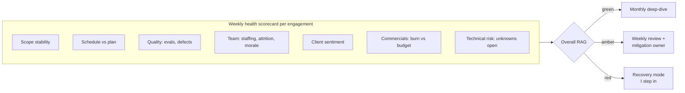
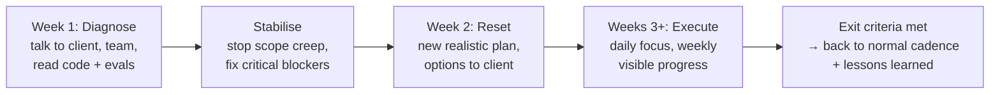
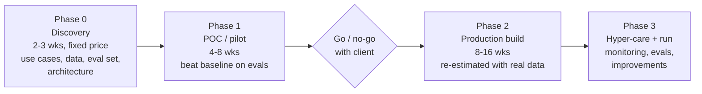
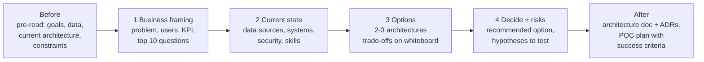
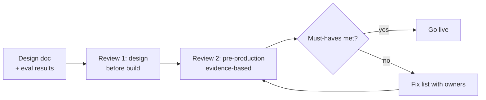
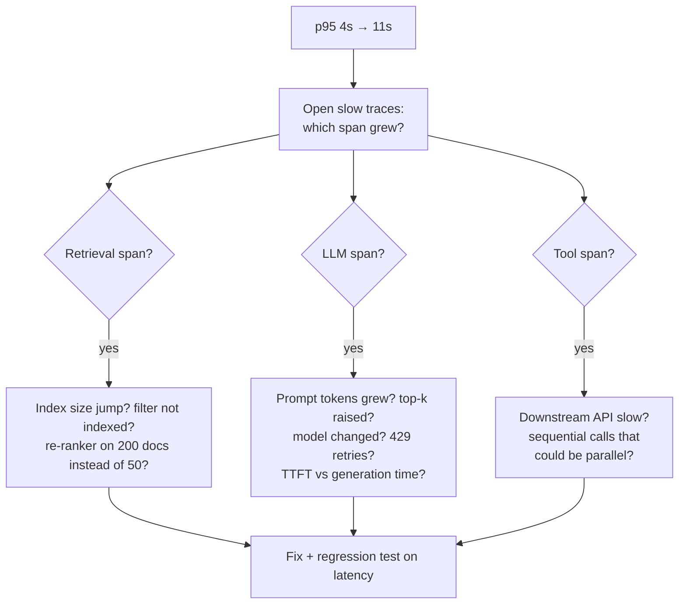

# 06 — Consulting Delivery, Pre-Sales, the Technical Review Bar & Hands-On Drills

> **JD lines covered:** [TUR] own technical delivery across **multiple concurrent client engagements** — delivery health, technical risks, staffing, **recovery when work goes off plan** · **set the technical review bar** and personally review RAG, agent/multi-agent, evaluation/guardrails, observability/scalability/security · **stay hands-on**: prototype, debug production, guide live deployments · **review scope before signature**, partner with pre-sales on **estimation** · staffing plans, redeployment, hiring · step into challenging engagements to **reset plans** · turn engagement work into **reusable components** · lead distributed teams. [DBX] lead **architecture design sessions** with customers; **shape AI product vision** on feasibility; translate business challenges into architectures; 3+ yrs consulting. [TTN] engage stakeholders, **validate hypotheses**; **rapid prototyping & lean experimentation**; mentorship; **POCs, accelerators, blogs, workshops, demos**; Streamlit/Gradio; open source.
>
> **Your edge:** 11+ years inside services firms (Capgemini → BMW, HCL → Air Canada, TCS → Maersk, Wipro → MGM). Tell these as **delivery ownership** stories. STAR answers here are templates — swap in your real details.
>
> **Already covered:** portfolio risks, budgets, exec comms, SLOs → [pack 01 / 05](../01-ai-engineering-leader/05-operational-excellence.md); team building & hiring → [pack 01 / 06](../01-ai-engineering-leader/06-leadership-influence.md).

---

## Part A — Running many client engagements

### Q6.1 · L3 · "You own delivery across 8 concurrent client engagements. How do you know which ones are in trouble?"

**Picture it:**



<details><summary><b>▶ Answer</b></summary>

**A standard health scorecard every engagement lead updates weekly** (10 minutes, not a report-writing exercise):

| Dimension | Leading indicators I watch |
|---|---|
| Scope | Change requests per week, unresolved requirement questions |
| Schedule | Milestones vs plan, **burn-up chart** trend, blocked items age |
| Quality | Eval scores trend (for GenAI), defect escape rate, demo feedback |
| Team | Open positions, unplanned leave/attrition, key-person dependency, overtime |
| Client | Sentiment in steering meetings, response time on decisions, escalations |
| Commercials | Effort burn vs budget, unbilled work, margin |
| Technical risk | Open unknowns (data access, model quality, integration), spikes pending |

**Rhythm:**
- **Weekly 30-min portfolio review** with engagement leads — only ambers/reds discussed in depth.
- **Monthly deep-dive** per engagement (architecture + delivery).
- **Client steering** monthly/fortnightly with the client sponsor.
- **Early-warning rule:** two consecutive ambers on the same dimension = treat as red.

**Look for leading signals, not lagging ones:** data access still not granted in week 3, the client not attending demos, eval scores flat for two sprints, a key engineer working weekends — these predict trouble weeks before a missed milestone.

</details>

**Say this:** *"A weekly seven-dimension health scorecard — scope, schedule, quality, team, client, commercials, technical risk — reviewed in 30 minutes with only ambers and reds discussed, focused on leading signals like stalled data access or flat eval scores. Two ambers in a row is a red."*

---

### Q6.2 · L3 · "An engagement is red — late, client unhappy. Walk me through your recovery."

**Picture it:**



<details><summary><b>▶ Answer</b></summary>

1. **Diagnose fast (first 3–5 days)** — separate conversations with the client sponsor, the client's technical lead, my engagement lead and engineers. Look at reality: code, eval results, backlog, burn. Typical root causes: **unclear or shifting scope**, data access/quality problems, underestimated integration, wrong architecture for the requirement, skills gap, or a broken relationship.
2. **Stabilise** — freeze new scope; fix the top 1–2 blockers (often data access or environment); add the right expertise (even temporarily — sometimes that's me, hands-on).
3. **Reset the plan with the client** — honest assessment, **2–3 options** (reduce scope to hit the date, keep scope and move the date, add capacity with cost), my recommendation, and what we need from them (decisions, data, SMEs). Agree new milestones with **visible demos every 1–2 weeks**.
4. **Execute visibly** — daily stand-up focused on the critical path; weekly sponsor update; early wins to rebuild trust.
5. **Commercial handling** — with account management: what's our fault vs client-caused (change requests), and a fair resolution.
6. **Exit and learn** — defined exit criteria (two green weeks, milestone hit); a blameless review; feed lessons into estimation and the scope-review checklist.

**STAR template (adapt to your real story):**
**S:** An enterprise client's AI/analytics delivery was 6 weeks behind; the client had escalated. **T:** Recover delivery and the relationship. **A:** Diagnosed that the data pipeline assumptions were wrong and scope had grown 40% via informal requests; froze scope, ran a workshop to re-prioritise into must-have/later, brought in a data engineer, put weekly demos in place. **R:** Delivered the re-scoped MVP in 5 weeks, the client approved phase 2. *(Replace with your actual numbers.)*

</details>

**Say this:** *"Diagnose in days by talking to everyone and reading the code and evals, stabilise by freezing scope and clearing blockers, reset with the client using honest options and a recommendation, then execute visibly with demos every week or two — and feed the lessons back into estimation."*

---

### Q6.3 · L3 · "How do you run the 'reset' conversation with a frustrated client stakeholder?"

<details><summary><b>▶ Answer</b></summary>

- **Prepare:** facts (what's done, what's not, why), options with impact on date/scope/cost, my recommendation, what I need from them.
- **Open with ownership, not excuses:** "We're behind, and part of that is on us. Here's what happened and what I'm changing."
- **Listen first** — let them say what matters most (often a specific business date or a demo to their leadership).
- **Present options** — trade-offs explicit; recommend one.
- **Agree concrete commitments on both sides** — ours (milestones, demo cadence, staffing) and theirs (data access by date X, SME time, faster decisions).
- **Write it down the same day** and follow up with visible progress within a week.
- **Tone:** calm, factual, no blame on the client team even when they contributed; frame client-side dependencies as risks we manage together.

</details>

**Say this:** *"Own what's ours, listen for what really matters to them, put two or three costed options on the table with my recommendation, agree commitments on both sides, write it down that day and show progress within a week."*

---

### Q6.4 · L3 · "How do you build staffing plans and redeploy engineers across engagements?"

<details><summary><b>▶ Answer</b></summary>

- **Supply view:** skills matrix (GenAI, ML, data, cloud, frontend, domain), seniority, current allocation and roll-off dates, location/time zone.
- **Demand view:** signed engagements + weighted pipeline from sales (probability × start date × roles).
- **Plan 8–12 weeks ahead** — match roll-offs to upcoming starts; identify gaps early (hire/partner) and surplus (bench → internal accelerators, training, pre-sales demos).
- **Team shape per engagement:** a strong tech lead + a mix of seniors and mids; avoid "all juniors" on a new GenAI client; one architect can oversee 2–3 engagements.
- **Redeploying:** move people at natural boundaries (milestones), with a 1–2 week overlap/hand-over; protect client continuity for key roles; be transparent with engineers about why.
- **Key-person risk:** at least two people know each critical component; documentation and recorded walkthroughs.
- **Hiring against a high bar:** structured loop with a practical GenAI exercise including evals and a client-communication scenario (pack 01 → 06 Q6.2); never lower the bar to fill a seat — use partners/contractors temporarily instead.

</details>

**Say this:** *"Skills matrix on the supply side, signed plus probability-weighted pipeline on the demand side, planned 8–12 weeks ahead; redeploy at milestone boundaries with overlap, protect key client roles, keep the bench productive on accelerators — and never lower the hiring bar to fill a seat."*

---

### Q6.5 · L2 · "How do you lead distributed engineering teams across time zones?"

<details><summary><b>▶ Answer</b></summary>

- **Write things down** — design docs, ADRs, decision logs; async by default.
- **Overlap hours** protected for the few things that need real-time discussion.
- **Clear ownership** of components per location to reduce hand-offs; avoid "follow-the-sun" for complex work unless hand-overs are excellent.
- **Demo culture** — recorded demos so everyone sees progress.
- **Same tooling and standards** everywhere (repo templates, CI, eval harness).
- **Visit/rotate** occasionally; recognise people across locations equally.

</details>

---

## Part B — Pre-sales, scoping and estimation

### Q6.6 · L3 · "You review the technical scope of every new engagement before signature. What red flags do you look for?"

<details><summary><b>▶ Answer</b></summary>

**Scope review checklist for GenAI/ML engagements:**

| Area | Red flag | What I ask for / change |
|---|---|---|
| **Outcome** | "Build an AI chatbot" with no measurable success criterion | Agreed KPI and acceptance criteria, ideally an eval set signed off by the client |
| **Accuracy promises** | "95% accuracy" committed before seeing data | Replace with eval-based acceptance after a discovery phase |
| **Data** | Data access, quality or volume unknown; PII unclear | Discovery phase; data access as a **client dependency with dates** |
| **Integration** | "Integrate with SAP/legacy" with no API details | Integration spike; assumptions documented |
| **Security/compliance** | Regulated data, no mention of client security review | Security review time in plan; data residency agreed |
| **Autonomy** | Agent that takes actions with no human approval | HITL in phase 1; autonomy as a later phase |
| **Model/hosting** | Who pays for tokens/GPUs? Which models are allowed? | Explicit run-cost assumptions and ownership |
| **Fixed price + high uncertainty** | Fixed price on undefined GenAI quality | Phase it: fixed-price discovery/POC → T&M or capped build |
| **Client dependencies** | SMEs, environments, approvals not committed | Named client roles and response times in SOW |
| **Operations** | No mention of who runs it after go-live | Hyper-care period + handover or managed service |

**My rule:** I don't sign off a scope I can't explain how we'll **test**. If we can't define acceptance, the first phase must be discovery that produces the acceptance criteria.

</details>

**Say this:** *"I look for missing success criteria, accuracy promises before seeing data, unknown data access, vague integrations, missing security reviews, autonomous actions without approval, unclear run costs and fixed price on undefined quality. If we can't define how we'll test it, phase one is discovery that defines acceptance."*

---

### Q6.7 · L3 · "How do you estimate a GenAI engagement with pre-sales?"

**Picture it:**



<details><summary><b>▶ Answer</b></summary>

**1. Phase the deal** — uncertainty is highest at the start, so estimate the next phase precisely and later phases as ranges, re-estimated at each gate.

**2. Bottom-up by workstream** (example for a RAG + agent assistant, production phase):

| Workstream | Typical effort drivers |
|---|---|
| Data ingestion & preparation | Number/types of sources, parsing complexity (scanned PDFs, tables), ACLs |
| Retrieval & prompt/agent logic | Number of intents/use cases, tools, languages |
| **Evaluation** (often forgotten) | Golden set creation with client SMEs, judge calibration, CI integration — budget **15–25%** of build effort |
| Integrations | APIs per system; auth complexity |
| UI/channel | Teams/web/CRM embedding |
| Security & compliance | Reviews, red-teaming, documentation |
| MLOps/LLMOps & infra | Environments, IaC, CI/CD, monitoring |
| Project management & client workshops | ~10–15% |

**3. Use reference data** from past engagements (velocity per source type, per tool) — and accelerators reduce effort; state that explicitly.

**4. Risk and contingency** — three-point estimates (best/likely/worst) for uncertain items; contingency 15–25% for GenAI builds depending on data clarity.

**5. Run-cost estimate for the client** — tokens per interaction × volume × model price, plus search/hosting — clients are often surprised by this later.

**6. Assumptions and dependencies written into the SOW** — data access dates, SME availability, environments, acceptance via eval set.

**Commercial model:** fixed price for discovery; T&M or capped T&M for build; outcome-based components only once metrics are proven.

</details>

**Say this:** *"Phase it — fixed-price discovery, a POC with a go/no-go, then a production build re-estimated with real data. Estimate bottom-up per workstream, budget 15–25% for evaluation, use past velocity and accelerators, add contingency for uncertainty, give the client a run-cost estimate, and write every dependency into the SOW."*

---

### Q6.8 · L3 · "How do you run an AI architecture design session with customer stakeholders?"

> **[DBX]** "Lead AI architecture design sessions with customer stakeholders" · **[TTN]** "translate business requirements into technical architectures, validate hypotheses".

**Picture it:**



<details><summary><b>▶ Answer</b></summary>

- **Right people:** business owner (value), domain SMEs (reality), data owner, security/architecture, the client's engineering lead (who'll run it).
- **Pre-read** sent a few days earlier; ask for sample data and the current architecture diagram.
- **Agenda (half day):**
  1. **Business framing** — problem, users, KPI, the top 10 real questions/tasks (these become the first eval set).
  2. **Current state** — data sources and quality, systems to integrate, security/compliance constraints, team skills, cloud/platform standards.
  3. **Options** — 2–3 architectures sketched live with trade-offs (e.g., managed Bedrock Knowledge Base vs custom pipeline; Genie-based vs custom agent) on cost, time, risk, control.
  4. **Decision & hypotheses** — recommended option and the **riskiest assumptions** to validate in a POC ("our documents are parseable", "text-to-SQL can hit 85% on the top 50 questions").
- **Facilitation:** draw, don't lecture; ask "how would we know it works?"; capture decisions and parking-lot items visibly.
- **Output within 48 hours:** architecture doc, ADRs, POC plan with success criteria and timeline.

**Validating hypotheses** = small, time-boxed experiments with a pre-agreed pass/fail threshold — the cheapest way to avoid building the wrong thing.

</details>

**Say this:** *"Right people in the room, a pre-read, then four blocks — business framing with their top ten real questions, current state, two or three options with trade-offs drawn live, and a decision with the riskiest hypotheses to test in a POC. Architecture doc and POC plan within 48 hours."*

---

### Q6.9 · L4 · "The client's AI vision isn't technically feasible. How do you shape it?"

<details><summary><b>▶ Answer</b></summary>

1. **Respect the ambition** — understand the business outcome behind the vision ("fully autonomous claims processing" = "settle claims in hours, not weeks").
2. **Show the feasibility map** — which parts are proven today, which are achievable with constraints, which are research. Evidence from a quick spike on their data beats opinions.
3. **Offer a staged path to the same outcome** — e.g., phase 1: AI extraction + human approval (70% faster); phase 2: auto-approve low-value, low-risk claims; phase 3: expand as accuracy proves out.
4. **Make risk tangible** — cost of errors, regulatory exposure, run cost at scale.
5. **Keep the vision alive** — a roadmap that ends where they want to go, with gates.

</details>

**Say this:** *"Find the outcome behind the vision, show a feasibility map backed by a quick spike on their data, and offer a staged path that reaches the same outcome safely — human-approved first, autonomy as accuracy is proven."*

---

## Part C — The technical review bar

### Q6.10 · L3 · "You set the review bar for production GenAI systems. What's on your architecture review checklist?"

> **[TUR]** "personally review architecture across RAG and retrieval · agent orchestration and multi-agent design · evaluation and guardrails · observability, scalability and security".

**Picture it:**



<details><summary><b>▶ Answer</b></summary>

**Two reviews:** a **design review** before build (cheap to change) and an **evidence-based pre-production review** (show me the evals, traces and load test — not slides).

**1. RAG & retrieval**
- [ ] Parsing quality checked on real documents (tables, scans)
- [ ] Chunking strategy justified by context-recall results
- [ ] Hybrid search + re-ranking considered; top-k tuned
- [ ] **Permission trimming** before the model sees text; tenant isolation
- [ ] Freshness: incremental sync, deletes handled, freshness SLO
- [ ] Citations required; "I don't know" behaviour tested

**2. Agents & multi-agent**
- [ ] Workflow vs agent choice justified; multi-agent split along ownership/permission lines, not fashion
- [ ] Tools: typed schemas, read/write separated, idempotent writes, server-side validation
- [ ] Least-privilege, **on-behalf-of identity**; no shared super-user service accounts
- [ ] HITL for irreversible/financial actions
- [ ] Max steps, token and cost budgets; loop detection; timeouts
- [ ] State checkpointing for long runs

**3. Evaluation & guardrails**
- [ ] Golden set (client-approved), adversarial and permission cases included
- [ ] Metrics with thresholds; LLM judge calibrated against humans
- [ ] Eval gate in CI; regression vs previous version
- [ ] Input/output guardrails; prompt-injection tests incl. **indirect** injection via documents/tools
- [ ] Red-team results reviewed; OWASP LLM Top 10 mapped

**4. Observability, scalability & security**
- [ ] End-to-end tracing (retrieval, every LLM and tool call, tokens, latency)
- [ ] Dashboards: quality, safety, cost, latency; alerts on SLOs
- [ ] Load test at 2× peak against provider rate limits; fallback model/region; graceful degradation
- [ ] Cost per interaction estimated and budgeted; caching/routing in place
- [ ] Secrets in a vault, private networking, encryption, data residency, retention rules, PII handling
- [ ] Model and prompt versions pinned; rollback tested; runbook + on-call owner

**Severity levels:** *must-fix before go-live* vs *fix within 30 days* vs *advice*. I publish the checklist so teams self-review first — the review then takes an hour, not a week.

</details>

**Say this:** *"Two reviews — design before build and evidence before production. Four sections: RAG (parsing, chunking, hybrid, permissions, freshness, citations), agents (workflow vs agent, typed tools, least privilege, HITL, budgets), evals and guardrails (client golden set, calibrated judges, CI gate, injection tests), and ops (tracing, load against rate limits, fallback, cost, security, rollback). It's published so teams self-review first."*

---

### Q6.11 · L3 · "How do you turn client engagement work into reusable components for the company's platform?"

<details><summary><b>▶ Answer</b></summary>

- **Harvest deliberately:** at each engagement retro ask "what did we build twice?" — connectors, chunkers, eval harnesses, guardrail configs, agent templates, Terraform modules, dashboards.
- **Contract check first:** IP ownership in the SOW — reusable *generic* components vs client-owned deliverables. Never reuse client data, prompts with client specifics, or proprietary logic.
- **Generalise and productise:** remove client specifics, add tests, docs and configuration, assign an owner, version it, publish in an internal catalogue.
- **Measure reuse:** engagements using each accelerator, effort saved vs estimate — feeds back into **pre-sales estimates** and win rates.
- **Standards from patterns:** when three engagements solve something the same way, it becomes a standard (reference architecture + review checklist item).

</details>

**Say this:** *"Ask at every retro what we built twice, check IP rights in the SOW, strip client specifics, productise with tests, docs and an owner, track reuse and feed the effort saved back into estimates — and when three teams solve it the same way, it becomes a standard."*

---

## Part D — Stay hands-on: debugging drills & prototyping

### Q6.12 · L3 · "Debug drill: a client's RAG assistant p95 latency went from 4s to 11s after last week's release."

**Picture it:**



<details><summary><b>▶ Answer</b></summary>

1. **Compare traces** before vs after release for the same request types — which span grew? (This is why tracing is a must-have.)
2. **Check the release diff** — prompt, top-k, re-ranker, model version, new tool, library upgrade.
3. **Common culprits:**
   - **Prompt tokens ballooned** (top-k raised from 5 to 20, or full chat history included) → longer prefill and higher cost.
   - **429 throttling + retries** after traffic grew → looks like latency; check provider rate-limit metrics.
   - **Re-ranker** scoring too many candidates.
   - **Unindexed metadata filter** → vector DB doing a slow scan.
   - **Sequential tool calls** that could run in parallel; slow downstream API.
   - **Output length** grew (prompt change made answers verbose) → generation time.
4. **Fix**, add a **latency budget per span** and a latency regression check in the pre-production test.

</details>

**Say this:** *"Compare traces before and after to find the span that grew, check the release diff, then go down the usual suspects — prompt tokens, throttling retries, an over-sized re-ranker, an unindexed filter, sequential tools, longer outputs — and add per-span latency budgets to the release gate."*

---

### Q6.13 · L3 · "Debug drill: an agent in production is looping, burning tokens, and sometimes calling the wrong tool."

<details><summary><b>▶ Answer</b></summary>

- **Contain:** lower max-steps/budget per run, enable a kill-switch for the affected flow, alert on runs exceeding N steps.
- **Diagnose from traces:** where does it loop? Typical causes:
  - **Tool errors returned as unhelpful text** ("error") → the model retries forever. Fix: structured error messages that say what to change, retry limits per tool.
  - **Ambiguous tool descriptions / overlapping tools** → wrong tool choice. Fix: clearer names and descriptions, fewer tools per agent, examples.
  - **Missing stop condition** in the graph; state not updated, so the same step repeats.
  - **Tool output too large** → context overflow, model loses track. Fix: summarise/truncate tool outputs.
  - **Model change** altered tool-calling behaviour → re-run agent eval suite.
- **Prevent:** agent scenario tests in CI (task success, steps, tool-call accuracy), per-run budgets, loop detection (same tool + same args twice → stop and escalate).

</details>

**Say this:** *"Contain with budgets and a kill-switch, then read the traces: unhelpful tool errors, overlapping tool descriptions, missing stop conditions, oversized tool outputs or a model change. Fix with structured errors, clearer tools, explicit termination and loop detection — and agent scenario tests in CI."*

---

### Q6.14 · L2 · "How do you champion rapid prototyping and lean experimentation without creating throwaway mess?"

<details><summary><b>▶ Answer</b></summary>

- **Hypothesis first:** "We believe <users> will <outcome> if <AI capability>; we'll know when <metric> on <eval set> ≥ <threshold>." Pass/fail decided before building.
- **Time-box** (1–2 weeks) with **kill criteria**.
- **Smallest testable thing:** real data sample, a notebook or a **Streamlit/Gradio** UI, 30–100 eval cases.
- **Prototype on the paved road where cheap** (gateway client, tracing) so a winner doesn't need a rewrite.
- **Show it to real users** early — usability problems kill more AI products than model quality.
- **Decide openly:** scale, iterate, or kill — and record the learning.

**A Streamlit demo in minutes:**

```python
# pip install streamlit ; run: streamlit run app.py
import streamlit as st

st.title("Policy Assistant — prototype")
q = st.text_input("Ask a question about HR policy")
if q:
    docs = retrieve(q)                                  # your retriever
    answer = generate(q, docs)                          # your LLM call
    st.write(answer)
    with st.expander("Sources"):
        for d in docs:
            st.markdown(f"- **{d['doc_id']}**: {d['text'][:200]}…")
    st.feedback("thumbs")                               # capture quick user feedback
```
- **Streamlit** builds a web UI from a Python script (re-runs top-to-bottom on each interaction) — ideal for internal demos and data apps.
- **Gradio** is similar, with ready-made components for ML demos (chat, image, audio) and easy sharing/Hugging Face Spaces hosting.
- For production UIs, move to **React** (or embed in Teams/CRM) behind proper auth.

</details>

**Say this:** *"Hypothesis with a pass/fail metric, a one-to-two-week time-box with kill criteria, the smallest testable thing — real data, a small eval set, a Streamlit or Gradio UI — built on the paved road where cheap, in front of real users early, and an explicit scale, iterate or kill decision."*

---

### Q6.15 · L2 · "Tell me about your contributions to the AI community — POCs, accelerators, blogs, open source."

<details><summary><b>▶ Answer</b></summary>

**Structure your answer (your real material):**
- **Open source:** **AgentPulse** — an open-source LLM reliability proxy on PyPI that self-heals schema drift in sub-second time, with an async telemetry pipeline and live dashboard. Explain the problem, design choice (fast model for repair), and what users/feedback you got.
- **Accelerators:** OpenTelemetry Spring Boot starter (`telemetry-common`) adopted across Azure Java services; MCP tool set (search, retrieve, filter, summarise, catalog) and a pluggable LLM provider layer that cut integration boilerplate ~40%.
- **POCs/demos:** production MCP RAG chatbot; voice agent experiments.
- **Knowledge sharing:** internal sessions/workshops you ran; this learnings repository.
- **Next 90 days (shows intent):** one blog post per month on lessons from production GenAI (e.g., "Prompt drift: three sources and how to catch each"), one workshop for client teams, contributions/issues to a framework you use.

**Why it matters to a consultancy:** it's credibility in pre-sales, a hiring magnet and a source of reusable IP.

</details>

**Say this:** *"AgentPulse on PyPI for LLM schema self-healing, an OpenTelemetry starter reused across services, MCP tooling that cut integration boilerplate about 40% — and I'm turning production lessons into monthly posts and client workshops, because that's credibility in pre-sales and a hiring magnet."*

---

### Q6.16 · L3 · "Mentoring junior engineers and data scientists in a consulting environment — what's different?"

<details><summary><b>▶ Answer</b></summary>

- **Client exposure is a growth tool** — juniors present a demo section, join design sessions as note-taker, then co-presenter.
- **Pair on production debugging** — the fastest way to learn real systems.
- **Review with explanations** — code and eval reviews that teach *why*.
- **Shared playbooks** (review checklist, estimation template, eval harness) so quality doesn't depend on who's on the engagement.
- **Rotate across engagements** to broaden domains; avoid juniors being stuck on support work.
- **Psychological safety under client pressure** — juniors must feel safe raising risks early; I shield them from blame in client conversations.
- **Data scientists → production:** teach testing, packaging, monitoring; engineers → ML: teach evaluation and statistics. Pair them.

</details>

---

## ⚡ Rapid-fire

| Question | One-line answer |
|---|---|
| Leading indicator of a failing engagement? | Data access still blocked in week 3 / client skipping demos. |
| Two ambers in a row? | Treat as red. |
| Phase-0 discovery output? | Use cases, data assessment, eval set, architecture, POC plan. |
| Eval effort in an estimate? | ~15–25% of build. |
| Fixed price on undefined quality? | Phase it: fixed discovery, then T&M/capped build. |
| Scope review golden rule? | Can't define how to test it → discovery first. |
| Design session output? | Architecture doc, ADRs, POC plan with pass/fail criteria — within 48h. |
| Pre-production review style? | Evidence (evals, traces, load test), not slides. |
| Agent loop quick fix? | Max steps/budget + loop detection + structured tool errors. |
| Streamlit vs Gradio? | Streamlit for data apps/internal demos; Gradio for ML demo components & HF Spaces. |
| Harvesting IP first check? | SOW IP clauses — never reuse client data or specifics. |
