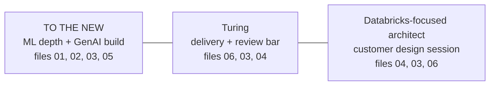
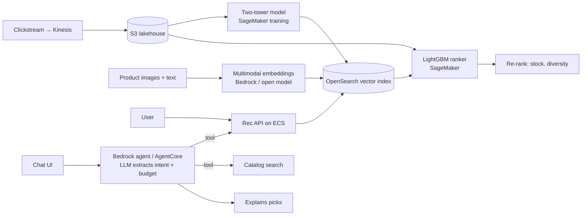
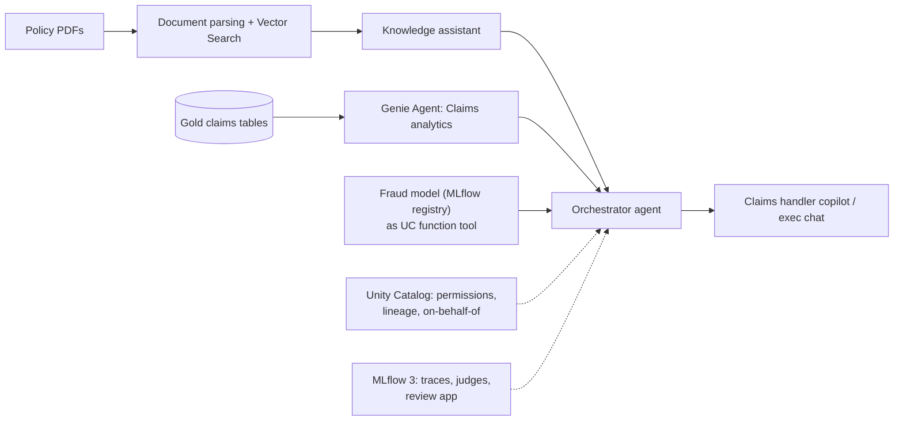

# 07 — Mock Interviews: One Loop per Company

> Out loud, with a timer. Answer first, then open the model answer. Use the 7-step design framework from [pack 01 / 07](../01-ai-engineering-leader/07-mock-interview.md): requirements → baseline/metric → architecture → decisions & trade-offs → safety → evals & monitoring → rollout & team.



---

## Loop A — TO THE NEW (Lead Data Scientist / GenAI architect)

**Likely rounds:** recruiter → ML/DS fundamentals → GenAI system design → coding (Python/pandas/sklearn or PyTorch) → stakeholder/leadership.

### A1. Hard technical questions (2 minutes each)

1. "Why would gradient boosting beat a neural network on our churn data?" → [01 Q1.4](01-ml-dl-foundations.md)
2. "Your fraud model has 0.97 ROC-AUC but the business says it's useless. Why?" → imbalance; PR-AUC; threshold at alert budget ([01 Q1.7](01-ml-dl-foundations.md))
3. "Explain LoRA's rank and alpha, and why QLoRA fits on one GPU." → [02 Q2.3–2.4](02-fine-tuning-transfer-learning.md)
4. "How do you detect prompt drift?" → [05 Q5.4](05-mlops-drift-hybrid.md)
5. "Pinecone or Qdrant for this client, and why?" → [03 Q3.9, 3.12](03-frameworks-vector-dbs.md)

### A2. Design case: "Build a product recommendation + shopping assistant for a fashion e-commerce client on AWS."

<details><summary><b>▶ Model answer</b></summary>

**Requirements:** 5M users, 300k SKUs, home-page recs + "complete the look" + a chat assistant ("outfit for a Goa wedding under ₹5k"); p99 < 150 ms for recs; KPI = conversion and revenue/session.



- **Classical core:** two-tower candidate retrieval + LightGBM ranker on feature-store features + business re-ranking (stock, diversity, margin). Trained on SageMaker, served on ECS/SageMaker endpoints.
- **GenAI layer:** multimodal product embeddings fix cold start for new SKUs; a shopping **agent** extracts constraints from chat and calls the recommender/catalog as **tools**, then explains choices. Guardrails for off-topic/unsafe; no hallucinated products — answers only from tool results.
- **Evals:** offline Recall@k/NDCG; agent eval set of 200 shopping requests (constraint satisfaction, relevance); online A/B on conversion.
- **Drift:** seasonal shifts (festive season), new collections → retraining cadence + data drift monitors; query drift on chat.
- **Team:** 2 ML engineers, 2 AI/backend engineers, 1 data engineer, 1 frontend, PM.

</details>

### A3. Coding prompt (20 minutes)

"Given a transactions DataFrame, build features per customer (last-30-day spend, transaction count, days since last purchase) without leakage, train a classifier and report PR-AUC."

<details><summary><b>▶ Model answer</b></summary>

```python
import pandas as pd
from sklearn.metrics import average_precision_score
from lightgbm import LGBMClassifier

tx = pd.read_parquet("tx.parquet")                    # customer_id, ts, amount
labels = pd.read_parquet("labels.parquet")            # customer_id, cutoff_date, churned

def features_as_of(tx, cutoff):
    past = tx[tx.ts < cutoff]                          # only data BEFORE the prediction date
    last30 = past[past.ts >= cutoff - pd.Timedelta(days=30)]
    f = past.groupby("customer_id").agg(last_ts=("ts", "max"), total_tx=("amount", "size"))
    f["days_since_last"] = (cutoff - f.pop("last_ts")).dt.days
    f["spend_30d"] = last30.groupby("customer_id")["amount"].sum()
    f["tx_30d"] = last30.groupby("customer_id")["amount"].size()
    return f.fillna(0)

rows = []
for cutoff, grp in labels.groupby("cutoff_date"):      # point-in-time features per cutoff
    f = features_as_of(tx, cutoff).reindex(grp.customer_id).fillna(0)
    rows.append(f.assign(churned=grp.set_index("customer_id").churned, cutoff=cutoff))
data = pd.concat(rows)

train = data[data.cutoff < "2026-07-01"]               # time-based split
test  = data[data.cutoff >= "2026-07-01"]
X_cols = ["total_tx", "days_since_last", "spend_30d", "tx_30d"]
model = LGBMClassifier(class_weight="balanced").fit(train[X_cols], train.churned)
print("PR-AUC:", average_precision_score(test.churned, model.predict_proba(test[X_cols])[:, 1]))
```
**Talk through:** features computed **only from data before each cutoff** (no leakage), time-based split, class weights, PR-AUC for imbalance; next: more features, CV, SHAP, MLflow logging.

</details>

---

## Loop B — Turing (AI Delivery Lead, multiple client engagements)

**Likely rounds:** recruiter (mandatory: GenAI in production within 2 years) → delivery leadership → GenAI architecture review (they show *their* design, you critique) → hands-on debugging → leadership/hiring.

### B1. Hard questions

1. "You have 8 engagements. How do you know which is about to fail?" → [06 Q6.1](06-consulting-delivery.md)
2. "Walk me through recovering a red engagement." → [06 Q6.2–6.3](06-consulting-delivery.md)
3. "What do you check before a SOW is signed?" → [06 Q6.6](06-consulting-delivery.md)
4. "Estimate a 3-source RAG assistant with two agent tools." → [06 Q6.7](06-consulting-delivery.md)
5. "Tell me about GenAI you personally shipped to production in the last 2 years." → MGM RAG alert summarisation: problem, architecture, your role, MTTR −25%, what broke and how you fixed it.

### B2. Architecture review exercise: "Here is a client team's design. Critique it."

> *Client design:* "A LangGraph agent for a bank's relationship managers. Uses a single service account with read/write access to CRM and core banking. Retrieves from a Chroma DB on the app server, top-k = 30. Prompt says 'never reveal other customers' data'. Tested manually on 20 questions. Deploying to all 2,000 RMs next month."

<details><summary><b>▶ Model answer — findings by severity</b></summary>

| # | Finding | Severity | Fix |
|---|---|---|---|
| 1 | **Single read/write service account** for core banking → excessive agency; any injection can act on any account | 🔴 Must-fix | On-behalf-of user identity; read-only tools by default; writes via approval workflow |
| 2 | **Access control via prompt** ("never reveal…") | 🔴 Must-fix | Permission trimming in retrieval and tools; prompts are not security |
| 3 | **Chroma on the app server** — no HA, no backups, scaling limits, ACL filtering unclear | 🔴 Must-fix for prod | Managed/clustered vector store or pgvector/OpenSearch with filtered search; IaC |
| 4 | **Manual testing on 20 questions** | 🔴 Must-fix | Golden set of 200+ with RM SMEs, adversarial + permission cases, CI eval gate, red-team incl. indirect injection |
| 5 | **Top-k = 30** → high latency/cost, noisy context | 🟠 30 days | Re-ranker, top-k 5–8 tuned on context recall |
| 6 | **Big-bang rollout to 2,000 users** | 🟠 Must change plan | Pilot 50 RMs → staged rollout with kill-switch |
| 7 | No mention of tracing, cost, SLOs, regulator documentation | 🟠 | OTel/MLflow tracing, cost per interaction, SLOs, model risk documentation for the bank |

**How to deliver it:** start with what's good (LangGraph is a sound choice for control), then must-fixes with reasons, then a clear path to "yes" with dates. Teams accept a high bar when the path is clear.

</details>

### B3. Debugging round

"Your client's assistant answered correctly in UAT but gives outdated policy answers in production." → stale index / sync not deployed / deletes not processed / different index alias in prod; check freshness metrics and the doc's version in the trace; fix sync + add freshness SLO and test ([pack 01 / 03 Q3.17](../01-ai-engineering-leader/03-genai-rag-agents-copilots.md), [04 Q4.2](04-cloud-data-platforms.md)).

---

## Loop C — Databricks-focused AI architect (customer-facing)

**Likely rounds:** recruiter → technical deep-dive (ML + GenAI + MLOps) → **customer role-play design session** → presentation of a past delivered model (track record) → consulting/behavioural.

### C1. Hard questions

1. "What's Unity Catalog's role in an agent system?" → [04 Q4.6, 4.8](04-cloud-data-platforms.md)
2. "How do you make Genie accurate?" → [04 Q4.7](04-cloud-data-platforms.md)
3. "What does DSPy give you that prompt engineering doesn't?" → [03 Q3.7](03-frameworks-vector-dbs.md)
4. "How do you evaluate a multi-agent system in MLflow?" → tracing per sub-agent, judges, review app, per-agent eval sets ([04 Q4.9](04-cloud-data-platforms.md), [pack 01 / 03 Q3.12](../01-ai-engineering-leader/03-genai-rag-agents-copilots.md))
5. "Show us a model you took to production and what you'd do differently." → prepare one story end-to-end with numbers.

### C2. Role-play: "I'm the CDO of an insurance company. We have claims data in Databricks and thousands of policy PDFs. My board wants 'AI agents'. Where do we start?"

<details><summary><b>▶ Model answer — how to run it</b></summary>

1. **Ask before proposing (5 min):** Which decisions/processes hurt most? (claims cycle time, fraud leakage, customer service load) Who are the users? What's governed in Unity Catalog today? Any regulatory constraints?
2. **Reflect back a use-case shortlist** scored on value × feasibility: (a) claims-handler copilot over policy PDFs + claim history, (b) natural-language analytics for claims leadership (Genie Agents on gold claims tables), (c) fraud triage — classical model + LLM investigation summary.
3. **Recommend a start:** (b) + (a) — fast, low risk, on governed data; (c) next, as it needs model validation.
4. **Sketch the architecture live:**



5. **Make success measurable:** 100 real handler questions + 50 leadership questions as the eval set; targets agreed (e.g., ≥ 85% correct with citations); pilot with one claims team in 6–8 weeks.
6. **Name risks:** document quality, PII, model risk governance for anything touching claim decisions (HITL), change management for handlers.
7. **Close with next step:** a half-day design session with claims ops + data owners, and a 2-week discovery to build the eval set.

**What they're grading:** you asked before you prescribed, tied it to business value, used their platform's governance, made success measurable, and named risks honestly.

</details>

---

## ⚡ 40 rapid-fire (mixed, all three companies)

1. Bagging vs boosting?
2. PR-AUC vs ROC-AUC — when?
3. L1 vs L2?
4. Isolation Forest idea?
5. Data leakage — one example?
6. K-means weakness?
7. Two-tower model?
8. Cold-start fixes?
9. NDCG measures?
10. BERT vs GPT?
11. CNN tasks + one model each?
12. LoRA in one line?
13. QLoRA's three ideas?
14. Memory for full fine-tune with Adam?
15. DPO needs what data?
16. Multi-LoRA serving?
17. LangGraph checkpointer?
18. CrewAI process types?
19. OpenAI Agents SDK handoff?
20. DSPy optimiser example?
21. HNSW knobs?
22. Post-filtering problem?
23. Pinecone vs pgvector — one reason each?
24. Bedrock Knowledge Bases does?
25. AgentCore — three components?
26. SageMaker deployment options?
27. Google's agent platform name now?
28. Unity Catalog governs?
29. Genie accuracy levers?
30. Cortex Analyst?
31. PSI thresholds?
32. Three sources of prompt drift?
33. Canary prompt set?
34. Two hybrid AI patterns?
35. Engagement health dimensions?
36. Eval share of a GenAI estimate?
37. Scope-review golden rule?
38. Two must-fix review findings you see most?
39. Agent looping — first two fixes?
40. Streamlit vs Gradio?

<details><summary><b>▶ Answer key</b></summary>

1. Parallel independent models (variance↓) vs sequential error-fixing models (bias↓).
2. PR-AUC for imbalanced positives; ROC-AUC hides rare-class weakness.
3. L1 zeroes weights; L2 shrinks smoothly.
4. Anomalies isolate in fewer random splits.
5. "refund_issued" used to predict complaints / scaler fit before split.
6. Assumes round, similar-size clusters; needs k; scale-sensitive.
7. User and item networks producing embeddings matched by ANN.
8. Content embeddings, popularity + context, exploration.
9. Ranking quality rewarding relevant items placed higher.
10. Bidirectional encoder (understand) vs causal decoder (generate).
11. Classification ResNet/ViT · detection YOLO/DETR · segmentation U-Net/SAM.
12. Freeze W, learn low-rank B·A.
13. NF4, double quantisation, paged optimisers.
14. ~16 bytes/parameter.
15. (prompt, chosen, rejected) pairs.
16. Many adapters share one base model in GPU.
17. Persists state per thread: resume, memory, HITL.
18. Sequential or hierarchical.
19. Transfer control to a specialist agent.
20. MIPROv2 / BootstrapFewShot.
21. M, ef_construction, ef_search.
22. Selective filters return fewer than k results.
23. Pinecone: zero-ops SaaS · pgvector: data already in Postgres with SQL filters.
24. Managed RAG: ingest from S3, chunk, embed, store, retrieve.
25. Runtime, Gateway, Identity (also Memory, Policy, Observability, Evaluations).
26. Real-time, serverless, async, batch transform.
27. Gemini Enterprise Agent Platform (evolution of Vertex AI).
28. Data, models, functions, vector indexes, agents.
29. Small curated domains, metric definitions, trusted SQL, instructions, benchmarks.
30. Snowflake text-to-SQL driven by a semantic model.
31. < 0.1 stable · 0.1–0.25 moderate · > 0.25 significant.
32. New user topics, prompt/config edits, provider model updates.
33. Fixed inputs run daily vs baseline outputs to catch silent changes.
34. ML decides + LLM explains; cascade small model → LLM.
35. Scope, schedule, quality, team, client, commercials, technical risk.
36. ~15–25% of build.
37. Can't define how to test it → discovery first.
38. Over-privileged service accounts; access control via prompt.
39. Per-run step/cost budget + structured tool errors (and loop detection).
40. Streamlit for data apps/internal demos; Gradio for ML demo components & HF Spaces.

</details>

---

## 📋 Before each interview — 10-minute checklist

- [ ] Pitch variant for this company ([README §4](README.md))
- [ ] One production GenAI story with architecture, your role, numbers, what broke
- [ ] One recovery/delivery story (Turing) or one customer design-session story (Databricks role) or one ML model story (TTN)
- [ ] The honest framing for your gap (TTN: DS years; DBX: consulting years; AWS vs Azure)
- [ ] 3 questions to ask them (pack 01 / 06 Q6.15)
