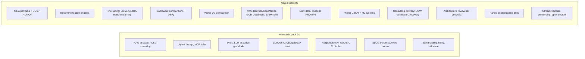
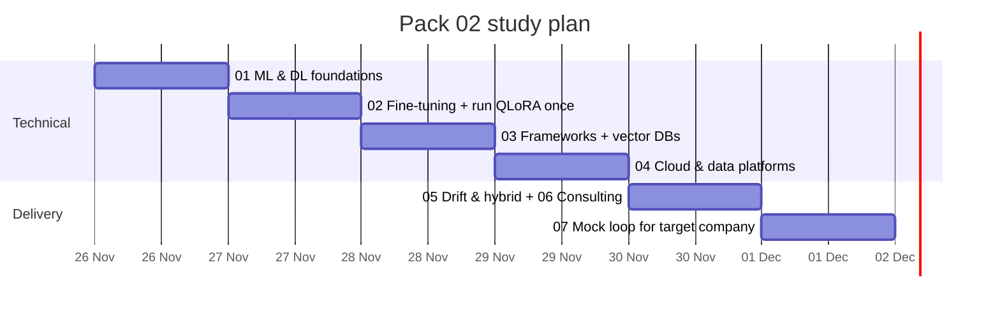

# Pack 02 — GenAI / ML Architect & AI Delivery Lead (3 postings)

> **Source:** three job postings shared on 25 Nov 2026. They overlap heavily, so they share one pack.
>
> | Tag | Company | Role signal | What's different from pack 01 |
> |---|---|---|---|
> | **[TTN]** | TO THE NEW | Lead Data Scientist / GenAI architect, 10–14 yrs incl. **8+ in DS/ML** | Classical ML + deep learning (NLP/CV), recommendation engines, LoRA/QLoRA, PyTorch/HF, vector DBs, **AWS preferred**, Streamlit/Gradio, open source |
> | **[TUR]** | Turing (Global India) | AI Delivery Lead across **multiple client engagements**, 12+ yrs, 5+ leading AI/ML delivery | Consulting delivery: delivery health, recovery, pre-sales estimation, staffing, **sets the technical review bar**, LangGraph/LlamaIndex/Semantic Kernel, Bedrock/Vertex, Databricks/Snowflake, **GenAI shipped to prod in last 2 yrs (mandatory)** |
> | **[DBX]** | Databricks-focused AI architect (customer-facing) | 12+ yrs hands-on ML/GenAI/MLOps/SWE, **3+ yrs consulting** | **Agent Bricks, Genie**, DSPy, MLflow, HuggingFace, customer architecture design sessions, graduate degree in a quantitative field |
>
> **Rule for this pack:** anything already answered in [pack 01](../01-ai-engineering-leader/README.md) is **linked, not repeated**. Everything here is new.

---

## 1. Coverage map — what's already done vs what this pack adds

| JD line | Covered where |
|---|---|
| End-to-end AI delivery, measurable business impact | Pack 01 → 01 Q1.1, Q1.10 |
| RAG pipelines, embeddings, prompt engineering, agents | Pack 01 → 03 (all) + **this pack 03** for frameworks & vector DBs |
| **Supervised / unsupervised / DL (NLP, CV), recommendation engines** | **01 — ML & DL foundations** |
| **Regression, trees, clustering, anomaly detection** | **01** |
| **LoRA / QLoRA, transfer learning, PyTorch, HF** | **02 — Fine-tuning** |
| **LangChain, LangGraph, LlamaIndex, Semantic Kernel, CrewAI, OpenAI Agents SDK, Bedrock Agents, DSPy** | **03 — Frameworks & vector DBs** |
| **Pinecone, Weaviate, Qdrant, Milvus, ChromaDB** | **03** |
| **AWS (preferred), Azure OpenAI, Vertex AI, Databricks (Agent Bricks, Genie), Snowflake, MLflow** | **04 — Cloud & data platforms** |
| **Data pipelines, feature readiness, scalable data architecture** | **04** |
| **Drift detection — data, concept AND prompt drift** | **05 — MLOps, drift & hybrid systems** |
| **Hybrid AI: GenAI + classical ML/DL** | **05** |
| MLOps/LLMOps CI/CD, versioning, testing | Pack 01 → 02 + **this pack 05** for drift code & MLflow |
| **Multiple concurrent client engagements, delivery health, recovery** | **06 — Consulting delivery** |
| **Scope review before signature, pre-sales estimation** | **06** |
| **Staffing plans, redeploying engineers, hiring bar** | **06** (+ pack 01 → 06 Q6.2) |
| **Technical review bar: RAG, multi-agent, evals/guardrails, observability/scale/security** | **06 — review checklist** |
| **Stay hands-on: prototype, debug prod, guide live deployments** | **06 debugging drills** + **07 mock** |
| **Rapid prototyping, lean experimentation; Streamlit/Gradio** | **06** |
| **POCs, accelerators, blogs, workshops, open source** | **06** |
| Data privacy, security, responsible AI | Pack 01 → 04 |

## 2. Files (study in this order)

| # | File | Main posting | Qs | Priority |
|---|---|---|---|---|
| 01 | [ML & deep learning foundations](01-ml-dl-foundations.md) | TTN, DBX | 18 | ⭐⭐⭐ (your biggest gap) |
| 02 | [Fine-tuning & transfer learning](02-fine-tuning-transfer-learning.md) | TTN | 11 | ⭐⭐⭐ |
| 03 | [GenAI frameworks & vector databases](03-frameworks-vector-dbs.md) | All three | 13 | ⭐⭐⭐ |
| 04 | [Cloud & data platforms: AWS, GCP, Databricks, Snowflake](04-cloud-data-platforms.md) | All three | 13 | ⭐⭐⭐ |
| 05 | [MLOps, drift & hybrid AI systems](05-mlops-drift-hybrid.md) | TTN | 10 | ⭐⭐ |
| 06 | [Consulting delivery, review bar & hands-on drills](06-consulting-delivery.md) | TUR, DBX | 16 | ⭐⭐⭐ |
| 07 | [Mock interviews — one loop per company](07-mock-interview.md) | All three | 3 loops + 40 rapid | ⭐⭐⭐ |

## 3. Honest gap check for these three postings

| Requirement | Your evidence | Risk | Plan |
|---|---|---|---|
| **[TTN] 8+ years in Data Science / ML** | Your core is Java/backend + GenAI (last ~2–3 yrs) | 🔴 High — this is a hard filter | Don't claim 8 yrs DS. Position as "AI systems engineer who ships ML/GenAI to production", and be fluent in file 01 so the technical rounds go well |
| **[TUR] GenAI shipped to production in last 2 years (mandatory)** | MGM RAG alert summarisation (prod), MCP tools, AgentPulse on PyPI | ✅ Meets it | Lead with MGM — numbers ready (MTTR −25%) |
| **[TUR] Owned delivery for external clients** | Wipro → MGM, Capgemini → BMW, HCL → Air Canada, TCS → Maersk | ✅ Strong — services background is an advantage here | File 06: tell it as delivery ownership, not just engineering |
| **[DBX] 3+ yrs customer-facing consulting** | Client-embedded at MGM/BMW etc. | ⚠️ Medium | Frame stakeholder workshops & design sessions you ran |
| **[DBX] Graduate degree in quantitative field** | B.Tech CSE | ⚠️ Possible filter | CSE is quantitative; let the recruiter decide; don't over-explain |
| **AWS preferred** | Mostly Azure | ⚠️ Medium | File 04 Part A — map every Azure service you know to its AWS twin |
| **PyTorch / HF / LoRA hands-on** | Limited | ⚠️ Medium | File 02 — run the QLoRA snippet once on Colab so you can say "I've done it" truthfully |
| **Databricks / Snowflake** | Limited | ⚠️ Medium | File 04 Part C — know the vocabulary + one design |

## 4. Pitch variants (30 seconds each)

- **[TTN]** "I build AI systems that reach production — GenAI and ML together. At MGM I shipped RAG-based alert summarisation on an observability platform I designed, cutting MTTR 25%. I've built MCP tooling and an open-source LLM reliability proxy on PyPI. I pair LLMs with classical models where they fit — for example, a classifier or anomaly model to decide *what* matters and an LLM to explain it."
- **[TUR]** "I've spent 11+ years in services delivery — BMW, Air Canada, Maersk, MGM — so client delivery, recovery and staffing are home ground. In the last two years I've shipped GenAI to production at MGM and I set review standards for RAG, agents, evals and observability. I stay hands-on: I still prototype, debug production and publish open source."
- **[DBX]** "I translate business problems into AI architectures customers can actually run: governed data, evaluated agents and MLflow-style observability. I've led design sessions with enterprise clients and shipped production RAG and agent tooling; I'm now deepening on the Databricks stack — Agent Bricks, Genie, Unity Catalog and MLflow 3."

## 5. Five-day plan

