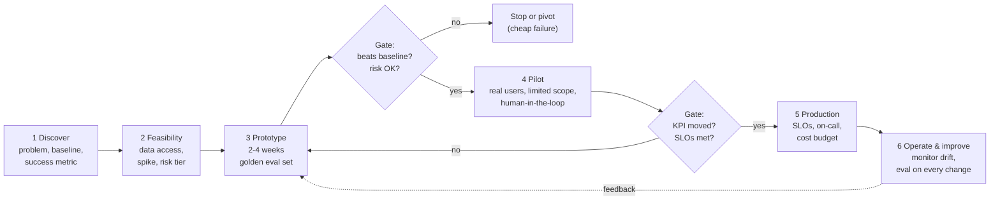
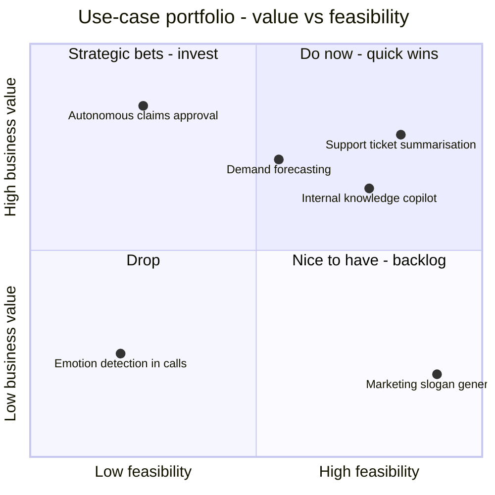
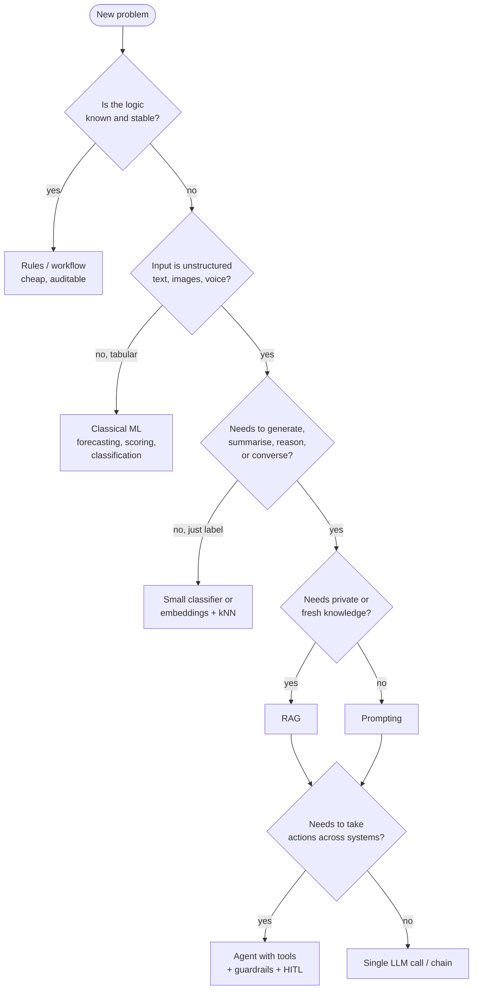
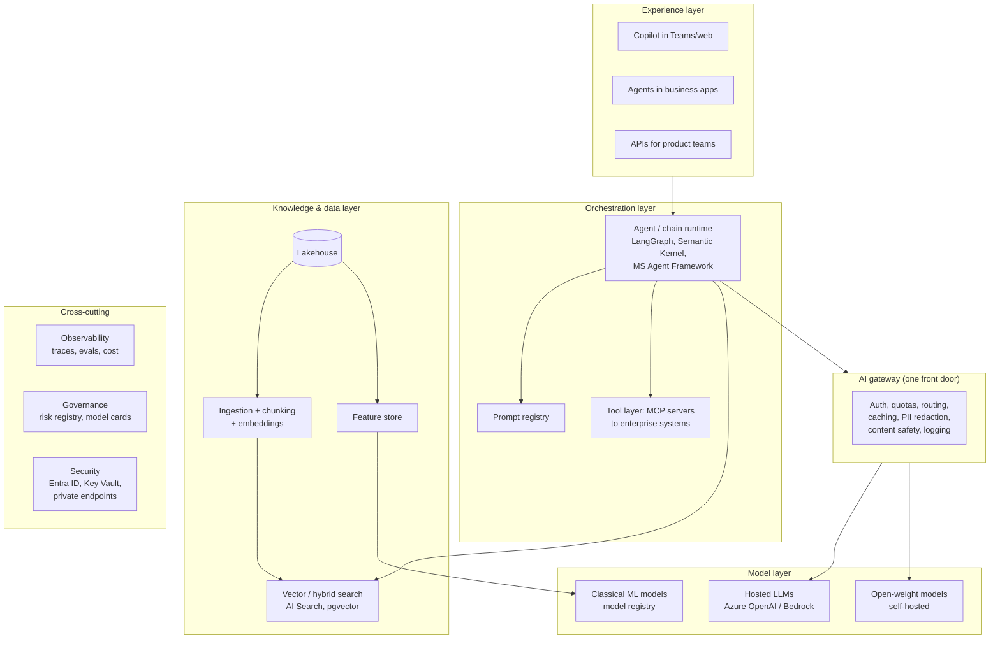
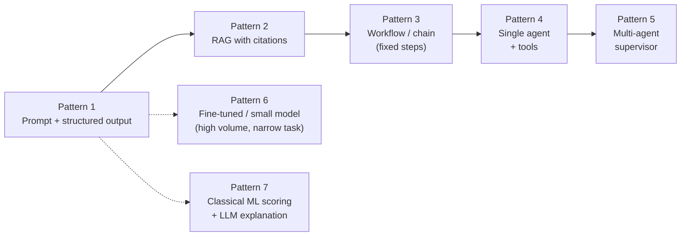
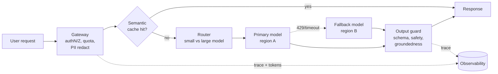
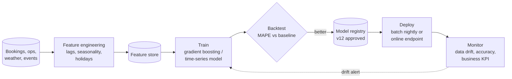
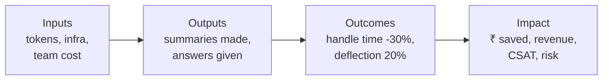
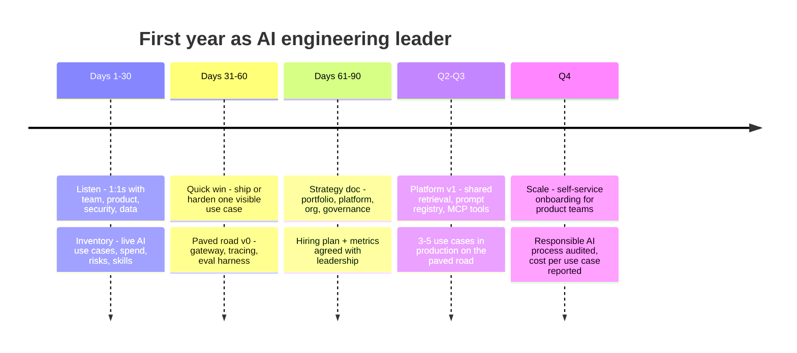

# 01 — AI/ML Strategy & Solution Delivery

> **JD lines covered:** lead end-to-end delivery of AI/ML, GenAI and Agentic AI initiatives from concept to production · define technical strategy, architecture and implementation patterns · partner with business to identify, prioritise and deliver high-impact use cases · drive adoption of LLMs, agents, intelligent automation, predictive analytics · ensure scalability, reliability, security, privacy, compliance and performance.
>
> **Prerequisites:** RAG, agents, embeddings basics → [`interview-prep/11-agentic-ai.md`](../../interview-prep/11-agentic-ai.md) Q1–Q18.

**Levels:** L1 basics · L2 practitioner · L3 senior/lead · L4 head/director judgement

---

## Part A — The delivery lifecycle

### Q1.1 · L2 · "Walk me through how you take an AI initiative from idea to production."

> **Why they ask:** They want to see that you know AI delivery is *not* normal software delivery — the hard parts are data, evaluation and adoption, not the code.

**Picture it:**

<b>▶ Answer</b>

I run AI work as **stage-gated, evidence-driven delivery**, because most AI projects fail between prototype and production, not at the prototype.

1. **Discover (1–2 weeks).** Write a one-page problem statement: *who* has the pain, *what* the current process costs (time, money, error rate) — that's the **baseline** — and *what number must move* for this to be worth it. No baseline = no project, because you can never prove value.
2. **Feasibility.** Three checks: **data** (do we have it, can we legally use it, is it good enough?), **technical spike** (can a model do this at all — usually a day of prompting against 20 real examples), and **risk tier** (does it touch customers, money, health, employment? — that decides how much governance follows; see file 04).
3. **Prototype (2–4 weeks).** The first deliverable is not the app — it is the **golden evaluation set**: 100–300 real inputs with expected outputs, agreed with the business. Every later change is measured against it.
4. **Gate 1.** Does it beat the baseline on the eval set, and is residual risk acceptable? If not, we stop — that is a *successful cheap failure*, and I report it as such.
5. **Pilot.** Real users, limited scope, **human-in-the-loop** (AI suggests, human approves), full tracing on. We measure the business KPI, not just model accuracy.
6. **Gate 2 → Production.** Production means: SLOs defined, on-call owner, runbooks, cost budget with alerts, security review signed, model card/documentation done.
7. **Operate.** Continuous evaluation, drift monitoring, user feedback loop back into the eval set.

**Example from my work:** at MGM the RAG alert summariser started as a spike on ~50 historic incidents. We built a golden set from past incident tickets, piloted with one on-call rotation where engineers rated each summary, and only rolled out once we saw a measurable MTTR drop — the final result was −25%.

**Say this:** *"I stage-gate AI. Baseline first, golden eval set before the app, pilot with a human in the loop, and production only when there's an owner, SLOs and a cost budget."*

**Follow-ups:** What's in your golden set? (→ file 03 Q3.10) · Who decides at the gate? (→ business owner + you + risk/security for higher tiers) · How long end-to-end? (Typical: 6–12 weeks to pilot for a GenAI assistant; longer for regulated/high-risk.)

---

### Q1.2 · L3 · "How do you identify and prioritise AI use cases across the business?"

> **Why they ask:** "Partner with business stakeholders to identify, prioritise and deliver high-impact AI use cases" — they want a repeatable method, not intuition.

**Picture it:**

<b>▶ Answer</b>

I use a **funnel + scoring** method so prioritisation is transparent and arguments are about data, not opinions.

**Step 1 — Collect.** Run discovery workshops per business unit. Ask: *"Where do people read, write, search, classify, summarise, or route things all day?"* — those are the GenAI-shaped problems. *"Where do you forecast or predict something?"* — those are classical ML.

**Step 2 — Score each idea** on a simple 1–5 scale:

| Dimension | Question | Weight |
|---|---|---|
| Business value | Hours saved, revenue, risk reduced — in money | 30% |
| Feasibility | Is the data available and clean? Is it technically solvable today? | 25% |
| Time to value | Can a pilot show results in < 1 quarter? | 15% |
| Risk | Customer-facing? Regulated? Autonomous decisions? (inverse score) | 15% |
| Strategic fit / reuse | Does it build a reusable capability (e.g., a retrieval platform others can use)? | 15% |

**Step 3 — Plot on value × feasibility** (diagram above):
- **Top-right → do now.** Usually internal, human-in-the-loop, text-heavy work.
- **Top-left → strategic bets.** High value but hard (data not ready, high risk) — fund a data-readiness or risk workstream first.
- **Bottom-right → backlog.** Easy but low value; good for training juniors.
- **Bottom-left → drop.**

**Step 4 — Portfolio balance.** I aim roughly for 60–70% quick wins (builds trust and funding), 20–30% strategic bets, ~10% exploration of emerging tech.

**Step 5 — Re-score quarterly**, because feasibility changes fast in GenAI (a model release can move an idea from "hard" to "easy").

**Reuse lens (the leader's angle):** I prefer the third use case that *reuses* the retrieval platform built for the first two over a slightly higher-value one-off — platform leverage compounds.

**Say this:** *"I score every idea on value, feasibility, time-to-value, risk and reuse, plot them on a 2×2, and run a portfolio: mostly quick wins to earn trust, some strategic bets, a little exploration — re-scored every quarter."*

**Follow-ups:** How do you put a money value on "time saved"? (hours × loaded cost × adoption rate — and say adoption honestly, often 30–60%.) · What if two VPs both say theirs is #1? (→ Q1.14)

---

### Q1.3 · L3 · "How do you decide if a problem needs GenAI, classical ML, or just rules?"

> **Why they ask:** A senior leader avoids "LLM for everything". This tests cost and reliability judgement.

**Picture it:**

<b>▶ Answer</b>

I walk down a ladder and **stop at the simplest rung that works**, because each rung up adds cost, latency and unpredictability:

1. **Rules / deterministic workflow** — if the business can write the logic down ("refund if order < ₹500 and delivered late"), code it. Cheapest, fully auditable, zero hallucination.
2. **Classical ML** — structured/tabular data and a numeric or class prediction: churn, demand forecasting, fraud score, ETA. Cheap at inference, well-understood metrics (precision/recall, MAPE), mature MLOps.
3. **Small model / embeddings** — classify or route text (e.g., ticket → team) — often a small fine-tuned classifier or embedding similarity beats an LLM on cost and latency at scale.
4. **LLM prompting** — needs language generation or flexible reasoning on content already in the prompt.
5. **RAG** — needs company-specific or up-to-date knowledge with citations.
6. **Agent** — must take multi-step actions across systems. Highest power and highest risk — needs tool permissions, guardrails and human approval for irreversible actions.

**Hybrid is normal.** Example: an insurance claims flow can use **OCR + LLM** to extract fields from documents, a **classical fraud model** to score risk, **rules** to apply policy limits, and an **LLM** to draft the customer letter — with a human approving anything above a threshold.

**Say this:** *"Simplest rung that works: rules, then classical ML, then small models, then LLM, then RAG, then agents. Every step up costs more and is less predictable, so it has to earn its place."*

---

### Q1.4 · L3 · "Describe a reference architecture for an enterprise AI platform."

> **Why they ask:** "Define technical strategy, architecture and implementation patterns for enterprise AI platforms and services."

**Picture it:**

<b>▶ Answer</b>

I describe it as **six layers plus three cross-cutting concerns**, and the main design principle is: **product teams build use cases; the platform team owns the shared, hard, risky parts once.**

| Layer | What lives there | Why it's shared |
|---|---|---|
| Experience | Copilots, embedded agents, APIs | Owned by product teams |
| Orchestration | Agent runtime, chains, **prompt registry** (versioned prompts), **tool layer** (MCP servers wrapping enterprise APIs) | One tool written once is reused by every agent |
| **AI gateway** | Single front door to every model: authentication, per-team quotas, model routing & fallback, semantic caching, PII redaction, content safety, token/cost logging | This is the **control point** — without it you can't govern cost or safety |
| Models | Hosted LLMs (Azure OpenAI in Foundry, Bedrock), open-weight models on AKS/GPU, classical ML from a **model registry** | Avoid lock-in; route by cost/quality |
| Knowledge & data | Ingestion pipelines, chunking, embeddings, hybrid search index, feature store, lakehouse | Retrieval quality is where most GenAI value is won or lost |
| Cross-cutting | Observability (traces, evals, cost dashboards), governance (risk registry, model cards, approvals), security (identity, secrets, private networking) | Must be non-optional and automatic |

**On Azure this maps to:** Microsoft Foundry (formerly Azure AI Foundry) for models/agents/evaluations · Azure API Management as the AI gateway · Azure AI Search for hybrid retrieval · AKS/Container Apps for custom services · Azure ML for classical ML and registry · Entra ID + managed identities · Key Vault · Private Endpoints · Azure Monitor/App Insights + OpenTelemetry.

**On AWS:** Bedrock (+ Bedrock Agents/Guardrails) · API Gateway or a custom gateway · OpenSearch / Aurora pgvector · SageMaker · EKS · IAM · CloudWatch.

**My MGM link:** the OpenTelemetry common module I built is exactly the "observability as a cross-cutting, non-optional library" idea — teams got tracing by adding one dependency.

**Say this:** *"Six layers — experience, orchestration, AI gateway, models, knowledge, plus observability, governance and security across all of them. The gateway is the control point for cost and safety; the knowledge layer is where quality is won."*

**Follow-ups:** Why a gateway instead of calling models directly? (→ file 02 Q2.8) · Which parts would you build vs buy? (→ Q1.6)

---

### Q1.5 · L3 · "What implementation patterns would you standardise for teams?"

> **Why they ask:** "Implementation patterns" + "reusable frameworks and accelerators" — they want a catalogue, so 20 teams don't invent 20 ways.

**Picture it:**

*Left → right = more autonomy, more risk, more governance needed.*

<b>▶ Answer</b>

I publish a **pattern catalogue** — each pattern comes with a reference implementation (template repo), its eval approach, and the risk controls it needs by default.

| # | Pattern | Use when | Default controls |
|---|---|---|---|
| 1 | **Prompt + structured output** (JSON schema) | Extraction, classification, drafting | Schema validation, low temperature |
| 2 | **RAG with citations** | Q&A over company knowledge | Access-controlled retrieval, "I don't know" allowed, groundedness eval |
| 3 | **Workflow / chain** — fixed steps, LLM inside some steps | Process is known (e.g., extract → validate → draft) | Deterministic control flow, step-level logs |
| 4 | **Single agent + tools** | Steps not known in advance | Tool allow-list, max steps, HITL for writes |
| 5 | **Multi-agent (supervisor)** | Genuinely separable expertise | Everything in 4 + per-agent budgets and tracing |
| 6 | **Fine-tuned / small model** | Very high volume, narrow task, cost-sensitive | Eval vs. large model baseline, retrain plan |
| 7 | **Classical ML + LLM explanation** | Predictions that need to be explained to humans | Model monitoring + explanation grounded in features |

**The rule I give teams:** *"Start at the lowest-numbered pattern that solves the problem. Moving right needs a written reason."* Most enterprise value today is in patterns 1–3. Workflows beat free agents when the process is known, because they are testable and predictable.

Each pattern's template repo already contains: gateway client, OTel tracing, eval harness wired into CI, prompt registry integration, and a README with the risk checklist — so the **paved road is also the fast road**.

**Say this:** *"Seven patterns, from prompt-plus-schema to multi-agent. Each has a template repo with tracing, evals and guardrails built in, and teams must justify moving to a more autonomous pattern."*

---

### Q1.6 · L3 · "Build vs buy vs partner — how do you decide for AI capabilities?"

> **Why they ask:** Budgets + "evaluate emerging AI technologies" — leaders spend money wisely.

<b>▶ Answer</b>

I decide per capability, using four questions:

1. **Is it a differentiator?** If the capability is how we win (our proprietary data + our process), **build** the thin layer that holds that logic. If it's commodity (meeting summaries, generic code assistant), **buy** (e.g., Microsoft 365 Copilot, GitHub Copilot).
2. **How fast is the market moving?** In fast-moving areas (agent frameworks, vector DBs) I avoid deep custom builds — I **wrap** vendor pieces behind our own interfaces so I can swap them. The AI gateway and MCP tool layer are exactly those seams.
3. **Total cost of ownership** — build cost is not just engineers; it's on-call, security patching, evaluations, upgrades every time a model changes. I compare 3-year TCO, not license vs. dev cost.
4. **Data, compliance, lock-in** — where does data go, data residency, can we export, exit cost.

**Typical outcome in an enterprise:**
- **Buy:** productivity copilots, content safety services, base models.
- **Build:** domain RAG over our knowledge, agents wired into our systems, evaluation datasets, the gateway policies.
- **Partner:** specialised areas where we lack skills today (e.g., speech, document AI in a niche language) — with knowledge-transfer clauses so we're not dependent forever.

**Say this:** *"Buy commodity, build differentiation, and put our own interface in front of anything that moves fast so we can swap vendors. Decide on three-year TCO, not license price."*

---

### Q1.7 · L3 · "How do you make sure an LLM solution meets scalability, reliability, security, privacy, compliance and performance requirements?"

> **Why they ask:** It's a literal JD bullet. They want an NFR checklist that is specific to LLMs.

**Picture it:**

<b>▶ Answer</b>

I treat the LLM as an **unreliable, expensive, rate-limited external dependency** and put an engineering checklist around it:

| NFR | LLM-specific risk | What I put in place |
|---|---|---|
| **Scalability** | Provider rate limits (tokens/min), GPU scarcity | Provisioned throughput for steady load + pay-as-you-go burst; multi-region deployments behind the gateway; async/queue for batch jobs; semantic cache |
| **Reliability** | 429s, timeouts, model version changes, non-determinism | Retries with backoff + jitter, circuit breaker, fallback model/region, **pin model versions**, regression evals before upgrading, graceful degradation ("search results only" mode) |
| **Security** | Prompt injection, data exfiltration via tools, over-privileged agents | Input/output guards, tool allow-lists, least-privilege managed identities, HITL for writes, red-teaming (file 04) |
| **Privacy** | PII in prompts/logs, data used for training | PII redaction at gateway, no-training/zero-retention contract terms, log masking, retention limits, data residency |
| **Compliance** | Explainability, audit, regulation (EU AI Act, sector rules) | Audit log of prompt/response/tool calls, model cards, risk tiering, approval workflow |
| **Performance** | Latency of large models, long prompts | Streaming responses, smaller model routing, prompt trimming, caching, parallel retrieval, measure **TTFT** (time to first token) and p95 end-to-end |

And I make each one **testable**: load tests against the gateway, chaos test (kill primary region), red-team suite in CI, and SLOs on latency/availability/quality (file 05).

**MGM link:** our alerting path had to work during incidents, i.e., exactly when everything else was under stress — so the summariser had a timeout and fell back to the raw alert rather than blocking the page.

**Say this:** *"I treat the model as a flaky, rate-limited, expensive dependency: gateway in front, cache, routing, fallback, pinned versions, guards on both sides, and every NFR has a test and an SLO."*

---

### Q1.8 · L2 · "Why do most AI POCs never reach production, and how do you prevent it?"

> **Why they ask:** The JD says "from concept through production deployment". They want someone who has crossed that gap.

<b>▶ Answer</b>

The common killers, and my counter for each:

| Why POCs die | My counter |
|---|---|
| **No baseline / no business metric** — demo looks great, nobody can prove value | Baseline and target KPI agreed in week 1 |
| **Demo data ≠ real data** — works on 10 cherry-picked examples | Golden set built from *real, messy* historic data, including the ugly cases |
| **No evaluation** — every prompt change is a gamble | Eval harness in CI from the prototype stage |
| **Security/compliance discovered late** — blocked at go-live | Risk tier + security engagement at feasibility stage |
| **Cost surprise at scale** — ₹ per call × real volume is huge | Cost-per-transaction estimate at prototype stage, model routing designed in |
| **No owner** — the innovation team built it, nobody wants to run it | Product + engineering owner named before pilot; platform team provides paved road |
| **No adoption** — users don't trust or don't change workflow | Embed in the tool they already use (Teams, CRM), show sources, train champions, measure usage |
| **Integration underestimated** — the "last mile" into SAP/CRM/ticketing | Integration spike in feasibility; MCP/tool layer reused |

The meta-point: **production is designed in from day one** — the POC is built on the same paved road (gateway, tracing, eval harness) as production, so "productionising" is scaling, not rewriting.

**Say this:** *"POCs die from no baseline, demo-only data, no evals, late security, cost surprises, no owner and no adoption. I fix all seven in the first two weeks, and the POC runs on the production paved road so nothing gets rewritten."*

---

### Q1.9 · L2 · "The JD says predictive analytics. Explain a predictive ML use case end to end."

> **Why they ask:** This is your gap area. They want to know you can lead ML engineers, not just GenAI developers.

**Picture it:**

<b>▶ Answer</b>

**Example: demand forecasting for staffing** (fits hospitality/aviation/logistics — MGM, Air Canada, Maersk all have this).

1. **Problem & metric.** Predict hourly demand per location for the next 14 days so rosters can be planned. Business KPI: overstaffing cost and missed-SLA hours. Model metric: **MAPE** (mean absolute percentage error) vs. the current baseline (last year same week + manager judgement).
2. **Data & features.** Historical volumes, calendar features (day of week, holidays, local events), weather, promotions. **Lag features** (demand 7 and 364 days ago). Stored in a **feature store** so training and serving use the *same* feature code — this prevents **training-serving skew**.
3. **Model.** Start with a strong simple baseline (seasonal naive), then gradient boosting (LightGBM/XGBoost) or a time-series model. Validate with **time-based backtesting** (train on past, test on later periods — never random splits for time series, that leaks the future).
4. **Registry & approval.** Model, data version, metrics and owner recorded in a **model registry** (Azure ML / MLflow / SageMaker). Promotion to prod is a governed step.
5. **Deploy.** Batch scoring nightly into the rostering system (most forecasts don't need real-time).
6. **Monitor.** **Data drift** (input distribution changes — e.g., a new route opens), **concept drift** (relationship changes — e.g., post-pandemic behaviour), accuracy once actuals arrive, and the business KPI. Drift triggers retraining via pipeline.
7. **Explain.** Feature importance/SHAP so planners trust it; and a GenAI layer can turn "why is Saturday high?" into plain language grounded in those features (pattern 7 in Q1.5).

**Classification vocabulary to have ready:** precision (of those flagged, how many were right), recall (of the real positives, how many we caught), F1, ROC-AUC, confusion matrix, class imbalance — and that the **threshold is a business decision** (fraud: favour recall; spam-to-trash: favour precision).

**Say this:** *"Same lifecycle discipline as GenAI, different tools: baseline, feature store to avoid training-serving skew, time-based backtesting, model registry, and drift monitoring that triggers retraining."*

---

### Q1.10 · L3 · "How do you build the business case and measure ROI for an AI initiative?"

> **Why they ask:** "Business impact measures" + "budgets" + "communicate business outcomes to executive leadership".

**Picture it:**

*Report outcomes and impact to execs — never just outputs.*

<b>▶ Answer</b>

**Formula I use:** `Annual value = volume × (baseline cost − new cost) × adoption rate × quality factor` minus `run cost + build cost + change cost`.

**Worked example — support agent copilot:**
- 400 agents, each handles 30 tickets/day; average handle time 10 min.
- Pilot shows AHT drops 25% when the copilot is used; adoption is 60%; 5% of suggestions need re-work (quality factor 0.95).
- Minutes saved/day = 400 × 30 × 10 × 0.25 × 0.60 × 0.95 ≈ 17,100 min ≈ 285 hours/day.
- Value is either **capacity** (absorb growth without hiring) or **cost**; I state which, because finance cares.
- Run cost: tokens + search + infra, estimated from pilot cost-per-ticket × annual volume.

**What makes it credible:**
- Baseline measured *before* the pilot, ideally with a **control group** (A/B: half the team without the copilot).
- Adoption measured honestly — it's usually the biggest lever and the biggest risk.
- Leading indicators (usage, acceptance rate of suggestions) reported weekly; lagging (AHT, CSAT, cost) monthly.
- I separate **hard savings** (headcount avoided, vendor cost cut) from **soft** (time freed) — execs trust you more when you don't inflate.

**Say this:** *"Volume times saving times adoption times quality, minus run and change cost — measured against a pre-pilot baseline with a control group, and I separate hard from soft savings."*

---

### Q1.11 · L4 · "If you joined, what would your first 90 days and 12-month AI roadmap look like?"

> **Why they ask:** Classic leadership question. Shows strategy, listening and sequencing.

**Picture it:**

<b>▶ Answer</b>

**Days 1–30 — Listen and map.** 1:1 with every lead and key stakeholders (product, architecture, security, data, finance). Inventory: what AI is already live (including shadow AI), current spend, incidents, skills, and what's blocking teams. Output: a short "current state + top 5 problems" note.

**Days 31–60 — Earn trust with a win + start the paved road.** Pick one use case that's close to done and get it safely into production (credibility matters). In parallel, stand up v0 of the shared foundations: AI gateway, tracing, eval harness template.

**Days 61–90 — Strategy.** A written strategy agreed with leadership: (1) use-case portfolio with scoring, (2) platform roadmap, (3) org & hiring plan, (4) governance/responsible AI process, (5) metrics we'll report.

**Months 4–12 — Three horizons:**
- **H1 (now):** productionise high-value, low-risk assistants (knowledge copilot, summarisation, document extraction).
- **H2 (next):** agents with bounded actions in core workflows, with HITL; shared retrieval platform used by 3+ teams.
- **H3 (explore):** emerging tech evaluated through a tech radar — e.g., agent-to-agent protocols, small on-device models — with time-boxed spikes.

**What I measure:** use cases in production, adoption, business KPIs per use case, cost per transaction, incidents, time-to-production for a new use case (platform effectiveness), team engagement and attrition.

**Say this:** *"Listen for 30 days, earn trust with one shipped win and a paved-road v0 by day 60, publish a strategy by day 90. Then three horizons — assistants now, bounded agents next, emerging tech as time-boxed bets."*

---

### Q1.12 · L3 · "How do you choose which model to use?"

> **Why they ask:** Model choice drives cost, latency, quality and compliance. Leaders must set a policy, not pick favourites.

<b>▶ Answer</b>

**Process: evaluate, don't guess.** For each use case, run the golden eval set against 2–4 candidate models and compare on a scorecard:

| Criterion | Question |
|---|---|
| Quality | Score on *our* eval set (not public leaderboards) |
| Latency | p50/p95 and time-to-first-token at our prompt size |
| Cost | Cost per transaction at expected volume (input + output tokens) |
| Context & features | Context window, tool calling, structured output, vision |
| Data & compliance | Region/residency, retention terms, no-training guarantees, certifications |
| Operational | Rate limits, provisioned capacity, version deprecation schedule |
| Lock-in | Can we swap via the gateway? |

**Policy I set:**
- Default to a **tiered model menu** (small/fast, medium, frontier) approved by security.
- **Route by task:** classification and extraction → small; complex reasoning → frontier. Often 70–80% of traffic can go to the small tier.
- **Pin versions** and re-run evals before any upgrade; vendors deprecate models on a schedule, so the upgrade path is a planned activity.
- **Open-weight models** when data can't leave our boundary, for very high-volume narrow tasks, or for fine-tuning — accepting the cost of hosting and patching them ourselves.

**Say this:** *"Our eval set decides, not leaderboards. A tiered, security-approved menu, routing by task difficulty, pinned versions, and open-weight models where data or volume justify self-hosting."*

---

## Part B — Scenarios

### Q1.13 · L3 · "The business wants a ChatGPT-style bot 'for everything' in four weeks. What do you do?"

> **Why they ask:** Tests managing expectations without saying "no".

<b>▶ Answer</b>

I say **"yes, to a focused version"** and reshape the ask:

1. **Clarify the real goal** — usually "employees can't find information" or "leadership wants visible AI progress". Both are solvable in four weeks if scoped.
2. **Scope to one domain with good content** — e.g., HR policies or IT support KB. "Everything" fails because content quality, access control and evaluation differ per domain.
3. **Offer the four-week plan:** week 1 ingest + golden set with the HR team; week 2 RAG with citations and access control; week 3 pilot with 50 users; week 4 fixes + go/no-go with metrics.
4. **Make the trade-off explicit in writing:** what's in, what's out, the risks (e.g., outdated docs give outdated answers), and the expansion path ("each new domain ≈ 2 weeks once the platform exists").
5. **Build it on the shared platform** so domain #2 is cheap — that's the real strategic win.

**Say this:** *"I never say no — I say yes to a scoped version: one domain, with citations and access control, piloted in four weeks, and built on a platform so the next domain takes two weeks."*

---

### Q1.14 · L4 · "A senior VP pushes a low-value, high-risk AI idea. How do you handle it?"

> **Why they ask:** Influence without authority (JD: "influence technology direction").

<b>▶ Answer</b>

1. **Understand the underlying goal** — in a 1:1, not in a big meeting. Often the idea is a proxy for a real problem (e.g., "AI that auto-approves expenses" = "finance team is overloaded").
2. **Run it through the same scoring as everything else**, transparently, with the VP's team providing inputs. The framework, not me, says it's low-value/high-risk — this de-personalises the decision.
3. **Offer a safer path to the same goal** — e.g., AI that pre-checks expenses and flags anomalies for a human (HITL) instead of auto-approving. Lower risk, faster to ship, most of the value.
4. **If they still insist,** escalate *with* them, not around them: present both options and the risk assessment to the decision forum (AI steering committee) and accept the decision — but get risk ownership recorded.
5. **Follow through** — whatever is decided, deliver it well.

**Say this:** *"Find the real goal, score it with the same transparent framework, offer a safer route to the same outcome, and if we still disagree, escalate together with the risk written down."*

---

## ⚡ Rapid-fire (answer in one breath)

| Question | One-line answer |
|---|---|
| Golden set? | 100–300 real inputs with agreed expected outputs; the contract for "good". |
| Baseline? | Current cost/time/error of the process *before* AI; without it there's no ROI. |
| HITL? | Human approves AI output before it takes effect — default for anything irreversible. |
| Training-serving skew? | Features computed differently in training vs. production; fix with a feature store. |
| Data vs concept drift? | Inputs change vs. the input→output relationship changes. |
| Why time-based backtesting? | Random splits leak future data into training. |
| Why pin model versions? | Provider updates change behaviour; upgrades must pass evals first. |
| Workflow vs agent? | Known steps → workflow (testable); unknown steps → agent (flexible, riskier). |
| Paved road? | Shared templates and services that make the safe way the fastest way. |
| Three horizons? | Now: assistants · Next: bounded agents · Explore: emerging tech spikes. |
