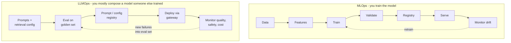
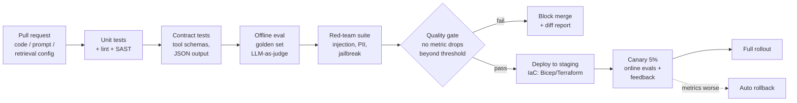
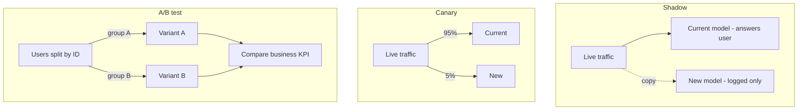
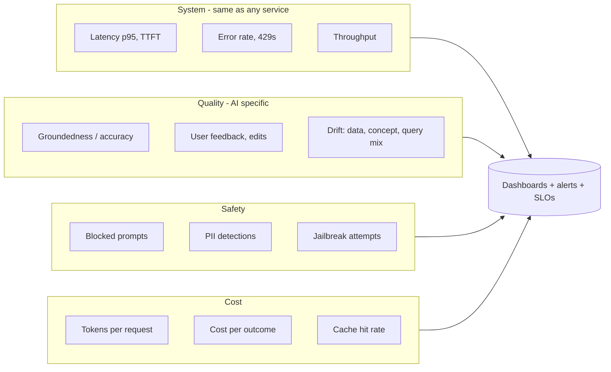
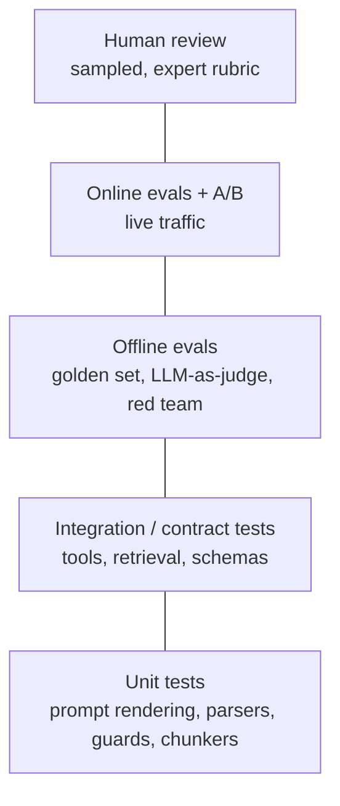
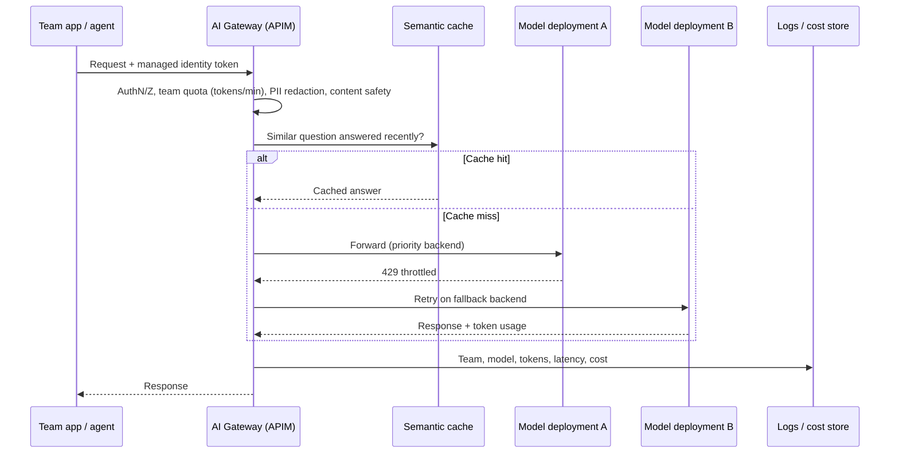
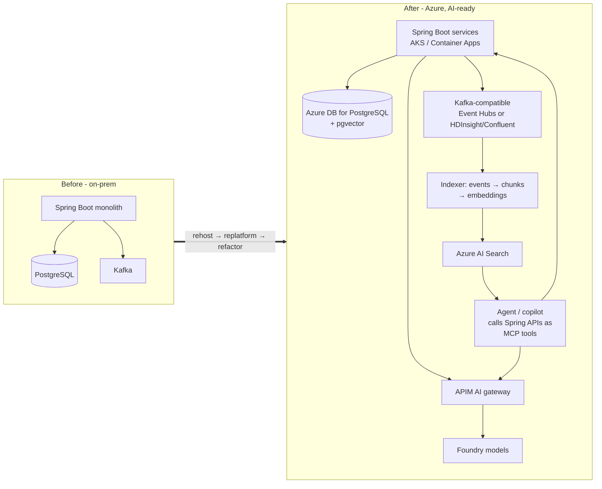
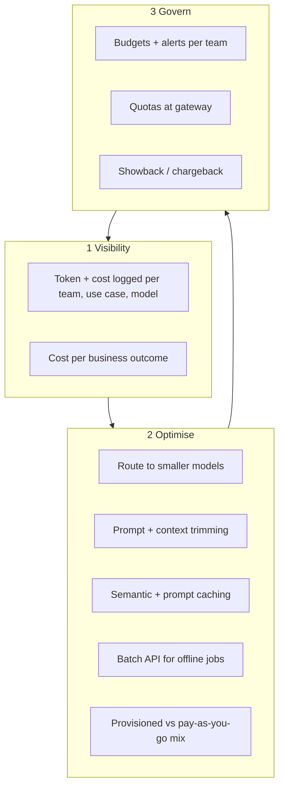
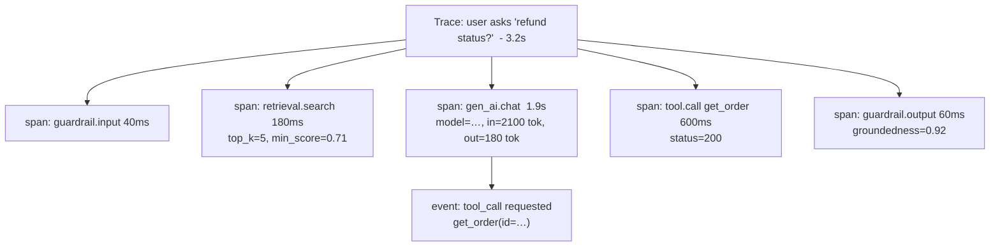
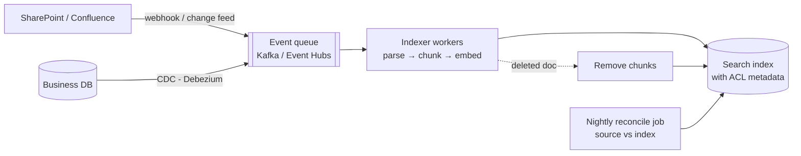

# 02 — AI Platform Engineering, Cloud Modernization, MLOps & LLMOps

> **JD lines covered:** architect and modernise cloud-native AI platforms on Azure/AWS · establish and mature MLOps, LLMOps and AI engineering practices (CI/CD, automated testing, deployment automation, monitoring, observability) · develop reusable services, APIs, frameworks and accelerators · optimise performance, efficiency, reliability and cost through governance and automation.
>
> **Prerequisites:** Docker/K8s/CI-CD/OpenTelemetry basics → [`interview-prep/09-…`](../../interview-prep/09-cloud-docker-k8s-cicd-observability.md). Azure basics → [`az-900/`](../../az-900/README.md).

---

## Part A — MLOps and LLMOps

### Q2.1 · L2 · "What is the difference between MLOps and LLMOps?"

> **Why they ask:** The JD names both. Many candidates know only one.

**Picture it:**

<b>▶ Answer</b>

Both are "DevOps for AI", but **what changes between releases** is different:

| Aspect | MLOps (classical ML) | LLMOps (GenAI) |
|---|---|---|
| The artefact you change | Model weights (you train them) | Prompts, retrieval config, tools, model *choice* — weights usually belong to a vendor |
| Main versioned items | Data, features, code, model | Prompts, system instructions, chunking/embedding config, tool schemas, model version |
| Testing | Accuracy/precision/recall on a hold-out set | Golden-set evals with LLM-as-judge + human review: groundedness, relevance, safety, format |
| Output | Number / class — easy to compare | Free text — hard to compare, non-deterministic |
| Main production risk | Data & concept drift | Hallucination, prompt injection, cost blow-up, provider changes |
| Cost profile | Training is expensive, inference cheap | Little training; **inference (tokens) is the main cost** |
| Monitoring | Drift, accuracy when labels arrive | Quality scores, user feedback, safety violations, tokens, latency, cost per request |

**What's the same:** version everything, automate the pipeline, gate releases on evaluation, monitor in production, feed failures back.

**Say this:** *"MLOps versions data and trained weights and watches drift. LLMOps versions prompts, retrieval config and model choice, gates on golden-set evals, and watches quality, safety and token cost. Same discipline, different artefacts."*

---

### Q2.2 · L3 · "Design the CI/CD pipeline for an LLM application."

> **Why they ask:** "CI/CD, automated testing, deployment automation" for AI is a core platform responsibility.

**Picture it:**

<b>▶ Answer</b>

The key idea: **prompts and retrieval config are code** — they live in Git, go through PRs, and every change runs the eval suite.

1. **Commit** — application code, prompt templates, retrieval settings (chunk size, top-k), tool schemas, model version pin — all in the repo (or a prompt registry referenced by version).
2. **Fast checks** — unit tests, linting, SAST, secret scanning, dependency scanning.
3. **Contract tests** — deterministic: does the output parse against the JSON schema? Do tool definitions match the APIs? Use recorded responses (mocks) so they're cheap and stable.
4. **Offline evaluation** — run the golden set (100–300 cases) against the real model. Metrics: groundedness, answer relevance, correctness vs. reference, format compliance, latency, tokens. LLM-as-judge for semantic scoring, calibrated against human labels.
5. **Red-team suite** — known prompt-injection and jailbreak attacks, PII leakage probes. Must stay at 0 critical failures.
6. **Quality gate** — compare against the **current production baseline**, not an absolute number. Block if any key metric drops more than an agreed tolerance (e.g., groundedness −2 points). Post a diff report on the PR showing which cases got better/worse.
7. **Deploy with IaC** (Bicep/Terraform), same artefacts across environments.
8. **Canary / progressive rollout** — 5% traffic, online evaluation on sampled live traffic + thumbs up/down; automatic rollback if quality, error rate or cost per request worsens.

**Practical notes:** evals cost money and time — run a small "smoke" subset on every PR and the full suite nightly and before release. Because outputs are non-deterministic, run critical cases multiple times or use temperature 0 for evals, and use tolerances rather than exact matches.

**Say this:** *"Prompts and retrieval config are code. Every PR runs unit and contract tests, a golden-set eval and a red-team suite, gated against the production baseline; then IaC deploy, a canary with online evals, and auto-rollback."*

**Follow-ups:** How do you trust LLM-as-judge? (→ file 03 Q3.11) · How long does the pipeline take? (smoke evals < 10 min on PR; full nightly.)

---

### Q2.3 · L2 · "What are MLOps maturity levels, and how would you move a team up?"

<b>▶ Answer</b>

A common model (Google/Microsoft style):

| Level | What it looks like | Pain |
|---|---|---|
| **0 — Manual** | Notebooks, manual training, model handed over as a file | Not reproducible; deploys take weeks; no monitoring |
| **1 — Pipeline automation** | Automated training pipeline, experiment tracking, model registry, automated deployment | Retraining still triggered by humans |
| **2 — CI/CD + continuous training** | Pipeline code itself is CI/CD'd; monitoring triggers retraining; automated validation gates | Requires mature data platform |

**How I move a team up:** pick one important model, not all at once. First make it **reproducible** (data versioning, experiment tracking with MLflow/Azure ML), then **automate deployment** with a registry and approval gate, then **add monitoring**, then **automated retraining**. Publish it as a template so the next model starts at level 1. Measure progress with: lead time from "model approved" to "in production", number of models with monitoring, % reproducible.

**Say this:** *"Level 0 is notebooks, level 1 is automated pipelines with a registry, level 2 is CI/CD plus monitoring-triggered retraining. I move one important model up the ladder and turn it into a template."*

---

### Q2.4 · L2 · "Explain model registry, feature store and experiment tracking — why does a platform need them?"

<b>▶ Answer</b>

- **Experiment tracking** (MLflow, Azure ML, Weights & Biases) — records every training run: code version, data version, hyper-parameters, metrics. Answers "which run produced this model and why was it better?"
- **Model registry** — the catalogue of approved models with versions, stages (staging → production → archived), owners, metrics, lineage and approval. It's the **single source of truth for what's in production** and the audit trail regulators ask for.
- **Feature store** (Feast, Databricks, Azure ML managed feature store, SageMaker Feature Store) — defines a feature once and serves it both for **offline training** and **online inference**, so the same logic is used in both places (no training-serving skew) and teams reuse features.

**GenAI equivalents:** a **prompt registry** (versioned prompts with eval results), an **evaluation store** (results per version), and the **vector index** with its embedding model version recorded — because changing the embedding model means re-indexing everything.

**Say this:** *"Tracking explains how a model was made, the registry says what's in production and who approved it, the feature store guarantees training and serving compute features the same way. For GenAI the equivalents are a prompt registry and an eval store."*

---

### Q2.5 · L3 · "What deployment strategies do you use for models and LLM features?"

**Picture it:**

<b>▶ Answer</b>

| Strategy | How | Best for |
|---|---|---|
| **Shadow** | New model receives a copy of live traffic; its output is logged, not shown | Risky changes; compare outputs on real data with zero user impact |
| **Canary** | Small % of traffic to the new version, increase gradually, auto-rollback on bad metrics | Most releases |
| **A/B test** | Users split into stable groups; compare **business KPIs** with statistical significance | Proving value (e.g., does the new prompt improve resolution rate?) |
| **Blue-green** | Two full environments, switch traffic at once | Infra changes, fast rollback |
| **Champion–challenger** | Current model (champion) keeps serving; challenger evaluated continuously and promoted if it wins | Classical ML with frequent retraining |
| **Feature flags** | Turn an AI feature on per tenant/user group | Gradual business rollout, kill-switch |

**For LLMs specifically:** a model version upgrade is a release — shadow it first (compare outputs on live traffic offline), then canary. Always keep a **kill-switch** feature flag that disables the AI feature and falls back to the non-AI path.

**Say this:** *"Shadow to compare safely, canary to release safely, A/B to prove business value, and a kill-switch flag on every AI feature."*

---

### Q2.6 · L3 · "What do you monitor for ML models vs. LLM applications in production?"

**Picture it:**

<b>▶ Answer</b>

Four families of signals:

1. **System health** (like any service): latency p50/p95, **time to first token**, error rate, rate-limit (429) count, throughput, dependency health (vector DB, tools).
2. **Quality**:
   - *Classical ML* — prediction distribution, **data drift** (PSI/KS tests on inputs), **concept drift**, accuracy once ground-truth labels arrive (often delayed).
   - *LLM* — online evals on a sample of traffic (groundedness, relevance via LLM-as-judge), **user signals** (thumbs, edits, copy rate, escalation to human), retrieval metrics (empty results, low similarity scores), **query-mix drift** (users asking new kinds of questions the knowledge base doesn't cover).
3. **Safety**: content-safety blocks, PII detections, injection attempts, tool calls denied by policy.
4. **Cost**: tokens in/out per request, cost per request and **cost per business outcome** (e.g., per resolved ticket), cache hit rate, spend vs budget per team.

Everything is **traced** end-to-end (OpenTelemetry): one trace shows the user request → retrieval → each LLM call → each tool call, with tokens and latency on each span. That's what makes debugging "why did it say that?" possible.

**Say this:** *"Four families — system health, quality, safety and cost — all on one end-to-end trace. For ML I add drift and delayed-label accuracy; for LLMs I add online evals, user feedback and cost per outcome."*

---

### Q2.7 · L3 · "How do you test AI systems? What does your test pyramid look like?"

**Picture it:**

*Bottom = many, fast, cheap, deterministic · Top = few, slow, expensive, judgement-based.*

<b>▶ Answer</b>

- **Unit (deterministic, many):** prompt templates render correctly, output parsers handle malformed JSON, chunker splits correctly, PII redactor catches patterns, guardrail rules fire. No LLM calls — fast.
- **Integration/contract:** retrieval returns expected doc IDs for known queries (retrieval tests are deterministic and very valuable!), tool schemas match APIs, end-to-end flow with a **mocked LLM** returning recorded responses.
- **Offline evals:** golden set against the real model — quality metrics with tolerances; red-team set; regression comparison with production.
- **Online:** canary metrics, sampled online evals, A/B tests on business KPIs.
- **Human review:** domain experts score a weekly sample with a rubric; their labels also calibrate the LLM judge.

**Non-determinism tricks:** temperature 0 for tests, assert on *properties* ("contains a citation", "valid JSON", "mentions refund policy") rather than exact text, run flaky-prone cases several times and use pass-rate thresholds.

**Say this:** *"Deterministic unit and retrieval tests at the bottom, golden-set evals and red-team in the middle, online evals and expert review at the top — and I assert on properties, not exact text."*

---

## Part B — Platform on Azure / AWS

### Q2.8 · L3 · "Why put an AI gateway in front of models, and what does it do?"

> **Why they ask:** It's the backbone of "governance and automation" for cost and reliability.

**Picture it:**

<b>▶ Answer</b>

Without a gateway, every team calls models directly with its own keys — you cannot control cost, enforce safety, rotate providers or even know who is spending what. The gateway is **one front door with policies**:

| Capability | Why |
|---|---|
| **AuthN/Z** with managed identities (no API keys in apps) | Security, auditability |
| **Token-based rate limits & quotas per team/app** | Fair sharing of provisioned capacity; cost control |
| **Load balancing & failover** across deployments/regions/providers | Reliability against 429s and outages |
| **Model routing** (small vs large) | Cost and latency |
| **Semantic caching** | Cost and latency for repeated questions |
| **PII redaction, content safety, prompt-injection screening** | Safety enforced centrally, not per team |
| **Token & cost logging per team** | Chargeback/showback, budget alerts |
| **Version abstraction** | Teams call "chat-default"; platform swaps the underlying model after evals |

**On Azure:** Azure API Management has built-in GenAI gateway policies — token limit per key/identity, emitting token metrics, load-balanced backend pools with circuit breakers, and semantic caching (with Azure Managed Redis). **On AWS:** API Gateway + Lambda, or an open-source gateway (LiteLLM, Envoy AI Gateway, Kong AI Gateway). **My link:** AgentPulse is a gateway/proxy too — it sits between agents and upstream APIs and repairs schema drift; the same "middleware as a control point" idea.

**Say this:** *"The gateway is the control point: identity, token quotas, failover, routing, caching, safety and per-team cost — so governance is automatic and teams never hold model keys."*

---

### Q2.9 · L2 · "Map the main Azure and AWS services you'd use for an AI platform."

<b>▶ Answer</b>

| Need | Azure | AWS |
|---|---|---|
| Hosted foundation models | Azure OpenAI and other models in **Microsoft Foundry** (formerly Azure AI Foundry) | **Amazon Bedrock** |
| Agent runtime | **Foundry Agent Service**, Microsoft Agent Framework (successor to Semantic Kernel + AutoGen) | **Bedrock AgentCore** / Bedrock Agents |
| Retrieval / search | **Azure AI Search** (hybrid + semantic ranker), Cosmos DB / PostgreSQL vector | OpenSearch, Aurora PostgreSQL pgvector, Bedrock Knowledge Bases, Kendra |
| Classical ML | **Azure Machine Learning** (pipelines, registry, managed endpoints) | **SageMaker** |
| Gateway | **API Management** (GenAI gateway policies) | API Gateway + custom/LiteLLM |
| Safety | **Azure AI Content Safety**, Prompt Shields | **Bedrock Guardrails** |
| Evaluation | Foundry evaluations (built-in + custom evaluators) | Bedrock model evaluation, SageMaker Clarify |
| Containers / GPUs | AKS (GPU node pools), Container Apps (serverless GPU) | EKS, ECS, SageMaker endpoints |
| Data | Microsoft Fabric / Data Lake, Databricks | S3, Glue, Redshift, Databricks |
| Identity & secrets | Entra ID, managed identities, Key Vault | IAM roles, Secrets Manager, KMS |
| Networking | Private Endpoints, VNet integration | VPC endpoints / PrivateLink |
| Observability | Azure Monitor, Application Insights, OpenTelemetry | CloudWatch, X-Ray, OpenTelemetry |
| IaC | Bicep, Terraform | CloudFormation, CDK, Terraform |

**Interview tip:** product names change often (Azure AI Studio → Azure AI Foundry → Microsoft Foundry). Say the *capability* first, then the current product name — it shows you understand the architecture, not just the brochure.

---

### Q2.10 · L3 · "How would you modernise a legacy enterprise application to be AI-ready on the cloud?"

> **Why they ask:** "Cloud modernization" — and it's your strongest overlap (on-prem Java Spring Boot + Kafka + PostgreSQL → Azure).

**Picture it:**

<b>▶ Answer</b>

I do it in **phases** so the business sees value before the big refactor:

1. **Assess** — inventory apps and dependencies (Azure Migrate), classify each with the 6/7 Rs (rehost, replatform, refactor, repurchase, retire, retain, relocate).
2. **Land on the cloud safely** — landing zone (networking, identity, policy, logging) first; replatform the Spring Boot services to **AKS or Azure Container Apps**, PostgreSQL to **Azure Database for PostgreSQL Flexible Server**, Kafka to **Event Hubs (Kafka-compatible endpoint)** or managed Kafka. Managed identities instead of passwords; Key Vault for secrets; OpenTelemetry from day one.
3. **Make it AI-ready** — three things legacy apps lack:
   - **Events:** business changes published as events → lets an indexer keep the AI knowledge base fresh in near-real-time instead of nightly batch copies.
   - **Clean APIs:** well-described REST APIs (OpenAPI) → can be wrapped as **MCP tools** so agents can act through the same validated business logic, never directly on the database.
   - **Data access controls** carried into the retrieval index (document-level permissions), so the copilot can't show a user what the app wouldn't.
4. **Add AI features incrementally** — e.g., summarise a case, draft a reply, natural-language search — each behind a feature flag via the AI gateway.

**My experience:** I've designed this exact on-prem Java Spring Boot + Kafka + PostgreSQL → Azure migration architecture, and at MGM built the OpenTelemetry starter used across Azure Java apps.

**Say this:** *"Landing zone first, replatform to managed services, then make it AI-ready with three things — events for fresh knowledge, clean APIs exposed as MCP tools, and permissions carried into retrieval — and add AI features behind flags."*

---

### Q2.11 · L3 · "When and how would you self-host open-weight models?"

<b>▶ Answer</b>

**When:** strict data boundary (data can't leave our network/region), very high volume of a narrow task where a small model is good enough (cheaper per token at scale), need for fine-tuning control, or avoiding a single-vendor dependency.

**How (Kubernetes example):**
- **Serving engine:** vLLM / TGI / NVIDIA NIM / Triton — continuous batching and paged KV-cache give much higher throughput than naive serving.
- **Infra:** AKS/EKS GPU node pools; autoscaling on queue depth or GPU utilisation (KEDA); scale-to-zero for dev; spot GPUs for batch jobs.
- **Optimisation:** quantisation (8-bit/4-bit) to fit smaller GPUs, smaller distilled models, prompt caching.
- **Expose through the same AI gateway** so apps don't know or care whether the model is hosted or self-run.

**Trade-offs I state honestly:** GPU capacity planning, patching, security of the model supply chain (verify weights/licences), and an on-call burden. Below a certain volume, hosted APIs are cheaper once you count people. I'd only do it with a clear volume/cost or compliance case.

**Say this:** *"Self-host only for a data-boundary, volume or control reason — vLLM on GPU node pools with KEDA autoscaling, quantised models, behind the same gateway — and count the on-call cost honestly."*

---

### Q2.12 · L3 · "How do you control and optimise AI cost across many teams?"

> **Why they ask:** "Optimise … cost through effective governance and automation" + "budgets".

**Picture it:**

<b>▶ Answer</b>

I run it as **AI FinOps** — visibility, optimisation, governance, repeat.

**1. Visibility.** Every call goes through the gateway, tagged with team, use case and model, so we know cost per team and **cost per business outcome** (per ticket resolved, per document processed). Cost per call alone is misleading — a pricier model that resolves more tickets can be cheaper per outcome.

**2. Optimisation levers (largest impact first, typically):**
- **Model routing** — send easy requests to small models; cascade to a big model only when needed.
- **Context trimming** — retrieve fewer, better chunks (re-ranking); summarise long histories. Input tokens are usually most of the bill in RAG.
- **Caching** — provider prompt caching for repeated long system prompts; semantic cache for repeated questions.
- **Batch APIs** for non-urgent work (often around half price).
- **Capacity mix** — provisioned throughput for the steady baseline, pay-as-you-go for spikes.
- **Output limits** — max tokens, concise formats.
- **Kill zombie use cases** — usage reviews each quarter.

**3. Governance.** Budgets and alerts per team, quotas at the gateway, showback reports monthly (chargeback once mature). New use cases must submit a cost-per-transaction estimate at the prototype gate.

**Say this:** *"Visibility per team and per business outcome, then the levers — routing, context trimming, caching, batch, capacity mix — and budgets with quotas enforced at the gateway."*

---

### Q2.13 · L3 · "Which reusable services and accelerators would you build, and how do you get teams to adopt them?"

> **Why they ask:** "Develop reusable services, APIs, frameworks and accelerators that improve engineering productivity and solution consistency."

<b>▶ Answer</b>

**What I'd build (in this order, based on what every use case needs):**
1. **AI gateway client SDKs** (Java + Python) — auth, retries, tracing built in.
2. **Retrieval-as-a-service** — ingestion connectors (SharePoint, Confluence, databases), chunking, embedding, hybrid search with permission filtering. Teams bring content, not code.
3. **Eval harness** — golden-set runner, standard metrics, LLM-judge templates, CI integration, PR diff reports.
4. **Guardrails library** — PII redaction, injection detection, output schema validation.
5. **MCP tool catalogue** — certified MCP servers for core systems (CRM, ticketing, HR), with permission scopes.
6. **Project templates** for the patterns in file 01 Q1.5 — one command creates a repo with all of the above wired in.
7. **Observability starter** — OpenTelemetry with GenAI conventions (my MGM `telemetry-common` Spring Boot starter is this idea).

**Adoption — platform as a product:**
- Treat product teams as **customers**: roadmap from their pain, docs, office hours, a Slack/Teams channel.
- **Paved road = fastest road**: using the templates must be quicker than building alone (security pre-approved, environments pre-provisioned).
- **Inner source** — teams can contribute; good contributions become official.
- **Measure**: time from idea to first production deployment, number of teams onboarded, % of AI traffic through the platform, developer satisfaction.
- **Mandate only the minimum** (gateway, logging, risk review). Everything else wins on merit.

**My numbers:** MCP-based standardisation cut boilerplate ~40%; the observability common module let teams onboard tracing with one dependency.

**Say this:** *"Gateway SDKs, retrieval-as-a-service, an eval harness, a guardrails library, an MCP tool catalogue and project templates — run as a product, where the paved road is the fastest road and only the essentials are mandatory."*

---

### Q2.14 · L3 · "How do you implement observability for LLM and agent systems?"

**Picture it:**

<b>▶ Answer</b>

- **Instrument with OpenTelemetry** using the **GenAI semantic conventions** (standard attribute names for model, token usage, operation) so any backend (Azure Monitor/App Insights, Grafana, Datadog, Langfuse) can read it.
- **One trace per user request** with child spans for: input guardrail → retrieval (query, top-k, scores, doc IDs) → each LLM call (model, tokens, latency, finish reason) → each tool call (name, status, duration) → output guardrail (scores).
- **Content logging is a privacy decision**: log prompts/responses only where allowed, with PII redaction and short retention; otherwise log metadata only.
- **Link quality signals to traces**: user feedback and online eval scores attached to the trace ID so you can jump from "bad answer" to "which chunk misled it".
- **Dashboards**: latency/TTFT, errors, tokens & cost per team, quality scores, safety blocks, agent loop counts (runaway detection).
- **Alerts on SLOs**, not raw metrics (file 05).

**My link:** this is literally what I built at MGM (OpenTelemetry common module across Azure Java apps) and what AgentPulse streams to its live dashboard.

**Say this:** *"OpenTelemetry with GenAI conventions — one trace per request with spans for guardrails, retrieval, each model call and each tool call — and feedback scores attached to the trace so a bad answer leads straight to its cause."*

---

### Q2.15 · L3 · "Scenario: your main model provider has a regional outage, or announces your model will be retired in 90 days."

<b>▶ Answer</b>

**Outage (minutes–hours):**
1. The gateway's circuit breaker trips and routes to the **fallback deployment** (another region, or an approved alternative model) — this must be tested regularly, not just configured.
2. If no fallback can meet quality, **degrade gracefully**: show search results without generated answers, queue non-urgent jobs, tell users clearly.
3. Incident process: comms to stakeholders, status page, post-incident review — was the fallback tested? capacity enough?

**Retirement (90 days):**
1. Inventory every use case on that model version (the gateway logs make this a query, not a hunt).
2. Run each use case's golden set against candidate replacements; fix prompts where scores drop.
3. Shadow → canary → full rollout per use case, prioritising the highest-traffic ones.
4. Lesson institutionalised: model upgrades are **planned work every quarter**, with a model lifecycle calendar.

**Say this:** *"For outages, tested failover at the gateway and graceful degradation. For retirements, the gateway tells me who's affected, golden-set evals pick the replacement, and shadow-then-canary rolls it out. Model upgrades are planned quarterly work."*

---

### Q2.16 · L2 · "How do you keep a RAG knowledge base fresh and in sync with source systems?"

**Picture it:**

<b>▶ Answer</b>

- **Event-driven incremental indexing**: source changes (webhooks, change feeds, CDC from databases) go onto a queue (Kafka/Event Hubs); indexer workers parse, chunk, embed and upsert only what changed. **Deletes and permission changes matter as much as new docs** — a deleted HR policy that's still retrievable is a real incident.
- **Idempotent upserts** keyed by document ID + chunk number; store source version/hash so re-processing is safe.
- **Nightly reconciliation** compares source vs. index and fixes misses (events do get lost).
- **Metadata per chunk:** source URL, last-modified date, owner, ACL groups, embedding model version — used for filtering, citations and re-indexing.
- **Freshness SLO**, e.g., "95% of changes searchable within 15 minutes", with a dashboard.
- **Embedding model change = full re-index** into a new index, then swap an alias (blue-green for indexes).

This is just my Kafka event-driven experience applied to AI — same patterns: idempotency, ordering per key, dead-letter queue for poison documents.

**Say this:** *"Event-driven incremental indexing from change feeds and CDC, idempotent upserts, deletes and permission changes treated as first-class, a nightly reconcile, and a freshness SLO."*

---

## ⚡ Rapid-fire

| Question | One-line answer |
|---|---|
| Provisioned throughput? | Reserved model capacity at a fixed price; predictable latency for steady load. |
| TTFT? | Time to first token — what users *feel* as speed when streaming. |
| KEDA? | Kubernetes event-driven autoscaling (scale on queue length, including to zero). |
| vLLM? | High-throughput open-source LLM serving engine (continuous batching, paged attention). |
| Quantisation? | Storing weights in fewer bits (8/4) — smaller, faster, slight quality loss. |
| PSI? | Population Stability Index — a common data-drift measure. |
| Shadow deployment? | New model sees live traffic but its output isn't shown to users. |
| Why re-index on embedding change? | Vectors from different embedding models aren't comparable. |
| Showback vs chargeback? | Showback reports cost to teams; chargeback actually bills their budget. |
| IaC on Azure? | Bicep or Terraform; same templates for every environment. |
