# 03 — Generative AI Deep Dive: RAG, Agents, Copilots, Prompt Standards, Evaluation, Guardrails

> **JD lines covered:** lead implementation of GenAI, RAG, AI Agents, Copilots and enterprise knowledge retrieval · establish standards for prompt engineering, model evaluation, guardrails, governance, observability and responsible AI · evaluate emerging AI technologies.
>
> **Prerequisites (don't skip if rusty):** [`interview-prep/11-agentic-ai.md`](../../interview-prep/11-agentic-ai.md) — LLM basics, RAG pipeline, ReAct, MCP basics, memory types. This file goes one level deeper: **how a leader designs, standardises and debugs these at enterprise scale.**

---

## Part A — Enterprise knowledge retrieval (RAG at scale)

### Q3.1 · L3 · "Design enterprise knowledge retrieval for 50,000 employees across SharePoint, Confluence and ticketing."

> **Why they ask:** "Enterprise knowledge retrieval solutions" is literally in the JD. Basic RAG answers fail here — they want scale, permissions and quality.

**Picture it:**

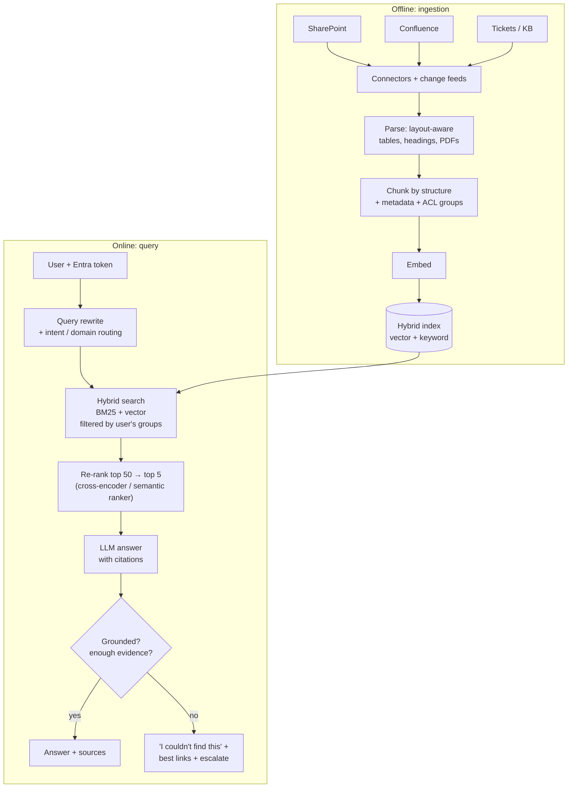

<b>▶ Answer</b>

I'd design it around four hard problems that toy RAG ignores:

**1. Ingestion quality (where most failures start).**
- Connectors with **incremental sync** (change feeds/webhooks) — not nightly full copies (see file 02 Q2.16).
- **Layout-aware parsing**: tables, headings, lists and PDFs parsed properly (Azure AI Document Intelligence or similar). A table flattened into one line of text is unretrievable.
- **Structure-aware chunking**: split on headings/sections, keep the section title path in each chunk ("HR Policy > Leave > Maternity"), modest overlap.
- **Rich metadata**: source, owner, last-modified, document type, region, **ACL groups**.
- **Content hygiene**: dedupe near-identical docs, flag stale ones (last edited > 2 years), and give content owners a dashboard of "questions we couldn't answer" — the knowledge gap is often the real problem.

**2. Permissions (non-negotiable).**
Security trimming at query time: each chunk carries the groups that can read it; the query is filtered by the user's group memberships from their token. The LLM must never *see* a chunk the user can't read — filtering after generation is too late. (Q3.4)

**3. Retrieval quality.**
- **Hybrid search** (keyword BM25 + vector) — vectors catch meaning, keywords catch exact terms like error codes, policy numbers, product names.
- **Query rewriting** — expand acronyms, resolve "it" from chat history, split multi-part questions.
- **Domain routing** — "leave policy" goes to the HR index first.
- **Re-ranking** — retrieve ~50 candidates, re-rank with a cross-encoder/semantic ranker, keep the top 3–8.

**4. Answer behaviour.**
- Answer **only from retrieved context, with citations** to the exact source.
- **Allowed to say "I don't know"** when evidence is weak — and that is tracked as a content-gap signal, not a failure.
- Freshness: prefer newer docs when two conflict; show "last updated" on citations.

**Scale numbers to mention:** millions of chunks is normal; index partitioning by domain/region; cache frequent queries; p95 latency target ~3–5 s for a streamed answer.

**Say this:** *"Four hard problems: ingestion quality, permissions, retrieval quality and answer behaviour. Layout-aware parsing with metadata and ACLs, security trimming before the model sees anything, hybrid search plus re-ranking, and answers with citations that are allowed to say 'I don't know'."*

**Follow-ups:** How do you know retrieval is the problem vs generation? (→ Q3.11, measure context recall separately) · What about multilingual content? (multilingual embeddings, translate query, index per language.)

---

### Q3.2 · L2 · "Explain chunking strategies and how you choose one."

**Picture it:**

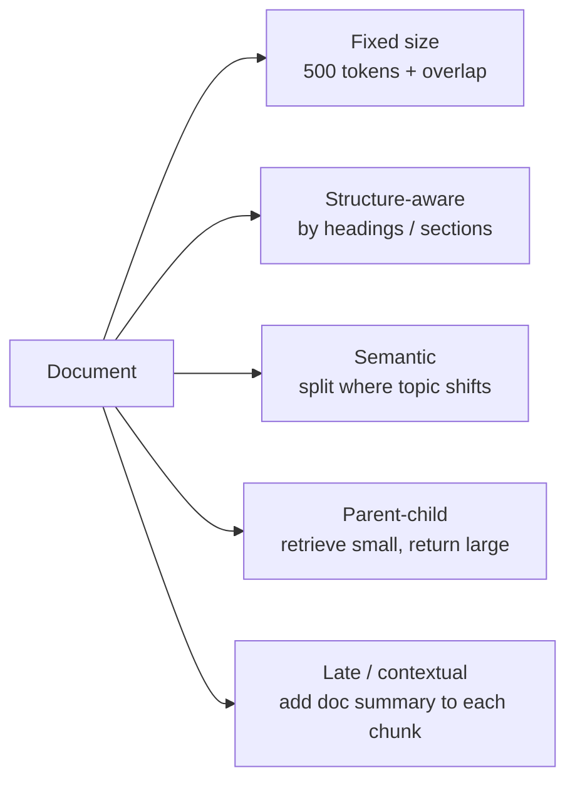

<b>▶ Answer</b>

| Strategy | How | Good for | Watch out |
|---|---|---|---|
| **Fixed-size + overlap** | e.g., 300–800 tokens, 10–20% overlap | Quick baseline, uniform text | Cuts ideas in half |
| **Structure-aware** | Split by headings, sections, list items, table boundaries | Policies, manuals, wiki pages | Needs good parsing |
| **Semantic** | Split where embedding similarity between sentences drops | Long narrative text | More compute, tuning |
| **Parent–child (small-to-big)** | Index small chunks for precise matching; return the larger parent section to the LLM | Precise retrieval + enough context | More storage |
| **Contextual chunks** | Prepend a short LLM-generated "where this chunk sits in the document" summary before embedding | Chunks that are ambiguous alone ("it must be submitted within 30 days") | Extra ingestion cost |

**How I choose:** I don't — the **eval set** does. Start structure-aware with a sensible size, then A/B two or three strategies measuring **context recall** (did the right chunk come back?) on the golden set. Keep tables whole and attach headers to them.

**Say this:** *"Structure-aware chunking with metadata as the default, parent-child when I need precision plus context, and the eval set's context-recall score decides — not intuition."*

---

### Q3.3 · L3 · "Beyond basic RAG — what advanced patterns do you know and when do they help?"

<b>▶ Answer</b>

| Pattern | Idea | Use when |
|---|---|---|
| **Query rewriting / multi-query** | LLM rewrites or generates several versions of the query; results merged | Vague or conversational questions |
| **HyDE** | Generate a hypothetical answer, embed *that*, search with it | Short queries that don't look like documents |
| **Agentic RAG** | An agent decides *whether*, *where* and *how many times* to search, can refine and search again | Multi-hop questions ("compare our 2025 and 2026 travel policy for contractors") |
| **GraphRAG / knowledge graph** | Extract entities and relations into a graph; retrieve along relationships, plus community summaries | "Global" questions across many docs, relationship-heavy domains |
| **Structured + unstructured (text-to-SQL + RAG)** | Route numeric/tabular questions to SQL generation over governed views; text questions to RAG | "How many open incidents in Mumbai last week?" |
| **Self-check / corrective RAG** | Grade retrieved chunks for relevance; if weak, re-search or say "not found" | High-precision domains |
| **Long-context + RAG** | Retrieve whole relevant documents into a long context window instead of tiny chunks | Few, long, highly relevant docs (contracts) |

**Leader's caution:** each adds latency and cost. I add one only when the eval set shows a specific failure class it fixes (e.g., 15% of failures are multi-hop → try agentic RAG).

**Say this:** *"Query rewriting, HyDE, agentic RAG for multi-hop, GraphRAG for relationship questions, text-to-SQL for numbers, corrective RAG for precision — each added only when the eval set shows the failure it fixes."*

---

### Q3.4 · L3 · "How do you make sure the copilot never reveals documents a user isn't allowed to see?"

**Picture it:**

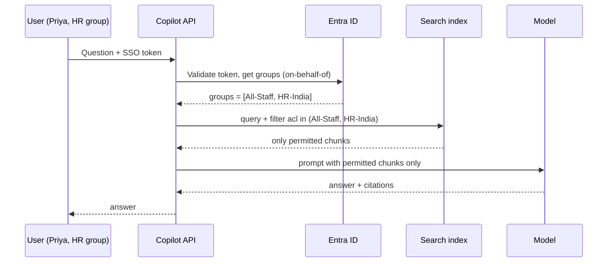

<b>▶ Answer</b>

- **Index-time:** every chunk stores the ACL of its source (group IDs / user IDs), synced when permissions change.
- **Query-time security trimming:** the app gets the user's identity (SSO, on-behalf-of flow), resolves group memberships, and the search query **filters** to chunks those groups can read. The LLM only ever receives permitted text.
- **Never rely on the prompt** ("don't reveal confidential info") — prompts are not access control.
- **Agents/tools:** use the **user's delegated identity** for tool calls (OAuth on-behalf-of), not a super-powered service account, so the agent can't do more than the user could.
- **Test it:** automated permission tests — users from different groups ask the same question; assert no forbidden doc IDs in retrieval logs.
- **Also guard against oversharing at the source:** a copilot exposes badly-permissioned SharePoint sites that nobody noticed before. Run a sensitivity-label / oversharing review (e.g., Microsoft Purview) *before* go-live.

**Say this:** *"ACLs on every chunk, filter by the user's groups at query time so the model never sees forbidden text, delegated identity for tools, automated permission tests — and clean up oversharing at the source before launch."*

---

## Part B — Copilots and agents

### Q3.5 · L2 · "Chatbot vs copilot vs agent — what's the difference, and how do you design a good enterprise copilot?"

**Picture it:**

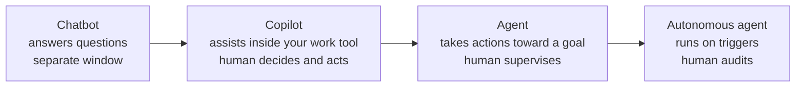
*Left → right: more autonomy, more value, more risk, more controls.*

<b>▶ Answer</b>

- **Chatbot** — conversational Q&A, usually in a separate window.
- **Copilot** — AI **embedded in the user's existing workflow** (CRM, IDE, ticketing, Teams) that drafts, summarises, suggests; **the human stays in control** and takes the action.
- **Agent** — given a goal, plans and **takes actions via tools**; human approves risky steps.
- **Autonomous agent** — triggered by events, runs without a human in each loop; humans audit.

**Good enterprise copilot design principles:**
1. **Live where the work is** — sidebar in the CRM/ticket tool, not a new app.
2. **Context-aware** — knows the current record (this ticket, this customer) so users don't paste context.
3. **Show sources and confidence** — users trust what they can check.
4. **Make editing easy** — draft, not final; one-click insert; capture edits as quality signal.
5. **Bounded actions** with confirmation ("Send this reply?").
6. **Measure acceptance rate** (suggestions used as-is / edited / discarded) — the single best product metric for a copilot.
7. **Fail gracefully** — if unsure, say so and point to the source.

**Say this:** *"Chatbot answers, copilot assists inside the workflow while the human acts, agent acts with supervision. A good copilot lives where the work is, knows the current context, cites sources, makes editing easy and measures acceptance rate."*

---

### Q3.6 · L3 · "How do you design a production-grade agent?"

> **Why they ask:** "Agentic AI initiatives" — they want controls, not demos.

**Picture it:**

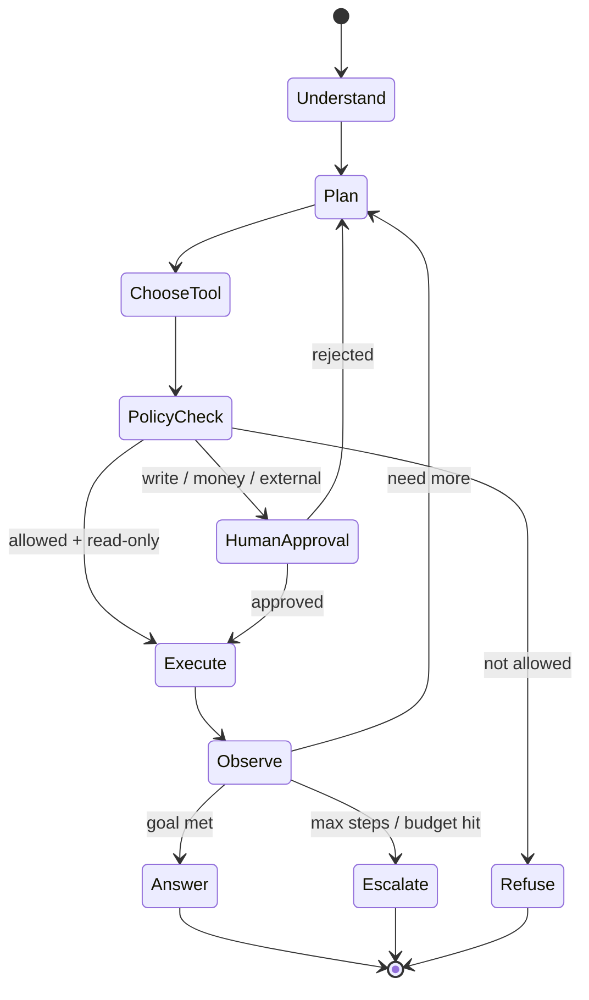

<b>▶ Answer</b>

I design agents as **controlled state machines with an LLM inside**, not as a free loop:

1. **Narrow scope** — one job ("resolve password-reset and access requests"), clear success criteria.
2. **Prefer explicit workflows** (LangGraph, Microsoft Agent Framework workflows) where steps are known; let the LLM decide only where it adds value. Explicit state makes it **testable, resumable and debuggable**.
3. **Tools** — small, well-described, typed (JSON schema), **idempotent** where possible; read and write tools separated; served via MCP for reuse.
4. **Policy layer between the model and tools** — the model *requests*; code *decides*: allow-list per agent, argument validation, per-user delegated identity, rate limits.
5. **Human-in-the-loop** for writes, money, external communication, or anything irreversible; approvals logged.
6. **Budgets** — max steps, max tokens, max time, max cost per task; on exceed → escalate to a human with context.
7. **Memory** — short-term state in the workflow; long-term memory only for what's needed, with retention rules and per-user isolation.
8. **Durability** — long tasks checkpoint state so they survive restarts (durable execution).
9. **Observability** — every thought/step/tool call traced; replay of a full run for debugging.
10. **Evaluation** — task success rate, tool-call accuracy, steps per task, cost per task, safety violations (Q3.12).

**Say this:** *"Narrow scope, explicit workflow where steps are known, typed tools behind a policy layer, human approval for anything irreversible, hard budgets on steps and cost, durable state, full tracing and task-level evals."*

---

### Q3.7 · L3 · "Multi-agent systems: MCP vs A2A — how do they relate?"

**Picture it:**

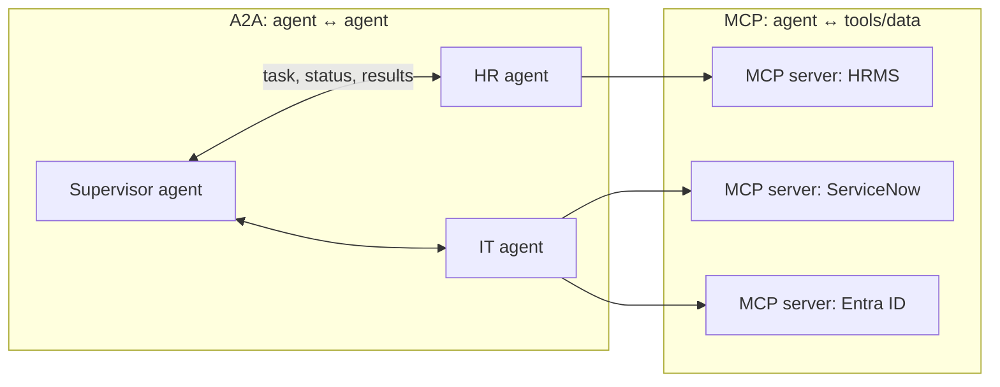

<b>▶ Answer</b>

- **MCP (Model Context Protocol)** — standard for an agent/app to connect to **tools, resources and prompts** (the "hands" and "data"). Vertical: agent → systems.
- **A2A (Agent2Agent protocol)** — standard for **agents to talk to other agents**, possibly built by different teams/vendors: discover capabilities (agent cards), delegate tasks, stream status, return results. Horizontal: agent ↔ agent.
- They are **complementary**: a supervisor delegates to an HR agent via A2A; the HR agent uses MCP to call the HRMS.

**When multi-agent is worth it:** different teams own different domains (HR, IT, finance) and want to own their agent; distinct tool sets and permissions; parallel work. **When not:** a single agent with good tools can do it — multi-agent adds latency, cost and failure modes (agents misunderstanding each other, loops). Start single-agent; split along **ownership and permission boundaries**, not because it looks impressive.

**Say this:** *"MCP connects an agent to tools and data; A2A connects agents to each other. I split into multiple agents along ownership and permission boundaries, otherwise one agent with good tools is cheaper and more reliable."*

---

### Q3.8 · L3 · "How would you run MCP safely in an enterprise?"

> **Why they ask:** You claim MCP expertise — expect depth.

<b>▶ Answer</b>

- **Remote MCP servers over Streamable HTTP**, deployed like any microservice (AKS/Container Apps), behind the API gateway — not random local servers on laptops for production use.
- **Authentication with OAuth 2.1** (the MCP authorisation spec): the server is an OAuth resource server; tokens are scoped and audience-bound; prefer **on-behalf-of the user** so actions carry the user's permissions.
- **Least-privilege tool design**: separate read and write tools; narrow scopes; validate every argument server-side; never expose "run arbitrary SQL".
- **Approved server registry/catalogue**: only vetted servers allowed; version pinning; review tool descriptions on change.
- **Threats specific to MCP:** **tool poisoning** (malicious instructions hidden in tool descriptions or tool outputs), **indirect prompt injection** through data returned by tools, **confused deputy** (server uses its own broad credentials for a user's request), **rug-pull** (a tool's behaviour changes after approval). Mitigations: registry + pinning, treat tool output as untrusted data, delegated identity, human approval for sensitive tools, logging of every call.
- **Observability**: every tool call traced with caller identity, arguments (redacted), result status.

**My experience:** I built MCP tools (search, retrieve, filter, summarise, catalog) and a pluggable provider layer; standardising on MCP cut integration boilerplate ~40%.

**Say this:** *"Remote MCP servers behind the gateway, OAuth with on-behalf-of identity, least-privilege read/write tools, an approved and version-pinned server catalogue, and tool outputs treated as untrusted to defend against tool poisoning and indirect injection."*

---

## Part C — Standards: prompts, evaluation, guardrails

### Q3.9 · L3 · "What would your prompt engineering standard contain?"

> **Why they ask:** "Establish standards for prompt engineering" — a leader writes the standard, not just prompts.

**Picture it:**

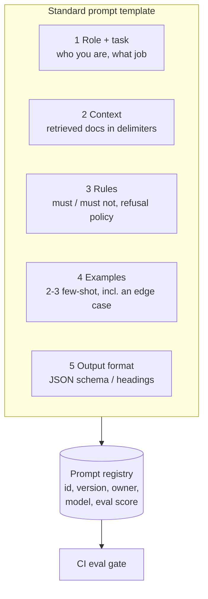

<b>▶ Answer</b>

**1. Structure (a template everyone follows):**
- Role and task, stated plainly.
- Context in clear delimiters (e.g., XML-style tags) with the instruction *"use only the context; if the answer isn't there, say so"*.
- Rules: dos/don'ts, tone, refusal policy, citation format.
- 2–3 **few-shot examples** including one edge case (e.g., the "not found" answer).
- **Output contract**: a JSON schema or fixed headings; use the provider's structured-output feature where available.

**2. Separation of trust:** system instructions vs. untrusted content (user input, retrieved docs, tool outputs) are clearly separated and labelled; untrusted content is never treated as instructions.

**3. Lifecycle:** prompts live in a **registry/repo** with ID, version, owner, target model and **linked eval results**; changes go through PR + eval gate (file 02 Q2.2); no prompt edits directly in production.

**4. Parameters:** default low temperature for factual/structured tasks; max output tokens set; model version pinned.

**5. Anti-patterns banned:** secrets or PII in prompts, "pretend you have no rules" style instructions, giant unmaintainable mega-prompts (split into steps), relying on the prompt for security.

**6. Reuse:** a shared library of tested building blocks (citation rules, refusal wording, JSON-repair instructions).

**Say this:** *"A five-part template — role, delimited context, rules, examples, output schema — with untrusted content clearly separated, prompts versioned in a registry with their eval scores, and changes only through the eval gate."*

---

### Q3.10 · L3 · "How do you build a golden evaluation dataset?"

<b>▶ Answer</b>

1. **Source from reality** — real historic questions/tickets/documents (anonymised), not invented ones. Sample by frequency *and* include the long tail.
2. **Cover categories deliberately**: common cases, hard cases, multi-hop, ambiguous questions, **questions that should be refused or answered "not found"**, adversarial/injection cases, different user roles (permission tests), different languages if relevant.
3. **Expected outputs with domain experts** — a reference answer and/or a checklist of required facts ("must mention 26 weeks", "must cite policy HR-12"), plus the expected source documents (for retrieval metrics).
4. **Size** — start with 100–300; grow continuously: **every production failure becomes a new test case**.
5. **Version it** like code; record which version each eval run used.
6. **Hold out a slice** that isn't used while tuning prompts, to avoid over-fitting the prompt to the test set.
7. **Refresh** when the business changes (new policies → old expected answers become wrong).

**Say this:** *"Real anonymised cases across common, hard, refusal, adversarial and permission categories, expected answers and sources agreed with domain experts, versioned like code, with a held-out slice — and every production failure becomes a new case."*

---

### Q3.11 · L3 · "Which metrics do you use to evaluate RAG, and can you trust LLM-as-judge?"

**Picture it:**

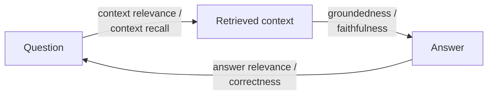
*The RAG triad — each edge is measured separately, so you know **which stage** to fix.*

<b>▶ Answer</b>

**Retrieval metrics (deterministic if you have expected sources):** context recall / hit rate @k (was a correct source in the top-k?), precision @k, MRR (how high was the first correct one?).

**Generation metrics:**
- **Groundedness / faithfulness** — is every claim supported by the retrieved context? (catches hallucination)
- **Answer relevance** — does it address the question?
- **Correctness** — matches the reference answer / required facts?
- **Citation accuracy** — do citations actually support the sentence?
- **Format compliance**, **refusal correctness** (refused when it should, answered when it should).

**Operational:** latency, tokens, cost per answer.

**Diagnosis logic:** low context recall → fix ingestion/chunking/search. Good context but low groundedness → fix the prompt/model. Grounded but irrelevant → fix query understanding.

**LLM-as-judge — trust but calibrate:**
- Known biases: favours longer answers, its own model family, position (first option in pairwise), and is inconsistent on vague rubrics.
- Make it reliable: **specific rubrics** (binary checks like "does the answer mention X?" beat 1–10 scores), ask for reasoning before the verdict, use a strong judge model different from the generator where possible, **calibrate against human labels** (measure agreement on 100+ cases; aim for high agreement before trusting it), randomise order in pairwise comparisons, re-check periodically.
- Tools: RAGAS, Azure AI Foundry/Microsoft Foundry evaluators, promptfoo, DeepEval, Langfuse.

**Say this:** *"Measure the RAG triad separately — context recall, groundedness, answer relevance — so I know which stage to fix. LLM-as-judge is useful only with specific rubrics and calibration against human labels."*

---

### Q3.12 · L3 · "How do you evaluate an agent, not just a single answer?"

<b>▶ Answer</b>

Agents are judged on **outcomes and trajectories**:

| Metric | Meaning |
|---|---|
| **Task success rate** | Did it reach the correct end state? (checked against the system: was the ticket actually updated correctly?) |
| **Tool-call accuracy** | Right tool, right arguments, right order |
| **Trajectory efficiency** | Steps, tokens, time and cost per successful task |
| **Safety** | Policy violations, attempted disallowed tools, actions without required approval |
| **Recovery** | Handles tool errors / missing data gracefully, escalates correctly |
| **Human intervention rate** | How often humans had to correct or take over |

**How:** scenario-based test suites run in a **sandbox** with mocked or test-instance systems; assertions on final system state + trajectory; repeat each scenario several times (non-determinism) and report pass rates. In production: track success, escalation and intervention rates per task type, and review a sample of traces weekly.

**Say this:** *"Agents are judged on task success against real system state, tool-call accuracy, efficiency per task, safety violations and human intervention rate — tested repeatedly in a sandbox because runs aren't deterministic."*

---

### Q3.13 · L3 · "Describe your guardrails architecture."

**Picture it:**

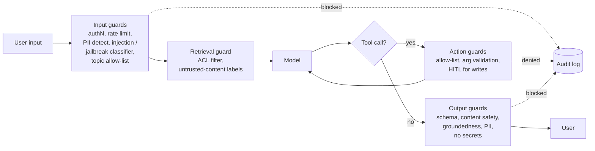

<b>▶ Answer</b>

**Defence in depth — four checkpoints, enforced in code, centrally where possible (gateway/library):**

1. **Input:** authentication and rate limits; PII detection/redaction; prompt-injection and jailbreak classifiers (e.g., Azure Prompt Shields, Bedrock Guardrails, open-source classifiers); topic/scope allow-list ("this HR bot doesn't give legal advice").
2. **Retrieval/context:** permission filtering; retrieved documents and tool outputs marked as **untrusted data**, scanned for embedded instructions (indirect injection).
3. **Action:** tool allow-list per agent, argument schema validation, business-rule checks (refund ≤ limit), delegated identity, **human approval for irreversible actions**.
4. **Output:** schema validation (with repair/retry — my AgentPulse self-healing), content safety, groundedness check, PII/secret leakage check, citation required.

**Principles:** deterministic checks first (cheap, reliable), model-based checks second; **fail closed** for high-risk actions, fail open with logging for low-risk content filters if availability matters more; every block is logged and reviewed for false positives (over-blocking kills adoption too).

**Say this:** *"Four checkpoints — input, context, action, output — deterministic checks first, classifiers second, human approval for irreversible actions, everything logged, and I watch false positives because over-blocking kills adoption."*

---

### Q3.14 · L2 · "How do you get reliable structured output from LLMs?"

<b>▶ Answer</b>

1. Use the provider's **native structured output / JSON-schema mode** or tool-calling with a schema — this constrains generation and removes most malformed output.
2. Keep schemas **simple and flat**, with enums for categorical fields and descriptions for each field.
3. **Validate** every response (Pydantic in Python, Jackson + Bean Validation in Java) — semantic validation too (dates in range, IDs exist).
4. On failure: **repair** (deterministic fixes, then a cheap model repair call), **retry** with the validation error in the prompt, then **fallback** (default path or human queue). Never pass invalid data downstream.
5. Monitor schema-failure rate per prompt/model version — a spike after a model upgrade is an early warning.

**Story:** AgentPulse does exactly this as a proxy — it detects schema drift in upstream responses and self-heals JSON in sub-second time using a fast model (Groq Llama 3.3 70B), so downstream services never see malformed payloads.

**Say this:** *"Native schema mode first, validate everything, then repair → retry with the error → fallback, and monitor schema-failure rate — which is exactly what my AgentPulse proxy automates."*

---

### Q3.15 · L3 · "When would you fine-tune, and which kind?"

<b>▶ Answer</b>

**Fine-tune when the gap is behaviour, not knowledge:** consistent format/style, a domain-specific skill or vocabulary, a narrow high-volume task where a **small fine-tuned model** can replace a large one (cost/latency), or when the prompt is enormous because of examples.

**Don't fine-tune for knowledge that changes** — use RAG.

**Kinds:**
- **SFT (supervised fine-tuning)** on input→ideal output pairs.
- **PEFT/LoRA** — trains small adapter weights; cheap, fast, can host many adapters on one base model.
- **Preference tuning (DPO/RLHF-style)** — teaches "prefer answer A over B" for tone/helpfulness.
- **Distillation** — a large model generates high-quality outputs; a small model is trained on them.

**Leader checklist before approving:** do we have ≥ hundreds–thousands of quality examples? Did prompting + RAG really plateau on the eval set? Who owns retraining when the base model is deprecated? Licence and data-usage rights for training data?

**Say this:** *"Fine-tune for behaviour or to shrink cost on a narrow high-volume task — usually LoRA or distillation into a small model — never to inject changing knowledge, and only after prompting and RAG plateau on the eval set."*

---

### Q3.16 · L2 · "Context windows are huge now. Do we still need RAG?"

<b>▶ Answer</b>

Yes, for most enterprise cases — long context is a tool, not a replacement:
- **Scale:** an enterprise has millions of documents; no context window holds them.
- **Cost & latency:** you pay per input token on every request; stuffing 500k tokens is slow and expensive (prompt caching helps only for repeated identical prefixes).
- **Permissions & freshness:** retrieval filters by user and picks the latest version; a giant static context can't.
- **Quality:** models still miss details buried in very long contexts ("lost in the middle"); focused context is usually more accurate.
- **Citations:** retrieval gives precise sources.

**Where long context wins:** a handful of long documents that are all relevant (analyse this contract, compare these two policies), or as the *second* stage — retrieve whole relevant documents instead of tiny chunks.

**Say this:** *"Long context complements RAG — retrieval handles scale, cost, permissions, freshness and citations; long context shines when a few whole documents are all relevant."*

---

## Part D — Scenarios

### Q3.17 · L3 · "The HR copilot told an employee the wrong maternity-leave entitlement. Walk me through what you do."

**Picture it:**

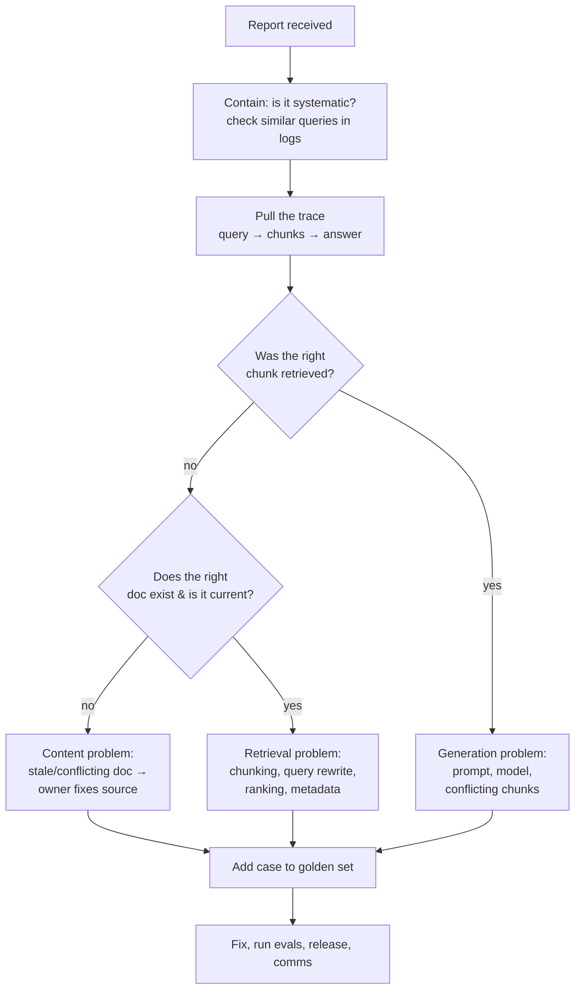

<b>▶ Answer</b>

1. **Contain & communicate.** Correct the employee's information directly (with HR). Check logs for similar questions — is it one-off or systematic? If systematic for a high-impact topic, temporarily route that topic to "please contact HR" (topic-level kill-switch).
2. **Diagnose with the trace** — the decision tree above. In my experience the most common root cause is **content**: an old policy PDF still in the index next to the new one, and the model picked the old one.
3. **Fix at the right layer:** retire stale docs / add effective-date metadata and prefer newest; improve chunking (tables of entitlements kept whole); adjust the prompt to flag conflicts ("sources disagree — please confirm with HR") instead of choosing silently.
4. **Prevent regression:** add this case and variants to the golden set; add a "conflicting sources" test category.
5. **Post-incident review** (blameless): what signal could have caught it earlier? Maybe a stale-document report and an online groundedness alert for HR topics.

**Say this:** *"Correct the person and contain the topic, pull the trace, decide whether it's content, retrieval or generation, fix at that layer, add the case to the golden set, and run a blameless review."*

---

### Q3.18 · L4 · "How do you evaluate emerging AI technologies without chasing hype?"

> **Why they ask:** "Evaluate emerging AI technologies and recommend innovative solutions aligned with business priorities."

**Picture it:**

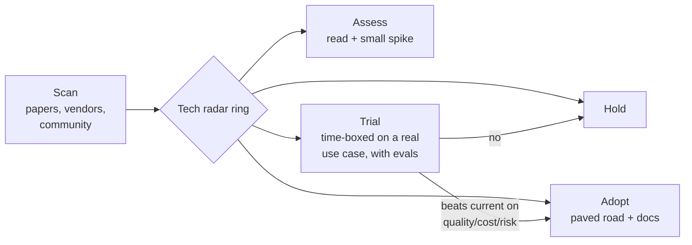

<b>▶ Answer</b>

- **AI tech radar** (Adopt / Trial / Assess / Hold), reviewed quarterly by senior engineers + architecture + security. Published so teams know what's approved.
- **Problem-first:** every evaluation is tied to a real backlog problem ("our multi-hop questions fail 20% of the time — does agentic RAG fix it?").
- **Time-boxed spikes** (1–2 weeks) with **our eval set** and a written result — "X improved groundedness 6 points at 1.4× cost" — not opinions.
- **Exit criteria** decided upfront: what must improve, at what cost, with what risk.
- **Adoption path:** if it wins, the platform team productises it into the paved road; one owner.
- **Healthy skepticism:** check maturity (GA vs preview, SLA), security review, vendor viability, lock-in, and total cost.
- I budget roughly **10% of team capacity** for exploration so it doesn't steal from delivery — and it keeps strong engineers engaged.

**Say this:** *"A quarterly tech radar, problem-first time-boxed spikes measured on our own eval set with exit criteria set upfront, about 10% capacity for exploration, and winners productised into the paved road."*

---

## ⚡ Rapid-fire

| Question | One-line answer |
|---|---|
| Hybrid search? | Keyword (BM25) + vector results fused (e.g., reciprocal rank fusion). |
| Re-ranker? | Cross-encoder that scores query–chunk pairs precisely; run on top ~50 candidates. |
| Security trimming? | Filtering retrieval to what the user may read, before the LLM sees it. |
| Indirect prompt injection? | Malicious instructions inside retrieved docs, emails or tool outputs. |
| Tool poisoning? | Hidden malicious instructions in an MCP tool's description or output. |
| A2A vs MCP? | Agent↔agent delegation vs agent↔tools/data. |
| Context recall? | Fraction of questions where a correct source was retrieved. |
| Groundedness? | Every claim supported by the provided context. |
| LoRA? | Fine-tuning small adapter matrices instead of all weights. |
| Acceptance rate? | % of copilot suggestions used — the key copilot product metric. |
| Lost in the middle? | Models under-use information placed mid-way in long contexts. |
| Durable execution? | Agent state checkpointed so long runs survive restarts. |
