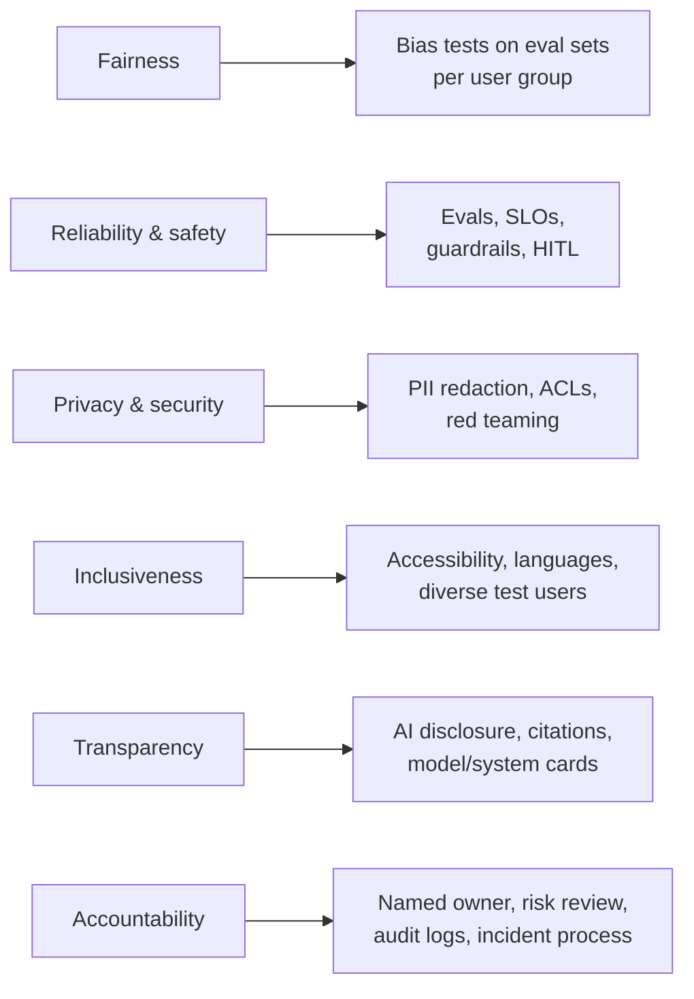
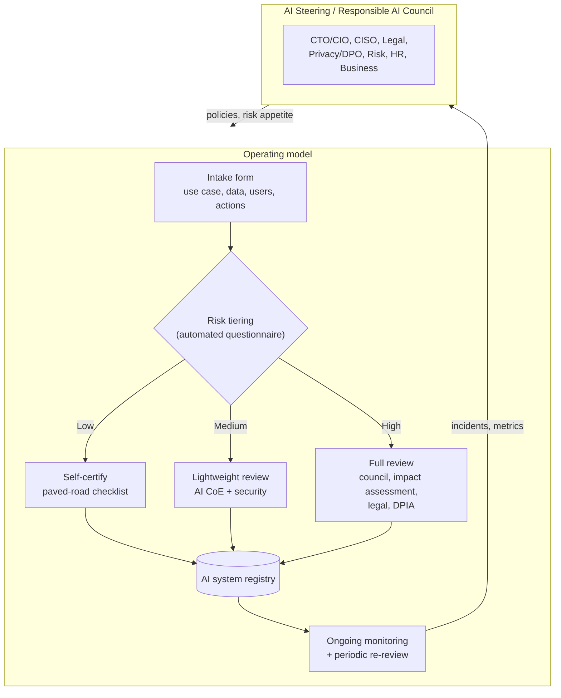
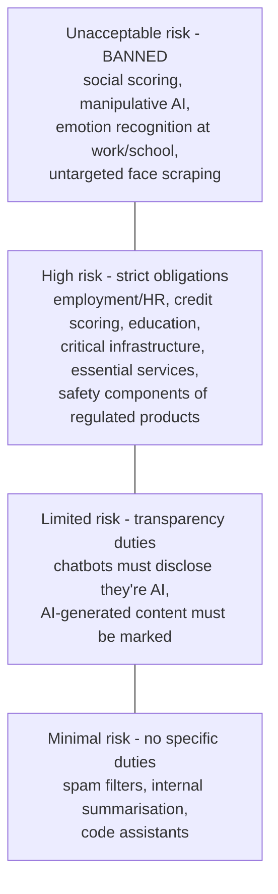
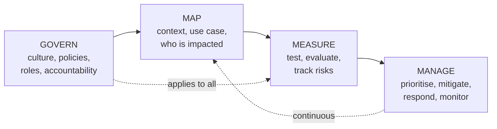
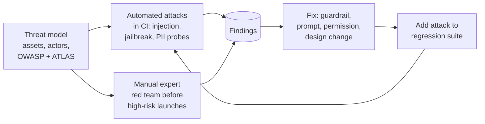
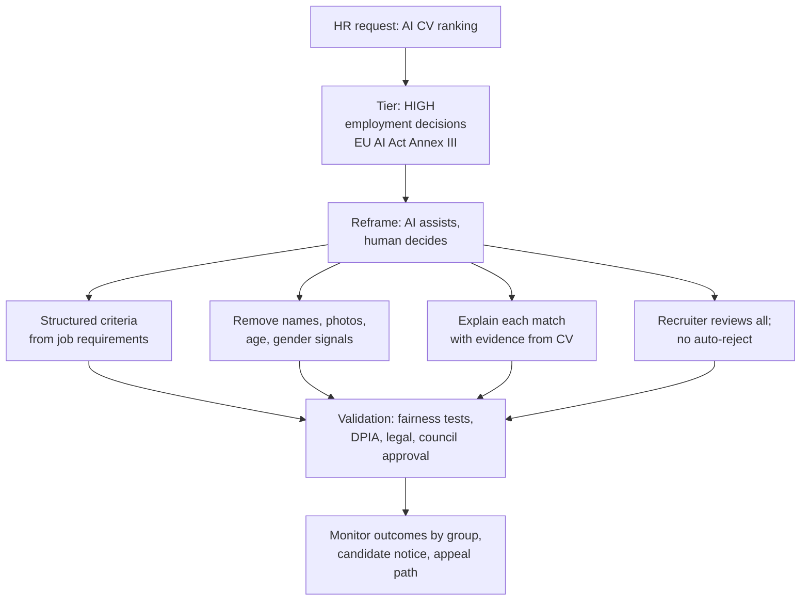

# 04 — Responsible AI, Governance, Security & Compliance

> **JD lines covered:** establish standards for guardrails, governance and responsible AI practices · drive adoption of trustworthy AI principles — transparency, monitoring, risk mitigation, model validation, compliance · ensure compliance with organisational policies, security standards, regulatory requirements and responsible AI guidelines.
>
> **Prerequisites:** guardrails architecture → file 03 Q3.13 · OAuth/RBAC → [`interview-prep/10-security-auth.md`](../../interview-prep/10-security-auth.md).
>
> ⚠️ **Regulation changes fast.** Dates below were checked on 24 Nov 2026 — re-check before the interview (sources at the bottom).

---

## Part A — Principles and frameworks

### Q4.1 · L2 · "What does 'Responsible AI' mean to you in practice?"

> **Why they ask:** Everyone can list principles. They want to hear how principles become engineering controls.

**Picture it:**

*Principle → control. If a principle has no control, it's a poster, not a practice.*

<b>▶ Answer</b>

I use a principle set like Microsoft's six — **fairness, reliability & safety, privacy & security, inclusiveness, transparency, accountability** — but the important part is that **each principle maps to a concrete control that is checked before release and monitored after**:

| Principle | Control I'd put in place |
|---|---|
| Fairness | Evaluate quality per user group/language/region; bias tests for any decision affecting people |
| Reliability & safety | Golden-set evals, SLOs, guardrails, human-in-the-loop for high-impact actions |
| Privacy & security | PII redaction, permission-aware retrieval, data minimisation, red teaming |
| Inclusiveness | Accessibility checks, multilingual support, diverse pilot users |
| Transparency | Users told they're interacting with AI, citations, system/model cards, explanation of limits |
| Accountability | A named business owner per AI system, risk review sign-off, audit logs, incident process |

**One-liner I use:** *"Responsible AI is a release checklist and a monitoring dashboard, not a slide."*

**Say this:** *"Six principles, but each one maps to a control we test before release and monitor after — otherwise it's a poster, not a practice."*

---

### Q4.2 · L3 · "How would you set up AI governance in a large enterprise?"

**Picture it:**

<b>▶ Answer</b>

**Structure (three layers):**
1. **AI Steering / Responsible AI council** — senior cross-functional group (tech, CISO, legal, privacy/DPO, risk, HR, business). Sets policy and risk appetite, decides on high-risk cases, reviews incidents.
2. **AI Centre of Excellence (CoE) / platform team** — owns standards, the paved road, review of medium-risk cases, training.
3. **Product teams** — own their AI systems day to day, with a named business owner and technical owner.

**Process:**
- **Intake** — every AI use case is registered (what it does, data, users, autonomy, decisions affected).
- **Risk tiering** — a questionnaire classifies it (Q4.3). Effort is **proportional** to risk.
- **Reviews** — low: self-certify against the checklist; medium: CoE + security review; high: full impact assessment, DPIA, legal, council approval.
- **AI system registry** — inventory of every AI system with owner, tier, model, data sources, eval results, approval date. Regulators and auditors ask for this first.
- **Monitoring and re-review** — triggers: model change, new data source, new user group, incidents, or yearly.
- **Policies** — acceptable use of AI (including public tools), data usage for AI, third-party/vendor AI assessment, AI incident response.
- **Training** — AI literacy for all staff (also an EU AI Act obligation), deeper training for builders.

**Frameworks to name:** NIST AI RMF for the risk process, ISO/IEC 42001 if the company wants a certifiable AI management system (Q4.4).

**Say this:** *"A cross-functional council sets policy and risk appetite, a CoE runs standards and reviews, product teams own their systems. Every use case goes through intake and risk tiering, review effort is proportional to risk, everything lands in an AI registry and is monitored and re-reviewed."*

---

### Q4.3 · L3 · "How do you risk-tier AI use cases? Explain the EU AI Act risk categories."

**Picture it:**

<b>▶ Answer</b>

**EU AI Act (Regulation (EU) 2024/1689) — four tiers:**
- **Unacceptable** (prohibited since Feb 2025): social scoring, manipulative/exploitative techniques, emotion recognition in workplaces/schools, untargeted scraping of facial images, etc.
- **High-risk**: AI used in areas like **employment** (CV screening, promotion, monitoring), **creditworthiness**, education, access to essential services, critical infrastructure, law enforcement — and AI as safety components of regulated products. Obligations: risk management system, data governance, technical documentation, logging, transparency to deployers, **human oversight**, accuracy/robustness/cybersecurity, quality management, registration, post-market monitoring.
- **Limited risk** — transparency: tell people they're talking to AI; mark AI-generated/deepfake content.
- **Minimal risk** — most business uses; voluntary codes.
- **General-purpose AI (GPAI) models** have their own provider obligations (since Aug 2025) — mainly relevant to model providers, but deployers must understand them.

**Timeline status (as of Nov 2026):** high-risk obligations were originally due 2 Aug 2026. Under the **Digital Omnibus on AI**, EU institutions reached a provisional agreement in May 2026 to defer them to **2 Dec 2027** for stand-alone (Annex III) systems and **2 Aug 2028** for AI embedded in regulated products. Check the final formal adoption status before the interview — and the right message is *"the delay is time to prepare, not a reason to wait."*

**My internal tiering (works regardless of jurisdiction):**

| Question | Raises tier if… |
|---|---|
| Who is affected? | Customers/public > employees > internal tools |
| Does it make or influence decisions about people? | Hiring, credit, pricing, eligibility |
| Autonomy | Acts without human approval |
| Data sensitivity | Personal, financial, health, confidential IP |
| Reversibility | Actions can't be undone |
| Scale | Many users / high volume |
| Regulated domain | Finance, health, aviation, employment |

**Applicability:** the EU AI Act applies to companies placing AI on the EU market or whose AI outputs are used in the EU — relevant for Indian IT services firms serving EU clients. In India, the **DPDP Act 2023** (with its Rules notified in 2025 and phased in) governs personal data, and the government has published **AI governance guidelines** favouring a principles-based approach.

**Say this:** *"Four EU tiers — banned, high-risk, transparency, minimal — and high-risk includes HR and credit. High-risk deadlines were provisionally pushed to December 2027 and August 2028, but I treat that as preparation time. Internally I tier by who's affected, decisions about people, autonomy, data sensitivity, reversibility and scale."*

---

### Q4.4 · L3 · "Which AI risk frameworks and standards do you know?"

**Picture it:**

*NIST AI Risk Management Framework — four functions.*

<b>▶ Answer</b>

| Framework | What it is | How I'd use it |
|---|---|---|
| **NIST AI RMF 1.0** (+ Generative AI Profile) | Voluntary US framework: **Govern, Map, Measure, Manage** | Backbone of the internal risk process; the GenAI profile lists GenAI-specific risks (confabulation, data privacy, information integrity…) |
| **ISO/IEC 42001** | Certifiable **AI management system** standard (like ISO 27001 for security) | When clients/regulators want proof; aligns policies, roles, risk assessments, continual improvement |
| **ISO/IEC 23894** | AI risk management guidance | Supports 42001 risk process |
| **EU AI Act** | Binding regulation (Q4.3) | Legal requirements by tier |
| **OWASP Top 10 for LLM Applications** | Security risks specific to LLM apps | Security review checklist & red-team plan (Q4.9) |
| **MITRE ATLAS** | Knowledge base of adversarial tactics against AI systems | Threat modelling |
| **Vendor frameworks** | Microsoft Responsible AI Standard, Google SAIF, AWS responsible AI | Practical templates and tooling |

**Leader framing:** "I don't run five frameworks in parallel. I build one internal control set and map it to NIST AI RMF, ISO 42001 and the EU AI Act, so one piece of evidence satisfies all three."

**Say this:** *"NIST AI RMF — govern, map, measure, manage — for the process, ISO 42001 if we need certification, the EU AI Act for legal duties, OWASP LLM Top 10 for security. One internal control set mapped to all of them."*

---

## Part B — Validation, transparency, fairness

### Q4.5 · L3 · "What does 'model validation' mean for an LLM system before go-live?"

> **Why they ask:** Literal JD phrase. In banks it's a formal function (model risk management, e.g., SR 11-7 style).

<b>▶ Answer</b>

Validation = **independent evidence that the system is fit for its intended purpose and its risks are controlled.** For an LLM system (not just the model) I require:

1. **Intended use & limits documented** — what it's for, what it must not be used for, users, risk tier.
2. **Performance evidence** — golden-set results vs. acceptance thresholds agreed with the business, broken down by segment (language, region, user type).
3. **Robustness** — paraphrased and noisy inputs, edge cases, long inputs; consistency across repeated runs.
4. **Safety & security** — red-team results (injection, jailbreak, data leakage, harmful content); OWASP LLM checklist.
5. **Fairness** — results per relevant group where people are affected (Q4.7).
6. **Privacy** — DPIA where personal data is involved; data flows, retention, residency verified.
7. **Human oversight design** — where humans approve, how they can override, how they're trained.
8. **Operational readiness** — monitoring, SLOs, fallback, kill-switch, incident runbook.
9. **Documentation** — **system card / model card**: purpose, data, evals, limitations, owners.
10. **Independent review** for high-risk tiers — someone who didn't build it (second line: risk/validation team).

**Revalidation triggers:** model version change, prompt/retrieval change beyond a threshold, new data source, new use, drift/incident.

**Say this:** *"Validation is independent evidence of fitness for purpose — documented intended use, performance against agreed thresholds by segment, robustness, red-team results, fairness, privacy, human oversight design and operational readiness — revalidated whenever the model, data or use changes."*

---

### Q4.6 · L2 · "How do you provide transparency and explainability for GenAI systems?"

<b>▶ Answer</b>

Different audiences need different transparency:

| Audience | What they get |
|---|---|
| **End users** | Clear disclosure that it's AI; **citations** to sources; confidence/limitation messages ("I couldn't find this"); easy path to a human; label AI-generated content |
| **Business owners** | System card: purpose, limits, eval results, known failure modes, monitoring dashboard |
| **Auditors / regulators** | Registry entry, approvals, logs of prompts/outputs/tool calls (as policy allows), validation report, change history |
| **Engineers** | Full traces for every request |

**Explainability for LLMs** is different from classical ML: you can't reliably explain *why* the weights produced a token, so you provide **process transparency** — what context it used (citations), which tools it called, what rules applied — rather than mathematical feature attribution. For classical ML decisions (credit, pricing) use SHAP/feature importance and reason codes.

**Say this:** *"Users get disclosure, citations and a path to a human; owners get a system card; auditors get the registry, approvals and logs. For LLMs I give process transparency — what it read and what it did — rather than pretending to explain the weights."*

---

### Q4.7 · L3 · "How do you test for bias and fairness in an LLM application?"

<b>▶ Answer</b>

1. **Decide if it matters** — fairness testing is essential when the system affects people (hiring, lending, customer treatment, performance reviews); lighter for internal document summarisation.
2. **Counterfactual testing** — same input with only a sensitive attribute changed (name suggesting gender/religion/region, age, accent in speech). Outputs should not materially differ. Automate this with templated variations.
3. **Segmented evaluation** — quality metrics broken down by language, region, user group. An English-only eval can hide that the Hindi answers are much worse.
4. **Outcome monitoring** — in production, compare outcomes (approval rates, escalation rates) across groups where lawful to measure.
5. **Mitigations** — remove unnecessary sensitive attributes from inputs, constrain the task (structured criteria instead of open judgement), human review of decisions, diverse evaluators, prompt rules.
6. **Document** findings and residual risk in the system card; get risk owner sign-off.

**Say this:** *"Counterfactual tests that change only the sensitive attribute, quality broken down by group and language, outcome monitoring in production, and mitigations like structured criteria and human review — documented with a risk owner."*

---

## Part C — Security and privacy

### Q4.8 · L3 · "How would you run an AI red-teaming programme?"

**Picture it:**

<b>▶ Answer</b>

- **Threat model first** — what can go wrong for *this* system: data leakage, harmful output, unauthorised actions, cost abuse, reputational content.
- **Automated red teaming in CI** — a growing library of attacks (direct/indirect injection, jailbreaks, PII extraction, system-prompt extraction, harmful content) run on every release; tools like PyRIT, garak, promptfoo, or the cloud providers' built-in safety evaluations.
- **Manual expert red teaming** before high-risk launches and major changes — creative, domain-aware attacks automated suites miss (e.g., social-engineering an HR agent into revealing salaries).
- **Indirect injection tests** — plant malicious instructions in a test document/email/web page and check the agent ignores them.
- **Severity triage and fix** — fix at the right layer (permissions and architecture first, prompts last).
- **Every finding becomes a regression test.**
- **Bug bounty / internal "break the bot" days** for widely used copilots.

**Say this:** *"Threat model, automated attacks in CI, expert manual red teams before high-risk launches, specific indirect-injection tests, fixes at the architecture layer first — and every finding becomes a regression test."*

---

### Q4.9 · L3 · "Walk me through the OWASP Top 10 for LLM applications."

<b>▶ Answer</b>

OWASP Top 10 for LLM Applications (2025 edition) with my one-line mitigation for each:

| # | Risk | Mitigation |
|---|---|---|
| LLM01 | **Prompt injection** (direct & indirect) | Separate trusted/untrusted content, input classifiers, least-privilege tools, HITL for actions |
| LLM02 | **Sensitive information disclosure** | Permission-aware retrieval, PII redaction, output scanning, no secrets in prompts |
| LLM03 | **Supply chain** (models, datasets, plugins) | Approved model/MCP registry, verify sources & licences, pin versions, scan dependencies |
| LLM04 | **Data and model poisoning** | Control ingestion sources, content provenance, review training/fine-tune data |
| LLM05 | **Improper output handling** | Treat output as untrusted: validate/escape before using in SQL, HTML, shell, APIs |
| LLM06 | **Excessive agency** | Minimal tools & permissions, delegated identity, approvals, budgets |
| LLM07 | **System prompt leakage** | Assume the system prompt will leak — no secrets or security logic in it |
| LLM08 | **Vector and embedding weaknesses** | ACLs on embeddings, tenant isolation, protect against embedding inversion & poisoning |
| LLM09 | **Misinformation** | RAG grounding, citations, groundedness checks, human review for high stakes |
| LLM10 | **Unbounded consumption** | Rate limits, token quotas, max tokens, budgets, abuse detection |

**Say this:** *"Injection, sensitive disclosure, supply chain, poisoning, improper output handling, excessive agency, system prompt leakage, vector weaknesses, misinformation, unbounded consumption — and the common theme is least privilege plus treating everything the model reads or writes as untrusted."*

---

### Q4.10 · L3 · "How do you handle privacy and data protection in GenAI — including the 'right to be forgotten'?"

<b>▶ Answer</b>

- **Data minimisation** — only send the model what the task needs; redact/tokenise PII at the gateway where possible.
- **Vendor terms** — enterprise agreements with **no training on our data**, defined retention (zero data retention for sensitive workloads where offered), certifications, and **data residency** (e.g., deploy in India/EU regions; check where abuse-monitoring data is stored).
- **Logs** — prompts and outputs are personal data too: mask, restrict access, short retention.
- **Lawful basis & purpose** — DPIA for personal-data use cases; GDPR for EU data subjects; **India's DPDP Act** (consent/notice, purpose limitation, data principal rights, breach reporting) for Indian personal data.
- **Right to erasure in RAG** — keep **source → chunk → vector lineage** (doc IDs on every chunk) so deleting a source deletes all its chunks/vectors and cached answers; caches and logs must follow retention rules too. If personal data was used to **fine-tune** a model, erasure is very hard — another reason to prefer RAG for personal data.
- **Cross-border transfer** rules checked for each model region.

**Say this:** *"Minimise and redact, contract for no-training and the right residency, treat logs as personal data, run DPIAs under GDPR or DPDP — and keep source-to-vector lineage so erasure actually deletes every chunk, which is also why I avoid fine-tuning on personal data."*

---

### Q4.11 · L3 · "Employees are pasting confidential data into public AI tools. What do you do?"

<b>▶ Answer</b>

Banning alone fails — people route around it. I combine **a better alternative + guardrails + education**:

1. **Provide a sanctioned tool** that's as good — an enterprise AI assistant with data protection (e.g., enterprise copilot / internal chat on our gateway). Demand is a signal of value.
2. **Acceptable-use policy** — what data classes can go where, in plain language.
3. **Technical controls** — DLP and browser/network controls (CASB) to block or warn on uploads of classified data to unapproved AI sites; sensitivity labels on documents.
4. **Discovery** — measure shadow AI usage (network logs) to see which tools and teams, then onboard their use cases properly.
5. **Education** — short training with real examples of leaks.
6. **Fast intake** for new tools so teams don't need to go around the process.

**Say this:** *"Give people a sanctioned tool that's as good, a plain-language policy, DLP to block sensitive uploads, measure shadow usage to find real demand, and a fast intake so nobody needs to go around the process."*

---

## Part D — Scenarios

### Q4.12 · L4 · "HR wants AI to screen and rank job applicants. How do you respond?"

**Picture it:**

<b>▶ Answer</b>

I don't refuse — I **reshape it into a defensible design** and route it through the high-risk process:

1. **Classify:** employment decisions are **high-risk** under the EU AI Act and sensitive under most labour/anti-discrimination laws. Full review: DPIA, legal, council approval.
2. **Reframe the goal:** recruiters are overloaded → "AI helps recruiters review faster", not "AI rejects candidates".
3. **Design choices:**
   - Extract skills/experience against **explicit job criteria** (structured), rather than an open "rate this candidate 1–10".
   - Strip or ignore attributes that proxy for protected characteristics (names, photos, age, gender cues, addresses).
   - Show **evidence** for each match from the CV; recruiters see why.
   - **No auto-rejection**; humans make every decision; candidates can request human review.
4. **Validation:** counterfactual fairness tests, outcome comparison against historical recruiter decisions, checks per group.
5. **Transparency:** candidates informed AI is used in screening; documentation kept.
6. **Monitor:** selection rates across groups, recruiter override rates, periodic audit.

**Say this:** *"It's high-risk, so full review. I reframe it as AI assisting recruiters against explicit criteria, with protected signals removed, evidence shown, no auto-rejection, fairness testing, candidate notice and outcome monitoring."*

---

### Q4.13 · L4 · "Governance often slows teams down. How do you keep it from becoming a bottleneck?"

<b>▶ Answer</b>

- **Risk-proportionate:** most use cases are low risk → self-certify via checklist in hours, not weeks. Deep reviews only for high-risk.
- **Governance built into the paved road:** if teams use the platform templates, 70–80% of controls (logging, PII redaction, content safety, eval harness, tracing) are **already satisfied automatically** — the review shrinks to the use-case-specific parts.
- **Policy as code:** gateway policies, CI eval gates and IaC policies (Azure Policy) enforce rules without meetings.
- **Clear SLAs for reviews** (e.g., medium-risk review in 5 working days) and one intake form, not five.
- **Embedded champions** in product teams trained to do first-line review.
- **Measure the process:** time from intake to approval; publish it; improve it.

**The framing that wins execs:** *"Good governance is what lets us say yes faster — because we can prove it's safe."*

**Say this:** *"Risk-proportionate reviews, controls built into the paved road and enforced as code, review SLAs, trained champions in teams — governance is what lets us say yes faster."*

---

## ⚡ Rapid-fire

| Question | One-line answer |
|---|---|
| Microsoft's 6 RAI principles? | Fairness, reliability & safety, privacy & security, inclusiveness, transparency, accountability. |
| NIST AI RMF functions? | Govern, Map, Measure, Manage. |
| ISO/IEC 42001? | Certifiable AI management system standard. |
| EU AI Act tiers? | Unacceptable, high, limited (transparency), minimal. |
| HR screening tier? | High-risk. |
| DPIA? | Data Protection Impact Assessment before high-risk personal-data processing. |
| DPDP Act? | India's Digital Personal Data Protection Act, 2023. |
| System card? | Document of purpose, data, evals, limits, owners of an AI system. |
| Excessive agency? | Agent has more tools/permissions/autonomy than the task needs. |
| Shadow AI? | Unapproved AI tools used by staff, often with company data. |
| Counterfactual fairness test? | Change only a sensitive attribute; output shouldn't change materially. |

---

**Sources (checked 24 Nov 2026):**
[DLA Piper — Digital AI Omnibus deferral](https://knowledge.dlapiper.com/dlapiperknowledge/globalemploymentlatestdevelopments/2026/The-Digital-AI-Omnibus-Proposed-deferral-of-high-risk-AI-obligations-under-the-AI-Act) ·
[Gibson Dunn — EU AI Act Omnibus agreement](https://www.gibsondunn.com/eu-ai-act-omnibus-agreement-postponed-high-risk-deadlines-and-other-key-changes/) ·
[Taylor Wessing — what the political deal means](https://www.taylorwessing.com/de/insights-and-events/insights/2026/05/the-eu-digital-omnibus-on-ai-what-the-political-deal-means) ·
[OWASP Top 10 for LLM Applications](https://genai.owasp.org/llm-top-10/) ·
[NIST AI RMF](https://www.nist.gov/itl/ai-risk-management-framework)
