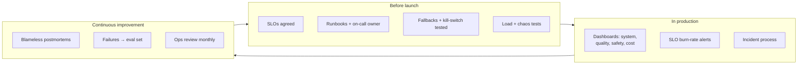
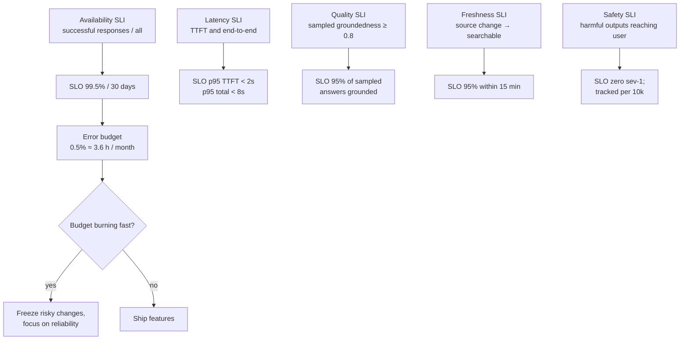
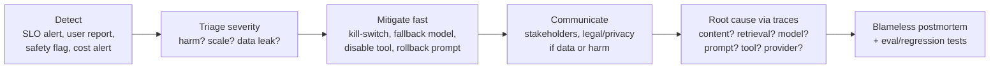
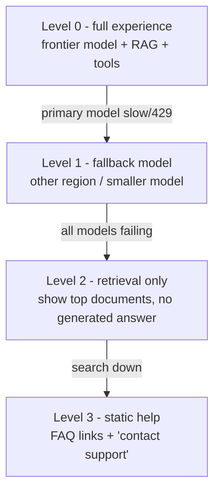
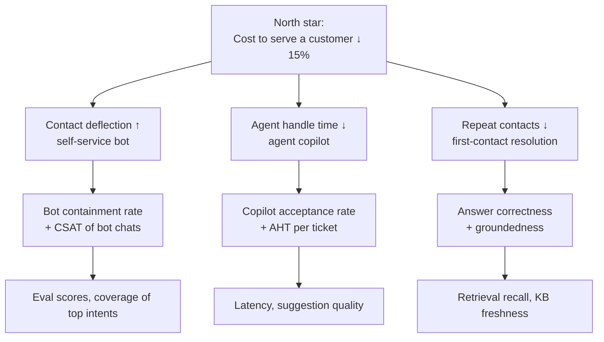
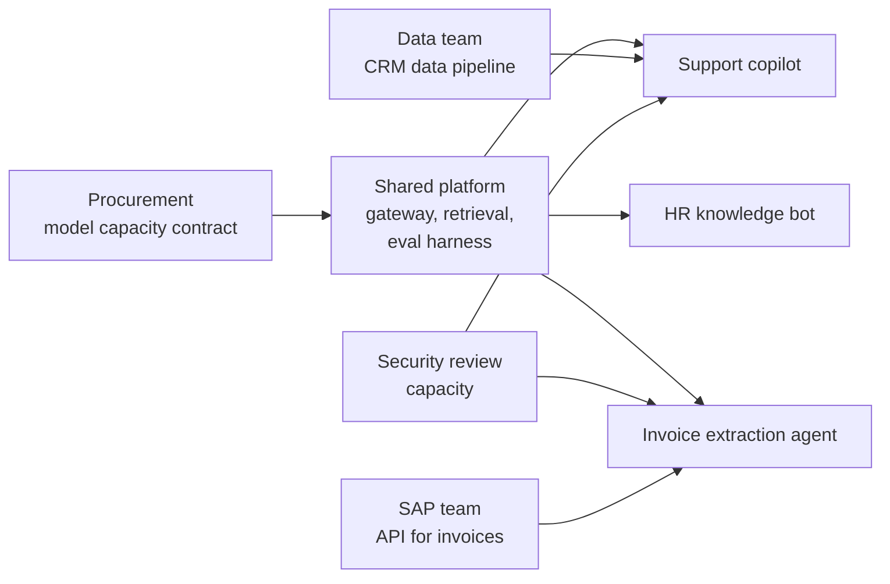
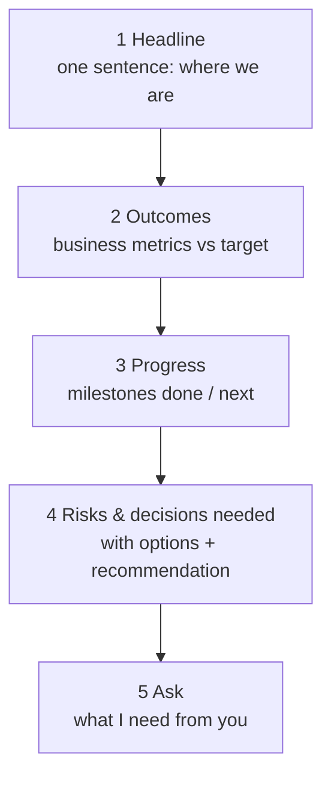

# 05 — Operational Excellence & Business Impact

> **JD lines covered:** establish operational excellence practices for AI products and platforms — reliability, resiliency, monitoring, incident management · define delivery metrics, SLOs and business impact measures · manage delivery risks, dependencies, priorities, budgets and resource allocation across multiple AI initiatives · communicate technical strategy, delivery progress and business outcomes to executive leadership.
>
> **Your anchor:** MGM — OpenTelemetry observability platform + RAG alert summarisation → **MTTR −25%**. Use it in almost every answer here.

---

## Part A — Reliability, SLOs, incidents

### Q5.1 · L3 · "What does operational excellence look like for an AI product?"

**Picture it:**

<b>▶ Answer</b>

The same SRE discipline as any critical service, **plus three AI-specific additions**: quality is a reliability signal, cost is an operational signal, and the model provider is a dependency you don't control.

**Production-readiness checklist (gate before launch):**
- SLOs agreed with the business (availability, latency, **quality**, and a cost guardrail).
- Named on-call owner; runbooks for top failure modes (provider 429/outage, retrieval index stale, quality drop, cost spike, safety incident).
- Fallbacks and **kill-switch** tested; graceful degradation designed.
- Load test at expected peak × 2 against the gateway (token-per-minute limits are the usual bottleneck).
- Dashboards across the four families (system, quality, safety, cost — file 02 Q2.6).

**In production:** alert on SLO burn rate (not raw noise), incident process with AI-specific severities (Q5.3), weekly review of sampled traces and user feedback.

**Continuous improvement:** blameless postmortems, every quality failure added to the golden set, monthly ops review per product (SLOs, incidents, cost, adoption).

**MGM example:** the observability module standardised tracing across services, so when an alert fired the RAG summariser could pull related traces/logs and give on-call engineers a grounded summary — MTTR dropped 25%.

**Say this:** *"Standard SRE — SLOs, on-call, runbooks, tested fallbacks, postmortems — plus three AI twists: quality is a reliability signal, cost is an operational signal, and the model provider is a dependency I don't control."*

---

### Q5.2 · L3 · "Define SLOs for an enterprise AI assistant."

> **Why they ask:** "Define … service-level objectives". Most candidates only give availability and latency.

**Picture it:**

<b>▶ Answer</b>

**SLI = what you measure; SLO = target over a window; error budget = allowed failure.**

| Dimension | SLI | Example SLO |
|---|---|---|
| Availability | Successful responses ÷ total (excluding user errors) | 99.5% over 30 days |
| Latency | Time to first token; end-to-end time | p95 TTFT < 2 s; p95 total < 8 s |
| **Quality** | % of sampled answers scored grounded/correct by online eval | ≥ 95% grounded |
| **Freshness** (RAG) | Time from source change to searchable | 95% within 15 min |
| **Safety** | Harmful/PII outputs reaching users | 0 severity-1; trend per 10k responses |
| Cost (guardrail, not SLO) | Cost per conversation/outcome | Within budget ± 10% |

**Error budget policy:** 99.5% availability ≈ 3.6 hours of failure per 30 days. If we burn it fast (e.g., provider issues or a bad release), we freeze risky changes and spend effort on resilience; if we're well within it, we ship faster. That turns reliability-vs-features arguments into data.

**AI nuance:** "available but wrong" is still a failure for users — that's why I add a **quality SLO**, measured on sampled live traffic with an LLM judge calibrated against humans, plus user feedback.

**Alerting:** multi-window **burn-rate alerts** (fast burn pages someone; slow burn creates a ticket), not alerts on every spike.

**Say this:** *"Availability and latency like any service, plus a quality SLO on sampled answers, a freshness SLO for retrieval and a safety SLO — with an error budget policy that decides when we freeze features and fix reliability."*

---

### Q5.3 · L3 · "How is incident management different for AI systems?"

**Picture it:**

<b>▶ Answer</b>

**New incident types beyond "it's down":**
- **Quality incidents** — wrong answers at scale (e.g., after a model upgrade or a bad document ingested).
- **Safety incidents** — harmful, offensive or biased output; jailbreak gone public (screenshots on social media).
- **Data incidents** — the assistant revealed data a user shouldn't see (privacy breach → legal/DPO involved, possible regulatory reporting).
- **Agent action incidents** — an agent did something wrong in a system (sent emails, changed records).
- **Cost incidents** — runaway loops or abuse burning budget.
- **Provider incidents** — outage, throttling, silent behaviour change.

**What changes in the process:**
1. **Severity criteria include harm and data exposure**, not just availability.
2. **Mitigation levers are AI-specific:** kill-switch per feature/topic, rollback prompt/config version, switch model, disable a tool, tighten a guardrail, purge a bad document from the index.
3. **Legal/privacy/comms** are in the loop for data and safety incidents.
4. **Root cause needs traces** — "why did it say that?" is only answerable if you logged retrieval and tool calls.
5. **Fix includes an eval case** so it can't silently return.
6. **AI incident register** feeds governance (file 04) — regulators increasingly expect it for high-risk systems.

**Say this:** *"New incident types — quality, safety, data exposure, agent actions, cost and provider. Severity includes harm, mitigation uses AI levers like kill-switches and prompt rollbacks, legal joins for data and safety, and every fix adds an eval case."*

---

### Q5.4 · L2 · "What resiliency patterns do you apply to AI services?"

**Picture it:**

*Degradation ladder: never a blank error page.*

<b>▶ Answer</b>

- **Timeouts everywhere** (LLM calls can hang) — with streaming, separate TTFT timeout from total timeout.
- **Retries with exponential backoff + jitter**, respecting `Retry-After` on 429s; limit retries so you don't amplify an outage.
- **Circuit breakers** per model deployment; **failover** across regions/providers at the gateway.
- **Bulkheads** — separate quotas for interactive vs batch traffic so a batch job can't starve users.
- **Queues for async work** (document processing, bulk summarisation) — smooths spikes against token limits.
- **Idempotency** for agent tool calls — retries mustn't create duplicate refunds or tickets.
- **Caching** of frequent answers and embeddings.
- **Degradation ladder** (diagram) and **kill-switch flags**.
- **Chaos tests** — regularly simulate provider failure and confirm the ladder works.

These are my standard microservice resilience patterns (Resilience4j in Java world) applied to a new kind of dependency.

**Say this:** *"Timeouts, backoff with jitter, circuit breakers and cross-region failover at the gateway, bulkheads between interactive and batch, idempotent tool calls, and a tested degradation ladder so users never hit a blank error."*

---

## Part B — Metrics and business impact

### Q5.5 · L3 · "Which delivery metrics would you track across your AI organisation?"

<b>▶ Answer</b>

Three layers — **flow, quality/reliability, outcome** — so no one optimises one at the cost of another:

| Layer | Metrics |
|---|---|
| **Delivery flow (DORA + AI)** | Deployment frequency · lead time for changes · change failure rate · time to restore · **time from idea to first production pilot** (platform effectiveness) · % of use cases passing gate 1 within 6 weeks |
| **Quality & reliability** | SLO attainment · eval scores trend per product · # quality/safety incidents · **eval coverage** (% of prompts/agents with golden sets in CI) |
| **Outcome / business** | Adoption (weekly active users, % of eligible users) · task KPIs (handle time, deflection, resolution) · cost per outcome · ₹ value realised vs business case |
| **Platform** | Teams onboarded · % of AI traffic via gateway · reuse of shared components |
| **People** | Engagement, attrition, hiring pipeline, skills coverage |

**Principles:** few metrics per audience; trends over snapshots; never use them to rank individuals (Goodhart's law — "when a measure becomes a target it ceases to be a good measure").

**Say this:** *"Three layers — DORA-style flow plus time-to-first-pilot, quality and reliability including eval coverage, and business outcomes like adoption and cost per outcome — with trends, few metrics per audience and never used to rank individuals."*

---

### Q5.6 · L3 · "How do you connect AI work to business impact? Give a metric tree."

**Picture it:**

<b>▶ Answer</b>

A **metric tree** links the executive's number to what engineers can actually move:

- **Top:** a business north star the exec already owns (cost to serve, revenue per customer, time-to-close, risk losses).
- **Middle — drivers:** the operational levers AI influences (deflection, handle time, first-contact resolution).
- **Bottom — product & model metrics:** acceptance rate, containment, groundedness, retrieval recall, latency.

**Why it matters:** engineers see why a 5-point groundedness gain matters; executives see that model metrics aren't vanity. When the bottom moves but the top doesn't, that's a signal (often adoption or process change is the blocker, not the model).

**Guardrail metrics alongside:** CSAT, escalation rate, complaints — so a "deflection" win isn't really customers giving up.

**Say this:** *"A metric tree from the exec's north star, through operational drivers, down to model metrics — with guardrail metrics like CSAT so we don't win the number and lose the customer."*

---

## Part C — Portfolio: risks, dependencies, budgets

### Q5.7 · L3 · "How do you manage risks and dependencies across multiple AI initiatives?"

**Picture it:**

*Shared dependencies are where portfolios slip — map them explicitly.*

<b>▶ Answer</b>

- **Single portfolio view** of all AI initiatives: stage, owner, next gate, RAG (red/amber/green) status, dependencies, risks.
- **RAID log** (Risks, Assumptions, Issues, Dependencies) per initiative, rolled up; top risks reviewed weekly with owners and dates.
- **Dependency map** (diagram) — shared bottlenecks are usually: platform features, data pipelines, security/legal review capacity, integration APIs owned by other teams, GPU/model capacity contracts. These get explicit agreements (dates, owners) and are reviewed in a cross-team sync.
- **AI-specific risks** I track: data access/quality, eval not passing threshold, regulatory classification, provider capacity/pricing changes, adoption risk, key-person risk.
- **Mitigation habits:** decouple (mock dependencies, feature flags), sequence work so platform capabilities land just before the use cases that need them, keep a buffer of platform capacity for "unblock" work, escalate early with options rather than late with problems.

**Say this:** *"One portfolio view with stage gates and RAG status, a RAID log rolled up weekly, an explicit dependency map for shared bottlenecks like platform, data, security review and provider capacity — and I escalate early with options."*

---

### Q5.8 · L4 · "How would you plan and manage the budget for an AI engineering organisation?"

<b>▶ Answer</b>

**Budget components:**
1. **People** (usually the largest) — engineers, ML/AI engineers, platform/SRE, data, product/design; mix of permanent, contractors, partners.
2. **Run cost** — model tokens/provisioned capacity, search/vector, compute (GPU), storage, observability tooling. Grows with adoption — must be forecast per use case.
3. **Build/one-off** — new platform capabilities, migrations, partner projects.
4. **Licences** — copilots, MLOps/eval/observability tools.
5. **Learning & exploration** — training, certifications, ~10% exploration capacity.

**How I plan:** bottom-up from the use-case portfolio (each with build effort + projected run cost from pilot unit economics) plus a platform baseline; top-down check against expected value. Hold a **contingency (10–15%)** because model pricing, volume and adoption are uncertain.

**How I manage during the year:** monthly actuals vs forecast per initiative; **unit cost** tracking (cost per outcome) so growth in spend is explained by growth in value; quarterly re-allocation from stalled initiatives to winners (stage gates make this easy); cost optimisation levers (file 02 Q2.12) as a standing workstream.

**Language for finance:** distinguish capex-like build from opex-like run; show payback period and how run cost scales with volume.

**Say this:** *"People, run cost, build, licences and exploration — planned bottom-up from the portfolio's unit economics with 10–15% contingency, tracked monthly on cost per outcome, and reallocated quarterly from stalled initiatives to winners."*

---

### Q5.9 · L4 · "You have 5 AI initiatives and capacity for 3. How do you allocate people?"

<b>▶ Answer</b>

1. **Re-score transparently** using the portfolio framework (value, feasibility, time-to-value, risk, reuse) with current data — not the original optimism.
2. **Check commitments and dependencies** — regulatory deadlines, contractual commitments, initiatives that unblock others (platform pieces).
3. **Options, not a single answer, to leadership:** e.g., (A) fund top 3 fully, pause 2; (B) fund top 2 fully, run 2 in a slower "discovery-only" mode; (C) add capacity via partner for one initiative with cost X.
4. **Avoid spreading thin** — five half-staffed teams deliver less than three fully staffed ones (context switching, no one owns production).
5. **Communicate the "not now" clearly** to the paused initiatives' sponsors with criteria for restart.
6. **Look for leverage** — can a shared platform capability make two initiatives cheaper?

**Say this:** *"Re-score honestly, respect hard commitments and unblockers, take two or three options to leadership instead of spreading people thin, and give paused sponsors clear restart criteria."*

---

## Part D — Executive communication

### Q5.10 · L3 · "How do you communicate AI strategy and progress to executive leadership?"

**Picture it:**

*One page. Outcomes before activities. Decisions before details.*

<b>▶ Answer</b>

**Principles:**
- **Lead with outcomes in their language** (money, time, risk, customers), not model names or accuracy scores.
- **Bottom line up front** — the first sentence says whether we're on track and what we need.
- **One page / one slide** monthly; details in an appendix.
- **Red is fine, surprises are not** — surface risks early with options and a recommendation.
- **Separate "what" from "how":** execs decide priorities, risk appetite and funding; engineers decide implementation.
- **Explain AI limits honestly** — "it will be wrong sometimes; here's how we catch it and the residual risk" builds more trust than over-promising.

**Example headline:** *"Support copilot is live for 400 agents; handle time is down 18% against a 20% target; adoption at 62% is the gap — we're fixing it with CRM integration next month. Decision needed: approve the HR assistant pilot (₹X, 6 weeks)."*

**Say this:** *"One page, bottom line first, outcomes in business language, risks with options and a recommendation, and a clear ask. Red is fine — surprises aren't."*

---

### Q5.11 · L4 · "Tell the board why an AI initiative they were excited about is being stopped."

<b>▶ Answer</b>

1. **Lead with the decision and the reason in one line:** *"We're stopping the autonomous claims-approval pilot: it met speed targets but couldn't meet our accuracy threshold for high-value claims, and the residual risk is above our appetite."*
2. **Show the evidence** — gate criteria agreed upfront, results vs. criteria. Because we stage-gated, this is a **cheap, early failure**, not a write-off.
3. **What we learned / kept:** the document-extraction component works and is being reused in two other workflows; the eval set and data pipeline are assets.
4. **What's next:** a lower-risk version (AI pre-checks, human approves) that captures ~60% of the value.
5. **Own it** — no blaming the model vendor or the data team.

**Say this:** *"Decision and reason in one line, evidence against criteria we agreed upfront, what we keep and reuse, the lower-risk alternative — and I own it."*

---

### Q5.12 · L3 · "Describe your postmortem process."

<b>▶ Answer</b>

- **Blameless** — focus on systems and decisions, not people; people who feel safe report early.
- Triggered for every sev-1/sev-2 and any safety/data incident.
- **Template:** summary, impact (users, duration, ₹, data), timeline, root cause(s) and contributing factors (5 Whys), what went well, what went badly, where we got lucky, **action items with owners and dates**.
- **AI-specific sections:** which layer failed (content, retrieval, model, prompt, tool, provider), were evals missing this case, did guardrails/monitoring catch it, was the kill-switch used?
- **Follow-through tracked** in the ops review; recurring themes become platform improvements.
- Share widely — other teams learn more from our failures than our successes.

**Say this:** *"Blameless, for every sev-1/2 and every safety or data incident, with an AI layer analysis and eval-gap question, owned action items tracked to closure, and shared widely."*

---

### Q5.13 · L3 · "Scenario: this month's AI spend doubled. What do you do?"

<b>▶ Answer</b>

1. **Find where** — gateway cost logs by team, use case, model, day. Usually one of: a new use case launched, a runaway agent loop, a batch job using the expensive model, a prompt change that added lots of context, a cache broken by a deployment, or abuse/scraping.
2. **Contain** — quota or temporary throttle on the offender; kill runaway jobs.
3. **Check value** — if spend doubled because usage doubled and cost per outcome is flat, that's success: update the forecast and talk to finance.
4. **Fix waste** — routing, context trimming, cache, batch API, max steps for agents.
5. **Prevent** — budget alerts per team at 50/80/100%, anomaly detection on daily spend, cost estimate required at gates, per-agent step/token budgets.

**Say this:** *"Break spend down by team, use case and model from gateway logs, contain any runaway, check whether cost per outcome actually changed, fix the waste, and add anomaly alerts and per-agent budgets so it can't surprise us again."*

---

## ⚡ Rapid-fire

| Question | One-line answer |
|---|---|
| SLI vs SLO vs SLA? | Measurement vs internal target vs contractual promise with penalties. |
| Error budget? | Allowed unreliability (1 − SLO); spend it on change, protect it with freezes. |
| Burn-rate alert? | Alerts on how fast the error budget is being consumed. |
| DORA four? | Deployment frequency, lead time, change failure rate, time to restore. |
| MTTR? | Mean time to restore/resolve — mine dropped 25% at MGM. |
| RAID? | Risks, Assumptions, Issues, Dependencies. |
| Goodhart's law? | A measure that becomes a target stops being a good measure. |
| Bulkhead? | Isolate resources so one workload can't starve another. |
| Kill-switch? | Feature flag to turn an AI feature off instantly with a safe fallback. |
| BLUF? | Bottom line up front — how every exec update starts. |
