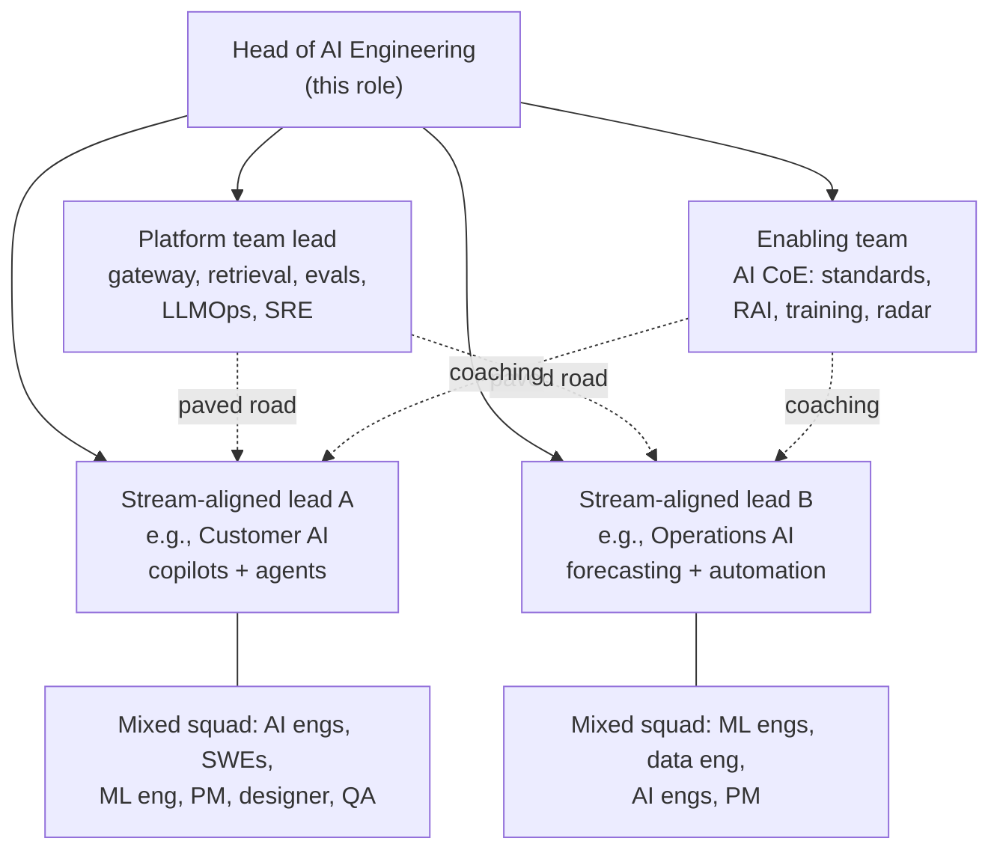
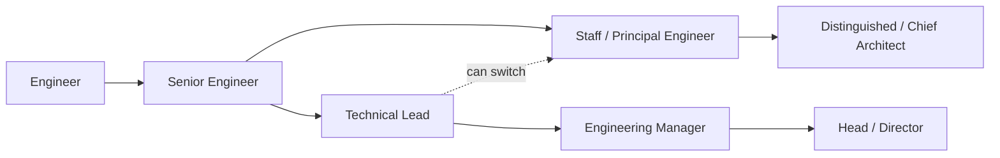
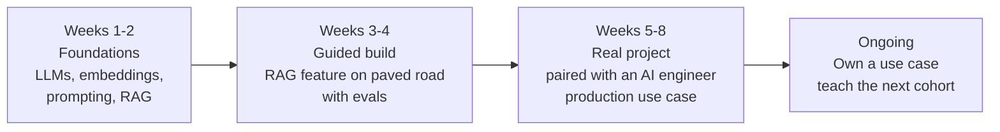
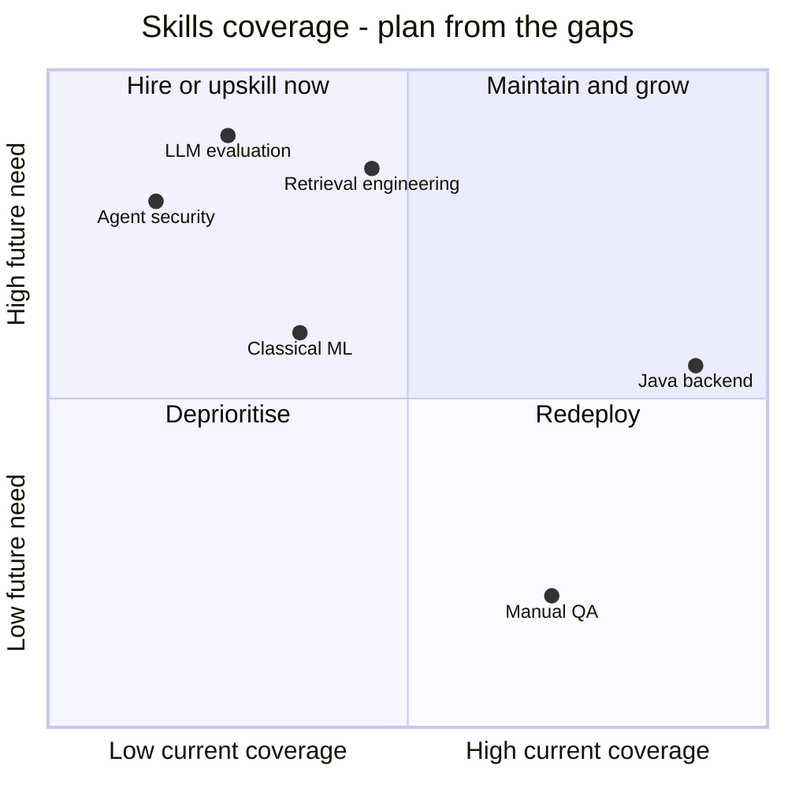
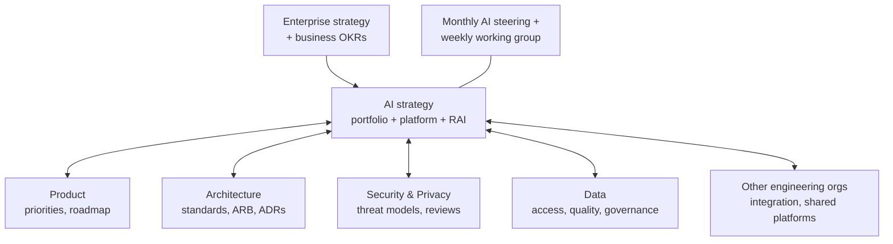

# 06 — Engineering Leadership, Talent Development & Enterprise Influence

> **JD lines covered:** build, mentor and lead high-performing teams of AI Engineers, ML Engineers, Software Engineers and Technical Leads · foster innovation, accountability, technical excellence, continuous learning and collaboration · drive workforce planning, talent development, succession planning and hiring · coach leaders on technical growth and career progression · collaborate with product, architecture, security, data and engineering organisations · influence technology direction and engineering standards across programs.
>
> **How to use the stories:** STAR answers below are **templates built from your real background** (MGM, BMW, AgentPulse, MCP). Before the interview, replace any detail that isn't exactly true with the real one — interviewers dig into stories, and a real detail beats a polished invention every time.
>
> **Basics:** STAR method and generic behavioural questions → [`interview-prep/13-hr-behavioral.md`](../../interview-prep/13-hr-behavioral.md), [`15-situational…`](../../interview-prep/15-situational-scenario-questions.md).

---

## Part A — Building teams

### Q6.1 · L4 · "How would you structure an AI engineering organisation?"

**Picture it:**

*Team Topologies style: stream-aligned teams deliver use cases; the platform team makes them fast; the enabling team makes them good.*

<b>▶ Answer</b>

I use **Team Topologies** thinking:

- **Stream-aligned teams** (2–4) aligned to business domains (customer, operations, internal productivity). Cross-functional squads of ~6–9: AI engineers, software engineers, an ML engineer where predictive work exists, a product manager, a designer for copilots, QA/eval specialist. Each **owns its use cases end-to-end, including production**.
- **Platform team** — AI gateway, retrieval service, eval harness, LLMOps pipelines, observability, SRE. Treats stream teams as customers.
- **Enabling team / AI CoE** — small, senior: standards, responsible AI process, architecture reviews, training, tech radar. Coaches teams rather than doing their work.

**Roles I'd define clearly** (they get confused in the market):

| Role | Core of the job |
|---|---|
| AI engineer | Builds LLM apps: RAG, agents, prompts, evals, integration |
| ML engineer | Trains/serves/monitors models; pipelines, feature stores |
| Data scientist | Problem framing, experimentation, statistics, modelling |
| Platform / MLOps engineer | Infrastructure, CI/CD, gateway, reliability |
| Software engineer | APIs, integration, front-end, the 80% of the system that isn't the model |

**Why this shape:** avoids the two classic failures — a central AI team that becomes a bottleneck, and fully scattered teams that each reinvent the platform and ignore governance (hub-and-spoke balance).

**Say this:** *"Team Topologies: domain-aligned squads own use cases end-to-end, a platform team gives them a paved road, and a small enabling CoE sets standards and coaches. That avoids both the central bottleneck and twenty teams reinventing the platform."*

---

### Q6.2 · L3 · "How do you hire AI engineers? What does your interview loop look like?"

<b>▶ Answer</b>

**What I look for (in order):** strong software engineering fundamentals → production mindset (testing, observability, failure modes) → **evaluation thinking** ("how would you know it works?") → GenAI/ML knowledge → communication and ownership. GenAI tools change every quarter; fundamentals and judgement don't.

**Loop (4–5 stages):**
1. **Recruiter + hiring-manager screen** — motivation, scope of past ownership.
2. **Practical exercise (take-home or live, ~2 hrs, paid or time-boxed):** build a small RAG/extraction feature *with an eval* on provided data. The eval and the write-up of failure cases matter more than the demo.
3. **System design** — e.g., "design a support copilot"; probe NFRs, permissions, evals, cost.
4. **Code/debug pairing** — debug a failing agent trace or a retrieval bug.
5. **Values/leadership** — ownership, collaboration, learning; for leads, people scenarios.

**Practices:** structured scorecards with criteria agreed before interviews, diverse panels, calibrated interviewers, fast decisions (top candidates have multiple offers), and a clear career path in the offer conversation.

**Build vs buy talent:** I also grow AI engineers internally from strong backend engineers (Q6.5) — often faster and better retention than hiring only externally.

**Say this:** *"Fundamentals and production judgement first, GenAI knowledge second. A practical exercise where the eval and failure analysis matter more than the demo, a system design, a debugging pair session and a values round — scored on criteria fixed in advance."*

---

### Q6.3 · L4 · "How is leading technical leads different from leading engineers?"

<b>▶ Answer</b>

- **From doing to multiplying:** with engineers I guide the work; with leads I **build their capacity to guide others**. If I'm solving their team's problems, I'm doing their job and blocking their growth.
- **Context over control:** I give leads clear outcomes, constraints and *why* (strategy, priorities, risk appetite) and let them decide *how*. I review decisions via lightweight artefacts (ADRs, plans), not by attending every meeting.
- **Coaching conversations:** regular 1:1s focused on their team's health, their own growth and their hardest problem; skip-levels with engineers to hear the ground truth (and never use them to undermine the lead).
- **A leadership team, not a hub-and-spoke:** leads solve cross-team problems together (shared OKRs, weekly leads sync), so I'm not the integration point for everything.
- **Measure leads on team outcomes** — delivery, quality, engagement, growth of their people — not personal technical output.
- **Succession:** each lead should have someone who could step in — that's part of their job.

**Say this:** *"With leads I multiply rather than do: give context and outcomes, not instructions; coach them in 1:1s; make them a leadership team that solves cross-team problems together; and judge them by their team's outcomes and their people's growth."*

---

### Q6.4 · L3 · "How do you mentor people and manage career progression?"

**Picture it:**

*Dual track: growing doesn't have to mean managing.*

<b>▶ Answer</b>

- **Clear career framework** with dual tracks (IC and management) and **observable expectations** per level (scope, technical depth, influence, delivery, people). People should know exactly what "next level" looks like.
- **Individual growth plans** — in 1:1s every quarter: where they want to go, 1–2 stretch goals, the evidence we'll collect.
- **Growth through work, not just courses:** stretch assignments (lead a design, own a production service, run an incident review, present to stakeholders), rotation between platform and product teams.
- **Coaching style:** ask before telling; let people make recoverable mistakes; give specific, timely feedback (situation → behaviour → impact).
- **Sponsorship, not only mentorship** — advocate for people in promotion discussions and put them in front of senior stakeholders.
- **AI-specific learning:** study groups, internal tech talks, paper/demo days, certification support (e.g., Azure AI Engineer), 10% exploration time.

**Say this:** *"A dual-track career framework with observable expectations, quarterly growth plans with stretch work, coaching by asking before telling, and sponsorship — I put my people in rooms where decisions are made."*

---

### Q6.5 · L3 · "How would you upskill a team of traditional Java/backend engineers into AI engineers?"

> **Why they ask:** Most enterprises can't hire enough AI talent. This is also **your own story** — you did it.

**Picture it:**

<b>▶ Answer</b>

**Why it works:** about 80% of a production AI system is normal software engineering — APIs, integration, reliability, security, observability. Java/backend engineers already have that. They need the other 20%: how LLMs behave, retrieval, prompting, **evaluation**, and AI-specific risks.

**Programme:**
1. **Foundations (2 weeks, part-time):** LLM concepts, embeddings, RAG, agents, prompt patterns, eval basics, responsible AI. Short, practical.
2. **Guided build:** each person builds a small RAG feature on the platform templates — including a golden set and CI eval. In Java too (Spring AI / LangChain4j) so they're productive in their language.
3. **Real project in pairs** with an experienced AI engineer.
4. **Teach-back:** graduates mentor the next cohort — scales the programme and cements learning.

**Measure:** # engineers certified internally, # shipped features by graduates, quality of their eval suites.

**My own path:** I'm a Java/Spring Boot engineer who moved into GenAI by building — RAG at MGM, MCP servers, AgentPulse on PyPI. I'd design the programme around that "learn by shipping" loop.

**Say this:** *"Eighty percent of an AI system is normal engineering, so backend engineers are a great base. Two weeks of foundations, a guided build with evals, a paired real project, then they teach the next cohort — it's exactly how I made the move myself."*

---

### Q6.6 · L3 · "How do you build a culture of innovation *and* accountability?"

<b>▶ Answer</b>

They look opposed but reinforce each other: **people take smart risks when failure is safe, and failure is safe when outcomes are owned and learned from.**

**Innovation:**
- ~10% time for exploration; quarterly hack/demo days with business judges; tech radar contributions.
- Experiments are **cheap by design** (paved road, sandbox environments, small spikes) and judged on learning, not just success.
- Celebrate good "kills" — stopping a weak idea early is a win.

**Accountability:**
- Clear ownership: every service and AI system has a named team and on-call; "you build it, you run it".
- Commitments are explicit and visible; slippage raised early is respected, hidden slippage is not.
- Blameless postmortems with action items that actually get done.

**Technical excellence & learning:** code review standards, ADRs for important decisions, internal talks, guilds (AI, platform, frontend), eval coverage as a team metric.

**Collaboration:** shared goals across teams, inner source, recognising people who unblock others.

**I model it:** I share my own mistakes in reviews, and I'm visibly first to ask "how do we know it works?"

**Say this:** *"Innovation needs safe, cheap failure; accountability makes failure safe because outcomes are owned and learned from. So: exploration time and demo days on one side, clear ownership, 'you build it, you run it' and blameless postmortems on the other — and I model both."*

---

### Q6.7 · L3 · "Tell me about handling an underperforming team member." (STAR template)

<b>▶ Answer</b>

**S:** A capable senior engineer's delivery dropped — missed commitments two sprints running, quality issues in reviews.
**T:** Understand the cause and either get them back on track or make a fair decision.
**A:**
- Private conversation first, **curious not accusatory**: shared specific observations (dates, PRs), asked what was going on. There was a mix: unclear expectations on a new AI component and a personal situation at home.
- Agreed a concrete plan: clearer scope and acceptance criteria, pairing with a stronger AI engineer for two weeks, a short flexibility arrangement for the personal issue, weekly check-ins with written notes.
- Gave specific, timely feedback each week — what improved, what still needed work.
**R:** Within ~6 weeks delivery and quality were back to expected levels; they later owned the eval harness for the team. *(If it hadn't improved, the next step would have been a formal performance plan with HR — fair, documented, no surprises.)*

**Principles to say:** address it early, separate the person from the performance, find the cause before prescribing, document, be fair to the person *and* to the team carrying the load.

**Say this:** *"Early, private and curious; specific evidence; find the cause; a written plan with support and check-ins; and if it doesn't improve, a fair, documented formal process — because the rest of the team deserves fairness too."*

---

### Q6.8 · L4 · "How do you do workforce planning and succession planning?"

**Picture it:**

<b>▶ Answer</b>

**Workforce planning (yearly, revisited quarterly):**
1. **Demand:** from the portfolio and platform roadmap → which skills, how many, when.
2. **Supply:** skills matrix of the current team (self-assessed + lead-validated), expected attrition, internal mobility.
3. **Gap:** plot skills by future need vs current coverage (chart above).
4. **Close the gap with a mix:** hire (scarce senior skills), **upskill** (adjacent skills — e.g., backend → AI engineering), partners/contractors (temporary peaks), automation (AI-assisted dev tools raise productivity).
5. **Budget and timing** aligned with the portfolio — hiring takes 2–4 months, so plan ahead.

**Succession planning:**
- For every critical role (each lead, platform architect, key on-call areas), identify **1–2 potential successors** with readiness ("ready now / 1 year / 2 years") and a development plan.
- Reduce **key-person risk** — documentation, pairing, rotating on-call, ADRs so decisions aren't in one head.
- Give successors real exposure: acting lead during leave, leading reviews, stakeholder presentations.
- Includes my own role: someone on my team should be able to step up.

**Say this:** *"Plan demand from the portfolio, map supply with a skills matrix, close gaps with a mix of hiring, upskilling, partners and automation. For succession, one or two named successors per critical role with readiness levels, real stretch exposure and no single-person knowledge."*

---

### Q6.9 · L3 · "How do you retain top AI talent when the market is hot?"

<b>▶ Answer</b>

People rarely leave only for money; they leave for **growth, impact, recognition, a bad manager, or boredom**.
- **Interesting, visible work** — production impact, not endless POCs; let strong people own hard problems.
- **Growth path** they can see — promotion criteria, staff-engineer track, conference talks, open-source contributions.
- **Learning budget and time** — exploration time, certifications, new tools.
- **Recognition** — specific and public; credit in exec updates.
- **Fair pay** — benchmark regularly and fix gaps proactively before someone has an offer in hand.
- **Stay interviews** — ask "what would make you leave?" before they do.
- **Good managers** — I invest in my leads' people skills because they're the biggest retention factor.

**Say this:** *"People leave for growth, impact, recognition or a bad manager more than money. So: visible production work, a clear path, learning time, specific recognition, proactive pay fixes, stay interviews — and strong leads."*

---

## Part B — Influence across the enterprise

### Q6.10 · L4 · "How do you align AI initiatives with enterprise strategy across product, architecture, security and data?"

**Picture it:**

<b>▶ Answer</b>

- **Start from their goals, not mine.** The AI strategy is explicitly derived from enterprise OKRs; every initiative traces to a business objective (the metric tree in file 05).
- **Shared forums with clear decision rights:** a monthly AI steering group (business + tech leadership) for priorities and risk appetite; a weekly working group of product, architecture, security, data and engineering representatives to unblock execution.
- **Bring partners in early:** security and data at the feasibility stage, not at launch; architecture via the normal review board with AI-specific reference patterns pre-approved.
- **Make their job easier:** e.g., give security a standard AI threat model and guardrail evidence pack; give data teams clear data contracts and lineage for AI use.
- **Joint OKRs** where possible (e.g., "AI-ready data products" shared with the data org).
- **Transparency:** portfolio and roadmap visible to all partners.

**Say this:** *"Derive the AI strategy from enterprise OKRs, run shared forums with clear decision rights, bring security and data in at feasibility rather than launch, and make partners' jobs easier with pre-approved patterns and evidence packs."*

---

### Q6.11 · L4 · "How do you influence engineering standards across programmes you don't control?"

<b>▶ Answer</b>

Influence without authority comes from **credibility, usefulness and inclusion**:
1. **Make the standard the easiest path** — templates, SDKs, CI checks that do the work. People adopt what saves them time (paved road).
2. **Co-create** — standards written via an open **RFC process** with engineers from multiple programmes; decisions recorded as **ADRs**. People support what they helped build.
3. **Proof before policy** — pilot with one willing team, publish the results (e.g., "40% less integration boilerplate"), then scale.
4. **Communities of practice / guilds** — AI guild meets regularly; champions in each programme.
5. **Mandate sparingly** — only for security, compliance and cost controls; everything else earns adoption.
6. **Listen to exceptions** — a documented exception process; frequent exceptions mean the standard is wrong.

**My story:** I drove MCP adoption for AI tooling by building a working prototype, showing the boilerplate reduction (~40%) and a pluggable provider layer, then letting teams try it — adoption followed the evidence.

**Say this:** *"Make the standard the easiest path, co-create it through RFCs and ADRs, prove it with one team before scaling, build a guild with champions, mandate only security, compliance and cost — and treat frequent exceptions as feedback."*

---

### Q6.12 · L3 · "Security is blocking your AI launch two days before go-live. What do you do?"

<b>▶ Answer</b>

1. **Assume good intent and understand the specific concern** — meet immediately with the security lead; get the concrete risk (e.g., "the agent's service account can write to every customer record").
2. **Separate must-fix from can-follow** — agree which findings are launch-blocking vs. acceptable with compensating controls and a dated fix.
3. **Options:** fix now (narrow the permissions); launch a reduced scope (read-only mode, internal users only); delay with a new date. Bring the options with business impact to the decision-makers together with security — never go around them.
4. **Document** the decision and any accepted risk with the risk owner's sign-off.
5. **Fix the process** — the real failure is that this surfaced two days before launch. Engage security at feasibility, give them the AI threat-model template, add automated security checks to the pipeline.

**Say this:** *"Understand the exact risk, split must-fix from fix-later-with-controls, offer options like reduced scope with security in the room — never around them — document accepted risk, and fix the process so security is in at feasibility next time."*

---

### Q6.13 · L3 · "Two of your tech leads strongly disagree on an architecture decision. How do you resolve it?"

<b>▶ Answer</b>

- **Frame it on criteria, not people:** ask both to write a short ADR-style comparison against agreed criteria (requirements, NFRs, cost, team skills, reversibility).
- **Check reversibility:** if the decision is easy to reverse ("two-way door"), pick one quickly and set a review point; if hard to reverse ("one-way door"), invest in a spike or prototype to get data.
- **Time-box the debate**; if they still disagree, **I decide**, explain the reasoning, and record it.
- **Disagree and commit** — both support the outcome; the person whose option wasn't chosen often leads a key part of the implementation (keeps ownership).
- **Revisit** at the agreed checkpoint with data.

**Say this:** *"Criteria-based comparison in an ADR, spike if it's a one-way door, quick pick if it's reversible, time-box the debate, then I decide and explain — and we disagree and commit with a checkpoint to revisit."*

---

### Q6.14 · L3 · "Tell me about a time you led a significant technical change across teams." (STAR template)

<b>▶ Answer</b>

**S:** At MGM Resorts, on-call engineers across many services were slow to find root causes — every team had its own logging style, tracing was patchy, and alerts arrived without context.
**T:** Reduce incident resolution time across teams, without being their manager.
**A:**
- Built a reusable **OpenTelemetry common module** (Spring Boot starter) so any service got consistent tracing/metrics/logs by adding one dependency — the paved road.
- Piloted with one team, measured the improvement, then presented results to other leads.
- Added **RAG-based alert summarisation**: on an alert, the system pulled related traces, logs and runbook content and gave on-call a grounded summary with links.
- Ran short enablement sessions and wrote the docs; kept configuration minimal so adoption was cheap.
**R:** **MTTR dropped ~25%** and onboarding boilerplate dropped significantly; the module became the default for new services.

**Lessons to state:** make adoption cheap, prove value with one team first, and measure the outcome the business cares about (MTTR), not activity.

**Say this:** *"At MGM I made observability a one-dependency paved road, proved it with one team, then added RAG alert summaries on top — MTTR down about 25%, and it became the default."*

---

### Q6.15 · L2 · "Do you have any questions for us?" — questions that signal a leader

<b>▶ Answer</b>

Pick 3–4:
1. "Which AI use cases are in production today, and which one would you most like to see scaled in the next year?"
2. "How is AI work funded and prioritised today — central budget, business-unit funded, or a mix?"
3. "What does the current platform look like — is there a shared gateway, retrieval and eval capability, or does each team build its own?"
4. "How mature is the responsible AI and governance process, and who owns AI risk decisions?"
5. "What's the team's current size and composition, and what's the hiring plan for this role's org?"
6. "What would make this hire a clear success after 12 months?"
7. "What's the biggest obstacle AI initiatives have hit here so far — data, security, adoption, or skills?"

---

## ⚡ Rapid-fire

| Question | One-line answer |
|---|---|
| Team Topologies four types? | Stream-aligned, platform, enabling, complicated-subsystem. |
| AI vs ML engineer? | AI eng composes LLM apps; ML eng trains/serves models. |
| ADR? | Architecture Decision Record — context, options, decision, consequences. |
| RFC? | Request for Comments — open proposal before a standard is set. |
| Disagree and commit? | Argue openly, then fully support the decision. |
| One-way vs two-way door? | Hard-to-reverse decisions need data; reversible ones need speed. |
| Stay interview? | Asking good people what would make them leave — before they do. |
| Sponsorship vs mentorship? | Mentors advise; sponsors use their influence to open doors. |
| SBI feedback? | Situation, Behaviour, Impact. |
| Key-person risk? | Critical knowledge held by one person; fix with docs, pairing, rotation. |
