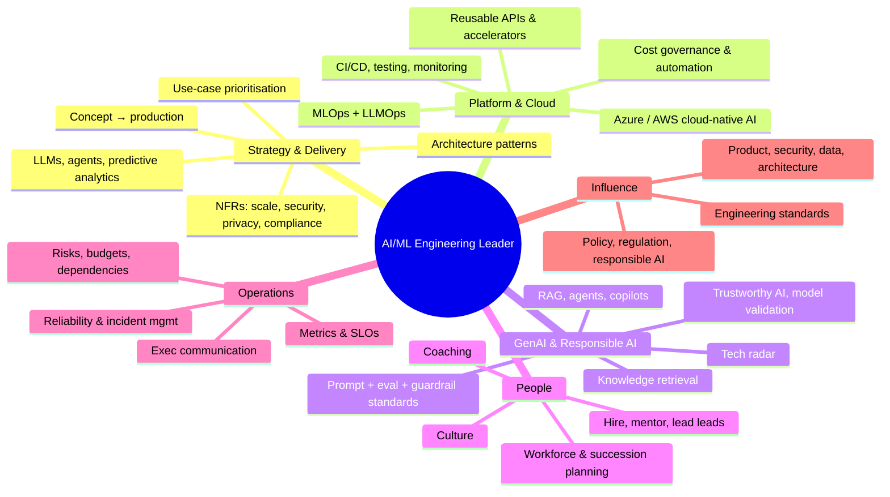
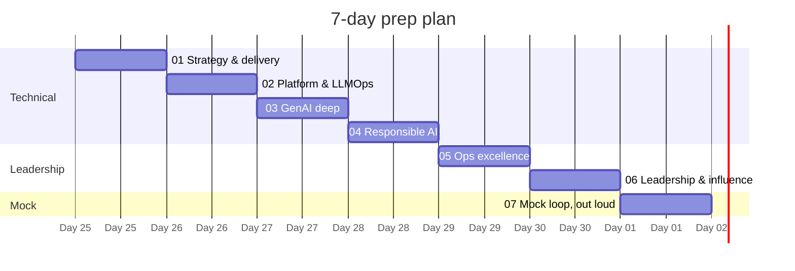

# Pack 01 — AI/ML Engineering Leader

> **Source:** job posting screenshots, 24 Nov 2026 (company not shown).
> **Level signal:** "lead teams of AI Engineers, ML Engineers, Software Engineers **and Technical Leads**", "workforce planning, succession planning", "budgets", "executive leadership" → this is a **manager-of-leads** role (Head of AI Engineering / Senior Engineering Manager / Principal AI Architect-cum-manager), not an IC tech-lead role. Expect **as many judgement and leadership questions as technical ones.**
> **Minimum bar:** Bachelor's in CS/AI/Data Science or related · **10+ years** software / AI-ML / platform engineering. You have 11+ yrs and a B.Tech CSE — you clear it.

---

## 1. The JD in one picture

## 2. Files in this pack (study in this order)

| # | File | JD section it covers | Qs | Priority |
|---|---|---|---|---|
| 01 | [AI strategy & solution delivery](01-ai-strategy-delivery.md) | AI/ML Strategy & Solution Delivery | 14 | ⭐⭐⭐ |
| 02 | [AI platform, cloud & LLMOps](02-ai-platform-cloud-llmops.md) | AI Platform Engineering & Cloud Modernization | 16 | ⭐⭐⭐ |
| 03 | [GenAI: RAG, agents, copilots — deep](03-genai-rag-agents-copilots.md) | Generative AI leadership (technical half) | 18 | ⭐⭐⭐ |
| 04 | [Responsible AI, governance & security](04-responsible-ai-governance.md) | Responsible AI + compliance bullets | 13 | ⭐⭐⭐ |
| 05 | [Operational excellence & business impact](05-operational-excellence.md) | Operational Excellence & Business Impact | 13 | ⭐⭐ |
| 06 | [Engineering leadership & influence](06-leadership-influence.md) | Talent Development + Enterprise Collaboration | 15 | ⭐⭐⭐ |
| 07 | [Mock interview: system design + rapid fire](07-mock-interview.md) | Everything, as a real loop | 4 designs + 40 rapid | ⭐⭐⭐ |

**Already covered elsewhere — don't re-read unless rusty:** LLM basics, embeddings, ReAct, MCP basics → [`interview-prep/11-agentic-ai.md`](../../interview-prep/11-agentic-ai.md) · K8s/CI/CD/OTel basics → [`interview-prep/09-…`](../../interview-prep/09-cloud-docker-k8s-cicd-observability.md) · OAuth/RBAC → [`interview-prep/10-security-auth.md`](../../interview-prep/10-security-auth.md) · STAR basics → [`interview-prep/13-hr-behavioral.md`](../../interview-prep/13-hr-behavioral.md).

## 3. Honest gap check — where they will push you

| JD asks for | Your evidence | Gap? | What to do |
|---|---|---|---|
| GenAI, RAG, agents, MCP | MGM RAG alert summarisation, MCP tools, AgentPulse on PyPI | ✅ Strong | Lead with it |
| Observability / reliability | MGM OpenTelemetry common module, MTTR −25% | ✅ Strong | Use for SLO + incident answers |
| Azure cloud-native | AKS, App Service, Functions, Azure migration work, AZ-900 prep | ✅ Good | Add AI-specific Azure services (file 02) |
| Enterprise delivery at scale | BMW, Air Canada, Maersk, MGM | ✅ Good | Quantify every story |
| **Classical ML / predictive analytics / MLOps** | Light | ⚠️ Gap | File 02 Q2.3–2.6, file 01 Q1.9 — learn the vocabulary: feature store, drift, model registry, shadow deploy |
| **Managing managers / leads, hiring plans, succession** | Tech Lead of teams | ⚠️ Gap | File 06 — frame your lead experience upward; prepare 2 hiring + 1 underperformer story |
| **Budgets & exec reporting** | Indirect | ⚠️ Gap | File 05 Q5.6–5.9 — learn unit economics (cost per resolved ticket) and a one-page exec update format |
| Responsible AI / regulation | Guardrails, prompt injection | ⚠️ Partial | File 04 — EU AI Act risk tiers, NIST AI RMF, ISO 42001 by name |

## 4. Your 60-second pitch for *this* role

> "I'm an engineering leader with 11+ years delivering enterprise platforms for MGM Resorts, BMW, Air Canada and Maersk. For the last few years my focus has been taking GenAI from prototype to production: at MGM I built RAG-based alert summarisation on top of an OpenTelemetry observability platform I designed, which cut MTTR by 25%. I standardised AI tool integration with MCP servers, which cut integration boilerplate by about 40%, and I open-sourced AgentPulse, an LLM reliability proxy that self-heals schema drift. What I bring is the *boring* half of AI that decides whether it ships: evaluation, guardrails, SLOs, cost control and teams that own it end to end. That's exactly what this role describes."

## 5. One-week plan

