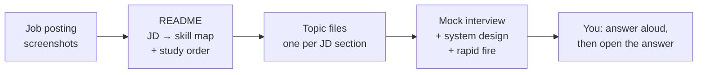

# JD Prep — Question Packs Built From Real Job Postings

> One folder per job posting. Every folder turns the JD's bullet points into **interview questions with deep answers, diagrams and "say this" lines**, mapped to your own experience (MGM, BMW, Air Canada, Maersk, AgentPulse).
>
> The older `interview-prep/` folder is the **foundation** (Java, Spring, Kafka, RAG basics). The packs here sit **on top of it** — they don't repeat basics, they go one level deeper and link back.

## Packs

| # | Folder | Role type | Focus | Files |
|---|---|---|---|---|
| 01 | [`01-ai-engineering-leader/`](01-ai-engineering-leader/README.md) | AI/ML Engineering Leader (Head / Sr. Manager / Principal) | GenAI + Agentic AI delivery, AI platform & LLMOps on Azure/AWS, Responsible AI, team leadership, SLOs & exec comms | 8 |

## How every pack is laid out

Inside each topic file:

| Element | What it is | How to use it |
|---|---|---|
| **Level tag** `L1`–`L4` | L1 = basics · L2 = practitioner · L3 = senior/lead · L4 = head/director judgement | Do L1–L2 first if the topic is new |
| **Why they ask** | The hidden thing the interviewer is checking | Aim your answer at it |
| **Picture it** | A Mermaid diagram (GitHub renders it — tap to zoom/pan) | Look at it *before* reading the answer |
| `▶ Answer` (collapsed) | The full answer | Say your answer out loud first, then expand |
| **Say this** | A 2–3 line spoken version | Memorise these |
| **Follow-ups** | What they ask next | Practise the chain, not single questions |

## Adding the next job posting

Send the JD screenshots and say *"add this to jd-prep"*. Each new pack:

1. Gets the next number (`02-…`, `03-…`).
2. Skips anything already covered in an earlier pack and links to it instead.
3. Updates the table above.
